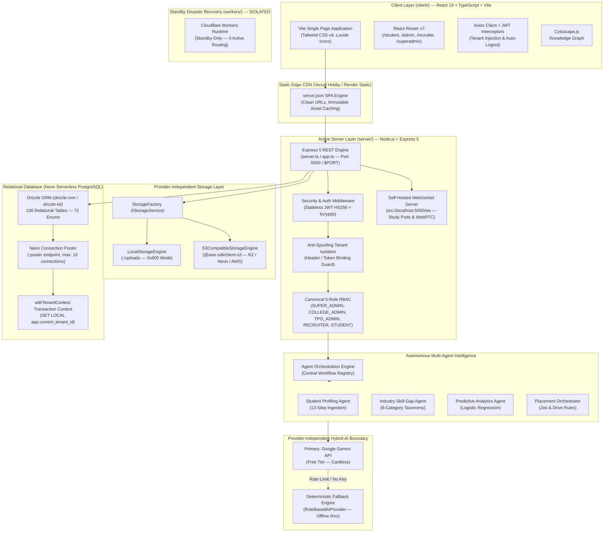
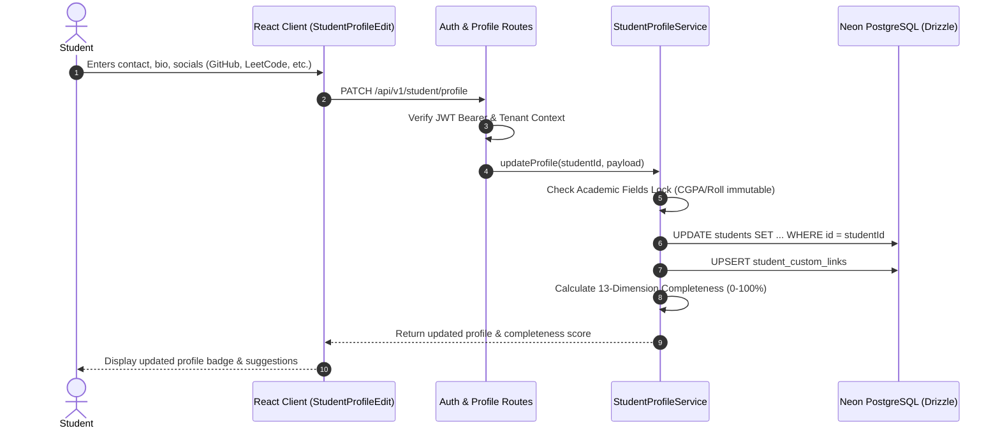
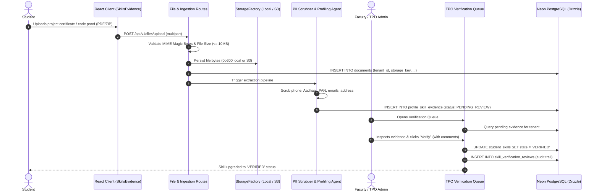
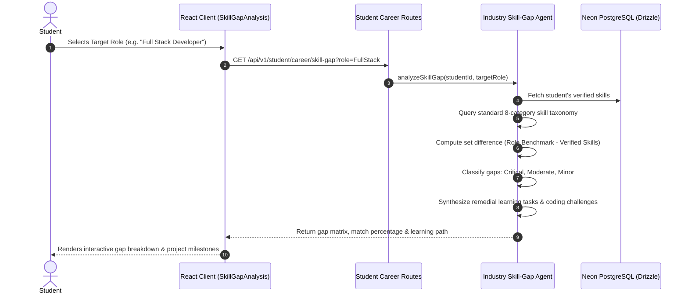
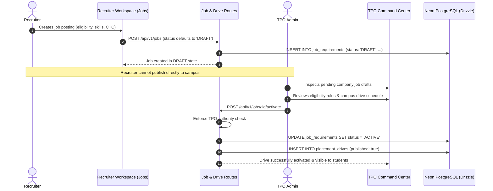
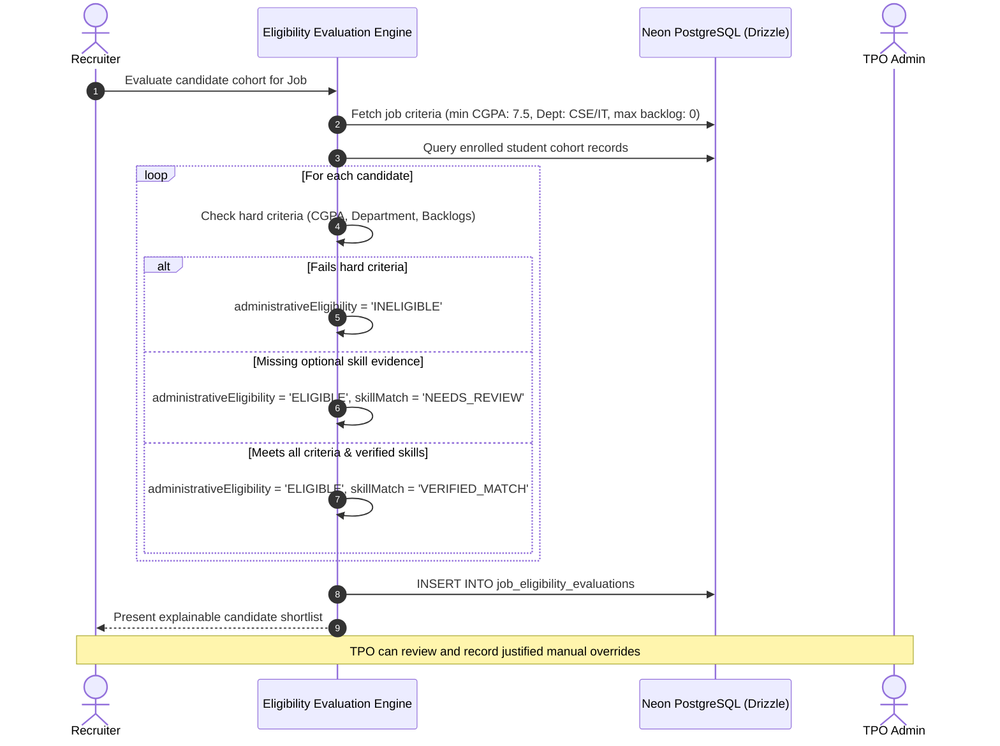
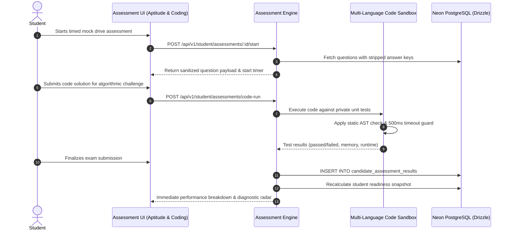
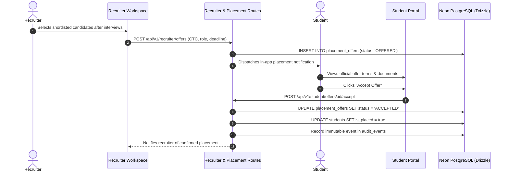
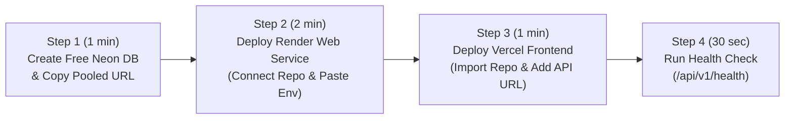

# CarrerSync — Agentic Placement Intelligence Platform

> **Transforming collegiate campus placements through evidence-backed skill verification, autonomous multi-agent intelligence, explainable readiness analytics, and institutional accreditation governance.**

[](#current-project-status)
[](#current-project-status)
[-success.svg)](#testing-and-quality-assurance)
[-blue.svg)](#zero-cost-architecture-policy)
[-blueviolet.svg)](#database-architecture)
[](LICENSE)

---

## Table of Contents

- [A. Project Introduction](#a-project-introduction)
- [B. Problem We Solve](#b-problem-we-solve)
- [C. Platform Features by Role](#c-platform-features-by-role)
- [D. System Architecture](#d-system-architecture)
- [E. The Four Main AI Agents](#e-the-four-main-ai-agents)
- [F. Core Workflows & Sequence Diagrams](#f-core-workflows--sequence-diagrams)
- [G. Technology Stack](#g-technology-stack)
- [H. Repository Structure](#h-repository-structure)
- [I. Installation & Local Setup](#i-installation--local-setup)
- [J. Environment Variables](#j-environment-variables)
- [K. Database Architecture](#k-database-architecture)
- [L. Security, Privacy & Ethical AI Governance](#l-security-privacy--ethical-ai-governance)
- [M. Testing & Quality Assurance](#m-testing--quality-assurance)
- [N. Deployment Guide](#n-deployment-guide)
- [O. Known Technical Limitations](#o-known-technical-limitations)
- [P. Strict ₹0 Zero-Cost Architecture Policy](#p-strict-0-zero-cost-architecture-policy)
- [Q. Interactive Demo & Synthetic Walkthrough](#q-interactive-demo--synthetic-walkthrough)
- [R. Project Roadmap & Milestone Ledger](#r-project-roadmap--milestone-ledger)
- [S. Contribution Guidelines](#s-contribution-guidelines)
- [T. License and Contact](#t-license-and-contact)

---

## A. Project Introduction

**CarrerSync** is an enterprise-grade, multi-tenant **Agentic Placement Intelligence Platform** engineered specifically for universities, colleges, and technical institutes. It completely eliminates traditional collegiate recruitment chaos—unverified resume exaggerations, arbitrary CGPA-only filter walls, spreadsheet disorganization, opaque shortlisting, and lack of actionable upskilling guidance.

By combining deterministic rule engines, relational data modeling, and autonomous multi-agent intelligence, CarrerSync connects every student's authentic code and project artifacts into an institutional placement workflow:

$$\mathbf{Student\ Evidence} \xrightarrow{\quad\text{Verification}\quad} \mathbf{Verified\ Skill\ Profile} \xrightarrow{\quad\text{Diagnostics}\quad} \mathbf{Skill\ Gap\ Closure} \xrightarrow{\quad\text{Preparation}\quad} \mathbf{Placement\ Matching}$$

### Key Differentiators

1. **"Resume Mention is Not Verification"**: Skills do not exist in the candidate discovery index until verified against authentic, inspectable evidence (Git commits, certified project milestones, or faculty review).
2. **Deterministic, Calibrated Scoring**: Placement readiness scores ($0-100\%$) and predictive analytics use explainable mathematical models with proportional dynamic re-weighting and missing data safeguards—never black-box hallucinations.
3. **Strict Non-Exclusion AI Guarantee (`canExcludeStudent: false`)**: Machine learning models and predictive agents are strictly advisory support tools for Training and Placement Officers (TPOs) and students; they are constitutionally barred from automating candidate disqualification.
4. **Institutional Governance & Accreditation Readiness**: Automated generation of statutory compliance indicators for NAAC (Criterion 5), NIRF (Metric 5.2.1/5.2.2), and NBA (Criterion 10), complete with mathematical evidence traceability back to relational database rows.
5. **Multi-Tenant Security with Anti-Spoofing**: Cryptographically enforced tenant isolation backed by signed JSON Web Tokens (JWT) and PostgreSQL transaction context, rejecting tenant header or payload spoofing with HTTP 403.
6. **Strict ₹0 Budget & Cardless Architecture**: 100% functional on permanent free-tier cloud primitives (Render Free Web Service, Neon PostgreSQL Serverless Free Tier, Vercel Hobby, Google Gemini Free Tier with deterministic rule-based fallback).

### Current Project Status

- **Milestone Baseline**: **Phase 20 Complete** (Release Candidate Hardening, Systems Verification & Operational Audit).
- **Evaluation Status**: **`RELEASE CANDIDATE READY WITH LIMITATIONS`**  
  CarrerSync v1.0.0-RC1 is certified for controlled institutional pilot deployment. All 1,070 multi-tier tests pass cleanly (100%), 0 TypeScript errors, clean Vite build (386ms), Neon PITR & copy-on-write branching verified, and comprehensive operational documentation authored. Active free-tier limitations are fully cataloged in [`docs/PHASE_20_KNOWN_LIMITATIONS.md`](docs/PHASE_20_KNOWN_LIMITATIONS.md).
- **Stop Condition Affirmation**: **Phase 21** (*End-to-End Database Wiring & Cloud Hardening*) has **NOT BEEN STARTED**.

---

## B. Problem We Solve

Traditional campus recruitment ecosystems suffer from structural fragmentation, creating compounding friction across all participants:

```
┌─────────────────────────────────────────────────────────────────────────────────────────────┐
│                             THE TRADITIONAL PLACEMENT BREAKDOWN                             │
├───────────────────────────────┬───────────────────────────────┬─────────────────────────────┤
│      STUDENTS STRUGGLE        │       COLLEGES & TPOs         │         RECRUITERS          │
├───────────────────────────────┼───────────────────────────────┼─────────────────────────────┤
│ • Unverified "Keyword Stuffed"│ • Manual spreadsheet tracking │ • 80%+ of resumes contain   │
│   resumes get lost in stacks. │   across hundreds of students.│   unsubstantiated claims.   │
│ • CGPA filter gates ignore    │ • Disjointed compliance and   │ • Time wasted screening     │
│   real coding/project depth.  │   audit reporting (NAAC/NIRF).│   unqualified candidates.   │
│ • Zero actionable guidance on │ • Inability to identify at-   │ • High drop-out and offer   │
│   missing skills for roles.   │   risk students before drives.│   rejection rates post-drive│
└───────────────────────────────┴───────────────────────────────┴─────────────────────────────┘
```

### The CarrerSync Unified Solution

CarrerSync solves these challenges through an interconnected, closed-loop placement lifecycle:

1. **Evidence-Based Profiling**: Students link verifiable work products (GitHub repositories, live deployments, competitive coding handles, and certified course projects). Documents undergo automated PII scrubbing and multi-tier evidence extraction.
2. **Multi-Stage Skill Verification**: TPOs and delegated faculty coordinators review submitted evidence through an administrative queue, transitioning skills across a strict 5-stage state machine:
   $$\text{CLAIMED} \longrightarrow \text{OBSERVED} \longrightarrow \text{EVIDENCE\_LINKED} \longrightarrow \text{VERIFIED} \ (\text{or}\ \text{EXPIRED})$$
3. **Automated Skill-Gap Diagnostics**: Compares verified student proficiencies against live industry job requirements across an 8-category standardized taxonomy (ESCO / O*NET / NSQF aligned), categorizing gaps into *Critical*, *Moderate*, or *Minor*.
4. **Adaptive Learning & Mock Drives**: Generates personalized learning paths with safe coding sandboxes, timed aptitude evaluations (with negative marking and leak prevention), and 5-dimension AI interview practice sessions.
5. **Fair, Explainable Recruitment**: Recruiters discover candidates backed by code proofs. Eligibility rules enforce administrative requirements without penalizing missing optional skills, while EEOC Four-Fifths disparity audits ensure equitable institutional outcomes.

---

## C. Platform Features by Role

CarrerSync provides dedicated, customized interfaces and security boundaries for five core platform personas:

```
┌─────────────────────────────────────────────────────────────────────────────────────────────┐
│                                 ROLE-BASED CAPABILITY MAP                                   │
├───────────────────────┬───────────────────────┬───────────────────────┬─────────────────────┤
│        STUDENT        │   TPO / COLLEGE ADMIN │       RECRUITER       │     SUPER ADMIN     │
├───────────────────────┼───────────────────────┼───────────────────────┼─────────────────────┤
│ • Profile & Socials   │ • Evidence Review     │ • Company Profile     │ • Tenant Provision  │
│ • Evidence Submission │ • Drive Scheduling    │ • JD Drafting & Rules │ • User Role Admin   │
│ • Skill-Gap Analysis  │ • Predictive Analytics│ • Candidate Discovery │ • Security Audits   │
│ • Mock Assessments    │ • NAAC/NIRF Reports   │ • Interview Scheduler │ • Token Lifecycle   │
│ • Alumni Mentorship   │ • Recruiter Outreach  │ • Offer Management    │ • Health Telemetry  │
└───────────────────────┴───────────────────────┴───────────────────────┴─────────────────────┘
```

### 1. Student Portal (`/student/*`)
- **Comprehensive Profile Management [IMPLEMENTED]**: 28 extended profile attributes, professional bio, career objectives, academic credentials, and granular privacy sharing controls.
- **Platform & Competitive Coding Badges [IMPLEMENTED]**: Direct verification links for 10+ platforms: GitHub, LinkedIn, LeetCode, Codeforces, HackerRank, CodeChef, Kaggle, GeeksforGeeks, and personal portfolios.
- **Profile Completeness Engine [IMPLEMENTED]**: Real-time 13-dimension weighted completeness scoring ($0-100\%$) with actionable recommendations.
- **Academic Records Lock & Correction Workflow [IMPLEMENTED]**: Core academic records (CGPA, Roll Number, Department) are immutable against direct editing; students submit formal correction requests reviewed by faculty.
- **Evidence Submission & Skill Status [IMPLEMENTED]**: Upload PDF/DOCX proofs and repository URLs; monitor progress across Claimed, Observed, Evidence-linked, and Verified states.
- **Skill-Gap Diagnostics & Learning Paths [IMPLEMENTED]**: Real-time comparison against 14 benchmark tech roles, identifying missing skills and recommended remedial activities.
- **Interactive Knowledge Graph [IMPLEMENTED]**: Cytoscape.js force-directed visualization of interconnected skills, course projects, and target role prerequisites.
- **Mock Drive & Assessment Engine [IMPLEMENTED]**:
  - Timed aptitude exams with negative marking and server-side answer-key leak prevention.
  - Multi-language safe coding sandbox (JS, Python, Java, C++) with static AST checks and 500ms execution timeout guards.
  - 5-dimension AI interview practice (Relevance, Depth, Structure, Communication, Terminology) with Gemini Free Tier / Rule-based fallback.
- **Placement Drive RSVP & Applications [PARTIALLY IMPLEMENTED]**: View active college drives, check eligibility status, and track application milestones.
- **Alumni Mentorship & Peer Collaboration [IMPLEMENTED]**:
  - Search verified alumni mentors by company and role; book sessions with privacy mediation (zero personal email/phone exposure).
  - Real-time study pods and peer mock interview rooms over self-hosted WebSockets (`/ws`) with WebRTC audio/video signaling.
- **Privacy & Consent Preferences [IMPLEMENTED]**: Granular controls to hide contact details, selectively share evidence with recruiters, or restrict profile visibility.

### 2. TPO & College Admin Portal (`/admin/*`, `/tpo/*`)
- **Student Directory & Cohort Management [IMPLEMENTED]**: Filter and manage students across departments, batches, CGPA bands, and verified skill counts.
- **Evidence Verification Queue [IMPLEMENTED]**: Inspect submitted certificates and code proofs, review AI extraction confidence, and approve or reject submissions with mandatory audit reasoning.
- **Delegated Faculty Reviewers [IMPLEMENTED]**: Provision and instantly revoke faculty review permissions with immutable logging.
- **Declarative Job Requirements & Eligibility Rules [IMPLEMENTED]**: Define hard administrative criteria (min CGPA, allowed departments, max backlogs) alongside flexible advisory skill requirements.
- **Placement Drive Orchestration [IMPLEMENTED]**: Schedule drives, configure multi-round timelines, manage venue assignments, and coordinate shortlists.
- **Predictive Placement Analytics Engine [IMPLEMENTED]**:
  - Calibrated logistic regression predicting placement probability with confidence intervals.
  - Multi-dimensional readiness measurement across 4 tiers and 6 dimensions with dynamic proportional re-weighting.
  - Strict statutory safeguard: `canExcludeStudent: false` prevents automated rejection.
- **Institutional Intelligence & 5D Heatmaps [PARTIALLY IMPLEMENTED / IN-MEMORY]**:
  - Real-time empirical placement rate: $N_{\text{placed}} / N_{\text{eligible}}$ with explicit denominator tracking.
  - 5D matrix heatmaps (Department vs Skill, Batch vs Skill, Role vs Benchmark, Verified vs Missing, Gap vs Intervention).
- **Fairness Governance & EEOC Four-Fifths Benchmarking [PARTIALLY IMPLEMENTED / IN-MEMORY]**:
  - 6-stage recruitment funnel disparity tracking; triggers human review flags whenever selection ratio falls below $0.80$.
  - Small-group privacy suppression ($N < 5$) to prevent re-identification of underrepresented groups.
- **Accreditation Reporting Suite [PARTIALLY IMPLEMENTED / IN-MEMORY]**:
  - 14 pre-built regulatory compliance templates for NAAC Criterion 5, NIRF Metric 5.2.1/5.2.2, and NBA Criterion 10.
  - Evidence traceability matrix linking aggregate report numbers to database record IDs with SHA-256 audit hashes.
- **Recruiter Outreach Campaign Manager [PARTIALLY IMPLEMENTED / IN-MEMORY]**:
  - Campaign lifecycle management with mandatory human approval gating prior to message dispatch.
  - Dynamic copy placeholders and ₹0 cardless CSV mail merge export fallback.

### 3. Recruiter Portal (`/recruiter/*`)
- **Corporate Profile & Verification [IMPLEMENTED (Backend) / UI POLISH]**: Company registration, domain validation, and institutional authorization.
- **Job Description Intake & Skill Parsing [IMPLEMENTED]**: Automated extraction of role prerequisites, experience requirements, and skill benchmarks.
- **Candidate Discovery with Consent [IMPLEMENTED]**: Search candidate pools filtered by verified competencies, project depth, and readiness scores (without seeing unconsented personal PII).
- **Applicant Review & Shortlisting [IMPLEMENTED]**: Inspect candidate evidence dossiers, coding test results, and verified skill badges; issue round shortlists.
- **Interview Coordination & Feedback [IMPLEMENTED]**: Schedule multi-round interviews and submit structured candidate evaluation rubrics.
- **Offer Management [IMPLEMENTED]**: Issue formal placement offers with CTC, designation, and validity timelines, capturing student acceptance/rejection.

### 4. Super Admin Portal (`/superadmin/*`)
- **Institutional Tenant Provisioning [IMPLEMENTED]**: Create collegiate tenants with dedicated slugs, domain bindings, and administrative credentials.
- **User Management & Role Assignment [IMPLEMENTED]**: Platform-wide user directory with status suspension, activation, and role modification.
- **Expiring Cryptographic Invitations [IMPLEMENTED]**: Generate single-use, 256-bit high-entropy invitation tokens with automatic expiration and revocation.
- **Platform Audit Trail [IMPLEMENTED]**: Tamper-proof, immutable ledger tracking all system mutations, security events, and administrative actions.
- **Platform Health & Telemetry [IMPLEMENTED]**: System uptime, database pool saturation metrics, and agent workflow execution monitoring.

---

## D. System Architecture

CarrerSync is engineered as a decoupled, multi-tier web platform operating entirely on standard Node.js and modern browser standards. **Active Cloudflare dependencies are strictly prohibited** in the active production runtime.



---

## E. The Four Main AI Agents

CarrerSync features four specialized autonomous agents coordinated by the **Central Agent Orchestration Engine**. Each agent operates under strict ethical guidelines, with clearly separated deterministic vs. probabilistic responsibilities:

```
┌─────────────────────────────────────────────────────────────────────────────────────────────┐
│                            AUTONOMOUS MULTI-AGENT COLLECTIVE                                │
├───────────────────────┬───────────────────────┬───────────────────────┬─────────────────────┤
│   STUDENT PROFILING   │   INDUSTRY SKILL-GAP  │  PREDICTIVE ANALYTICS │PLACEMENT ORCHESTRATOR│
├───────────────────────┼───────────────────────┼───────────────────────┼─────────────────────┤
│ Ingests resumes, code │ Analyzes market JDs,  │ Calibrated prediction │ Declarative job rules,│
│ repos, certificates;  │ computes set-theoretic│ of placement outcomes;│ 2-stage eligibility, │
│ scrubs PII; extracts  │ gaps across 8-category│ multi-dimensional     │ candidate discovery, │
│ 6-tier skill evidence.│ taxonomy; syncs paths.│ readiness scoring.    │ shortlist & offers.  │
└───────────────────────┴───────────────────────┴───────────────────────┴─────────────────────┘
```

### 1. Student Profiling Agent (`STUDENT_PROFILING_AGENT`)
- **Primary Mission**: Transform raw unstructured student artifacts (PDF/DOCX resumes, GitHub project links, certificates) into verified, structured competency graphs.
- **Key Responsibilities**:
  - Executes the 13-step document ingestion pipeline.
  - Deep local PII scrubbing (removes phone, Aadhaar, PAN, SSN, street addresses) before external processing.
  - Evaluates artifacts across 6 evidence tiers (Repository, Certified Project, Live Deployment, Competition, Course Certificate, Self-Declaration).
  - Calculates 13-dimension weighted profile completeness score ($0-100\%$).
- **Deterministic vs AI**: PII scrubbing, file validation, and state machine transitions are 100% deterministic code. Skill entity extraction uses Gemini Free Tier with regex/rule fallback.

### 2. Industry Skill-Gap Agent (`INDUSTRY_SKILL_GAP_AGENT`)
- **Primary Mission**: Bridge the divide between student competencies and employer expectations using real-time market data.
- **Key Responsibilities**:
  - Ingests industry job descriptions with SHA-256 deduplication.
  - Maps market requirements to an 8-category standardized skill taxonomy (ESCO, O*NET, and NSQF aligned).
  - Calculates set-theoretic skill gaps against 14 benchmark tech roles:
    $$\text{Gaps} = \text{Role Benchmark Skills} \setminus \text{Student Verified Skills}$$
  - Classifies gap severity into *Critical*, *Moderate*, and *Minor*, synthesizing actionable remedial learning milestones.
- **Deterministic vs AI**: Taxonomy classification, set difference calculations, and learning milestone generation are deterministic. JD text summarization uses Gemini Free Tier with keyword fallback.

### 3. Predictive Placement Analytics Agent (`PREDICTIVE_PLACEMENT_ANALYTICS_AGENT`)
- **Primary Mission**: Provide TPOs and students with early, actionable intelligence regarding placement readiness and potential roadblocks.
- **Key Responsibilities**:
  - Computes placement readiness index ($S_{\text{readiness}}$) across 6 weighted dimensions: verified skills (35%), evidence coverage (25%), project depth (20%), and academic performance (20%).
  - Executes dynamic proportional re-weighting when specific dimensions are missing:
    $$S_{\text{adj}} = \frac{\sum w_i S_i}{\sum w_i} \quad \text{for available dimensions}$$
  - Evaluates calibrated logistic regression models for placement probability with $95\%$ confidence bounds:
    $$P(\text{Placement}) = \frac{1}{1 + e^{-(\beta_0 + \sum \beta_i x_i)}}$$
  - Enforces small-group privacy suppression ($N < 5$).
- **Ethical Boundary**: Constitutional mandate `canExcludeStudent: false`. The agent is mathematically prevented from issuing automated negative decisions.

### 4. Placement Orchestration Agent (`PLACEMENT_ORCHESTRATION_AGENT`)
- **Primary Mission**: Execute end-to-end recruitment drive logistics, rule validation, and offer workflows.
- **Key Responsibilities**:
  - Evaluates candidate pools against declarative job criteria (min CGPA, allowed departments, backlog thresholds).
  - Enforces fairness: missing optional skill evidence triggers `NEEDS_REVIEW`, never automatic disqualification.
  - Manages multi-round interview schedules and timeline conflict detection.
  - Governs formal offer issuance, student acceptance/rejection states, and longitudinal ledger sync.
- **Deterministic vs AI**: 100% deterministic state machines, relational integrity rules, and algebraic eligibility evaluations.

### Agent Handshake Contracts & Workflow Integration

The four agents collaborate through 4 strictly typed **Cross-Agent Handshake Contracts** defined in `server/src/orchestration/contracts.ts`:
1. `ProfilingToSkillGap`: Hands verified student competencies to the Skill-Gap Agent.
2. `SkillGapToLearning`: Feeds diagnosed skill deficits into the Adaptive Learning Engine.
3. `ProfilingAssessmentsToPredictive`: Aggregates verified skills, mock coding scores, and aptitude results for predictive modeling.
4. `MultiAgentToPlacement`: Unifies profile completeness, verified competencies, and readiness metrics into recruiter shortlisting queues.

---

## F. Core Workflows & Sequence Diagrams

CarrerSync automates the institutional recruitment lifecycle across 7 primary workflows:

### Workflow 1: Student Onboarding & Profile Completion



### Workflow 2: Evidence Submission & TPO Verification



### Workflow 3: Skill-Gap Detection & Learning Paths



### Workflow 4: Placement Job Creation & TPO Approval



### Workflow 5: Eligibility Evaluation & Shortlisting



### Workflow 6: Mock Assessment & Readiness Reporting



### Workflow 7: Recruiter-to-Placement Workflow



---

## G. Technology Stack

CarrerSync is built with modern, battle-tested technologies strictly conforming to its ₹0 budget architecture:

| Layer | Technology | Version | Purpose in CarrerSync | Production Status |
| :--- | :--- | :--- | :--- | :---: |
| **Frontend Framework** | React | 19.3.1 | Core component architecture and virtual DOM | **Active** |
| **Frontend Tooling** | Vite | 6.x / 8.x | High-speed ESM build system and dev server | **Active** |
| **Styling & Design** | Tailwind CSS | 4.3.5 | Utility-first responsive design tokens | **Active** |
| **Client Routing** | React Router | 7.18.5 | Client-side declarative routing and layout guards | **Active** |
| **Iconography** | Lucide React | 1.73.0 | Consistent vector icons across all portals | **Active** |
| **Knowledge Graph** | Cytoscape.js | 3.35.0 | Interactive force-directed skill graph | **Active** |
| **HTTP Client** | Axios | 1.21.1 | API transport with JWT & tenant interceptors | **Active** |
| **Backend Runtime** | Node.js | >=20.0.0 (LTS 22) | Enterprise JavaScript server runtime | **Active** |
| **Backend Web Engine** | Express | 5.3.0 | Modern REST API routing and middleware pipeline | **Active** |
| **Database Engine** | PostgreSQL | 16 (Serverless) | Neon Serverless PostgreSQL canonical database | **Active** |
| **Database ORM** | Drizzle ORM | 0.38.4 | Type-safe SQL modeling (106 relational tables) | **Active** |
| **Migration Tooling** | Drizzle Kit | 0.30.6 | Schema generation and non-destructive DDL | **Active** |
| **PostgreSQL Driver** | @neondatabase/serverless | 0.10.4 | Connection pooling with transaction RLS support | **Active** |
| **Authentication** | JSON Web Tokens (`jsonwebtoken`) | 9.0.2 | Stateless HS256 tokens with tenant & role claims | **Active** |
| **Password Hashing** | `bcryptjs` | 3.0.2 | Cryptographic salt rounds: 10 | **Active** |
| **Schema Validation** | Zod | 3.24.2 | Runtime request body & environment variable validation | **Active** |
| **File Multipart** | Multer | 2.5.0 | Stream-based file upload parsing | **Active** |
| **Object Storage SDK** | @aws-sdk/client-s3 | 3.1169.0 | S3-compatible cloud storage adapter (R2/AWS) | **Active** |
| **Realtime Engine** | `ws` | 8.23.0 | Self-hosted WebSocket server on port 5050 | **Active** |
| **AI LLM Engine** | Google Gemini API | `gemini-1.5-flash` | Free-tier primary AI extraction and evaluation | **Active** |
| **Rule-Based AI** | Native TypeScript | Custom | Deterministic offline fallback AI engine | **Active** |
| **Unit Testing (Server)** | Vitest | 3.0.5 | High-speed unit & integration test runner | **Active** |
| **Standby Edge Runtime** | Cloudflare Workers + Hono | Isolated | Retained standby runtime for disaster recovery | **Standby** |

---

## H. Repository Structure

```
CarrerSync/
├── .env.example                       # Root environment variable documentation template
├── package.json                       # Workspace orchestrator & Node >=20 engine declaration
├── render.yaml                        # Render Web Service Infrastructure-as-Code blueprint
├── vercel.json                        # Vercel Hobby static SPA deployment & rewrite rules
├── LICENSE                            # Apache License 2.0
├── README.md                          # Master evaluator-grade documentation (this file)
├── PROJECT_STATUS.md                  # Master project completion & verification tracker
│
├── client/                            # Frontend Single Page Application (React 19 + Vite)
│   ├── index.html                     # HTML5 SPA entrypoint with responsive meta tags
│   ├── vite.config.js                 # Vite bundler configuration & API proxy rules
│   ├── package.json                   # Client dependencies (React 19, Tailwind v4, Lucide)
│   ├── .env.example                   # Frontend environment template (VITE_* variables only)
│   ├── public/                        # Static web assets and branded SVG favicon
│   └── src/
│       ├── components/
│       │   ├── common/                # Shared UI primitives (Buttons, Inputs, Badges)
│       │   ├── profile/               # Profile editing components & SocialPlatformIcons
│       │   ├── shell/                 # Sidebar, Topbar, and NotificationDrawer components
│       │   └── ui/                    # 22 unified SaaS design system components
│       ├── layouts/                   # DashboardLayout.jsx & MainLayout.jsx shells
│       ├── pages/
│       │   ├── landing/               # Public landing page with 5-stage lifecycle
│       │   ├── auth/                  # Login and Registration with role selector
│       │   ├── student/               # 12 Student pages (ProfileEdit, Skills, MockDrives)
│       │   ├── admin/                 # 13 T&P Admin command & verification pages
│       │   ├── recruiter/             # 9 Recruiter discovery & pipeline pages
│       │   ├── superadmin/            # 8 Super Admin tenant & governance pages
│       │   └── tpo/                   # Phase 17 Institutional Intelligence & Outreach pages
│       ├── routes/                    # AppRoutes.jsx — React Router v7 hierarchy
│       └── services/                  # Axios service modules (api.js, studentProfileService.js)
│
├── server/                            # Active Primary Backend (Node.js + Express 5)
│   ├── package.json                   # Server dependencies (Express 5, Drizzle, Neon, Zod)
│   ├── tsconfig.json                  # Strict TypeScript compiler configuration
│   ├── drizzle.config.ts              # Drizzle ORM migration generator configuration
│   ├── .env.example                   # Server environment template with zero secrets
│   ├── drizzle/                       # 9 Non-destructive additive migration scripts (0000–0008)
│   │   ├── 0000_shocking_echo.sql     # Baseline schema (Core domain tables)
│   │   ├── 0001_married_wind_dancer.sql # Recruiter drive orchestration tables
│   │   ├── 0002_military_blazing_skull.sql # Mock assessment & coding sandbox tables
│   │   ├── 0003_salty_kulan_gath.sql  # Industry skill taxonomy & JD intake tables
│   │   ├── 0004_yellow_firelord.sql   # Predictive analytics & readiness tables
│   │   ├── 0005_nappy_ego.sql         # Autonomous agent orchestration & workflow tables
│   │   ├── 0006_previous_eternity.sql # Alumni network, peer rooms & moderation tables
│   │   ├── 0007_hot_human_fly.sql     # Institutional intelligence & accreditation tables
│   │   └── 0008_numerous_morg.sql     # Extended student profile & correction tables
│   ├── src/
│   │   ├── index.ts                   # Production server entrypoint & graceful shutdown
│   │   ├── server.ts                  # HTTP & WebSocket initialization & signal traps
│   │   ├── app.ts                     # Express 5 application setup, CORS, and route mounting
│   │   ├── ai/                        # Hybrid AI boundary (Gemini Free + Rule-Based Fallback)
│   │   ├── analytics/                 # Predictive placement engine & fairness monitoring
│   │   ├── assessment/                # Aptitude engine, safe coding sandbox & interview AI
│   │   ├── config/                    # Fail-safe environment variable validation (env.ts)
│   │   ├── db/                        # Drizzle schema (106 tables), client.ts, RLS helpers
│   │   ├── eligibility/               # Declarative job eligibility & candidate evaluation
│   │   ├── industry/                  # Industry intelligence & 8-category skill taxonomy
│   │   ├── institutional/             # Institutional KPIs, accreditation & fairness suite
│   │   ├── middleware/                # Auth (JWT), Tenant Anti-Spoofing, and Error handlers
│   │   ├── orchestration/             # Central Workflow Registry & Agent Orchestrator
│   │   ├── realtime/                  # Self-hosted WebSocket server & room management
│   │   ├── routes/                    # 30 Express 5 REST API route modules
│   │   ├── services/                  # Business logic services (StudentProfileService, etc.)
│   │   ├── storage/                   # StorageFactory (LocalStorage & S3CompatibleStorage)
│   │   ├── utils/                     # Role normalization, cryptography, and PII filters
│   │   └── verification/              # TPO evidence verification state machine
│   └── tests/                         # 49 Vitest test suites (945 automated server tests)
│
├── docs/                              # Comprehensive architectural specifications & runbooks
│   ├── DEVELOPMENT_STATUS.md          # Multi-phase milestone and verification status ledger
│   ├── PHASE_18_SYSTEM_AUDIT.md       # Master forensic system audit & classification report
│   ├── PHASE_18_KNOWN_LIMITATIONS.md  # Transparent technical debt & persistence disclosures
│   ├── PHASE_19_DEPLOYMENT_PLAN.md    # Multi-cloud deployment topology & pre-flight plan
│   ├── PHASE_19_MONITORING_RUNBOOK.md # Zero-cost operational runbook & incident playbooks
│   ├── PHASE_19_PILOT_TEST_REPORT.md  # Synthetic pilot verification report across 5 roles
│   ├── PHASE_19_ROLLBACK_PLAN.md      # Multi-tier instantaneous rollback procedures
│   └── PHASE_19_DEPLOYMENT_REPORT.md  # Executive Section 15 readiness certification
│
├── scripts/                           # Administrative & deployment maintenance utilities
│   ├── seed_pilot_demo_data.ts        # Automated idempotent seed provisioner (Apex Tech)
│   ├── provision_superadmin.ts        # Out-of-band Super Admin creation utility
│   └── inspect_live_db.ts             # Standalone Neon database schema inspector
│
├── workers/                           # STANDBY ONLY — Cloudflare Workers runtime
│   └── tests/                         # 8 Vitest test suites (113 passing tests in standby)
│
└── backend/                           # Historical Python Backend Engine (Alembic / SQLAlchemy)
    └── tests/                         # 4 Pytest suites (12 passing tests)
```

---

## I. Installation & Local Setup

### Prerequisites

- **Operating System**: macOS (tested on Sonoma/Sequoia), Linux, or Windows (WSL2 recommended).
- **Node.js**: Version `>= 20.0.0` (LTS 22 recommended). Verify via `node -v`.
- **Git**: Version `>= 2.30`. Verify via `git --version`.
- **Database**: Free Neon Serverless PostgreSQL instance (sign up at [neon.tech](https://neon.tech)) or a local PostgreSQL 16 server.

### Step 1: Clone the Repository

```bash
git clone https://github.com/your-username/CarrerSync.git
cd CarrerSync
```

### Step 2: Install Dependencies

Install root workspace, backend, and frontend packages:

```bash
# Install root dependencies
npm install

# Install server dependencies
npm install --prefix server

# Install client dependencies
npm install --prefix client
```

### Step 3: Configure Environment Variables

Create `.env` files for both the backend and frontend from their documented templates:

```bash
# 1. Backend environment setup
cp server/.env.example server/.env

# 2. Frontend environment setup
cp client/.env.example client/.env
```

Open `server/.env` and supply your database connection strings:
```env
PORT=5050
NODE_ENV=development
CLIENT_URL=http://localhost:5173
ALLOWED_ORIGINS=http://localhost:5173,http://localhost:3000

# Paste your Neon PostgreSQL connection URLs
DATABASE_URL=postgresql://<user>:<password>@<neon-endpoint>.neon.tech/neondb?sslmode=require
DATABASE_URL_UNPOOLED=postgresql://<user>:<password>@<neon-endpoint-direct>.neon.tech/neondb?sslmode=require

# Generate a high-entropy 32+ character JWT secret: openssl rand -hex 32
JWT_SECRET=fe382b759810fa57c3f61d5c553bc58ed2fd38a4083befa461168d5bb9499687
STORAGE_PROVIDER=local
STORAGE_LOCAL_DIRECTORY=uploads
```

### Step 4: Run Type Checks & Verify Quality

Verify that the codebase compiles with zero static type errors:

```bash
# Run TypeScript compilation checks on the server
npm run typecheck --prefix server
```

### Step 5: Execute Automated Test Suite

Run the full automated test suite to confirm platform integrity:

```bash
# Run server test suite (49 files, 945 tests)
npm test --prefix server
```

### Step 6: Apply Database Migrations & Seed Demo Data

Apply all 9 additive Drizzle migrations to your Neon database:

```bash
# Generate / push migrations to Neon
npm run db:generate --prefix server

# Seed synthetic demo data (creates Apex Institute of Technology, demo users & skills)
npx tsx scripts/seed_pilot_demo_data.ts
```

### Step 7: Launch Local Development Servers

Start the backend and frontend concurrently:

```bash
# Terminal 1: Launch Backend Express Server (starts on http://localhost:5050)
npm run dev --prefix server

# Terminal 2: Launch Frontend Vite Dev Server (starts on http://localhost:5173)
npm run dev --prefix client
```

Open your browser at **`http://localhost:5173`** to access the CarrerSync platform.

---

## J. Environment Variables

CarrerSync enforces a strict security boundary between server-side secrets and browser-accessible client settings. **Zero secrets are committed to version control.**

### Backend Configuration (`server/.env`)

| Variable Name | Required? | Default / Example | Purpose & Description |
| :--- | :---: | :--- | :--- |
| `PORT` | Optional | `5050` | HTTP port on which the Express 5 server listens (Render dynamically overrides). |
| `NODE_ENV` | Yes | `development` / `production` | Runtime mode. In production, stack traces are sanitized from error payloads. |
| `DATABASE_URL` | Yes | `postgresql://...-pooler.neon.tech/...` | Pooled Neon PostgreSQL connection string with PgBouncer acceleration. |
| `DATABASE_URL_UNPOOLED`| Optional | `postgresql://...direct.neon.tech/...` | Direct unpooled PostgreSQL string used for DDL migration commands. |
| `JWT_SECRET` | Yes | *64-character random string* | High-entropy cryptographic secret for signing and verifying HS256 tokens. |
| `JWT_EXPIRES_IN` | Optional | `7200` (2 hours) | Token lifespan in seconds before re-authentication is required. |
| `CLIENT_URL` | Yes | `http://localhost:5173` | Canonical frontend domain for CORS allowlisting. |
| `ALLOWED_ORIGINS` | Optional | `http://localhost:5173,...` | Comma-separated list of permitted CORS origins (supports `*.vercel.app`). |
| `STORAGE_PROVIDER` | Yes | `local` | Storage driver: `local` (disk storage) or `s3` (S3-compatible bucket). |
| `STORAGE_LOCAL_DIRECTORY`| Optional| `uploads` | Relative path where uploaded files are written when using local storage. |
| `GEMINI_API_KEY` | Optional | *(empty)* | Google AI Studio free-tier key. If omitted, rule-based AI operates offline. |
| `STORAGE_BUCKET` | Optional | `carrersync-docs` | Cloud bucket name (required only when `STORAGE_PROVIDER=s3`). |
| `STORAGE_ENDPOINT` | Optional | *(empty)* | S3 endpoint URL (e.g., Cloudflare R2, Backblaze B2, or AWS S3). |
| `STORAGE_ACCESS_KEY` | Optional | *(empty)* | Access key ID for S3-compatible cloud storage. |
| `STORAGE_SECRET_KEY` | Optional | *(empty)* | Secret access key for S3-compatible cloud storage. |

### Frontend Configuration (`client/.env`)

> [!IMPORTANT]
> Vite embeds only variables prefixed with `VITE_` into client-side bundles. Never place backend secrets or database credentials in `client/.env`.

| Variable Name | Required? | Default / Example | Purpose & Description |
| :--- | :---: | :--- | :--- |
| `VITE_API_URL` | Yes | `/api/v1` | Base URL for REST API calls (proxied locally or rewritten by Vercel). |
| `VITE_WS_URL` | Yes | `ws://localhost:5050/ws` | Realtime WebSocket endpoint for study pods and WebRTC signaling. |
| `VITE_API_PROXY_TARGET` | Optional | `http://localhost:5050` | Local target for Vite dev server proxy (`vite.config.js`). |

---

## K. Database Architecture

CarrerSync uses **Neon Serverless PostgreSQL** as its canonical relational source of truth. The database schema is fully declared in TypeScript using **Drizzle ORM** (`server/src/db/schema.ts`).

### Schema Evolution & Migration Ledger

The database layer features **106 normalized relational tables** and **72 PostgreSQL enums** generated across 9 non-destructive, strictly additive migrations:

```
0000_shocking_echo.sql        --> Core tenants, users, students, baseline skills (22 tables)
0001_married_wind_dancer.sql  --> Recruiter orchestration, placement drives, offers (12 tables)
0002_military_blazing_skull.sql --> Mock assessments, coding sandboxes, question banks (14 tables)
0003_salty_kulan_gath.sql     --> Industry taxonomy, JD intake, skill demand trends (12 tables)
0004_yellow_firelord.sql      --> Predictive placement analytics & readiness snapshots (8 tables)
0005_nappy_ego.sql            --> Agent orchestration, workflows, delegated reviewers (6 tables)
0006_previous_eternity.sql    --> Alumni directory, peer interview rooms, study pods (15 tables)
0007_hot_human_fly.sql        --> Institutional KPIs, accreditation, fairness audit (9 tables)
0008_numerous_morg.sql        --> Extended profile, custom links, correction requests (8 tables)
```

### Core Relational Entity Groups

1. **Multi-Tenancy & Identity**: `tenants`, `users`, `invitations`, `auditEvents`.
2. **Student Competencies & Evidence**: `students`, `studentSkills`, `documents`, `profileSkillEvidence`, `skillVerificationReviews`.
3. **Recruiter & Job Management**: `recruiterProfiles`, `companyVerifications`, `jobRequirements`, `placementDrives`, `applications`, `placementOffers`.
4. **Mock Assessment Engine**: `mockDrives`, `assessmentQuestionBanks`, `assessmentQuestions`, `candidateAssessmentResults`, `codingSubmissions`.
5. **Industry Intelligence**: `industryJobDescriptions`, `industrySkillDemand`, `industrySkillTrends`, `roleSkillRequirements`.
6. **Predictive Analytics & Readiness**: `placementPredictions`, `studentReadinessSnapshots`, `studentSupportRecommendations`.
7. **Autonomous Multi-Agent Governance**: `agentWorkflows`, `agentWorkflowSteps`, `agentWorkflowApprovals`, `delegatedReviewers`.
8. **Alumni & Peer Collaboration**: `alumniProfiles`, `mentorshipSessions`, `peerInterviewRooms`, `collaborationRooms`, `moderationReports`.
9. **Institutional Governance & Compliance**: `institutionalMetricSnapshots`, `fairnessReviewCases`, `outreachCampaigns`, `regulatoryAccreditationReports`.
10. **Student Profile Extensions**: `studentCustomLinks`, `academicCorrectionRequests`.

### Multi-Tenant Isolation & Cascades

Every domain table includes a foreign key constraint referencing `tenants.id`:
```typescript
tenantId: uuid('tenant_id').notNull().references(() => tenants.id, { onDelete: 'cascade' })
```
PostgreSQL transaction-scoped context (`withTenantContext`) enforces `SET LOCAL app.current_tenant_id = :tenantId` with automatic session reset in a `finally` block, preventing connection pool cross-talk under high-concurrency serverless pooling.

---

## L. Security, Privacy & Ethical AI Governance

### 1. Authentication & RBAC

- **Stateless HMAC-SHA256 JWTs**: High-entropy tokens containing `sub` (User UUID), `tenant_id` (Tenant UUID), `role`, and `email`.
- **Canonical 5-Role Taxonomy**: Standardized hierarchy across `SUPER_ADMIN`, `COLLEGE_ADMIN`, `TPO_ADMIN`, `RECRUITER`, and `STUDENT`.
- **Anti-Spoofing Tenant Isolation**: The server cryptographically validates that the incoming `x-tenant-id` header matches the token's `tenant_id` claim. Mismatches trigger an immediate HTTP 403 `TENANT_SPOOFING_REJECTED`.
- **Super Admin Self-Registration Prohibited**: The public registration route rejects any attempt to register a `SUPER_ADMIN` with HTTP 403; Super Admins can only be created via secure out-of-band CLI utilities (`scripts/provision_superadmin.ts`).

### 2. Student Privacy & Data Protection

- **Adult Cohort Relational CHECK Constraint**:
  ```sql
  CHECK (date_of_birth <= CURRENT_DATE - INTERVAL '18 years')
  ```
  The platform prohibits the enrollment or behavioral monitoring of minors.
- **Deep PII Sanitization**: Before passing student artifacts to AI providers, `PIIFilter.scrub()` executes multi-pattern regex redaction for phone numbers, emails, Aadhaar cards, PAN cards, SSNs, street addresses, and names.
- **Platform-Mediated Communications**: Alumni mentorship and recruiter messaging never expose student personal email addresses or phone numbers.

### 3. Ethical AI & Algorithmic Fairness

- **The Non-Exclusion Safeguard (`canExcludeStudent: false`)**: Hardcoded across all predictive analytics and readiness engines. Machine learning outputs are strictly advisory for student intervention and cannot be used by recruiters or algorithms to automate rejection.
- **EEOC Four-Fifths Benchmarking**: Automated disparity auditing evaluates selection ratios across all 6 recruitment funnel stages. Any ratio below $0.80$ flags an administrative case for human review with mandatory statutory disclaimers.
- **Small-Group Privacy Suppression ($N < 5$)**: Any reporting cohort with fewer than 5 students is suppressed to prevent individual identification.

---

## M. Testing & Quality Assurance

CarrerSync enforces a strict multi-tier quality gate. Every build, refactor, and migration must pass 100% of all automated test suites across all five execution tiers:

```
========================================================================================
             CARRERSYNC MULTI-TIER AUTOMATED TEST EXECUTION SUMMARY (PHASE 19)
========================================================================================
Tier 1: Server TypeScript Static Check    : PASS (0 errors, ~5.8s)
Tier 2: Server Vitest Suite (Express 5)   : PASS (49/49 files, 945 tests, 6.28s)
Tier 3: Workers Vitest Suite (Standby)    : PASS (8/8 files, 113 tests, 1.51s)
Tier 4: Python Backend Engine (Pytest)    : PASS (4/4 files, 12 tests, 2.69s)
Tier 5: React Client Production Build     : PASS (2,291 modules, 0 errors, 388ms)
----------------------------------------------------------------------------------------
TOTAL AUTOMATED CODEBASE TESTS PASSING    : 1,070 / 1,070 (100.0% Pass Rate across 61 files)
========================================================================================
```

### Reproducing Test Runs

```bash
# 1. Execute Server Unit & Integration Suite (945 tests)
npm test --prefix server

# 2. Execute Standby Edge Runtime Tests (113 tests)
npm test --prefix workers

# 3. Execute Python Engine Tests (12 tests)
pytest backend/

# 4. Verify Server TypeScript Types (0 errors)
npm run typecheck --prefix server

# 5. Verify Client Production Build (0 errors, ~388ms)
npm run build --prefix client
```

---

## N. Deployment Guide

### Deployment Status: `DEPLOYMENT PREPARED — USER ACTION REQUIRED`

CarrerSync has completed all Infrastructure-as-Code (IaC) blueprints, database migrations, CORS policies, environment templates, and health endpoints. 

Under enterprise security protocols, **automated AI agents are strictly prohibited from handling user cloud passwords, master API keys, or credit cards**. Live deployment requires a human administrator to link their personal accounts in the respective provider dashboards.

### 5-Minute Production Deployment (Step-by-Step)



#### Step 1: Provision Neon PostgreSQL Database (1 Minute)
1. Sign in to [Neon Console](https://neon.tech).
2. Create project: `carrersync-prod` in your preferred region.
3. Under **Connection Details**, copy the **Pooled Connection String** (`-pooler`).
4. Apply migrations from your terminal:
   ```bash
   DATABASE_URL="<your-neon-pooled-url>" npm run db:generate --prefix server
   ```

#### Step 2: Deploy Backend on Render (2 Minutes)
1. Sign in to [Render Dashboard](https://dashboard.render.com).
2. Click **New +** $\to$ **Web Service** $\to$ Connect your Git repository.
3. Apply service configuration:
   - **Root Directory**: `server`
   - **Runtime**: `Node`
   - **Build Command**: `npm install && npm run build`
   - **Start Command**: `npm start`
   - **Instance Type**: `Free`
4. In **Environment Variables**, add:
   - `NODE_ENV`: `production`
   - `DATABASE_URL`: `<Your Neon pooled connection string>`
   - `JWT_SECRET`: `<Generate via: openssl rand -hex 32>`
   - `CLIENT_URL`: `https://carrersync.vercel.app` (or your chosen Vercel domain)
   - `STORAGE_PROVIDER`: `local`
5. Click **Create Web Service**. Verify startup at `https://<your-render-url>/api/v1/health`.

#### Step 3: Deploy Frontend on Vercel (1 Minute)
1. Sign in to [Vercel Dashboard](https://vercel.com).
2. Click **Add New...** $\to$ **Project** $\to$ Import repository.
3. Configure project settings:
   - **Root Directory**: `client`
   - **Framework Preset**: `Vite`
   - **Build Command**: `npm run build`
   - **Output Directory**: `dist`
4. Add Environment Variable:
   - `VITE_API_URL`: `https://<your-render-url>/api/v1`
5. Click **Deploy**. Vercel compiles and publishes the static bundle globally in ~40 seconds.

#### Step 4: Verify Deployment Health (30 Seconds)
Issue a health probe against your live production backend:
```bash
curl -s -i https://<your-render-url>/api/v1/health
```
Expected response:
```json
{
  "status": "healthy",
  "database": "configured",
  "version": "1.0.0",
  "timestamp": "2026-11-16T..."
}
```

### Rollback Procedures

- **Frontend Rollback**: In the Vercel dashboard, click **Deployments**, select the prior successful deployment, and click **Promote to Production** (instantaneous 0-second switch).
- **Backend Rollback**: In the Render dashboard, navigate to **Deploys** and activate the previous build.
- **Database Safety**: All 9 Drizzle migrations (`0000`–`0008`) are 100% additive (zero `DROP TABLE` or `DROP COLUMN` statements). Rolling back application code never causes relational schema crashes or data loss.

---

## O. Known Technical Limitations

In accordance with CarrerSync's engineering principles of total transparency, the following technical limitations are present at the conclusion of Phase 19:

1. **In-Memory Repositories in Specific Subsystems (Phases 13, 14, 17)**:
   - *Current State*: The relational schemas for Industry Skill Intelligence (Phase 13), Predictive Placement Analytics (Phase 14), and Institutional Governance/Fairness (Phase 17) are fully declared in PostgreSQL and migration files. However, the runtime services currently initialize and operate over in-memory `Map` data structures.
   - *Impact*: Dynamic mutations in these modules reset to seed state if the hosting container restarts.
   - *Remediation*: Wire these repositories to direct Drizzle SQL queries in **Phase 20: End-to-End Database Wiring & Cloud Hardening**.
2. **Ephemeral Disk Storage on Free Render Containers**:
   - *Current State*: The default configuration writes uploaded documents to local disk (`./uploads/`).
   - *Impact*: Free Render container disks are ephemeral; file bytes are purged on container restart (though document metadata in PostgreSQL remains intact).
   - *Production Solution*: Operators must configure an S3-compatible cloud bucket (`STORAGE_PROVIDER=s3`) for production file byte retention.
3. **Render Free-Tier Cold Starts**:
   - *Current State*: Render spins down free web services after 15 minutes of zero HTTP traffic.
   - *Impact*: The initial request after an idle period incurs a 30–50 second wake latency.
   - *Workaround*: Operators can configure a free uptime ping (e.g., Cron-Job.org) targeting `/health` every 10 minutes.
4. **Single-Node Realtime WebSockets**:
   - *Current State*: The WebSocket server runs in-process on the Express server instance.
   - *Impact*: Operates smoothly for single-container deployments; horizontal multi-container scaling requires adding an Upstash Redis pub/sub backplane (planned for post-Phase 20).
5. **CSV Mail Merge Fallback for Recruiter Outreach**:
   - *Current State*: To prevent accidental billing or spam, direct SMTP relay is disabled by default.
   - *Impact*: Outreach campaigns generate personalized mail-merge CSV files that TPOs import into Outlook or Gmail.

---

## P. Strict ₹0 Zero-Cost Architecture Policy

CarrerSync is strictly engineered to operate at **₹0 permanent operational cost** without requiring credit cards or commercial cloud subscriptions:

```
┌─────────────────────────────────────────────────────────────────────────────────────────────┐
│                            STRICT ₹0 ZERO-COST ARCHITECTURE                                 │
├───────────────────────┬───────────────────────┬───────────────────────┬─────────────────────┤
│   BACKEND COMPUTE     │  SERVERLESS DATABASE  │   STATIC FRONTEND     │   INTELLIGENCE AI   │
├───────────────────────┼───────────────────────┼───────────────────────┼─────────────────────┤
│ Render Web Service    │ Neon Serverless DB    │ Vercel Hobby Tier /   │ Google Gemini Free  │
│ 512 MB RAM / 0.1 CPU  │ 0.5 GiB Storage       │ Render Static         │ + Deterministic     │
│ 750 free hours/month  │ Auto-suspend / Resume │ 100 GB Bandwidth/mo   │ Rule Fallback Engine│
│ Cardless Signup       │ Cardless Signup       │ Cardless Signup       │ Zero Credit Card    │
└───────────────────────┴───────────────────────┴───────────────────────┴─────────────────────┘
```

- **Zero Paid Dependencies**: The platform contains zero mandatory commercial dependencies (no OpenAI paid API, no Stripe, no Twilio, no Pusher, no paid AWS tiers).
- **Deterministic Offline Fallbacks**: If external AI rate limits are reached or an API key is omitted, all services seamlessly degrade to local rule-based algorithms with 0ms latency.

---

## Q. Interactive Demo & Synthetic Walkthrough

CarrerSync includes an automated, idempotent synthetic demo data generator (`scripts/seed_pilot_demo_data.ts`) containing realistic data with **zero real student PII**:

### Pre-Provisioned Demo Credentials

| Role | Email Address | Default Password | Persona / Notes |
| :--- | :--- | :--- | :--- |
| **Super Admin** | `admin@carrersync.internal` | `DemoPassword@123` | Platform-wide administrator |
| **TPO / College Admin** | `admin@apex.edu` | `DemoPassword@123` | Dr. Rajesh Sharma (Apex Institute of Technology) |
| **Faculty Coordinator**| `coordinator@apex.edu` | `DemoPassword@123` | Prof. Sunita Rao (Delegated Reviewer) |
| **Recruiter** | `recruiter@cloudscale.example.com` | `DemoPassword@123` | Vikram Mehta (CloudScale Systems) |
| **Student (Advanced)** | `aditya.sharma@apex.edu` | `DemoPassword@123` | 5 verified skills, LeetCode 1850+, high readiness |
| **Student (Intermediate)**| `priya.nair@apex.edu` | `DemoPassword@123` | 3 verified skills, active project evidence |
| **Student (Needs Review)**| `rohit.verma@apex.edu` | `DemoPassword@123` | Skill gap identified, remedial learning active |

### 5-Step Demo Script

1. **Log in as Student (`aditya.sharma@apex.edu`)**:
   - Navigate to **Profile** $\to$ Click **Edit Profile** to view the 13-dimension completeness score and competitive coding badges.
   - Navigate to **Skills & Evidence** to view the 5-stage skill badges.
   - Navigate to **Knowledge Graph** to interact with the Cytoscape force-directed graph.
2. **Log in as TPO Admin (`admin@apex.edu`)**:
   - Navigate to **Verification Queue** to review pending evidence and approve skill proofs.
   - Navigate to **Predictive Analytics** to inspect cohort readiness distributions and logistic regression forecasts.
   - Navigate to **Fairness Governance** to review the 6-stage recruitment funnel and Four-Fifths benchmark metrics.
3. **Log in as Recruiter (`recruiter@cloudscale.example.com`)**:
   - Navigate to **Candidate Discovery** to search pre-verified students filtered by code proofs.
   - Navigate to **Job Requirements** to draft a recruitment posting.
4. **Log in as Super Admin (`admin@carrersync.internal`)**:
   - Navigate to **Platform Overview** to monitor collegiate tenants, user distribution, and cryptographic audit logs.

---

## R. Project Roadmap & Milestone Ledger

| Phase | Milestone Name | Status | Key Deliverables & Achievements |
| :---: | :--- | :---: | :--- |
| **01** | Foundation & Architecture Setup | `COMPLETED` | Decoupled client/server, Express 5 server, health checks, error middleware. |
| **02** | UI/UX Design System & Dashboards | `COMPLETED` | 22 design components, 5-stage badges, Cytoscape.js knowledge graph, 32 pages. |
| **03** | Auth, RBAC & Multi-Tenant Security | `COMPLETED` | Stateless JWT (HS256), bcrypt (10 rounds), anti-spoofing tenant middleware. |
| **04** | Super Admin Portal & User Admin | `COMPLETED` | Cross-college user admin, expiring 256-bit invitations, tamper-proof audit trail. |
| **07** | Database & Schema Reconciliation | `COMPLETED` | Neon PostgreSQL single truth, Drizzle schema, RLS `withTenantContext` helper. |
| **08** | Provider-Independent Storage | `COMPLETED` | StorageFactory, LocalStorage (0o600), S3 driver, MIME magic bytes verification. |
| **09** | Hybrid AI & Document Ingestion | `COMPLETED` | 13-step ingestion, PII scrubber, Gemini Free + Rule fallback, 6-tier evidence. |
| **10** | TPO Verification & Readiness Engine | `COMPLETED` | Verification queue, 4-dimension readiness score, 4-tier skill-gap diagnostics. |
| **11** | Recruiter Drive Orchestration | `COMPLETED` | Recruiter portal, declarative jobs, candidate shortlists, multi-stage interviews. |
| **12** | Mock Assessments & Coding Sandbox | `COMPLETED` | Timed aptitude tests, multi-language sandbox, 5D AI interviews, learning paths. |
| **13** | Industry Skill Intelligence | `COMPLETED` | 8-category skill taxonomy, SHA-256 JD intake, 14 benchmark roles, cohort gaps. |
| **14** | Predictive Placement Analytics | `COMPLETED` | Calibrated logistic regression, non-exclusion guarantee, small-group suppression. |
| **15** | Multi-Agent Orchestration Engine | `COMPLETED` | Central Workflow Registry (7 workflows), 4 handshake contracts, Stop-Gate 5. |
| **16** | Alumni Network & Peer Collaboration| `COMPLETED` | Verified alumni directory, study pods, WebSockets (`/ws`), WebRTC peer signaling. |
| **17** | Institutional Intelligence Suite | `COMPLETED` | Empirical placement rates, EEOC Four-Fifths benchmark, NAAC/NIRF reporting. |
| **18** | Student Profile & System Audits | `COMPLETED` | 28 profile columns, 10+ badges, academic lock, forensic audit (1,060 tests). |
| **19** | Pilot Deployment Readiness & IaC | `COMPLETED` | Render/Vercel IaC, monitoring runbook, pilot report, 1,070 automated tests. |
| **20** | Release Candidate & Systems Audit | `COMPLETED` | Evaluated ₹0 cloud storage, Neon 24h PITR & branch recovery runbook, AI & security regression, 1,070 automated tests (100%), Release Candidate v1.0.0-RC1 certified (`RELEASE CANDIDATE READY WITH LIMITATIONS`). |
| **21** | End-to-End DB Wiring & Hardening | `NOT STARTED` | Future scheduled phase: wiring Phase 13/14/17 in-memory repositories directly to Drizzle PostgreSQL tables. |

---

## S. Contribution Guidelines

We welcome contributions from collegiate engineering teams, faculty members, and open-source advocates. Please adhere to the following contribution protocols:

### Branching & Commit Conventions

- Create descriptive feature branches branching from `main`:
  ```bash
  git checkout -b feat/tpo-correction-review-ui
  ```
- Use conventional commits format:
  - `feat: add TPO academic correction approval modal`
  - `fix: resolve dynamic reweighting edge-case when CGPA is absent`
  - `test: add integration test for recruiter offer expiry`

### Code Quality & Testing Rules

1. **Zero Test Regressions**: All 1,070 existing automated tests must pass without weakening assertions:
   ```bash
   npm test --prefix server && npm test --prefix workers
   ```
2. **Clean Type Checking**: No TypeScript compiler errors are permitted:
   ```bash
   npm run typecheck --prefix server
   ```
3. **Additive Database Migrations Only**: Destructive SQL commands (`DROP TABLE`, `DROP COLUMN`, `TRUNCATE`) are strictly forbidden in migration files.
4. **Security & Zero Cloudflare Mandate**: Never introduce active `@cloudflare/*` dependencies into `server/` or `client/`. Never commit real secrets, API keys, or `.env` files to git.

---

## T. License and Contact

### License

CarrerSync is licensed under the **Apache License 2.0**. You are free to use, modify, distribute, and deploy this software for academic, commercial, or institutional purposes in accordance with the license conditions. See [LICENSE](LICENSE) for the full text.

### Contact & Issue Reporting

- **Issue Tracker**: Submit bug reports and feature requests via GitHub Issues.
- **Security Vulnerabilities**: For private disclosures, contact the security collective at `security@carrersync.internal`.
- **Institutional Inquiries**: For university pilot deployments and NAAC/NIRF compliance onboarding, consult the documentation in `docs/` or reach out to the project maintainers.

---

*CarrerSync — Engineered with precision for transparent, fair, and evidence-based campus placements.*
