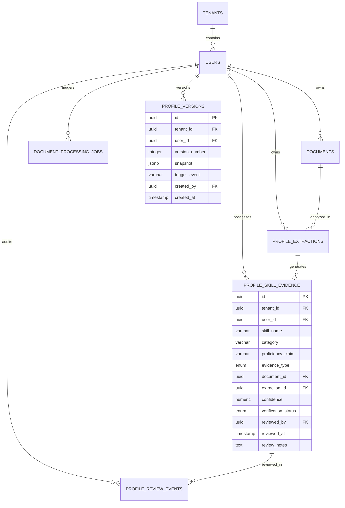

# CarrerSync AI Profiling Agent Architecture Specification

> **Document Type**: Canonical AI System Architecture & Engineering Specification  
> **Status**: APPROVED & CANONICAL  
> **Phase**: Phase 09 — AI Profiling Agent & Evidence Ingestion Engine  
> **Target Release**: Active Node.js + Express Backend (`server/src/ai/`, `server/src/ingestion/`, `server/src/services/`)  
> **Master Policy**: Strict ₹0 Zero-Cost Architecture | Zero External PII Egress | Human-in-the-Loop Verification  

---

## 1. Executive Summary & Core Mission

The **Student Profiling Agent** is an autonomous intelligence service within the CarrerSync placement platform. Its mission is to transform unstructured student artifacts—such as PDF resumes, DOCX portfolios, and certification records—into structured, verifiable, evidence-backed competency profiles.

In legacy recruitment systems, resumes are treated as unverified assertions where keyword stuffing, exaggerated claims, and formatting quirks corrupt candidate evaluation. The CarrerSync Profiling Agent is architected around a non-negotiable foundational axiom:

$$\text{\bf "Resume mention is not verification."}$$

The Profiling Agent functions as an **evidence extraction and recommendation engine**, not an autonomous certifier. It parses artifacts, extracts claimed competencies, identifies contextual project applications, extracts certification metadata, computes deterministic confidence scores, and prepares a structured staging proposal. Every extracted skill must be explicitly reviewed and accepted by the student, and formal verification remains the exclusive prerogative of human institutional evaluators (Training & Placement Officers and Faculty Coordinators).

```
┌────────────────────────────────────────────────────────────────────────────────────────┐
│                                 THE PROFILING AXIOM                                    │
│                                                                                        │
│  "An AI model may detect that a resume contains the word 'Kubernetes'.                │
│   It may even detect that a project description cites 'container orchestration'.       │
│   However, detection is only discovery of evidence. True verification demands          │
│   code proof, rigorous assessment, or human institutional review."                     │
└────────────────────────────────────────────────────────────────────────────────────────┘
```

---

## 2. High-Level Agent Architecture

The Profiling Agent sits at the intersection of document ingestion, hybrid machine intelligence, relational persistence, and human review workflows.

```mermaid
flowchart TD
    subgraph StorageLayer["1. Secure Storage Tier"]
        DocStorage[("IStorageService\n(Local Disk / S3-Compatible)")]
    end

    subgraph IngestionPipeline["2. Ingestion & Pre-Processing Tier"]
        DocDownloader["Document Streamer\n(Tenant & Owner Authorized)"]
        MagicValidator["Magic Byte Validator\n(PDF %PDF-, DOCX PK\x03\x04)"]
        ParserRouter{"MIME Parser Router"}
        PDFParser["PDF Parser\n(FlateDecode zlib Stream Decompression)"]
        DOCXParser["DOCX Parser\n(word/document.xml Tag Extractor)"]
        ImageParser["Scanned/Image Parser\n(Manual Review Flag Generator)"]
        Normalizer["Text Normalizer\n(Unicode, Whitespace, Control Chars)"]
        PIIFilter["PII Sanitizer & Scrubber\n(Email, Phone, Aadhaar Redaction)"]

        DocStorage --> DocDownloader --> MagicValidator --> ParserRouter
        ParserRouter -->|application/pdf| PDFParser --> Normalizer
        ParserRouter -->|docx| DOCXParser --> Normalizer
        ParserRouter -->|image/*, scanned| ImageParser --> Normalizer
        Normalizer --> PIIFilter
    end

    subgraph HybridAIEngine["3. Hybrid AI Engine Tier (server/src/ai/)"]
        AIFactory["AIFactory\n(Provider Selector & Fallback Controller)"]
        GeminiProvider["Gemini 1.5/2.0 Flash\n(Structured JSON Output Prompting)"]
        RuleProvider["Deterministic Rule-Based Provider\n(Regex Taxonomies & Pattern Analyzers)"]
        ZodValidator["Zod Output Schema Guard\n(0.0-1.0 Confidence, Strict Enums)"]

        PIIFilter -->|Sanitized Text| AIFactory
        AIFactory -->|Primary: Free Tier| GeminiProvider
        AIFactory -->|Fallback: Offline / Rate Limit| RuleProvider
        GeminiProvider -.->|On Error / 429| RuleProvider
        GeminiProvider --> ZodValidator
        RuleProvider --> ZodValidator
    end

    subgraph ModularProfiling["4. Modular Profiling Capabilities"]
        ModResume["Resume Segmentation\n(Education, Experience, Skills)"]
        ModProject["Project Analysis\n(Tech Stack, Complexity, Role)"]
        ModCert["Certificate Analysis\n(Issuer, ID, Expiry)"]
        ModSkill["Skill Classification\n(8 Canonical Categories)"]
        ModConfidence["Confidence Calculator\n(Multi-Signal Evidence Formula)"]
        ModExplain["Explainability Engine\n(Transparent Justification Texts)"]

        ZodValidator --> ModResume & ModProject & ModCert & ModSkill
        ModResume & ModProject & ModCert & ModSkill --> ModConfidence --> ModExplain
    end

    subgraph RelationalStaging["5. Staging & Persistence Tier (PostgreSQL)"]
        StagingTable[("profileExtractions\n(status: PENDING_REVIEW)")]
        JobsTable[("documentProcessingJobs\n(status: COMPLETED)")]
        ModExplain --> StagingTable
        ModExplain --> JobsTable
    end

    subgraph HumanInTheLoop["6. Human-in-the-Loop Review Tier"]
        StudentUI["Student Review Modal\n(Inspect Skills, Confidence, Warnings)"]
        DecisionAction{"Student Review Decision"}
        ApproveAction["Approve Extraction\n(Select Approved Skills)"]
        RejectAction["Reject Extraction\n(Discard / Flag Inaccuracies)"]

        StagingTable --> StudentUI --> DecisionAction
        DecisionAction -->|Approve| ApproveAction
        DecisionAction -->|Reject| RejectAction
    end

    subgraph ProfileLedger["7. Verified Profile Ledger Tier"]
        SkillEvidence[("profileSkillEvidence\n(EVIDENCE_FOUND / PENDING_REVIEW)")]
        ReviewEvents[("profileReviewEvents\n(Immutable Audit Log)")]
        ProfileVersions[("profileVersions\n(JSON Snapshot Ledger)")]

        ApproveAction --> SkillEvidence
        ApproveAction --> ReviewEvents
        ApproveAction --> ProfileVersions
        RejectAction --> ReviewEvents
    end
```



---

## 3. Modular Structure of the Profiling Agent

The Profiling Agent is structured into discrete, loosely-coupled functional modules. Each module enforces single-responsibility isolation, comprehensive error recovery, and strict validation.

```
server/src/ai/
├── ai.types.ts                  # Domain models, enums, extraction contracts
├── ai.errors.ts                 # Typed domain error hierarchy
├── ai.interface.ts              # IAIService contract definition
├── ai.factory.ts                # Dual-provider instantiation and fallback manager
├── schemas/
│   └── profiling.schema.ts      # Strict Zod runtime schemas
├── utils/
│   └── pii-filter.ts            # Sensitive identity scrubber
├── prompts/
│   └── profiling.prompts.ts     # Anti-hallucination system instructions
└── providers/
    ├── gemini.provider.ts       # Google Gemini Free Tier adapter
    └── rule-based.provider.ts   # Deterministic, offline regex/taxonomy extractor
```

### 3.1 Resume Analysis Sub-Module
- **Section Segmentation**: Parses document text into semantic zones: Personal Header, Summary, Education, Technical Skills, Professional Experience, Academic Projects, Certifications, and Extracurricular Activities.
- **Chronological Reconstruction**: Detects time intervals, degree titles, graduation years, and GPA metrics.
- **Experience Delineation**: Differentiates between formal employment (internships, full-time roles) and academic coursework, preventing coursework from masquerading as production engineering experience.

### 3.2 Project Analysis Sub-Module
- **Technology Stack Identification**: Scans project titles and narratives to isolate exact programming languages, frameworks, libraries, databases, and deployment platforms utilized.
- **Role & Contribution Delineation**: Analyzes contextual action verbs (*"architected"*, *"implemented"*, *"benchmarked"* vs. *"assisted"*, *"explored"*) to determine student responsibility.
- **Artifact Verification Linking**: Scrapes and validates repository URLs (`github.com/...`) and live deployment links (`*.vercel.app`, `*.render.com`), preparing downstream hooks for Phase 10 Git verification.

### 3.3 Certificate Analysis Sub-Module
- **Issuer Validation**: Matches issuing authorities against a catalog of recognized providers (e.g., AWS, Microsoft, Google Cloud, Cisco, Oracle, Coursera, freeCodeCamp).
- **Metadata Extraction**: Isolates credential IDs, issue dates, expiration dates, and verification URLs.
- **Domain Alignment**: Maps credential subject matter directly to standardized skills (e.g., *AWS Certified Solutions Architect* maps to `AWS`, `Cloud Architecture`, `Networking`).

### 3.4 Skill Extraction & Categorization Sub-Module
Extracted skills are normalized against a canonical 8-category taxonomy:
1. `programming_languages`: Python, TypeScript, JavaScript, Java, C++, Go, Rust, C#, PHP, Ruby, Kotlin, Swift, SQL.
2. `frameworks`: React, Node.js, Express, Next.js, Django, FastAPI, Spring Boot, Vue.js, Angular, Flask, NestJS.
3. `databases`: PostgreSQL, MongoDB, Redis, MySQL, SQLite, Cassandra, Neo4j, DynamoDB.
4. `cloud_devops`: Docker, Kubernetes, AWS, Google Cloud, Azure, CI/CD, GitHub Actions, Terraform, Linux, Nginx.
5. `core_cs`: Data Structures & Algorithms, Object-Oriented Programming, Operating Systems, Database Management Systems, Computer Networks, System Design.
6. `data_ai`: Machine Learning, Deep Learning, PyTorch, TensorFlow, Pandas, NumPy, Scikit-learn, NLP, Computer Vision.
7. `tools`: Git, GitHub, Postman, Vite, Webpack, Linux Bash, Jira, Figma.
8. `soft_skills`: Technical Writing, Agile Methodology, Team Leadership, Problem Solving.

### 3.5 Skill Verification & Evidence Mapping Sub-Module
Skills extracted from resumes are **never** assigned verified status upon discovery. Instead, the sub-module maps skills to evidentiary sources:
- **Resume Mention**: Maps to `evidenceType: 'RESUME'`, default status `PENDING_REVIEW`.
- **Project Supported**: Maps to `evidenceType: 'PROJECT'`, default status `EVIDENCE_FOUND`.
- **Certificate Supported**: Maps to `evidenceType: 'CERTIFICATE'`, default status `PENDING_REVIEW`.
- **Self-Declared**: Entered directly by student, maps to `evidenceType: 'SELF_DECLARED'`, default status `SELF_DECLARED`.

### 3.6 Quality Assessment & Heuristics
- **Buzzword Density Heuristic**: Flags profiles containing excessive skill dumps without supporting project narratives or contextual usage.
- **Anachronism & Contradiction Detection**: Flags anomalies (e.g., 5 years of experience claimed by an undergraduate student in their 2nd year).
- **Scanned Document Review Flags**: Detects image-based PDFs or scanned papers that lack extractable text streams, raising high-severity `ExtractionWarning` flags that mandate manual human verification.

### 3.7 Confidence Calculation Formula & Range Bounds
Every extracted skill is assigned a deterministic confidence score $C \in [0.0, 1.0]$. Confidence represents the syntactic and contextual strength of evidence found within the analyzed artifact:

$$C = \text{clamp}\left( W_{\text{base}} + W_{\text{context}} + W_{\text{mult}} - P_{\text{penalty}}, \; 0.10, \; 0.99 \right)$$

Where:
- $W_{\text{base}}$: Baseline weight determined by primary extraction source:
  - Project Implementation context: $0.65$
  - Dedicated Technical Skills section mention: $0.50$
  - Casual narrative mention in text: $0.35$
- $W_{\text{context}}$: Boost for descriptive implementation detail:
  - Mentions metrics, libraries, or architecture (e.g., *"using React hooks with Tailwind CSS"*): $+0.15$
  - Mentions measurable outcome or complexity: $+0.10$
- $W_{\text{mult}}$: Multiplicity boost (skill appears in multiple distinct sections, e.g. both Skills and Projects): $+0.10$
- $P_{\text{penalty}}$: Ambiguity penalty (skill mentioned in isolated comma-separated list without project proof): $-0.10$

> **Strict Bound Invariant**: Confidence **never** reaches $1.00$ ($100\%$) via automated parsing. Absolute confidence is reserved exclusively for formal human institutional verification or cryptographic code execution tests.

### 3.8 Explainability Engine
Every skill extraction generates a human-readable explanation stored in `ExtractedSkill.explanation`. Examples:
- *"Found in Technical Skills section; corroborated by project 'E-Commerce Platform' utilizing React and Tailwind CSS."*
- *"Extracted from Project 'Real-time Chat Engine' with explicit mention of WebSocket and Redis pub/sub architecture."*
- *"Isolated mention in summary text without associated project evidence. Requires supplementary proof."*

---

## 4. Hybrid AI Architecture & Fallback Protocol

CarrerSync guarantees continuous, zero-downtime operation under the ₹0 zero-cost architecture by pairing Google Gemini's Free Tier with an offline, deterministic rule-based engine.

```
                    ┌───────────────────────────────┐
                    │  Incoming Analysis Request    │
                    └───────────────┬───────────────┘
                                    │
                                    ▼
                    ┌───────────────────────────────┐
                    │   PII Scrubber & Sanitizer    │
                    └───────────────┬───────────────┘
                                    │
                                    ▼
                    ┌───────────────────────────────┐
                    │       AIFactory Router        │
                    └───────┬───────────────┬───────┘
                            │               │
       GEMINI_API_KEY Set?  │               │ Force 'rule-based' OR
       AND Not Throttled    │               │ No API Key Configured
                            ▼               ▼
              ┌──────────────────┐    ┌──────────────────────────┐
              │  GeminiProvider  │    │  RuleBasedAIProvider     │
              │  (Free Tier API) │    │  (Deterministic Regex    │
              └────────┬─────────┘    │   & Keyword Taxonomies)  │
                       │              └────────────┬─────────────┘
          Success?     │                           │
          ┌────────────┴────────────┐              │
       Yes│                       No│(429/Timeout) │
          ▼                         ▼              │
    ┌────────────┐            ┌──────────────┐     │
    │  Validate  │            │ Log Fallback │     │
    │ with Zod   │            │ to Rule-Base │     │
    └─────┬──────┘            └──────┬───────┘     │
          │ Pass                     └─────────────┼────────┐
          │                                        │        │
          ▼                                        ▼        ▼
    ┌────────────────────────────────────────────────────────────┐
    │              ProfilingExtractionResult Output              │
    └────────────────────────────────────────────────────────────┘
```

### 4.1 Primary Tier: Google Gemini Free Tier
- **Model Target**: `gemini-1.5-flash` or `gemini-2.0-flash` endpoint via Google AI Studio (`generativelanguage.googleapis.com`).
- **Zero Cost Guarantee**: Utilizes the standard 15 requests per minute (RPM), 1,500 requests per day (RPD) free tier with **zero credit card requirement**.
- **Structured JSON Invariant**: System prompts mandate strict JSON generation conforming to the `ProfilingExtractionResult` schema.
- **Runtime Guard**: Outputs are validated through `profilingExtractionSchema` in `server/src/ai/schemas/profiling.schema.ts`. Any structural violation immediately triggers fallback.

### 4.2 Fallback Tier: Deterministic Rule-Based Provider
- **Design Target**: 100% offline, zero-network, sub-15ms execution time.
- **Implementation**: Regex-based token boundary analysis, case-insensitive taxonomy dictionaries, and structural section headers.
- **Immunity**: Immune to external API rate limits, network outages, billing suspensions, and provider deprecations.
- **Zero Hallucination**: Deterministic regex matching guarantees that only words physically present in the source text are ever extracted.

### 4.3 Fault Tolerance & Auto-Degradation Table

| Failure Scenario | Trigger Condition | System Behavior | User Impact |
| :--- | :--- | :--- | :--- |
| **No API Key** | `GEMINI_API_KEY` unset or empty | `AIFactory` routes directly to `RuleBasedAIProvider` | Profiling proceeds instantly; zero errors raised |
| **Rate Limit / 429** | Gemini Free Tier 15 RPM quota exceeded | Catches `AIQuotaExceededError`; transparently reroutes to `RuleBasedAIProvider` | Zero user-visible disruption; job completes |
| **Network Timeout** | Gemini API call exceeds 15,000ms | Aborts request via `AbortController`; executes rule-based fallback | Job completes within bounded latency |
| **Schema Validation Error**| Gemini produces malformed JSON | `ZodError` caught; logs validation diff; executes rule-based fallback | Structured data guarantees preserved |
| **Scanned / Image Document**| No extractable text stream in PDF/image | Ingestion marks `requiresManualReview: true`; skips LLM | Student & TPO notified to perform manual review |

---

## 5. Graph Memory Foundation

Competency evaluation in CarrerSync is inherently relational and graph-structured: students acquire skills, substantiate them with evidence artifacts, target corporate roles, and bridge skill gaps.

### 5.1 Relational Graph Emulation in Neon PostgreSQL
CarrerSync models graph relationships directly within normalized PostgreSQL tables, leveraging foreign keys and composite indexes for multi-tenant graph queries:



### 5.2 Node & Edge Taxonomy
In the relational knowledge graph:
- **Student Node**: `users` where `role = 'student'` (linked to `students` table).
- **Evidence Node**: `documents` records (PDF resumes, GitHub URLs, certificates) with SHA-256 integrity hashes.
- **Skill Node**: Canonical skill entities characterized by name and category.
- **Evidence Edge (`HAS_EVIDENCE`)**: `profileSkillEvidence` records joining Student $\rightarrow$ Skill $\rightarrow$ Document with confidence scores and verification states.
- **Review Edge (`REVIEWED_BY`)**: `profileReviewEvents` linking Reviewer $\rightarrow$ Skill Evidence $\rightarrow$ Timestamp $\rightarrow$ Decision.

### 5.3 Optional FalkorDB / Cypher Projection (Future Roadmap)
While Neon PostgreSQL serves as the canonical persistent store of truth, the architecture supports projection into FalkorDB or RedisGraph for high-speed multi-hop graph traversals:
```cypher
// Example multi-hop Cypher query for verified candidate discovery
MATCH (s:Student)-[e:HAS_EVIDENCE]->(sk:Skill)
WHERE e.verification_status = 'VERIFIED'
  AND sk.name IN ['React', 'TypeScript', 'PostgreSQL']
WITH s, count(sk) as verified_skills_count
WHERE verified_skills_count >= 3
RETURN s.id, s.name, verified_skills_count
ORDER BY verified_skills_count DESC
```

---

## 6. Verification Integrity & Human-in-the-Loop Guardrails

### 6.1 The Anti-Autonomous Principle
Under no circumstances may an AI agent automatically graduate a student skill to `VERIFIED`. Autonomous verification is explicitly prohibited by platform policy.

1. **Student Gate**: The student must inspect all extracted skills, projects, and confidence levels. The student may reject erroneous extractions or modify proficiency claims prior to staging.
2. **Institutional Gate**: TPO Administrators and Faculty Coordinators maintain sole authority to award `VERIFIED` status upon reviewing physical certificates, verifying repository commits, or administering proctored assessments.

### 6.2 Profile Versioning Ledger (`profileVersions`)
Every time an approved extraction mutates a student's competency record, an immutable snapshot is written to `profileVersions`:
- `versionNumber`: Incremental version integer ($1, 2, 3, \dots$).
- `snapshot`: Complete JSON representation of all active skills, evidence links, and verification states.
- `triggerEvent`: Context string (e.g., `DOCUMENT_INGESTION_APPROVED`, `MANUAL_SKILL_ADDED`, `TPO_VERIFICATION`).
- `createdBy`: User ID of the actor initiating the modification.

This immutable ledger guarantees full auditability, rollback capability, and tamper-evident placement eligibility tracking.
