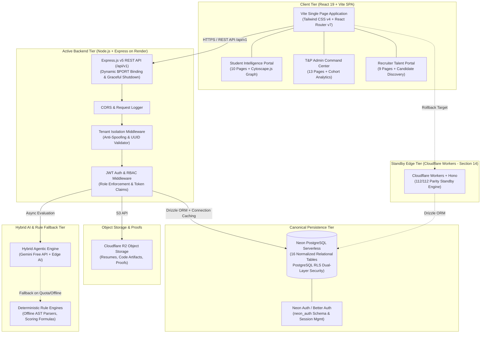
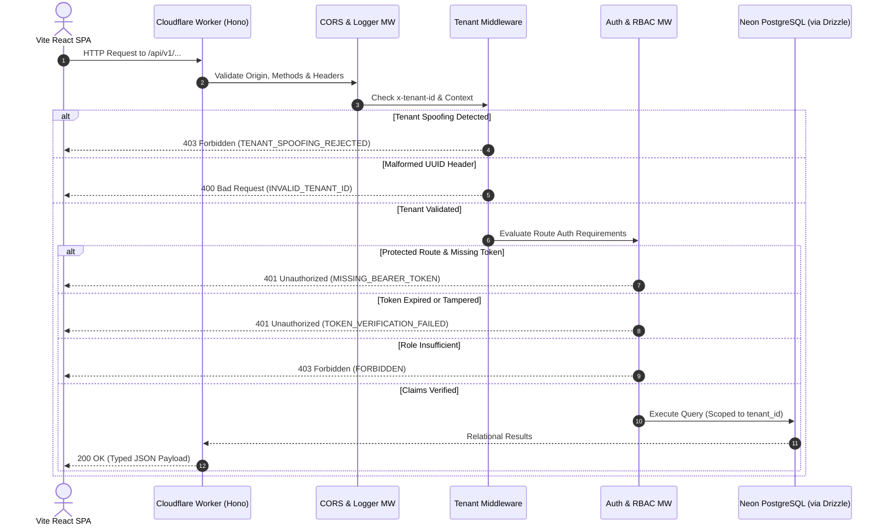
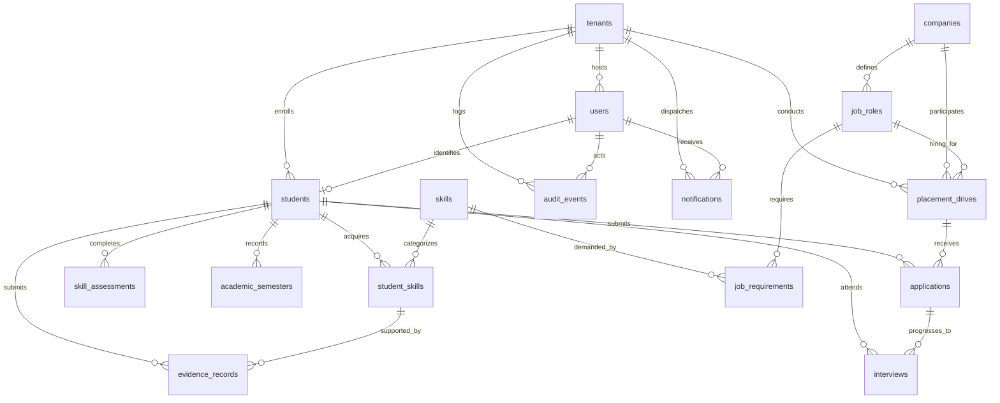
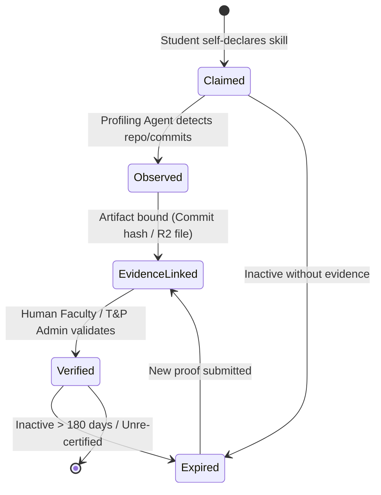
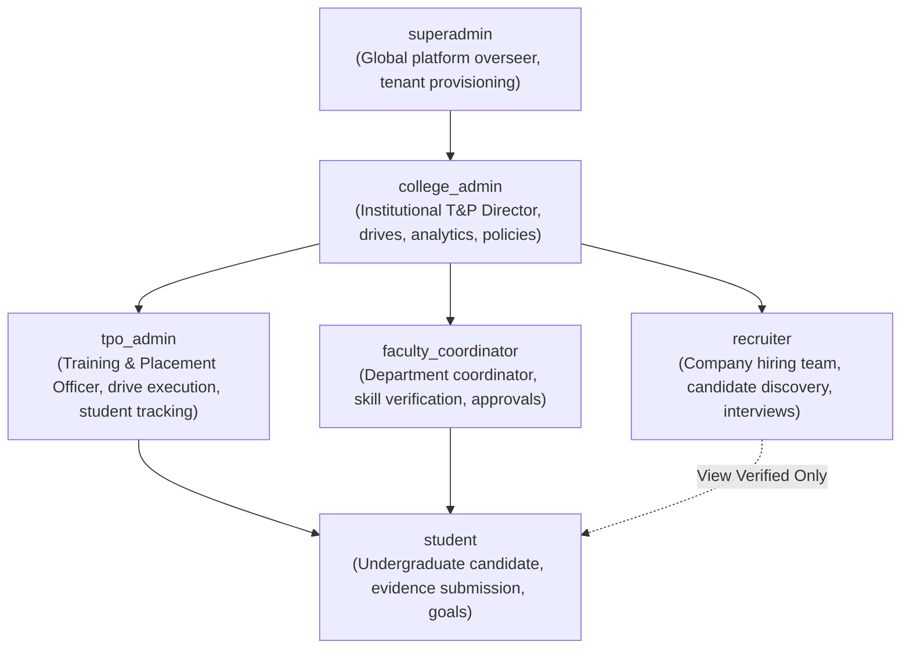
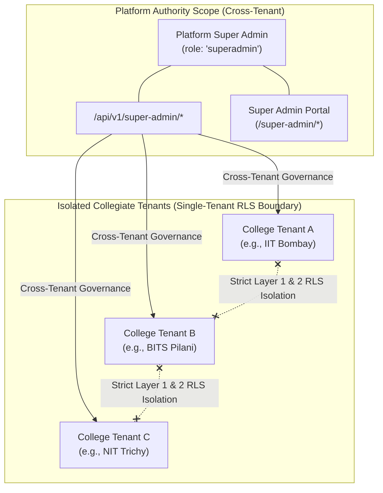
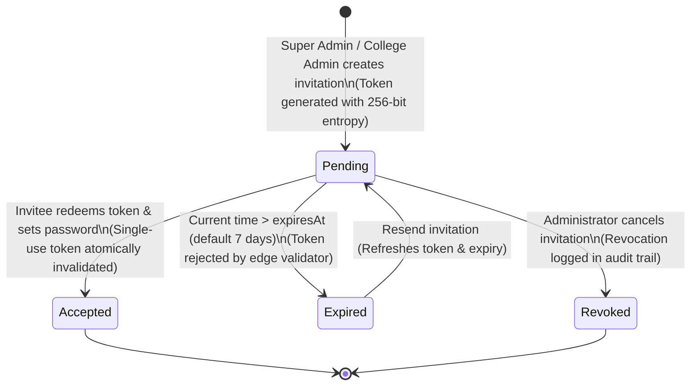
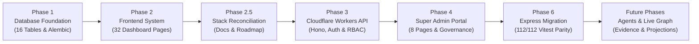

# CarrerSync System Architecture Specification

> **Document Type**: Canonical System Architecture & Engineering Specification  
> **Status**: APPROVED & CANONICAL  
> **Target Release**: Phase 06 Backend Migration (Node.js + Express + Neon PostgreSQL + Drizzle ORM + Render Deployment)  
> **Master Policy**: Strict ₹0 Zero-Cost Architecture | Zero Data Loss Guarantee  

---

## 1. Executive Summary & Core Mission

**CarrerSync** is an enterprise-grade **Agentic Placement Intelligence Platform** engineered to modernize collegiate campus hiring. It bridges the gap between student evidence, certified skills, industry demand, and campus recruitment workflows.

Traditional placements rely on unverified resumes, arbitrary GPA cutoffs, and spreadsheet chaos. CarrerSync establishes an **evidence-driven, verifiable competency pipeline**:

```
Student Evidence (GitHub Repositories, PRs, Commits, R2 Artifacts)
       │
       ▼
5-Stage Skill Verification Lifecycle (Claimed → Observed → Evidence-linked → Verified → Expired)
       │
       ▼
Deterministic & Hybrid Skill-Gap Benchmarking (Target Role Demands vs. Verified Competencies)
       │
       ▼
Personalized Remediation Learning Paths (Milestones, Curated Tasks & Assessments)
       │
       ▼
Multi-Tenant Campus Placement Drive Orchestration (Deterministic Eligibility & Human Decision Audit)
```

---

## 2. High-Level System Architecture

CarrerSync deploys an enterprise-grade, zero-cost architecture featuring an active **Node.js + Express** REST API tier (hosted on **Render Free Tier** with dynamic `$PORT` binding and graceful shutdown), **Neon Serverless PostgreSQL** as the single canonical source of truth, **Drizzle ORM** for type-safe database queries, and a standby **Cloudflare Workers** edge runtime temporarily retained per Section 14 for dual-engine validation and instant rollback.



---

## 3. Technology Stack & Zero-Cost Architecture Policy

The platform strictly adheres to a **₹0 operational budget** utilizing enterprise-grade open-source tools and perpetual free tiers. Core platform operations (authentication, eligibility evaluation, student records, audit logs) **never** depend on paid third-party APIs.

| Architectural Layer | Technology | Version / Spec | Free Tier Strategy & Operational Rationale | Cost |
| :--- | :--- | :--- | :--- | :--- |
| **Active Backend Compute** | Node.js + Express | Node v20+/v24+, Express v5 | Render Free Tier Web Service: 512 MB RAM, dynamic `$PORT` binding, auto-sleep, zero hosting costs | **₹0** |
| **Standby Edge Compute** | Cloudflare Workers | V8 Isolates / Hono v4 | Standby / comparison runtime per Section 14 (100k req/day free, 0ms cold starts) | **₹0** |
| **API Web Framework** | Express.js / Hono | Express v5.1.0 / Hono v4.7.2 | Standard enterprise Node.js HTTP pipeline with full Vitest test parity (112/112 tests) | **₹0** |
| **Frontend Framework** | React 19 + Vite | React 19.x, Vite 6.x | Static SPA hosted on Vercel Hobby / Cloudflare Pages with CDN edge caching | **₹0** |
| **Styling & Icons** | Tailwind CSS v4, Lucide | v4.0.0, Lucide-React | Zero-runtime CSS extraction, consistent institutional light theme tokens | **₹0** |
| **Canonical Database** | Neon PostgreSQL | Serverless v16 | Single source of truth: 0.5 GB storage, auto-suspend, zero-cost pooling | **₹0** |
| **Data Access / ORM** | Drizzle ORM | v0.38.4 | Zero-overhead SQL generation, TypeScript safety, `@neondatabase/serverless` | **₹0** |
| **Database Migrations** | Alembic / Drizzle Kit | Python / Node | Version-controlled async migrations and bidirectional rollback testing | **₹0** |
| **Authentication & RBAC** | Neon Auth / Better Auth | JWT (HS256) + bcrypt | Stateless JWT, bcrypt salt rounds 10, multi-tenant RBAC role guards | **₹0** |
| **Object Storage** | Cloudflare R2 | S3-Compatible API | 10 GB storage free, 1M Class A operations/month, zero egress bandwidth fees | **₹0** |
| **Graph Visualization** | Cytoscape.js | v3.30+ | Client-side interactive knowledge graph rendering with CoSE layout | **₹0** |
| **AI Intelligence** | Hybrid Engine | Gemini API + Rules | Deterministic fallback ensures 100% platform availability with zero paid API | **₹0** |

---

## 4. Active Node.js + Express Backend Architecture (`server/`)

### 4.1 Enterprise Express Engine & Lifecycle Management
The primary backend engine resides in `server/` and provides an enterprise-ready, maintainable, and inspectable Node.js + Express foundation:
- **Runtime**: Node.js LTS v20+ / v24+ with TypeScript execution via `tsx`.
- **Dynamic Port Binding**: Honors Render's injected `$PORT` environment variable, defaulting locally to port `5000`:
  ```typescript
  const PORT = Number(process.env.PORT) || 5000;
  server.listen(PORT, '0.0.0.0', () => { ... });
  ```
- **Graceful Shutdown**: Intercepts `SIGINT` and `SIGTERM` signals, closes active HTTP keep-alive connections cleanly within a 10-second timeout, and releases database client handles.
- **Health Probing**: Exposes `/health`, `/api/health`, and `/api/v1/health` endpoints returning server timestamp, version, and database connectivity state.

### 4.2 Database Access & RLS Context Binding
Direct database operations use Drizzle ORM with the `@neondatabase/serverless` client:
1. **Connection Caching**: The pool factory in `server/src/db/client.ts` caches driver instances across requests.
2. **Protocol Normalization**: Normalizes incoming connection strings (e.g., automatically handling `postgresql+asyncpg://` or `postgres://` prefixes).
3. **Transaction-Scoped RLS Helper**:
   ```typescript
   export async function withTenantContext<T>(
     tenantId: string,
     callback: (tx: any) => Promise<T>
   ): Promise<T> {
     return db.transaction(async (tx) => {
       await tx.execute(sql`SELECT set_config('app.current_tenant_id', ${tenantId}, true)`);
       return callback(tx);
     });
   }
   ```

### 4.3 Defense-in-Depth Middleware Pipeline
1. **CORS & Logger**: Permissive origin header validation and console request tracing (`METHOD PATH STATUS - TIME ms`).
2. **Tenant Isolation (`server/src/middleware/tenant.ts`)**:
   - Authoritative tenant identity derived from verified JWT.
   - Header/body spoofing rejected immediately with HTTP 403 `TENANT_SPOOFING_REJECTED`.
   - Super Admin cross-tenant governance bypass supported for platform administration.
3. **Authentication & RBAC (`server/src/middleware/auth.ts`)**:
   - `requireAuth`: Bearer token extraction and HS256 signature verification.
   - `requireRole`: Strict role hierarchy checking (`superadmin`, `college_admin`, `tpo_admin`, `faculty_coordinator`, `recruiter`, `student`).
4. **Centralized Error Handling (`server/src/middleware/error.ts`)**:
   - Standardized JSON responses (`success: false`, `error: { code, message }`).
   - Redacts credentials and internal stack traces in production environments.

---

## 5. Standby Cloudflare Workers Runtime & Parity Architecture (`workers/`)

### 5.1 V8 Isolate Architecture & Retention Rationale
As documented in Section 14, Cloudflare Workers operates directly on Google V8 isolates with sub-millisecond cold starts and is temporarily maintained alongside Express:
- Retained to guarantee 100% architectural parity and zero-downtime rollback capabilities.
- Shares the identical 16-table Drizzle schema (`workers/src/db/schema.ts` ↔ `server/src/db/schema.ts`).
- Executes an identical 112-test Vitest suite covering cryptography, tenant isolation, RBAC, and route behaviors.

### 5.2 Connection Acceleration via Cloudflare Hyperdrive
Direct connection from edge serverless workers to PostgreSQL leverages **Cloudflare Hyperdrive**:
1. Maintains pooled persistent connections to Neon PostgreSQL from edge PoPs.
2. Eliminates TLS handshake latency on every worker invocation.
3. Automatically caches read queries when appropriate while guaranteeing write consistency.

---

## 5. Hono REST API Architecture (`/api/v1`)

The edge API is organized under the `/api/v1` namespace with a modular Hono router structure:

```
workers/
├── wrangler.toml              # Cloudflare Worker configuration, bindings & secrets
├── package.json               # Dependencies (Hono, Drizzle, Neon serverless, bcryptjs, Zod)
├── tsconfig.json              # Strict TypeScript configuration
├── src/
│   ├── index.ts               # Hono root app, global CORS, logger, 404 & error handlers
│   ├── types.ts               # Environment bindings, AppEnv, UserRole, session contexts
│   ├── db/
│   │   ├── client.ts          # Neon Serverless + Drizzle ORM singleton factory
│   │   └── schema.ts          # 16 normalized tables, 9 enums, relations & indexes
│   ├── middleware/
│   │   ├── auth.ts            # JWT Bearer token validator & RBAC role guard
│   │   └── tenant.ts          # Anti-spoofing tenant isolation & UUID format validator
│   ├── utils/
│   │   └── crypto.ts          # bcrypt hashing (salt rounds 10) & JWT token signing/verifying
│   └── routes/
│       ├── auth.routes.ts     # /api/v1/auth (register, login, me, logout, refresh)
│       ├── tenant.routes.ts   # /api/v1/tenants (list active, provision tenant, verify)
│       ├── student.routes.ts  # /api/v1/students (profiles, verified skills, evidence)
│       ├── skill.routes.ts    # /api/v1/skills (taxonomy, 5-stage transitions, binding)
│       ├── drive.routes.ts    # /api/v1/drives (placements, criteria, applications)
│       └── admin.routes.ts    # /api/v1/admin (analytics, audit trails, tenant config)
```

### 5.1 Route & Middleware Execution Pipeline

Every incoming request traverses a defense-in-depth pipeline:



### 5.2 Core API Endpoints Specification

| Namespace | Method & Endpoint | Auth & RBAC | Description |
| :--- | :--- | :--- | :--- |
| **System** | `GET /health` | Public | Health ping, worker service name, version, timestamp |
| **System** | `GET /api/v1/health` | Public | Extended health check reporting database connection status |
| **Auth** | `POST /api/v1/auth/register` | Public (Tenant Context) | Registers student, admin, coordinator, or recruiter under college tenant |
| **Auth** | `POST /api/v1/auth/login` | Public (Tenant Context) | Authenticates credentials, issues signed JWT token with tenant claims |
| **Auth** | `GET /api/v1/auth/me` | `requireAuth` | Returns active user profile, tenant identity, and authorized permissions |
| **Tenants** | `GET /api/v1/tenants/` | Public | Lists active college institutions for registration onboarding |
| **Tenants** | `POST /api/v1/tenants/` | `requireAuth` (`superadmin`) | Provisions a new college institution tenant with custom slug & domain |
| **Students** | `GET /api/v1/students/me` | `requireAuth` (`student`) | Returns authenticated student's full academic and verified skill profile |
| **Skills** | `GET /api/v1/skills/` | `requireAuth` (Any Role) | Canonical taxonomy search filtered by category or canonical slug |
| **Drives** | `GET /api/v1/drives/` | `requireAuth` (Any Role) | Returns active campus placement drives matching student eligibility |
| **Admin** | `GET /api/v1/admin/analytics` | `requireAuth` (`college_admin`) | Institutional placement metrics, skill distribution, and cohort trends |

---

## 6. Drizzle ORM Relational Schema (Neon PostgreSQL)

The relational schema is defined with TypeScript type safety in `workers/src/db/schema.ts` and mirrors the PostgreSQL 16 schema. It enforces referential integrity through foreign keys, cascade rules, composite uniqueness, and categorical check constraints.

### 6.1 The 16 Canonical Relational Tables



1. **`tenants`**: Institutional boundary. Stores college name, unique slug, verified custom domain, institutional settings, and active status flag.
2. **`users`**: Platform actors (`superadmin`, `college_admin`, `faculty_coordinator`, `recruiter`, `student`). Contains email, bcrypt password hash, tenant foreign key, active status, and audit timestamps.
3. **`students`**: Academic profile linked 1:1 with `users`. Stores roll number, department, batch year, degree, cumulative CGPA, verified backlogs count, date of birth, and Cloudflare R2 resume key.
4. **`skills`**: Standardized canonical competency catalog. Stores skill name, canonical slug, category (`programming_languages`, `frameworks`, `databases`, `cloud_devops`, `core_cs`, `data_ai`, `soft_skills`), and active status.
5. **`studentSkills`**: Relational junction connecting students to skills. Encapsulates the **5-Stage Verification Lifecycle**, proficiency level (`beginner`, `intermediate`, `advanced`, `expert`), validation score (0–100), and last active timestamp.
6. **`evidenceRecords`**: Verifiable proof objects. Stores evidence type (`github_commit`, `github_pr`, `project_repository`, `deployed_application`, `coding_assessment`, `certification`), external repository URL, git commit hash, Cloudflare R2 storage key, evaluation score, and human verification status.
7. **`skillAssessments`**: Automated and proctored coding assessments. Captures assessment title, score, max score, percentile rank, proctoring flags, and completion timestamp.
8. **`academicSemesters`**: Normalized term-by-term academic audit trail. Tracks semester number, SGPA, credits attempted, credits earned, and backlog flags.
9. **`companies`**: Participating hiring organizations. Stores company name, industry sector, corporate website, tier (`tier_1`, `tier_2`, `mass_recruiter`, `startup`), and partnership status.
10. **`jobRoles`**: Specific hiring designations offered by companies. Stores title, department focus, minimum compensation (LPA), maximum compensation (LPA), and work location.
11. **`jobRequirements`**: Competency specifications for job roles. Stores required skill foreign key, mandatory flag (`is_mandatory`), minimum required proficiency, and relative evaluation weight.
12. **`placementDrives`**: Campus recruitment events. Stores drive title, hiring company, target batch year, allowed departments, minimum CGPA cutoff, maximum allowed backlogs, drive lifecycle status (`draft`, `published`, `ongoing`, `completed`, `cancelled`), and drive schedule dates.
13. **`applications`**: Student candidacy submissions for placement drives. Captures application lifecycle (`applied`, `eligible`, `shortlisted`, `interview_scheduled`, `offered`, `rejected`, `withdrawn`), deterministic eligibility evaluation outcome, and human decision maker ID (`final_decision_by`).
14. **`interviews`**: Multi-stage evaluation rounds. Stores application foreign key, round number, round type (`online_test`, `technical_1`, `technical_2`, `hr`, `management`), interviewer name, numeric rating (1–5), qualitative feedback, and recommendation.
15. **`auditEvents`**: Tamper-proof security and compliance log. Captures actor ID, tenant ID, action verb, target entity, IP address, user agent, and contextual JSON metadata.
16. **`notifications`**: Targeted user alerts. Stores title, message, alert category, read status, and link target.

### 6.2 The 5-Stage Skill Verification Lifecycle

A foundational principle of CarrerSync is that **skills are not binary claims; they are dynamic, evidence-backed states**:



1. **`Claimed`**: Self-reported by the student without verifiable evidence attached. Excluded from recruiter shortlisting filters.
2. **`Observed`**: Detected automatically by the Profiling Agent via repository source parsing, AST analysis, or commit log scans. Represents an unconfirmed signal.
3. **`Evidence-linked`**: Formally bound to inspectable code evidence (GitHub commit SHA, merged pull request, deployed URL, or Cloudflare R2 code artifact).
4. **`Verified`**: Formally reviewed and signed off by a human faculty coordinator, placement officer, or validated proctored coding assessment. **AI agents cannot independently assign Verified status.**
5. **`Expired`**: Competency lapsed due to lack of ongoing activity, commits, or recertification over a defined period (e.g., 180 days).

---

## 7. Multi-Tenant Transaction-Scoped Security & Isolation

CarrerSync enforces a strict **Dual-Layer Multi-Tenancy Architecture** ensuring that no institution can access, view, or mutate another institution’s records under any circumstance.

### 7.1 Layer 1: Edge Gateway Validation & Anti-Spoofing Middleware
Executed at the Cloudflare Worker layer on every incoming request (`workers/src/middleware/tenant.ts`):
- **Authoritative JWT Tenant Identity**: For authenticated requests, the user’s `tenant_id` embedded in the cryptographically signed JWT is strictly authoritative.
- **Tenant Spoofing Prevention**: If a client supplies a custom `x-tenant-id` header or body parameter that differs from the JWT tenant claim, the request is immediately rejected with HTTP `403 Forbidden` (`TENANT_SPOOFING_REJECTED`) and logged as a security alert.
- **UUID Validation**: All tenant identifiers must conform to canonical RFC 4122 UUID v4 formatting. Malformed strings are rejected with HTTP `400 Bad Request`.
- **Institutional State Verification**: Ensures the tenant institution exists and is currently active before dispatching database transactions.

### 7.2 Layer 2: PostgreSQL Row-Level Security (RLS)
Executed at the database kernel level within Neon PostgreSQL:
- **Transaction-Scoped Context**: Every database connection or transaction sets the session variable:
  ```sql
  SET LOCAL app.current_tenant_id = '11111111-1111-1111-1111-111111111111';
  ```
- **Database Engine Policies**: Every tenant-owned table is secured with PostgreSQL RLS:
  ```sql
  ALTER TABLE students ENABLE ROW LEVEL SECURITY;
  
  CREATE POLICY tenant_isolation_policy ON students
    FOR ALL
    USING (tenant_id = NULLIF(current_setting('app.current_tenant_id', true), '')::uuid)
    WITH CHECK (tenant_id = NULLIF(current_setting('app.current_tenant_id', true), '')::uuid);
  ```
- **Zero-Leakage Assurance**: Even if an application query inadvertently omits a `WHERE tenant_id = ...` clause, the PostgreSQL engine filters out rows belonging to all other institutions.

---

## 8. Neon Auth & Better Auth Compatibility

CarrerSync integrates **Neon Auth** (powered by **Better Auth**) to provide seamless, secure identity management without adding recurring monthly SaaS costs.

### 8.1 Schema Separation & Coexistence
- Managed authentication tables live inside the dedicated `neon_auth` PostgreSQL schema (`neon_auth.users`, `neon_auth.sessions`, `neon_auth.accounts`, `neon_auth.verifications`).
- Core business entities live in the `public` schema (`public.users`, `public.students`, `public.tenants`), linking to authentication identities via immutable UUID keys.
- Drizzle ORM queries interact cleanly with application tables while delegating credential and session verification to the auth engine.

### 8.2 Stateless Edge Token Architecture
- **JWT Cryptography**: Signed using HMAC-SHA256 (`HS256`) via Web Crypto APIs supported natively in V8 isolates.
- **Token Claims**: Contains `sub` (user UUID), `tenant_id` (institution UUID), `role` (`UserRole`), `email`, issued-at (`iat`), and expiration (`exp`, default 2 hours).
- **Password Security**: Passwords hashed using `bcrypt` with 10 salt rounds (`bcryptjs`). Plain text credentials are never persisted or logged.

### 8.3 Role-Based Access Control (RBAC) Hierarchy



- **`superadmin`**: Platform administrator; possesses platform root authority, provisions new college tenants, manages system policies, monitors platform-wide audit trails, and manages user accounts cross-tenant.
- **`college_admin`**: Institutional Training & Placement (T&P) Director; possesses full administrative control over their college’s students, drives, recruiters, and eligibility rules.
- **`tpo_admin`**: Training & Placement Officer; manages day-to-day placement operations, drive applications, company interview slots, and student communications.
- **`faculty_coordinator`**: Department faculty; reviews student code evidence, conducts proctored reviews, and upgrades skill states from `Evidence-linked` to `Verified`.
- **`recruiter`**: Verified corporate hiring representative; browses verified talent pools, shortlists eligible candidates, and submits interview evaluations.
- **`student`**: Enrolled candidate; manages personal profile, links GitHub accounts, reviews skill gaps, and applies for campus placement drives.

### 8.4 Super Admin Platform Authority & Multi-Tenant Boundaries

CarrerSync balances multi-tenant data isolation with centralized platform operations:



#### 1. Universal Cross-Tenant Governance vs. Single-Tenant Boundaries
- **Single-Tenant Actors**: Users with roles `student`, `faculty_coordinator`, `tpo_admin`, or `college_admin` are strictly bounded to their assigned college (`tenantId`). Attempts to access resources belonging to another college are blocked at Layer 1 (Edge Anti-Spoofing Middleware) and Layer 2 (PostgreSQL Row-Level Security).
- **Super Admin Governance**: The `superadmin` role has platform-level authority. Routes under `/api/v1/super-admin/*` enforce:
  1. `requireAuth`: Validates JWT signature, non-tampered claims, and expiration.
  2. `requireRole(['superadmin'])`: Enforces that only users with the `superadmin` role can access the portal endpoints (returning `403 Forbidden` for all other roles).
  3. **Isolation Exemption**: Super Admin handlers execute queries across all registered collegiate tenants, allowing system-wide statistics, global user directories, college activation/suspension, and platform-wide audit analytics.

#### 2. Institutional Tenant Lifecycle Governance
- **College Provisioning (`POST /api/v1/super-admin/colleges`)**: Registers a new educational institution with verified name, unique URL slug, custom official domain, physical location, and contact metadata.
- **Suspension & Reactivation (`PATCH /api/v1/super-admin/colleges/:id/status`)**: Super Admins can toggle `isSuspended` and `status` (`active`, `suspended`, `inactive`). When a college is suspended, all associated students, faculty, and administrators from that tenant are immediately barred from authenticating (`TENANT_SUSPENDED`).
- **Domain & Configuration Controls**: Super Admins can update institutional settings, allowed email domains, and maximum seat allocations.

#### 3. Out-of-Band Initial Bootstrapping Policy
- **Zero Public Registration**: To eliminate privilege escalation vulnerabilities, CarrerSync does **not** expose a public registration page for Super Admins.
- **Initial Bootstrapping**: The platform root administrator is provisioned out-of-band via CLI using `scripts/provision_superadmin.ts` or `scripts/provision_superadmin.py` with direct `DATABASE_URL` credentials.
- **Subsequent Administrative Users**: Additional administrators, TPOs, and recruiters are onboarded through authenticated invitations or direct creation with mandatory audit trail logging.

---

### 8.5 Cryptographic Single-Use Invitation Lifecycle Mechanics

User onboarding across institutions and recruitment partners is governed by an expiring, cryptographically secure invitation state machine.



#### 1. Relational Schema (`invitations` Table)
Defined in `workers/src/db/schema.ts`:
- `id`: Primary key UUID.
- `tenantId`: Foreign key to `tenants.id` (nullable for cross-tenant recruiter invites; non-null for college-scoped roles).
- `email`: Target invitee email address.
- `role`: Role to be granted upon acceptance (`college_admin`, `tpo_admin`, `recruiter`, `student`).
- `fullName`: Invitee full name.
- `token`: Unique cryptographically random single-use verification token.
- `status`: Enum (`pending`, `accepted`, `expired`, `revoked`).
- `metadataJson`: Contextual parameters (department, roll number, company, batch year).
- `invitedByUserId`: Foreign key to the issuing administrator's `users.id`.
- `expiresAt`: Expiration timestamp (default 7 days from generation).
- `acceptedAt`: Timestamp of successful redemption.

#### 2. Cryptographic Security Mechanics
- **High-Entropy Token Generation**: Generated using cryptographic pseudo-random number generators (`crypto.randomBytes(32).toString('hex')` or Web Crypto `crypto.getRandomValues()`), producing 256 bits of entropy to prevent brute-force token enumeration.
- **Atomic Single-Use Invalidation**: Token acceptance executes inside an atomic transaction:
  ```sql
  UPDATE invitations 
  SET status = 'accepted', acceptedAt = NOW(), updatedAt = NOW()
  WHERE token = $1 AND status = 'pending' AND expiresAt > NOW()
  RETURNING id, email, role, tenant_id;
  ```
  If zero rows are updated, the request is rejected with `400 Bad Request` (`INVITATION_INVALID_OR_CONSUMED`), preventing replay attacks and race conditions.
- **Resend & Token Rotation**: When an invitation is resent (`POST /api/v1/super-admin/invitations/:id/resend`), the existing token is discarded, a new high-entropy token is generated, and `expiresAt` is extended.

---

### 8.6 Super Admin Platform Audit Trails & Compliance Logging

All platform mutations executed by Super Admins and institutional administrators are immutably captured in the `audit_events` relational table.

#### 1. Audit Trail Specifications
- **Tamper-Proof Design**: Audit records are insert-only. No API endpoint exists to update or delete audit events (`FORBIDDEN`).
- **Comprehensive Event Capture**:
  - `tenant_id`: Scoped college tenant or platform root tenant.
  - `actor_user_id`: Authenticated administrator UUID.
  - `action`: Authoritative action verb (`COLLEGE_CREATED`, `COLLEGE_STATUS_UPDATED`, `USER_CREATED`, `USER_STATUS_UPDATED`, `USER_ROLE_UPDATED`, `INVITATION_CREATED`, `INVITATION_REVOKED`, `INVITATION_RESENT`, `SUPERADMIN_INITIAL_PROVISIONING`).
  - `entity_type`: Target entity class (`college`, `user`, `invitation`, `policy`).
  - `entity_id`: UUID of the affected entity.
  - `details`: JSON payload capturing old vs. new state diffs, IP addresses, and metadata.
  - `created_at`: UTC timestamp with timezone.
- **Query & Analytics**: The Super Admin Audit Trail is queryable via `GET /api/v1/super-admin/audit-logs` with full-text search, actor filtering, entity filtering, and date range criteria, and displayed at `/super-admin/audit-logs`.

---

## 9. Canonical Database Reconciliation & Zero-Loss MongoDB Migration Roadmap

### 9.1 The Canonical Decision: Neon PostgreSQL
During early architecture development (Phase 01), a dual data store concept was explored with MongoDB Atlas and FalkorDB. Concurrently, an authoritative 16-table relational schema was created for **Neon PostgreSQL**.

**Architectural Decision**: **Neon PostgreSQL is established as the single canonical source of truth for CarrerSync.** MongoDB Atlas is completely retired.

### 9.2 Zero Data Loss Guarantee
The complete decommissioning of MongoDB involves **zero data loss** due to four verified platform facts:
1. **No Instantiated Mongoose Models**: The legacy file `server/src/models/index.js` only defined string constants for collections. No Mongoose schemas or models were instantiated or compiled.
2. **Disconnected Operational Mode**: The legacy Express connection manager (`server/src/config/db.js`) ran in non-blocking disconnected mode whenever `MONGODB_URI` was unconfigured.
3. **Zero Production Data**: The project was in development preview; zero live student, drive, or institutional records were ever written to MongoDB Atlas.
4. **Complete Relational Superset**: The 16 normalized PostgreSQL tables completely subsume and expand upon the 11 planned MongoDB collections, adding relational integrity constraints, foreign key cascades, and row-level security.

### 9.3 Planned Collections to Relational Tables Mapping

| Planned MongoDB Collection | Canonical Neon PostgreSQL Table(s) | Relational Enhancements & Constraints |
| :--- | :--- | :--- |
| `Users` | `tenants`, `users`, `neon_auth.users` | Separation of institution from user; composite unique `(tenant_id, email)`; bcrypt credential hashing. |
| `Students` | `students`, `academic_semesters` | Normalized semester SGPA/backlog tracking; composite unique `(tenant_id, roll_number)`. |
| `Skills` | `skills` | Standardized canonical ontology with slug indexing (`canonical_slug`) and categorical taxonomy. |
| `Evidence` | `evidence_records`, `skill_assessments` | Direct binding to verified skills; Cloudflare R2 object key tracking; commit SHA auditability. |
| *Embedded Skills Array* | `student_skills` | **The 5-Stage Verification Lifecycle** (`Claimed` → `Verified`); composite unique `(student_id, skill_id)`. |
| `Projects` | `evidence_records` (`project_artifact`) | Unified evidence tracking with inspectable GitHub URLs and R2 artifacts. |
| `JobRequirements` | `companies`, `job_roles`, `job_requirements` | 3-tier hierarchy: Companies → Roles → Weighted skill requirements with mandatory flags. |
| `Drives` | `placement_drives` | Drive lifecycle (`draft`, `published`, `ongoing`, `completed`, `cancelled`); batch & department filters. |
| `EligibilityRules` | `placement_drives` (relational criteria) | Deterministic criteria: `min_cgpa`, `max_active_backlogs`, allowed departments. |
| `EligibilityResults` | `applications` | Normalized application record; composite unique `(drive_id, student_id)`; human decision audit. |
| *New Interview Entity* | `interviews` | Multi-round interview tracking (`online_test`, `technical_1`, `technical_2`, `hr`, `management`). |
| `LearningPaths` | `learning_recommendations`, `skill_gap_analyses` | Analytical gap computation separated from actionable remediation milestones. |
| `AuditLogs` | `audit_events`, `agent_execution_logs` | Tamper-proof compliance log storing actor ID, action, resource, metadata, and agent telemetry. |

### 9.4 Migration & Phase Roadmap



1. **Phase 1: Relational Database Foundation (COMPLETED)**: 16 normalized tables created in Neon PostgreSQL, Alembic migrations verified, synthetic multi-tenant seeder executed, 12/12 Pytest tests passing.
2. **Phase 2: UI/UX Design System & Dashboard Foundation (COMPLETED)**: 22 reusable UI components, public SaaS landing page, 32 dashboard pages across Student (10), Admin (13), and Recruiter (9) portals, Cytoscape.js knowledge graph, Vite production build passing in 340ms.
3. **Phase 2.5: Architecture & Stack Reconciliation (COMPLETED)**: Full architectural audit, complete MongoDB retirement with zero data loss, approved canonical stack specification (`docs/RECONCILIATION.md`).
4. **Phase 3: Cloudflare Workers Edge API & Security (COMPLETED)**: Edge API under `/api/v1` built with Hono v4, Drizzle ORM schema, dual-layer tenant isolation, JWT authentication, RBAC middleware, and 76 Vitest tests passing.
5. **Phase 4: Super Admin Portal, Governance & User Provisioning (COMPLETED)**: 8 Super Admin portal pages (`/super-admin/*`), out-of-band CLI bootstrapper (`scripts/provision_superadmin.ts`), expiring single-use invitations (`invitations` table), platform audit trail, and 112/112 Vitest tests.
6. **Phase 06: Node.js + Express Backend Migration (COMPLETED)**: Ported API engine to Node.js + Express (`server/`) with dynamic Render `$PORT` binding, graceful shutdown, Neon PostgreSQL connection caching, transaction-scoped RLS context helper (`withTenantContext`), and full 112/112 Vitest test parity (100% parity gate met). Standby Cloudflare Workers runtime preserved per Section 14 for zero-downtime rollback assurance.
7. **Future Phases: Agentic Evidence Ingestion & Live Graph Projections (PLANNED)**: Profiling Agent AST code ingestion, Skill-Gap Agent deterministic benchmarking, and Placement Orchestration Agent workflows.

---

## 10. AI Boundary & Deterministic Reliability Guarantees

CarrerSync implements an agentic AI architecture that guarantees **100% operational uptime** without requiring paid external model subscriptions:

1. **Provider-Independent Hybrid Strategy**: Utilizes Google Gemini API Free Tier (or Cloudflare Workers AI) for semantic summarization and repository inspection when quota is available.
2. **Offline Deterministic Fallbacks**: Every AI agent capability is backed by a deterministic, offline rule engine:
   - *Student Profiling*: Regex & Abstract Syntax Tree (AST) language keyword parser.
   - *Skill Gap Analysis*: Set-difference matching algorithm between student competencies and job requirement thresholds.
   - *Predictive Analytics*: Weighted multi-factor readiness scoring formula.
   - *Drive Orchestration*: Deterministic finite-state machine (FSM).
3. **Core Platform Operations Immunity**: Critical business logic—including authentication, password validation, tenant isolation, role verification, academic eligibility evaluation, and drive shortlisting—**never invokes external LLMs**. Core decisions remain tamper-proof, auditable, and mathematically deterministic.
