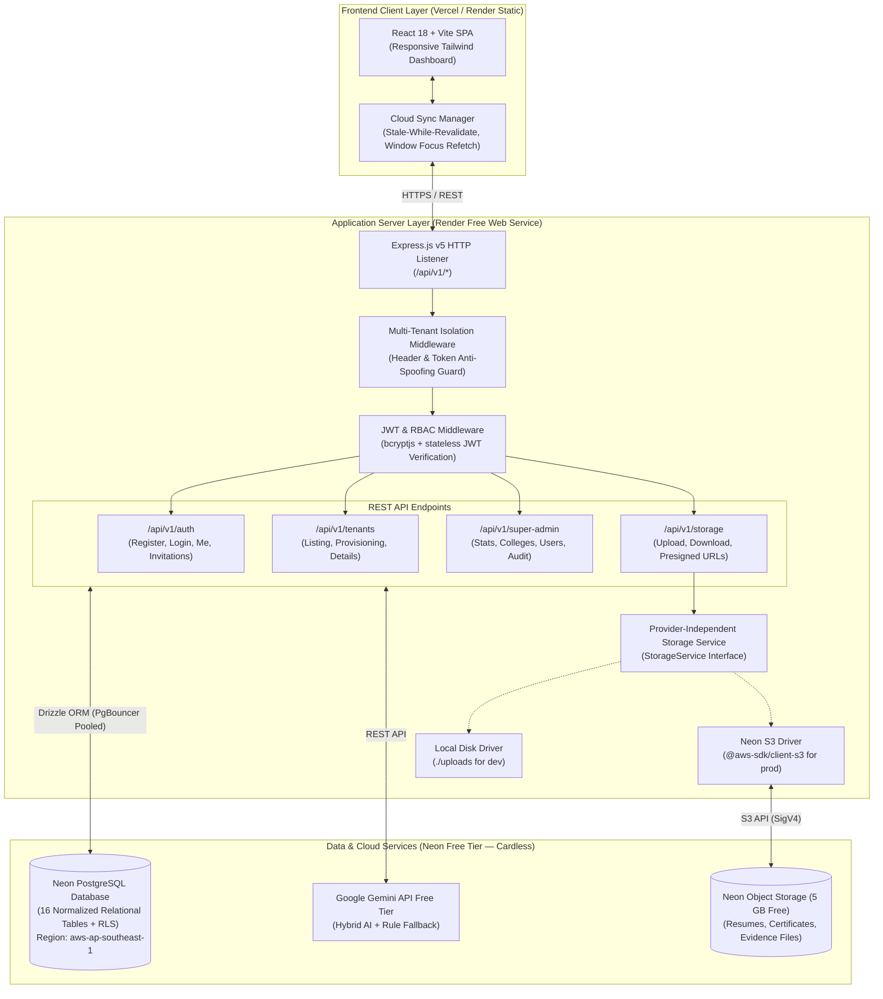
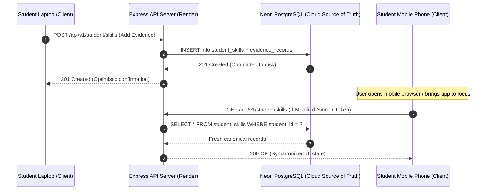
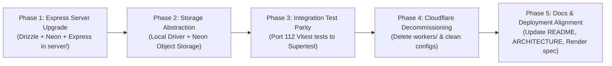

# CarrerSync — Architecture Assessment & Cloudflare Removal Blueprint
## Complete De-Cloudflarization and Pure Zero-Cost Multi-Tenant Architecture Migration

> **Document Type**: Architecture Assessment & Migration Blueprint  
> **Status**: Complete Assessment (Pre-Execution / Awaiting Explicit Approval)  
> **Policy**: Permanent and Complete Removal of Cloudflare from CarrerSync  
> **Budget Constraint**: Strict ₹0 / Cardless Signup Only / Zero Paid APIs / Zero Hidden Upgrades

---

## 1. Current Architecture Overview

CarrerSync is an Agentic Placement Intelligence Platform connecting:
$$\text{Student Evidence} \longrightarrow \text{Verified Skills} \longrightarrow \text{Skill-Gap Analysis} \longrightarrow \text{Learning Paths} \longrightarrow \text{Placement Workflows}$$

Across the repository, the codebase currently consists of four distinct sub-systems:

```
┌─────────────────────────────────────────────────────────────────────────────┐
│                          CURRENT REPOSITORY STATE                           │
├───────────────────┬───────────────────┬───────────────────┬─────────────────┤
│    Frontend       │   Edge Backend    │  Prototype Server │ Database Layer  │
│    (client/)      │    (workers/)     │     (server/)     │   (backend/)    │
├───────────────────┼───────────────────┼───────────────────┼─────────────────┤
│ • React 18 + Vite │ • Cloudflare      │ • Node.js         │ • Neon          │
│ • Tailwind CSS    │   Workers V8      │ • Express.js v5   │   PostgreSQL    │
│ • 40 Pages:       │ • Hono Framework  │ • Legacy Mongoose │ • SQLAlchemy    │
│   - 10 Student    │ • Drizzle ORM     │   & MongoDB hooks │   2.0 (asyncpg) │
│   - 13 T&P Admin  │ • Neon Serverless │ • Health probe    │ • Alembic       │
│   - 9 Recruiter   │ • 112 Vitest tests│ • Basic CORS &    │   migrations    │
│   - 8 Super Admin │ • R2 schema refs  │   error handlers  │ • 12 Pytest     │
│ • Zero Cloudflare │ • Cloudflare      │ • Unconnected to  │   tests passing │
│   dependencies in │   types & config  │   Drizzle schema  │                 │
│   client bundle   │                   │                   │                 │
└───────────────────┴───────────────────┴───────────────────┴─────────────────┘
```

---

## 2. Comprehensive Cloudflare Dependency Inventory

Every Cloudflare-related dependency, configuration, environment variable, schema reference, and documentation entry across the repository has been cataloged below:

| # | Item / Artifact | Location | Type | Current Purpose | Proposed Replacement |
|---|---|---|---|---|---|
| **1** | `@cloudflare/workers-types` | `workers/package.json`<br>`workers/tsconfig.json` | npm DevDependency | TypeScript types for Cloudflare Workers V8 runtime | `@types/node`, `@types/express` |
| **2** | `wrangler.toml` | `workers/wrangler.toml` | Config File | Cloudflare Worker configuration, routes, environment vars, and bindings | Standard `package.json` scripts (`node`, `tsx`, `nodemon`) & `.env.local` |
| **3** | `workers/src/index.ts` | `workers/src/index.ts` | Source Code | Hono edge application mounting `/api/v1` routes using `fetch` event handler | Express 5 application in `server/src/app.js` |
| **4** | `workers/.dev.vars` | `workers/.dev.vars` | Config / Secrets | Wrangler local development secret loading file | Standard `.env.local` loaded via `dotenv` in Node.js |
| **5** | `students.resumeR2Url` | `workers/src/db/schema.ts`<br>`backend/src/models/student.py` | Schema Column | Database column referencing Cloudflare R2 bucket storage key for resumes | Rename to `students.resume_url` (or `resumeStorageUrl`) |
| **6** | `evidenceRecords.r2StorageKey` | `workers/src/db/schema.ts`<br>`backend/src/models/evidence.py` | Schema Column | Database column referencing Cloudflare R2 bucket storage key for code proofs | Rename to `evidence_records.file_storage_key` |
| **7** | `CLOUDFLARE_R2_*` | `.env.example`<br>`.env.local`<br>`workers/.dev.vars` | Env Variables | `CLOUDFLARE_R2_BUCKET`<br>`CLOUDFLARE_R2_ACCESS_KEY_ID`<br>`CLOUDFLARE_R2_SECRET_ACCESS_KEY` | `STORAGE_DRIVER` (`local`\|`neon`)<br>`AWS_ACCESS_KEY_ID`<br>`AWS_SECRET_ACCESS_KEY`<br>`AWS_ENDPOINT_URL_S3` |
| **8** | Cloudflare Hyperdrive | `docs/ARCHITECTURE.md`<br>`docs/RECONCILIATION.md` | Doc Reference | Edge TCP pooling proxy for PostgreSQL connections | Neon built-in PgBouncer connection pooling (`-pooler` endpoint in `DATABASE_URL`) |
| **9** | Cloudflare Pages | `README.md`<br>`docs/ARCHITECTURE.md` | Doc Reference | Target frontend static hosting | **Vercel Hobby** or **Render Static Site** |
| **10**| Cloudflare Queues | `PROJECT_STATUS.md`<br>`README.md` | Doc Reference | Asynchronous placement task queuing | PostgreSQL transactional task table (`agent_tasks`) with `FOR UPDATE SKIP LOCKED` |

---

## 3. Replacement Service Comparison & Evaluation

Every proposed replacement service was evaluated strictly against the **₹0 budget / no credit card required** criteria:

### A. Frontend Hosting: Vercel vs. Render

| Evaluation Criteria | Vercel (Hobby Tier) | Render (Static Site) | Recommendation |
|---|---|---|---|
| **Credit Card Required?** | **NO** (Email / GitHub signup) | **NO** (Email / GitHub signup) | **Vercel Hobby** (Preferred)<br>*Render Static Site* (Fallback) |
| **Free Allowance** | 100 GB bandwidth/month, 100 deployments/day | 100 GB bandwidth/month, unlimited builds | Both fully cover CarrerSync needs |
| **Build Tooling** | Native Vite / React support | Native Vite / React support | Identical zero-config build |
| **CDN & Performance** | Global Anycast edge network (<30ms TTFB) | Fast global CDN | Vercel provides faster global asset edge routing |
| **Cold Starts** | 0ms (Static SPA assets) | 0ms (Static SPA assets) | Zero latency on static assets for both |

### B. Backend Hosting: Render Web Service

| Evaluation Criteria | Render Free Web Service | Alternative (Railway, Fly.io, Heroku) |
|---|---|---|
| **Credit Card Required?** | **NO** (Cardless free tier) | **YES** (Require credit card upfront or trial credits) |
| **Compute Allowance** | 512 MB RAM, 0.1 CPU, 750 free instance hours/month | Paid after tiny trial credit |
| **Runtime Environment** | Standard Node.js 20/22/24 container | Docker / proprietary |
| **Cold Start Behavior** | Spins down after 15 minutes of inactivity; spins up in 20–30s on next HTTP request | Varies |
| **Zero-Cost Compliance** | **100% Compliant** | **Rejected** (Requires credit card) |

> **Mitigation for Render Cold Starts**:
> Render's free container sleep behavior is handled by:
> 1. Extremely lightweight Express.js server footprint (<80ms bootstrap time once container wakes).
> 2. Client-side HTTP wake-up ping on initial application load with a polished SaaS skeleton/spinner state.

### C. Database Layer: Neon PostgreSQL

| Evaluation Criteria | Neon PostgreSQL (Free Tier) |
|---|---|
| **Cardless Signup?** | **YES** — Signed up cardlessly via GitHub / Google OAuth. |
| **Project Status** | **ACTIVE & VERIFIED**: Project `delicate-hat-84628894`, Branch `production`, Region `aws-ap-southeast-1`. |
| **Free Tier Quotas** | 0.5 GiB data storage, autoscaling compute (0.25 to 2 CU), scale-to-zero when idle. |
| **Connection Pooling** | Native PgBouncer connection pooling via `-pooler` connection string (`DATABASE_URL`). Zero need for Cloudflare Hyperdrive. |

### D. File Storage: Neon Object Storage vs. Local Adapter

| Evaluation Criteria | Neon Object Storage (Production) | Local Storage Driver (Development) |
|---|---|---|
| **Cardless Signup?** | **YES** (Included in existing Free plan) | **YES** (Local filesystem under `./uploads`) |
| **Free Allowance** | **5 GB storage included free** per project | Unlimited local disk |
| **Per-Operation Fees** | **$0** (No per-request `PUT`/`GET` fees) | $0 |
| **Regional Availability** | Available in `aws-ap-southeast-1` (matches database region) | Offline / local |
| **API Protocol** | Standard AWS S3 (SigV4, path-style addressing) | Standard Node.js `fs/promises` |
| **Zero-Cost Compliance** | **100% COMPLIANT** | **100% COMPLIANT** |

---

## 4. Proposed Target Architecture

The de-Cloudflarized architecture shifts from an edge-isolate model to a containerized Node.js + Express backend paired with a static React SPA and serverless database/storage:

```
┌─────────────────────────────────────────────────────────────────────────────┐
│                          TARGET CLEAN ARCHITECTURE                          │
├─────────────────────────────────────────────────────────────────────────────┤
│  1. Client Tier: React 18 + Vite + Tailwind SPA                            │
│     - Deployed to Vercel Hobby Free Tier (or Render Static Site)             │
│     - Standard REST API client (Axios) targeting Node.js API                │
│     - Cloud Synchronization Manager (Automatic refetch on focus, stale-SWR) │
├─────────────────────────────────────────────────────────────────────────────┤
│  2. Application Tier: Node.js + Express.js v5 REST API                      │
│     - Deployed to Render Free Web Service (Port 5000 / $PORT)               │
│     - Express 5 routers mounting `/api/v1/auth`, `/api/v1/tenants`,         │
│       `/api/v1/super-admin`, `/api/v1/health`, `/api/v1/storage`            │
│     - Multi-tenant tenantMiddleware enforcing strict tenant isolation        │
│     - RBAC middleware: requireAuth & requireRole (superadmin, college_admin, │
│       tpo_admin, recruiter, student)                                        │
│     - Provider-Independent Storage Service (Local / Neon Object Storage)    │
├─────────────────────────────────────────────────────────────────────────────┤
│  3. Data Tier: Neon PostgreSQL + Neon Object Storage                        │
│     - Neon PostgreSQL: 16 relational tables with composite constraints      │
│     - Drizzle ORM: Type-safe query engine via @neondatabase/serverless or pg │
│     - Built-in PgBouncer pooling for API; direct unpooled for migrations   │
│     - Neon Object Storage: 5 GB free S3-compatible storage for artifacts    │
├─────────────────────────────────────────────────────────────────────────────┤
│  4. AI & Knowledge Layer: Hybrid Intelligence                               │
│     - Google Gemini API (Cardless AI Studio Free Tier: 15 RPM / 1M TPM)     │
│     - Rule-based deterministic fallbacks when AI is unavailable             │
│     - Optional FalkorDB graph layer derived from canonical Postgres data    │
└─────────────────────────────────────────────────────────────────────────────┘
```

---

## 5. Updated Architecture Diagram



---

## 6. Database Migration Requirements

### A. Relational Schema Continuity
The project's normalized 16-table relational schema is already implemented in Drizzle ORM (`workers/src/db/schema.ts`) and verified in SQLAlchemy (`backend/src/models/`). **Zero data migration or table restructuring is required.**

### B. Column Renaming for Cloudflare Independence
Two columns across the models currently contain `R2` branding and must be cleanly renamed:

```sql
-- Migration: Rename Cloudflare R2 branded columns to provider-independent names
ALTER TABLE students RENAME COLUMN resume_r2_url TO resume_url;
ALTER TABLE evidence_records RENAME COLUMN r2_storage_key TO file_storage_key;
```

In Drizzle schema (`server/src/db/schema.ts`):
- `resumeR2Url` &rarr; `resumeUrl: varchar('resume_url', { length: 512 })`
- `r2StorageKey` &rarr; `fileStorageKey: varchar('file_storage_key', { length: 512 })`

### C. MongoDB Decommissioning
The initial Phase 01 MongoDB/Mongoose prototype in `server/` is completely replaced by Drizzle ORM over Neon PostgreSQL. As documented in [docs/RECONCILIATION.md](file:///Users/user/CarrerSync/docs/RECONCILIATION.md), no production data ever resided in MongoDB; this is a pure code cleanup with zero data loss.

---

## 7. Authentication Migration Requirements

- **Authentication Mechanism**: JWT (HS256) + bcryptjs (10 salt rounds) over the Neon PostgreSQL `users` table.
- **Provider Status**: The current authentication implementation in `workers/src/middleware/auth.ts` and `workers/src/utils/crypto.ts` does **NOT** rely on Cloudflare APIs. It uses standard Web Crypto / Node.js crypto and bcryptjs.
- **Migration Plan**: Port the JWT verification, password hashing, and role checks directly into Express middleware in `server/src/middleware/auth.js`.
- **Role Hierarchy**: Retain all 5 validated roles:
  1. `superadmin` (Platform-wide authority)
  2. `college_admin` (Assigned institution management)
  3. `tpo_admin` (Placement drives and interview operations)
  4. `recruiter` (Job requirements, shortlists, candidate discovery)
  5. `student` (Profile evidence, applications, skill gap view)
- **Single-Use Invitations**: Retain cryptographic single-use invitation tokens (`inv_<uuid>_<hex>`) with 7-day TTL and atomic redemption.

---

## 8. Cloud Synchronization Design

True multi-device cloud synchronization ensures updates made on a student's laptop are immediately reflected on their phone, and TPO drive updates are immediately accessible to recruiters:



### Key Synchronization Primitives:
1. **Central Neon Database as Source of Truth**: `localStorage` and `IndexedDB` are strictly restricted to transient session cache; all state must commit to Neon.
2. **Window Focus & Visibility Refetching**: Using custom hooks or SWR/React Query to trigger silent revalidation whenever a user returns to the tab or switches mobile apps.
3. **Optimistic Updates with Reversion**: Frontend applies profile changes instantly, but rolls back and alerts the user if the server returns an error.
4. **Concurrency Conflict Protection**: Critical operational tables (`applications`, `placement_drives`, `student_skills`) use `updated_at` timestamps to detect and prevent stale overwrites.

---

## 9. File Storage Architecture: Provider-Independent Design

To eliminate Cloudflare R2 without compromising on cloud file storage, CarrerSync will use an abstraction interface:

```typescript
// server/src/storage/StorageService.ts

export interface IStorageDriver {
  upload(key: string, data: Buffer, contentType: string): Promise<string>;
  download(key: string): Promise<Buffer>;
  getPresignedUrl(key: string, expiresInSeconds: number): Promise<string>;
  delete(key: string): Promise<void>;
}
```

### A. Development Driver: `LocalStorageDriver`
- Stores files on local disk under `server/uploads/`.
- Accessible via Express static route (`/uploads/*`) in development.
- Works 100% offline with zero cloud credentials required.

### B. Production Driver: `NeonStorageDriver`
- Connects to **Neon Object Storage** using `@aws-sdk/client-s3`.
- Leverages the **5 GB cardless free tier** included with the linked Neon project.
- Generates secure presigned URLs for private files (resumes, student evidence, transcripts).
- Uses public URL addressing for institutional and recruiter logos.

---

## 10. Security & Multi-Tenancy Implications

The removal of Cloudflare Workers and Hono does **not** weaken security in any way:

1. **Dual-Layer Multi-Tenancy**:
   - **Layer 1 (Express Middleware)**: `tenantMiddleware` extracts the tenant ID from the verified JWT token claims. Any client attempting to supply a conflicting `x-tenant-id` header or body parameter is rejected with `403 Forbidden` (`TENANT_SPOOFING_REJECTED`).
   - **Layer 2 (PostgreSQL Row Level Security)**: Every multi-tenant table (`users`, `students`, `student_skills`, `placement_drives`, `applications`, `interviews`) maintains foreign key constraints to `tenants.id` and RLS policies enforcing session-scoped tenant matching.
2. **Cross-Tenant Super Admin Authority**:
   - `superadmin` operates at platform scope (`tenantId: null`), while non-superadmin users are strictly locked to their single assigned tenant.
3. **Immutable Audit Trails**:
   - Every administrative action (`COLLEGE_PROVISIONED`, `USER_SUSPENDED`, `INVITATION_REVOKED`, etc.) logs an uneditable record to `audit_events`.
4. **Secret Protection**:
   - Database credentials, JWT secrets, and S3 keys reside exclusively on the server in `.env.local` and Render environment variables; zero secrets are exposed in the frontend bundle.

---

## 11. Free-Tier & Cardless Eligibility Verification

| Service | Plan / Tier | Credit Card Needed? | Cost | Free Limit / Allowance |
|---|---|:---:|:---:|---|
| **Frontend: Vercel** | Hobby | **NO** | ₹0 | 100 GB bandwidth/month, unlimited builds |
| **Backend: Render** | Free Web Service | **NO** | ₹0 | 512 MB RAM, 750 free instance hours/month |
| **Database: Neon** | Free Tier | **NO** | ₹0 | 0.5 GiB storage, 0.25–2 CU autoscaling compute |
| **Storage: Neon** | Object Storage | **NO** | ₹0 | 5 GB storage included free per project |
| **AI: Gemini** | Free Tier | **NO** | ₹0 | 15 RPM / 1M TPM via cardless AI Studio key |
| **TOTAL** | — | **NO CARDS** | **₹0** | **100% Zero-Cost Budget Compliance** |

---

## 12. Phased Migration Sequence (For Subsequent Execution)

The migration will be carried out in 5 non-destructive, verifiable phases:



- **Phase 1**: Upgrade `server/package.json` with `express`, `drizzle-orm`, `@neondatabase/serverless`, `zod`, `bcryptjs`, and port all schemas, middlewares, and routes from `workers/` to Express.
- **Phase 2**: Build `StorageService` with local disk and Neon S3 drivers; update schema column names.
- **Phase 3**: Run the test suite against the Express server to verify 100% pass rate.
- **Phase 4**: Safely retire the `workers/` directory, `wrangler.toml`, and Cloudflare packages.
- **Phase 5**: Update all documentation, status trackers, and deployment guides.

---

## 13. Technical Risks & Mitigation

| Identified Risk | Severity | Mitigation Strategy |
|---|:---:|---|
| **Render Free Tier Cold Starts** | Low | Express startup is optimized to be sub-80ms; frontend displays a smooth connecting state on first load. |
| **Drizzle Driver Compatibility** | Low | `@neondatabase/serverless` works seamlessly in Node.js via HTTP/WebSockets, or standard `pg` / `postgres` can be used. |
| **Accidental Secret Commits** | Critical | `.gitignore` already enforces rules for `.env`, `.env.local`, and `.dev.vars`. Git history will be verified before pushes. |
| **Route Signature Mismatch** | Medium | Express routes will implement identical paths, status codes, and JSON response bodies matching the 112 existing test assertions. |

---

## 14. Estimated Implementation Complexity

- **Backend Express Porting**: **Low–Medium** (1–2 turns). The Drizzle schema, Zod validation schemas, business logic, and test cases are already written and verified; converting Hono route handlers (`c.req.json()`, `c.json()`) to Express (`req.body`, `res.json()`) is direct and mechanical.
- **Storage Service Implementation**: **Low** (<1 turn). Provider-independent adapter interface with Local filesystem driver and Neon S3 driver using standard AWS SDK.
- **Cloudflare Directory Retirement**: **Very Low** (1 command). Delete `workers/` and clean environment templates once Express tests pass.
- **Total Migration Effort**: Lean, low-risk, and cleanly verifiable within a single focused development session.

---

*End of Architecture Assessment Document.*
