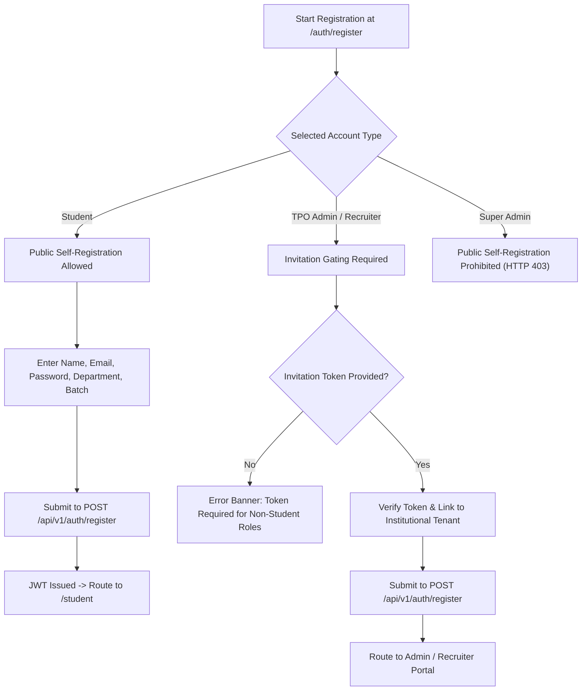

# CareerSync — Demo Login & Role Navigation Guide

**Document Version:** 1.0.0 (Phase 19 Pilot / Phase 20 Production Readiness)  
**Target Audience:** Evaluators, Institution Administrators, TPOs, Recruiters, Students, and Engineers  
**System Theme:** CareerSync M3 Mint Design System (Surface: `#E2FFFE`, Primary: `#02E8A7`, Text: `#002020`)  
**Security Standard:** HS256 JWT + Multi-Tenant Scoped RBAC + Bcrypt / Argon2id Password Hashing  

---

## 1. Overview

CareerSync is an institutional placement intelligence and multi-tenant accreditation platform. The frontend web client features an automated **6-Role Demo Login System** that connects directly to the backend authentication API (`/api/v1/auth/login`) with real JWT token issuance, authenticated session storage, and deterministic role-based dashboard routing.

### Key Capabilities
- **Real Backend Authentication:** All logins hit `/api/v1/auth/login` to verify credentials against PostgreSQL and return signed JWTs.
- **6 Supported Roles:** Student, TPO Admin, College Admin, Recruiter, Super Admin, and Alumni.
- **1-Click Fast Login:** Instant one-click login cards on the login page allow evaluators to immediately access any portal without typing credentials.
- **Role Autofill Selector:** 6-role selector tabs autofill credentials and tenant parameters for inspection.
- **Secure Registration Gating:** Open self-registration for students; mandatory invitation token gating for institutional admins and recruiters; super admin registration prohibited.
- **Strict M3 Mint Compliance:** Clean mint/aqua/cyan UI theme adhering strictly to `#E2FFFE` surfaces and `#002020` typography with zero prohibited blue/purple hues.

---

## 2. Supported Roles & Demo Credentials Matrix

The table below outlines all 6 canonical demo personas configured across the backend database seeds and frontend authentication service:

| # | Role | Display Label | Email | Password | Tenant Slug | Target Dashboard Route | Persona & Primary Responsibility |
|---|------|---------------|-------|----------|-------------|------------------------|----------------------------------|
| **1** | `student` | **Student** | `aditya.sharma@apex.edu` | `DemoPassword@123` | `apex-tech` | [`/student`](file:///Users/user/CarrerSync/client/src/routes/AppRoutes.jsx#L134) | **Aditya Sharma** (B.Tech CSE, Batch 2025). Builds verified skill evidence, practices mock drives, and applies for jobs. |
| **2** | `tpo_admin` | **TPO Admin** | `tpo@apex.edu` | `DemoPassword@123` | `apex-tech` | [`/admin`](file:///Users/user/CarrerSync/client/src/routes/AppRoutes.jsx#L162) | **Prof. Rajiv Menon** (Training & Placement Officer). Verifies student evidence, orchestrates campus drives, and reviews cohort KPIs. |
| **3** | `college_admin` | **College Admin** | `admin@apex.edu` | `DemoPassword@123` | `apex-tech` | [`/college-admin`](file:///Users/user/CarrerSync/client/src/routes/AppRoutes.jsx#L207) | **Dr. Rajesh Sharma** (Principal / Dean). Accesses institutional intelligence, NIRF/NAAC accreditation metrics, and governance. |
| **4** | `recruiter` | **Recruiter** | `recruiter@cloudscale.example.com` | `DemoPassword@123` | `apex-tech` | [`/recruiter`](file:///Users/user/CarrerSync/client/src/routes/AppRoutes.jsx#L221) | **Vikram Mehta** (Lead Recruiter, CloudScale Systems). Posts jobs, discovers verified candidates with consent, conducts interviews, and releases offers. |
| **5** | `superadmin` | **Super Admin** | `admin@carrersync.internal` | `DemoPassword@123` | *N/A (Platform)* | [`/super-admin`](file:///Users/user/CarrerSync/client/src/routes/AppRoutes.jsx#L238) | **Platform Super Admin**. Manages college tenants, platform-wide user provisioning, observability metrics, and security audit logs. |
| **6** | `alumni` | **Alumni** | `alumni@apex.edu` | `DemoPassword@123` | `apex-tech` | [`/alumni`](file:///Users/user/CarrerSync/client/src/routes/AppRoutes.jsx#L214) | **Vikram Malhotra** (Alumni Mentor, Class of 2022). Mentors active students, conducts peer mock interviews, and shares industry guidance. |

---

## 3. How to Log In (Fast Testing Methods)

The CareerSync login page is located at:
```
http://localhost:5173/auth/login
```

Evaluators have two methods for signing into any role:

### Method A: 1-Click Fast Demo Login (Recommended for Evaluators)
1. Navigate to `/auth/login`.
2. Scroll to the **"1-Click Fast Demo Login"** section at the bottom of the login card.
3. Click any of the 6 role buttons (**Student**, **TPO Admin**, **College Admin**, **Recruiter**, **Super Admin**, or **Alumni**).
4. The client will immediately:
   - Authenticate with the backend `/api/v1/auth/login` endpoint.
   - Securely store the JWT and user profile in `localStorage`.
   - Update `AuthContext` across the application.
   - Display a success toast notification.
   - Redirect directly to that role's respective portal.

### Method B: Role Autofill Selector + Custom Credentials
1. Navigate to `/auth/login`.
2. Under **"Select Demo Role"**, click any of the 6 role buttons in the top tab grid.
3. The email, password, and institutional slug fields will immediately autofill with valid demo credentials.
4. You may inspect or modify the credentials if testing a custom account.
5. Click **"Enter [Role] Portal"**.
6. On success, the client routes to the proper dashboard. On invalid credentials, a clear alert banner and toast will display the exact error returned by the server.

---

## 4. Account Registration & Institutional Gating

The registration portal is located at `/auth/register`. CareerSync implements institutional RBAC protection at registration:



### Registration Policies
1. **Student Registration:** Open to any student belonging to an authorized institution tenant (`apex-tech`). Auto-provisions student academic profile records.
2. **Administrative & Recruiter Roles:** Gated by single-use `invitationToken`. Public registration without an invite token is blocked on both client and server to prevent privilege escalation.
3. **Super Admin Role:** Completely disabled on public registration endpoints. Super Admins can only be provisioned through secure out-of-band CLI seed scripts or existing Super Admin platform invitations.

---

## 5. End-to-End Demo Testing Scenarios

### Scenario 1: Student Verified Evidence & Practice
1. **Log in as Student** via 1-click button (`aditya.sharma@apex.edu`).
2. Land on `/student`.
3. Navigate to **"Skills & Evidence"** (`/student/skills`):
   - Review 5-stage verified skills (Claimed, Observed, Evidence-linked, Verified, Expired).
   - Inspect GitHub repository and project evidence links.
4. Navigate to **"Mock Drives"** (`/student/mock-drives`):
   - Access simulated aptitude assessments, coding sandboxes, and AI interview practice.
5. Navigate to **"Applications & Offers"** (`/student/applications`):
   - View live application statuses for CloudScale Systems.

### Scenario 2: TPO Placement Orchestration & Verification Queue
1. **Log in as TPO Admin** via 1-click button (`tpo@apex.edu`).
2. Land on `/admin`.
3. Open **"Verification Portal"** (`/admin/verification`):
   - Review pending student skill claims and submitted evidence records.
   - Approve or reject claims with auditable feedback.
4. Open **"Placement Drives"** (`/admin/drives`):
   - Inspect active drives, eligibility rules, and shortlisted candidate pools.
5. Open **"Accreditation Reports"** (`/admin/accreditation`):
   - Generate NAAC Criterion 5 and NIRF placement metric exports.

### Scenario 3: College Admin Institutional Intelligence
1. **Log in as College Admin** via 1-click button (`admin@apex.edu`).
2. Land on `/college-admin`.
3. Inspect **Institutional Intelligence**:
   - Placement percentage trajectories across departments.
   - Median CTC, highest packages, and gender parity metrics.
   - NAAC / NIRF accreditation data compliance readiness.

### Scenario 4: Recruiter Candidate Discovery & Offer Management
1. **Log in as Recruiter** via 1-click button (`recruiter@cloudscale.example.com`).
2. Land on `/recruiter`.
3. Navigate to **"Candidate Discovery"** (`/recruiter/discovery`):
   - Filter candidates by verified skills and readiness score (respecting privacy consent).
4. Navigate to **"Shortlists & Interviews"** (`/recruiter/interviews`):
   - Coordinate technical and HR interview rounds.
5. Navigate to **"Offers"** (`/recruiter/offers`):
   - Generate and dispatch formal placement offers.

### Scenario 5: Super Admin Tenant & Platform Observability
1. **Log in as Super Admin** via 1-click button (`admin@carrersync.internal`).
2. Land on `/super-admin`.
3. Navigate to **"Colleges & Tenants"** (`/super-admin/colleges`):
   - View provisioned institutions (e.g., Apex Institute of Technology).
   - Provision new multi-tenant institutions.
4. Navigate to **"Security & Audit Logs"** (`/super-admin/audit`):
   - Inspect tamper-evident system logs, login actions, and RBAC modifications.

### Scenario 6: Alumni Mentorship & Peer Collaboration
1. **Log in as Alumni** via 1-click button (`alumni@apex.edu`).
2. Land on `/alumni`.
3. Navigate to **"Alumni Dashboard"** (`/alumni/dashboard`):
   - View mentorship requests from junior students.
   - Schedule peer mock interview rooms.
4. Navigate to **"Alumni Profile"** (`/alumni/profile`):
   - Update current company, designation, and mentorship availability.

---

## 6. Architecture & Client Authentication Plumbing

```
┌────────────────────────────────────────────────────────┐
│                   React 19 Frontend                    │
│                                                        │
│   Login.jsx / Register.jsx                             │
│       │                                                │
│       ▼                                                │
│   AuthContext.jsx (React Context + Hooks)              │
│       │                                                │
│       ▼                                                │
│   authService.js                                       │
│       │                                                │
│       ▼                                                │
│   apiClient (Axios Interceptor)                        │
│     - Attaches Authorization: Bearer <sanitized_token> │
│     - Attaches X-Tenant-ID: <tenant_id>                │
└───────────────────────┬────────────────────────────────┘
                        │ HTTP POST /api/v1/auth/login
                        ▼
┌────────────────────────────────────────────────────────┐
│                   Express 5 Backend                    │
│                                                        │
│   auth.routes.ts                                       │
│     - Zod Validation (LoginSchema / RegisterSchema)    │
│     - Password verification (bcrypt.compare)           │
│     - Generates HS256 JWT                              │
│         Claims: sub, tenant_id, role, email            │
└───────────────────────┬────────────────────────────────┘
                        │
                        ▼
┌────────────────────────────────────────────────────────┐
│             Neon PostgreSQL (106 Tables)               │
│                                                        │
│   - tenants (apex-tech)                                │
│   - users (aditya.sharma@apex.edu, tpo@apex.edu, ...)  │
│   - students, job_roles, placement_drives, etc.        │
└────────────────────────────────────────────────────────┘
```

### Storage and Security Highlights
- **Sanitized Bearer Tokens:** Strips redundant or duplicate `Bearer` prefixes before sending to backend.
- **Tenant Context Injection:** Automatically extracts `tenant_id` from user claims and transmits in `X-Tenant-ID` header.
- **Auto-Logout on Expiry:** Detects token expiration client-side via JWT `exp` claim and cleans up storage.
- **Cross-Tab Synchronization:** Listens to `storage` events to ensure login/logout syncs across browser tabs in real time.

---

## 7. Troubleshooting & Common Questions

**Q: Login fails with "INVALID_CREDENTIALS"?**  
A: Ensure the database has been seeded by running `npm run db:seed:demo` (or `npx tsx scripts/seed_pilot_demo_data.ts`) in the backend repository. The demo password for all accounts is `DemoPassword@123`.

**Q: How do I switch roles after logging in?**  
A: Use the **Portal Switcher** dropdown in the Topbar (top right), or click the user avatar and choose **Sign out** to return to `/auth/login` and pick a different role.

**Q: Where can I see my current authenticated role?**  
A: Inspect `localStorage.getItem('role')` in browser dev tools, or observe the role badge rendered in the application sidebar and topbar.
