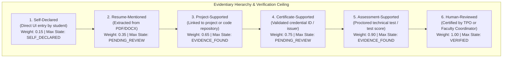
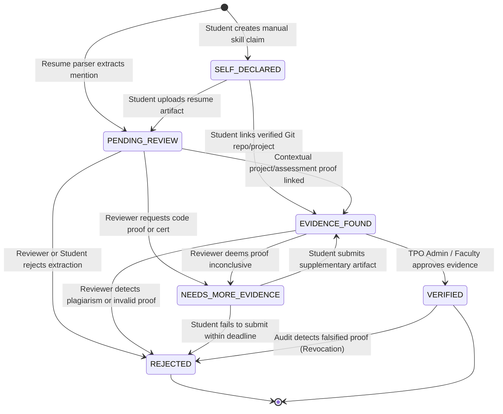

# CarrerSync Evidence & Skill Verification Rules Specification

> **Document Type**: Canonical Verification & Evidence Policy Specification  
> **Status**: APPROVED & CANONICAL  
> **Phase**: Phase 09 — AI Profiling Agent & Evidence Ingestion Engine  
> **Target Release**: Active Node.js + Express Backend & Python Verification Service  
> **Master Policy**: Evidence-Driven Placement | "Resume mention is not verification"  

---

## 1. The Core Principle: "Resume Mention is Not Verification"

In traditional collegiate recruitment, students frequently populate resumes with exhaustive inventories of modern frameworks, programming languages, and cloud tools. Recruiters and placement cells are forced to rely on unverified claims, leading to mismatches, inflated interview dropouts, and lost hiring cycles.

CarrerSync eliminates resume inflation by instituting an uncompromising core axiom:

$$\mathbf{\text{“Resume\ mention\ is\ not\ verification.”}}$$

```
┌────────────────────────────────────────────────────────────────────────────────────────┐
│                        THE FIRST PRINCIPLE OF CARRERSYNC                               │
│                                                                                        │
│  A skill claim on a resume is merely an assertion of familiarity.                     │
│  True verification requires verifiable artifacts: code repositories,                   │
│  proctored assessments, authenticated certificates, or human institutional             │
│  evaluation. The platform enforces this distinction at every layer of the              │
│  data model, AI profiling service, and recruitment workflow.                           │
└────────────────────────────────────────────────────────────────────────────────────────┘
```

---

## 2. Evidence Categories & Evidentiary Weights

To qualify a student's competency claim, CarrerSync classifies evidence into six formal hierarchical categories. Each category carries a distinct evidentiary weight and verification ceiling:



### Category 1: Self-Declared (`SELF_DECLARED`)
- **Origin**: Entered manually by the student candidate via the web portal.
- **Proof Required**: None.
- **Evidentiary Weight**: $0.15$.
- **Verification Ceiling**: Cannot exceed status `SELF_DECLARED` without supplementary artifact submission.
- **Placement Impact**: Filterable by recruiters, but clearly flagged as uncorroborated.

### Category 2: Resume-Mentioned (`RESUME`)
- **Origin**: Discovered and extracted from an uploaded resume document (PDF or DOCX) by the Profiling Agent.
- **Proof Required**: Document upload with matching token boundary in textual body.
- **Evidentiary Weight**: $0.35$.
- **Verification Ceiling**: Cannot exceed status `PENDING_REVIEW`.
- **Placement Impact**: Serves as raw candidate profile context; cannot satisfy hard recruitment drive eligibility criteria.

### Category 3: Project-Supported (`PROJECT`)
- **Origin**: Corroborated by a detailed project description, architectural narrative, or linked Git repository.
- **Proof Required**: Named project entry citing the technology in an active implementation context (e.g., *"Engineered microservices backend utilizing Go and Docker"*), with verifiable project artifacts.
- **Evidentiary Weight**: $0.65$.
- **Verification Ceiling**: Status `EVIDENCE_FOUND`.
- **Placement Impact**: Qualifies candidate for automated skill-gap matching and project-based drive shortlisting.

### Category 4: Certificate-Supported (`CERTIFICATE`)
- **Origin**: Extracted from an academic, cloud, or technical certification document.
- **Proof Required**: Document artifact containing issuing organization, certification title, credential ID, and/or verification URL.
- **Evidentiary Weight**: $0.75$.
- **Verification Ceiling**: Status `PENDING_REVIEW` until human TPO or faculty review confirms credential authenticity.
- **Placement Impact**: Pre-qualifies candidate for specialized recruiter search filters.

### Category 5: Assessment-Supported (`ASSESSMENT`)
- **Origin**: Direct result from an institutional or standardized coding benchmark, proctored mock drive, or technical challenge.
- **Proof Required**: System-verified test record with timestamp, score, percentile, and anti-cheating audit trail.
- **Evidentiary Weight**: $0.90$.
- **Verification Ceiling**: Status `EVIDENCE_FOUND`.
- **Placement Impact**: High-confidence ranking in recruiter candidate discovery feeds.

### Category 6: Human-Reviewed (`HUMAN_REVIEWED`)
- **Origin**: Formal verification decision enacted by an authorized Training & Placement Officer (TPO Admin) or Faculty Coordinator.
- **Proof Required**: Institutional sign-off, interview evaluation, or physical credential inspection.
- **Evidentiary Weight**: $1.00$.
- **Verification Ceiling**: Full `VERIFIED` status.
- **Placement Impact**: Unconditionally unlocks participation in verified campus placement drives.

---

## 3. Verification Status State Machine

Skill evidence transitions through a strict, deterministic state machine governed by the `verificationStatusEnum` in PostgreSQL:



### Detailed State Transition Table

| Source State | Destination State | Trigger Event | Authorized Roles | Mandatory Requirements & Audit Log |
| :--- | :--- | :--- | :--- | :--- |
| `[*]` | `SELF_DECLARED` | Student adds skill claim | `student` | Creates `profileSkillEvidence` with `evidenceType: 'SELF_DECLARED'`. |
| `[*]` | `PENDING_REVIEW` | Profiling Agent analyzes document | `system` (AI) | Generated via extraction staging; requires student approval. |
| `SELF_DECLARED` | `EVIDENCE_FOUND` | Project / Git repository attached | `student`, `system` | Corroborating project text or Git commit history attached. |
| `PENDING_REVIEW` | `EVIDENCE_FOUND` | Student approves extraction with project backing | `student`, `tpo_admin` | Transition logged in `profileReviewEvents` with student user ID. |
| `PENDING_REVIEW` | `REJECTED` | Student or TPO dismisses extracted skill | `student`, `tpo_admin` | Skill omitted from evidence records; reason logged. |
| `PENDING_REVIEW` | `NEEDS_MORE_EVIDENCE`| Evaluator finds resume mention insufficient | `tpo_admin`, `faculty_coordinator` | Review notes logged; notification dispatched to student. |
| `EVIDENCE_FOUND` | `VERIFIED` | Institutional evaluation approved | `tpo_admin`, `college_admin`, `faculty_coordinator` | **Strict Human Gate**: AI is forbidden from triggering this transition. |
| `EVIDENCE_FOUND` | `NEEDS_MORE_EVIDENCE`| Artifact inconclusive or incomplete | `tpo_admin`, `faculty_coordinator` | Reviewer notes specifying missing requirements. |
| `EVIDENCE_FOUND` | `REJECTED` | Verification fails (plagiarized code, invalid cert)| `tpo_admin`, `college_admin` | Immediate disqualification flag; review event audited. |
| `VERIFIED` | `REJECTED` | Post-audit revocation | `tpo_admin`, `college_admin`, `superadmin` | Revocation audit event; snapshot preserved in `profileVersions`. |

---

## 4. AI Recommendation vs. Human/TPO Verification Boundaries

CarrerSync maintains an absolute, architectural division of responsibilities between automated AI agents and authorized human administrators.

```
┌───────────────────────────────────────┬───────────────────────────────────────┐
│        AI PROFILING AGENT             │     HUMAN TPO / FACULTY EVALUATOR     │
│       (Recommendation Tier)           │         (Authority Tier)              │
├───────────────────────────────────────┼───────────────────────────────────────┤
│ ✓ Extract text from documents         │ ✓ Certify skills to VERIFIED status   │
│ ✓ Detect technical keywords & tools   │ ✓ Conduct physical/live interviews    │
│ ✓ Identify project contextual usage   │ ✓ Inspect credential issuer registries│
│ ✓ Flag scanned documents for review   │ ✓ Authorize campus placement drives   │
│ ✓ Redact student PII locally          │ ✓ Review plagiarism & integrity flags │
│ ✓ Compute evidence confidence (0-1)   │ ✓ Override or reject AI proposals     │
│ ✗ CANNOT grant VERIFIED status        │ ✗ Cannot bypass tenant isolation      │
│ ✗ CANNOT mutate live profile without  │ ✗ Cannot alter immutable audit logs   │
│   student and institutional review    │                                       │
└───────────────────────────────────────┴───────────────────────────────────────┘
```

### 4.1 What the AI Agent CAN Do
1. **Syntactic & Contextual Extraction**: Parse resumes and portfolios to identify technical entities across 8 standardized categories.
2. **Contextual Association**: Map extracted skills to project paragraphs, academic courses, and certification credentials.
3. **Objective Confidence Calculation**: Compute bounded scores $[0.10, 0.99]$ reflecting evidentiary density and source multiplicity.
4. **Transparent Explainability**: Produce human-readable rationale strings detailing exactly why a skill was proposed and which section contained the source proof.
5. **Quality & Anomaly Flagging**: Detect high buzzword density, conflicting dates, or missing project corroboration.

### 4.2 What the AI Agent CANNOT Do
1. **Autonomous Verification**: Under no circumstances may an AI model transition an evidence record to `VERIFIED`.
2. **Silent Mutation**: The AI cannot silently add, edit, or delete items from a student's public recruitment profile without human-in-the-loop sign-off.
3. **Subjective Judgment**: The AI cannot make definitive hiring or disqualification decisions for placement drives.
4. **Credential Authentication**: The AI cannot sign or issue cryptographically verified certificates.

---

## 5. Five-Role Access Control & Governance Matrix

| Role | Propose Skills | Approve AI Staging | Certify to `VERIFIED` | Reject / Revoke | View Evidence |
| :--- | :---: | :---: | :---: | :---: | :---: |
| `STUDENT` | Yes (Own profile) | Yes (Own profile) | **NO** | Yes (Own claims) | Yes (Own records) |
| `FACULTY_COORDINATOR`| No | Yes (Cohort) | Yes (Assigned cohort)| Yes (Assigned cohort)| Yes (College tenant) |
| `TPO_ADMIN` | No | Yes (College) | Yes (All students) | Yes (All students) | Yes (College tenant) |
| `COLLEGE_ADMIN` | No | Yes (College) | Yes (College-wide) | Yes (College-wide) | Yes (College tenant) |
| `RECRUITER` | **NO** | **NO** | **NO** | **NO** | Yes (Drive applicants)|
| `SUPER_ADMIN` | **NO** | **NO** | **NO** | Yes (Platform audit)| Yes (Audit stream) |

---

## 6. Auditability & Immutable Proof Preservation

1. **Every Decision is Audited**: Every state transition—whether initiated by a student, an automated parser staging event, or a TPO verification—writes an immutable record to `profileReviewEvents`:
   - `tenantId`: Institution boundary.
   - `userId`: Student candidate ID.
   - `reviewerId`: ID of the actor executing the action.
   - `reviewerRole`: Role of the actor (`student`, `tpo_admin`, `faculty_coordinator`).
   - `previousState` & `newState`: Complete state diff.
   - `comment`: Mandatory rationale when rejecting or requesting more evidence.
2. **Tamper-Evident Version Ledger**: Whenever an extraction is approved and converted to active evidence, a point-in-time JSON snapshot is appended to `profileVersions`. Previous snapshots are strictly read-only and cannot be updated or purged.
