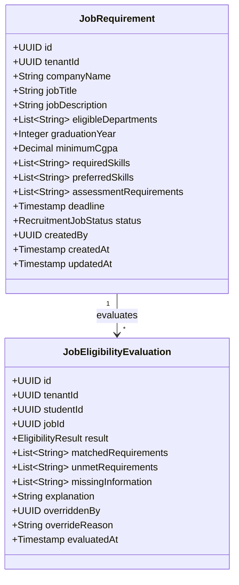
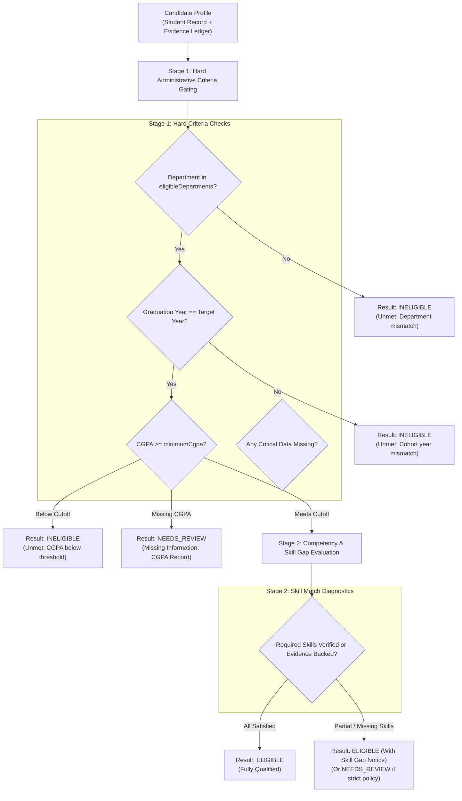

# CarrerSync Declarative Job Requirements & Eligibility Engine Specification

> **Document Type**: Canonical Architecture & Evaluation Engine Specification  
> **Status**: APPROVED & CANONICAL  
> **Phase**: Phase 10 — TPO Verification Portal, Placement Readiness & Job Eligibility Subsystem  
> **Target Release**: Active Node.js + Express Backend (`server/src/eligibility/`) & React Client (`client/src/pages/tpo/`)  
> **Master Policy**: Declarative Objective Gating | Missing Data Is Not Ineligibility | Mandatory Override Audit  

---

## 1. Executive Summary & Philosophy

In traditional campus placement offices, candidate eligibility filtering is a major source of friction, disputes, and human error. Spreadsheets with conflicting cutoff formulas, overlooked transfer credits, and manual resume reviews frequently lead to either eligible students being disenfranchised or unqualified candidates slipping into interview slots.

The **CarrerSync Job Eligibility Engine** establishes a declarative, auditable, and multi-stage evaluation pipeline. Placement administrators and corporate recruiters declare job criteria as structured JSON specifications. The engine evaluates candidates using a **two-stage architecture** that strictly separates non-negotiable hard administrative criteria from advisory skill competencies.

```
┌────────────────────────────────────────────────────────────────────────────────────────┐
│                        CORE MANDATES OF THE ELIGIBILITY ENGINE                         │
│                                                                                        │
│  1. Hard Administrative Criteria (Department, Graduation Year, CGPA)                   │
│     are evaluated separately from advisory skill matches.                              │
│                                                                                        │
│  2. MISSING DATA IS NOT INELIGIBILITY:                                                 │
│     A missing academic record returns NEEDS_REVIEW or INSUFFICIENT_DATA,               │
│     NEVER a punitive rejection as INELIGIBLE.                                          │
│                                                                                        │
│  3. MANDATORY OVERRIDE AUDIT:                                                          │
│     Any administrative override of an evaluation requires explicit TPO authority       │
│     and a mandatory, tamper-proof justification log.                                   │
└────────────────────────────────────────────────────────────────────────────────────────┘
```

---

## 2. Declarative Job Requirement Specification

Every campus recruitment drive or job listing is modeled as a declarative specification persisted in the `jobRequirements` relational table:



### Relational Schema (`server/src/db/schema.ts`)
```sql
CREATE TABLE job_requirements (
    id UUID PRIMARY KEY DEFAULT gen_random_uuid(),
    tenant_id UUID NOT NULL REFERENCES tenants(id) ON DELETE CASCADE,
    company_name VARCHAR(200) NOT NULL,
    job_title VARCHAR(200) NOT NULL,
    job_description TEXT NOT NULL,
    eligible_departments JSONB NOT NULL DEFAULT '[]',
    graduation_year INTEGER,
    minimum_cgpa NUMERIC(4, 2),
    required_skills JSONB NOT NULL DEFAULT '[]',
    preferred_skills JSONB NOT NULL DEFAULT '[]',
    assessment_requirements JSONB NOT NULL DEFAULT '[]',
    deadline TIMESTAMP WITH TIME ZONE,
    status VARCHAR(50) NOT NULL DEFAULT 'ACTIVE',
    created_by UUID NOT NULL REFERENCES users(id) ON DELETE CASCADE,
    created_at TIMESTAMP WITH TIME ZONE DEFAULT NOW(),
    updated_at TIMESTAMP WITH TIME ZONE DEFAULT NOW()
);
```

---

## 3. Two-Stage Evaluation Pipeline

The engine evaluates candidates through a structured two-stage decision pipeline, ensuring transparent differentiation between binary cutoffs and qualitative competencies:



### Stage 1: Hard Administrative Criteria
These are non-negotiable institutional requirements set by the hiring enterprise or placement cell:
1. **Department Match**: Verifies whether candidate's enrolled department (e.g. `CSE`, `IT`) exists in `eligibleDepartments`. If empty, all departments are eligible.
2. **Graduation Year Match**: Asserts candidate's expected graduation year matches `graduationYear`.
3. **Minimum CGPA Cutoff**: Verifies whether student's cumulative CGPA meets or exceeds `minimumCgpa`.

### Stage 2: Competency & Advisory Skill Matching
Evaluates whether the candidate possesses the technical competencies needed to perform the role:
- Evaluates `requiredSkills` using the deterministic Skill Gap Diagnostics engine.
- Matches are categorized into `VERIFIED_MATCH`, `EVIDENCE_MATCH`, `PENDING_VERIFICATION`, or `MISSING_SKILL`.
- Advisory feedback is generated without causing arbitrary administrative rejections, allowing recruiters to inspect practical project proofs.

---

## 4. Evaluation Result Classifications

Every candidate evaluation produces one of four mutually exclusive results:

| Result Category | Semantic Meaning | Operational Impact | Candidate Actions |
| :--- | :--- | :--- | :--- |
| **`ELIGIBLE`** | Meets all hard criteria; required competencies verified or evidence-backed. | Candidate permitted to submit direct application; included in recruiter shortlist. | Submit formal drive application. |
| **`INELIGIBLE`** | Explicitly fails one or more hard criteria (e.g., department or CGPA below cutoff). | Application submission blocked by default unless overridden by TPO. | Review unmet requirements; inspect alternative campus drives. |
| **`NEEDS_REVIEW`** | Qualified on available criteria, but critical data is ambiguous or pending institutional verification. | Candidate flagged in TPO workspace for manual determination; cannot be auto-rejected. | Upload missing transcripts or prompt department coordinator. |
| **`INSUFFICIENT_DATA`** | Fundamental profile attributes (e.g., department, enrollment cohort) are unrecorded. | Evaluation cannot proceed; student notified to complete core enrollment profile. | Complete basic profile in Student Portal. |

---

## 5. Missing Data Handling: "Missing Data is Not Ineligibility"

A paramount architectural guarantee of CarrerSync is **equitable due process**:

```
┌────────────────────────────────────────────────────────────────────────────────────────┐
│                        MISSING DATA SAFEGUARD PROTOCOL                                 │
│                                                                                        │
│  Problem: Delays in institutional transcript generation or transfer credit processing  │
│           frequently leave student CGPA fields empty temporarily.                      │
│                                                                                        │
│  Violation: Auto-rejecting candidates as INELIGIBLE due to missing registrar records   │
│             punishes students for administrative delays.                               │
│                                                                                        │
│  CarrerSync Solution:                                                                  │
│  If minimumCgpa is specified (e.g., 7.50) but candidate's CGPA is null/undefined:     │
│  1. Result is set to NEEDS_REVIEW (NOT INELIGIBLE).                                    │
│  2. missingInformation records: ["Cumulative CGPA not yet recorded in student profile"]│
│  3. Explanation explicitly states: "Academic record missing; candidate held for manual  │
│     TPO review rather than automated rejection."                                       │
└────────────────────────────────────────────────────────────────────────────────────────┘
```

---

## 6. TPO Override Protocol & Audit Logging

Placement realities necessitate human administrative judgment. Institutional placement officers frequently handle legitimate exceptions, including:
- Dean-approved CGPA rounding or credit adjustments.
- Top-tier open source contributors whose verified GitHub artifacts warrant company interview waivers.
- Specific departmental exemptions granted by corporate talent acquisition partners.

### The Override Workflow
```
[Evaluation Result: INELIGIBLE / NEEDS_REVIEW]
                     │
                     ▼
  [TPO inspects candidate portfolio in Job Eligibility Portal]
                     │
                     ▼
  [TPO clicks 'Override Eligibility' button]
                     │
                     ▼
  [Modal mandates explicit non-empty justification string]
  (e.g., "Dean approved waiver due to published IEEE paper and verified React repo")
                     │
                     ▼
  [POST /api/v1/jobs/:jobId/eligibility/:studentId/review]
                     │
                     ▼
  [System verifies TPO_ADMIN / COLLEGE_ADMIN role & tenant isolation]
                     │
                     ▼
  [Atomically updates jobEligibilityEvaluations: result -> ELIGIBLE, overriddenBy -> UUID]
                     │
                     ▼
  [Appends immutable record to auditEvents ledger]
```

### Mandatory Justification Guard
The backend controller strictly validates the override payload:
```typescript
if (!overrideReason || overrideReason.trim().length < 10) {
  return res.status(400).json({
    error: 'VALIDATION_ERROR',
    message: 'A detailed justification reason (minimum 10 characters) is required for TPO override.'
  });
}
```

### Relational Persistence (`jobEligibilityEvaluations`)
```sql
CREATE TABLE job_eligibility_evaluations (
    id UUID PRIMARY KEY DEFAULT gen_random_uuid(),
    tenant_id UUID NOT NULL REFERENCES tenants(id) ON DELETE CASCADE,
    student_id UUID NOT NULL REFERENCES users(id) ON DELETE CASCADE,
    job_id UUID NOT NULL REFERENCES job_requirements(id) ON DELETE CASCADE,
    result VARCHAR(50) NOT NULL,
    matched_requirements JSONB NOT NULL DEFAULT '[]',
    unmet_requirements JSONB NOT NULL DEFAULT '[]',
    missing_information JSONB NOT NULL DEFAULT '[]',
    explanation TEXT NOT NULL,
    overridden_by UUID REFERENCES users(id) ON DELETE SET NULL,
    override_reason TEXT,
    evaluated_at TIMESTAMP WITH TIME ZONE DEFAULT NOW()
);
```

---

## 7. REST API Reference

All job endpoints require Bearer JWT authentication and enforce strict multi-tenant isolation.

### 1. Job Management Endpoints

| Method | Endpoint | Allowed Roles | Description |
| :--- | :--- | :--- | :--- |
| `POST` | `/api/v1/jobs` | `TPO_ADMIN`, `COLLEGE_ADMIN`, `RECRUITER` | Creates a new declarative job requirement listing. |
| `GET` | `/api/v1/jobs` | `TPO_ADMIN`, `COLLEGE_ADMIN`, `RECRUITER`, `STUDENT` | Retrieves active job requirements for the authenticated tenant. |
| `GET` | `/api/v1/jobs/:jobId` | `TPO_ADMIN`, `COLLEGE_ADMIN`, `RECRUITER`, `STUDENT` | Retrieves full details of a specific job requirement. |
| `PUT` | `/api/v1/jobs/:jobId` | `TPO_ADMIN`, `COLLEGE_ADMIN`, `RECRUITER` (creator) | Updates job criteria and parameters. |

### 2. Eligibility & Evaluation Endpoints

| Method | Endpoint | Allowed Roles | Description |
| :--- | :--- | :--- | :--- |
| `POST` | `/api/v1/jobs/:jobId/evaluate` | `TPO_ADMIN`, `COLLEGE_ADMIN`, `RECRUITER` | Triggers batch eligibility evaluation for all cohort students or an individual student (`studentId`). |
| `GET` | `/api/v1/jobs/:jobId/eligibility` | `TPO_ADMIN`, `COLLEGE_ADMIN`, `RECRUITER` | Retrieves comprehensive candidate eligibility matrix and rule-by-rule evaluations. |
| `POST` | `/api/v1/jobs/:jobId/eligibility/:studentId/review` | `TPO_ADMIN`, `COLLEGE_ADMIN` | Submits official TPO override with mandatory documented justification. |
