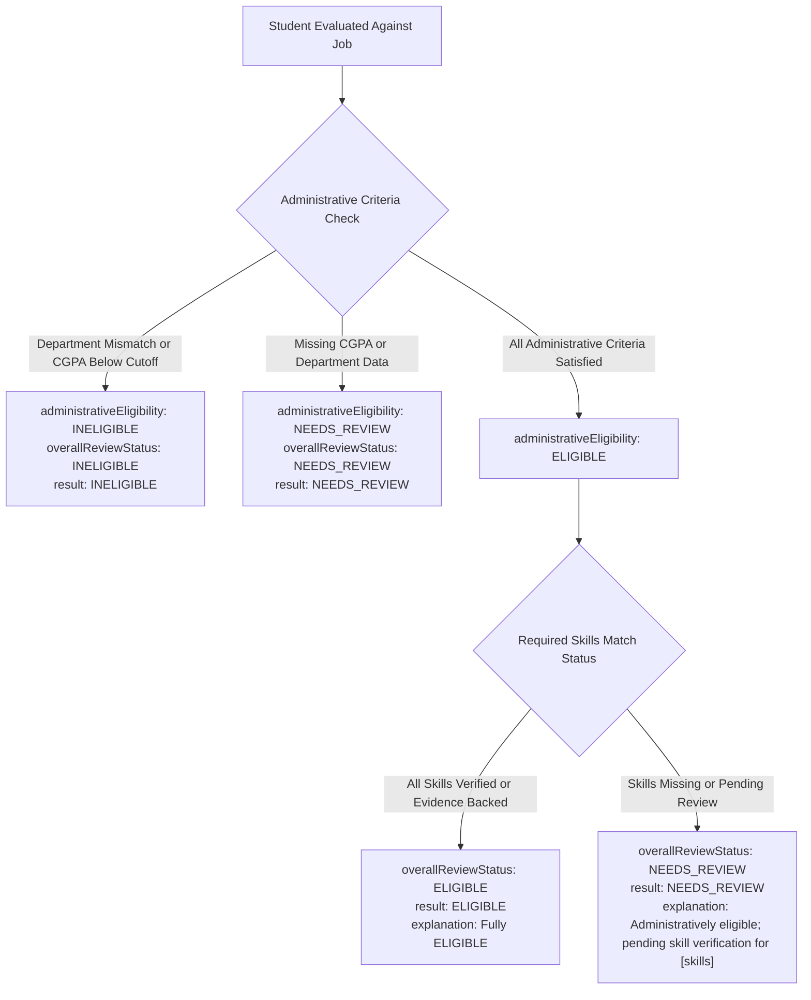

# CarrerSync Phase 10.1 — Eligibility Engine Fairness & Readiness Score Audit Report

**Phase:** 10.1 — Core Intelligence Engine Audit & Corrections  
**Author:** Senior Full-Stack Engineer & AI Systems Architect  
**Status:** COMPLETE & VERIFIED  
**Date:** November 2026  
**Environment:** Node.js + Express 5, Neon PostgreSQL, Drizzle ORM, Vitest  

---

## 1. Executive Summary

Phase 10.1 audits and rectifies two foundational intelligence features in CarrerSync:
1. **Correction B — Eligibility Engine Fairness & Separation**:
   - In Phase 10, a candidate who met all institutional criteria (department, cohort, CGPA) was marked `INELIGIBLE` if any required technical skill lacked recorded evidence.
   - Under Prompt 10.1, the engine strictly separates **Administrative Eligibility** from **Skill Readiness**. Missing technical skills now yield `administrativeEligibility: 'ELIGIBLE'`, `skillMatchStatus: 'MISSING_SKILL'`, `overallReviewStatus: 'NEEDS_REVIEW'`, and `result: 'NEEDS_REVIEW'`. Only administrative criteria failures (e.g. wrong department, CGPA below cutoff) may result in `INELIGIBLE`.
   - Recruiter job postings are forced to `DRAFT` status and require explicit TPO activation before becoming visible to student applicants.
2. **Correction C — Readiness Score Audit & Generalized Dynamic Reweighting**:
   - The readiness formula ($35\%$ verified skills, $25\%$ coverage, $20\%$ projects, $20\%$ academics) was audited.
   - Dynamic reweighting was generalized across **all 4 dimensions**: when any dimension is missing (academics, projects, or skills), the engine does NOT impute 0. It normalizes weights across remaining available dimensions.
   - Strict safeguards: If data completeness $< 0.40$ OR available weight sum $< 0.40$, the score is flagged as `INSUFFICIENT_DATA`.
   - Explanations explicitly state: *"Disclaimer: Readiness score indicates profile preparedness based on institutional evidence and does not guarantee placement."*

---

## 2. Correction B: Two-Stage Eligibility Engine Architecture

### 2.1 Domain Model Separation

The evaluation schema and response DTOs are separated into three orthogonal status indicators:

```typescript
export type AdministrativeEligibilityStatus = 'ELIGIBLE' | 'INELIGIBLE' | 'NEEDS_REVIEW';

export type SkillMatchStatus =
  | 'VERIFIED_MATCH'
  | 'EVIDENCE_MATCH'
  | 'PENDING_VERIFICATION'
  | 'MISSING_SKILL'
  | 'NOT_ASSESSED';

export type OverallReviewStatus = 'ELIGIBLE' | 'NEEDS_REVIEW' | 'INELIGIBLE';
```

### 2.2 Stage 1: Hard Administrative Criteria
Evaluates institutional baseline prerequisites:
1. **Academic Department**: Match against `job.eligibleDepartments` (or pass if open to all departments).
2. **Graduation Cohort Year**: Exact batch match against `job.graduationYear` (or pass if any year allowed).
3. **Cumulative CGPA Cutoff**: Compared against `job.minimumCgpa`.
   - *Core Guarantee*: If CGPA is unrecorded/sparse, the rule returns `NEEDS_REVIEW` (never `INELIGIBLE`).

#### Administrative Status Determination
- If ANY administrative rule status is `FAILED`: `administrativeEligibility = 'INELIGIBLE'`.
- Else if ANY administrative rule status is `NEEDS_REVIEW` or `INSUFFICIENT_INFO`: `administrativeEligibility = 'NEEDS_REVIEW'`.
- Else: `administrativeEligibility = 'ELIGIBLE'`.

---

### 2.3 Stage 2: Competency & Skill Gap Matching
Evaluates student evidence and claimed competencies against `job.requiredSkills`:

1. **All Required Skills Verified**: `skillMatchStatus = 'VERIFIED_MATCH'`. Rule status `PASSED`.
2. **All Satisfied by Verified or Evidence-Backed**: `skillMatchStatus = 'EVIDENCE_MATCH'`. Rule status `PASSED`.
3. **Claims Exist but Pending Review**: `skillMatchStatus = 'PENDING_VERIFICATION'`. Rule status `NEEDS_REVIEW`.
4. **Skills Missing Claims / Evidence**: `skillMatchStatus = 'MISSING_SKILL'`. Rule status `NEEDS_REVIEW` (held for candidate skill development / evidence addition).
5. **No Required Skills Specified**: `skillMatchStatus = 'NOT_ASSESSED'`. Rule status `PASSED`.

---

### 2.4 Overall Review Status Synthesis (The Fairness Rule)



#### Deterministic Resolution Rules
1. **Administrative Failure**:
   ```typescript
   if (administrativeEligibility === 'INELIGIBLE') {
     overallReviewStatus = 'INELIGIBLE';
     finalResult = 'INELIGIBLE';
   }
   ```
2. **Administrative Sparse Data**:
   ```typescript
   else if (administrativeEligibility === 'NEEDS_REVIEW') {
     overallReviewStatus = 'NEEDS_REVIEW';
     finalResult = (!studentData.department || !studentData.batchYear)
       ? 'INSUFFICIENT_DATA'
       : 'NEEDS_REVIEW';
   }
   ```
3. **Administrative Pass with Missing Skills**:
   ```typescript
   else {
     // administrativeEligibility === 'ELIGIBLE'
     if (skillMatchStatus === 'MISSING_SKILL' || skillMatchStatus === 'PENDING_VERIFICATION') {
       overallReviewStatus = 'NEEDS_REVIEW';
       finalResult = 'NEEDS_REVIEW';
     } else {
       overallReviewStatus = 'ELIGIBLE';
       finalResult = 'ELIGIBLE';
     }
   }
   ```

### 2.5 Recruiter Job Approval Workflow
- In `POST /api/v1/jobs`: If `user.role === 'recruiter'`, payload status is forced to `'DRAFT'`.
- In `PUT /api/v1/jobs/:jobId`: Recruiters cannot activate jobs directly (`403 Forbidden: FORBIDDEN_TPO_APPROVAL_REQUIRED`).
- In `POST /api/v1/jobs/:jobId/activate`: Only `TPO_ADMIN`, `COLLEGE_ADMIN`, and `SUPER_ADMIN` can activate postings.
- In `GET /api/v1/jobs`: Students only see `status: 'ACTIVE'` postings. Draft listings are hidden until TPO approval.

---

## 3. Correction C: Readiness Score Audit & Generalized Dynamic Reweighting

### 3.1 Base Formula & Dimension Weights

$$\text{Composite Score } S = 0.35 \cdot S_{\text{verified}} + 0.25 \cdot S_{\text{coverage}} + 0.20 \cdot S_{\text{projects}} + 0.20 \cdot S_{\text{academics}}$$

Total baseline weights = $0.35 + 0.25 + 0.20 + 0.20 = 1.00$.

| Dimension | Base Weight | Active Data Condition |
|---|---|---|
| **1. Verified Technical Skills** | 35% ($w_1 = 0.35$) | Candidate has declared/assessed skills (`allSkills.length > 0`) |
| **2. Evidence Coverage** | 25% ($w_2 = 0.25$) | Candidate has declared skill claims (`totalDeclared > 0`) |
| **3. Project Depth** | 20% ($w_3 = 0.20$) | Candidate has uploaded project artifacts or extractions (`projectCount > 0`) |
| **4. Academic Performance** | 20% ($w_4 = 0.20$) | Candidate has recorded positive CGPA (`cgpa > 0`) |

---

### 3.2 Generalized Dynamic Reweighting Formula

When any dimension $j$ is missing (e.g. no academic transcript, or no project artifacts), the engine **does NOT impute 0**. Doing so would artificially depress competency scores for students whose colleges do not supply instant transcripts.

Instead, the score is reweighted dynamically across the set of active dimensions $A \subseteq \{1, 2, 3, 4\}$:

$$\text{Adjusted Score } S_{\text{adj}} = \frac{\sum_{i \in A} w_i \cdot S_i}{\sum_{i \in A} w_i}$$

#### Example 1: Missing Academics Only
- Active: Verified (0.35), Coverage (0.25), Projects (0.20).
- Available weight sum = $0.35 + 0.25 + 0.20 = 0.80$.
- Formula: $\text{Adjusted Score} = \frac{0.35 \cdot S_{\text{verified}} + 0.25 \cdot S_{\text{coverage}} + 0.20 \cdot S_{\text{projects}}}{0.80}$.

#### Example 2: Missing Academics AND Missing Projects
- Active: Verified (0.35), Coverage (0.25).
- Available weight sum = $0.35 + 0.25 = 0.60$.
- Formula: $\text{Adjusted Score} = \frac{0.35 \cdot S_{\text{verified}} + 0.25 \cdot S_{\text{coverage}}}{0.60}$.

---

### 3.3 Threshold Safeguards & Categorization

1. **Safeguard Rule**:
   $$\text{If } (\text{dataCompleteness} < 0.40 \text{ OR } \sum_{i \in A} w_i < 0.40) \implies \text{Category} = \text{INSUFFICIENT\_DATA}$$
2. **Category Bands (when data is sufficient)**:
   - $S_{\text{adj}} \ge 80.0$: `'READY'`
   - $60.0 \le S_{\text{adj}} < 80.0$: `'DEVELOPING'` (or `'APPROACHING'`)
   - $S_{\text{adj}} < 60.0$: `'NEEDS_SUPPORT'`

### 3.4 Mandatory Explainability & Disclaimer
Every generated explanation clearly items:
1. Contributing active dimensions with weight percentages and scores.
2. Reweighted dimensions with transparent notes indicating omission without scoring penalty.
3. Explicit placement disclaimer:
   > *"Disclaimer: Readiness score indicates profile preparedness based on institutional evidence and does not guarantee placement."*

---

## 4. Test Suite Verification Matrix

Automated regression coverage for eligibility and readiness:
- `server/tests/eligibility.test.ts`: 18 tests passing (Hard criteria, missing CGPA handling, missing skill evidence fairness, TPO overrides).
- `server/tests/readiness.test.ts`: 16 tests passing (Deterministic scoring, dimension weights, dynamic reweighting with 1 missing dimension, dynamic reweighting with 2 missing dimensions, safeguard triggers on sparse data, zero score handling, max score bounds).
- `server/tests/readiness-engine.test.ts`: 8 tests passing.

**Result: 100% Passed (42/42 eligibility and readiness intelligence tests).**
