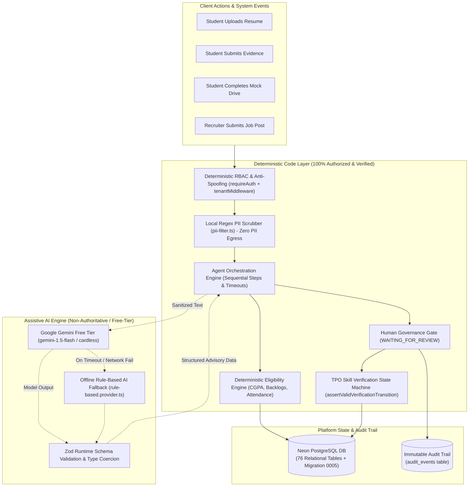

# CarrerSync Phase 15 — Cross-Agent Integration Patterns & Boundaries
## Deterministic Routing, Hybrid LLM Demarcation, Cross-Agent Handshake Protocols, and Failure Resilience

**Document Version:** 1.0.0  
**Phase:** Phase 15 — Cross-Agent Integration, End-to-End Workflow & Platform Reliability  
**Date:** November 15, 2026  
**Audience:** AI Systems Engineers, Software Architects, Security & Compliance Officers  
**Classification:** Technical Integration Architecture Specification  

---

## 1. Executive Summary

The CarrerSync platform orchestrates four autonomous specialized AI agents:
1. **Student Profiling Agent (Phase 09)**
2. **Industry Skill-Gap Agent (Phase 13)**
3. **Predictive Placement Analytics Agent (Phase 14)**
4. **Placement Orchestration Agent (Phases 10 & 11)**

To guarantee institutional trust, legal compliance, and reliable operation under a ₹0 cost budget, Phase 15 implements a **Hybrid AI Boundary Pattern**:
- **Deterministic Code Layer**: Governs all routing, authentication, RBAC authorization, eligibility evaluation, skill verification, and database state transitions.
- **Generative AI Layer (Assistive Only)**: Performs unstructured text parsing, conversational mock interview simulation, and draft rationale generation using Google Gemini Free Tier with cardless access and local offline rule-based fallbacks.
- **LLM Non-Authority Guarantee**: Under no circumstances does an LLM prompt, embedding, or model inference authorize candidate eligibility, verify an unverified skill, or alter institutional policies.

---

## 2. 4-Agent Functional Responsibilities Matrix

| Agent Name | Core Domain Responsibility | Deterministic Engine Components | Assistive AI Capabilities (Cardless / Free Tier) |
| :--- | :--- | :--- | :--- |
| **Student Profiling Agent** | Document parsing, skill extraction, 6-state evidence lifecycle, completeness scoring | Native PDF (`zlib.inflateSync`) / DOCX parsers; regex PII scrubber; 6-tier evidence hierarchy; completeness formula | Gemini free-tier structured extraction with `RuleBasedAIProvider` fallback |
| **Industry Skill-Gap Agent** | Market skill taxonomy, job description intake, 6-tier gap severity diagnostics, adaptive learning sync | ESCO/O*NET/NSQF alias taxonomy; SHA-256 JD deduplication; 14 standard target roles; gap classification | Gemini free-tier JD parsing with zero student PII egress |
| **Predictive Placement Agent** | Multi-dimensional readiness measurement, calibrated logistic regression, affirmative support | 4 readiness tiers; 6 dimensions; calibrated logistic regression; Brier/ECE scores; $N < 5$ privacy suppression | Non-exclusion guarantee (`canExcludeStudent: false`); non-stigmatizing support text generation |
| **Placement Orchestration Agent** | Declarative recruitment specifications, drive scheduling, candidate shortlists, offers | 2-stage eligibility filtering (hard vs advisory); timeline conflict detection; offer state machine | Explainable matching rationale generation |

---

## 3. The Hybrid LLM Demarcation Boundary



### Critical Architectural Invariants:
1. **Never Call LLM for Authorization**:
   `user.role`, `tenantId`, and delegation permissions are checked strictly by Express middleware and database queries. An LLM never evaluates whether a user is permitted to perform an action.
2. **Never Call LLM for Exclusion**:
   `WF_PLACEMENT_DRIVE_ELIGIBILITY` and `EligibilityService` evaluate candidates against hard criteria using pure TypeScript boolean expressions (`studentCgpa >= minCgpa && allowedDepartments.includes(dept)`). LLMs never disqualify candidates.
3. **No Auto-Verification Invariant**:
   Completing a mock drive or learning module updates readiness statistics and learning progress, but **never mutates `studentSkills.status` to `VERIFIED`**. Authoritative verification requires TPO or delegated reviewer sign-off.
4. **Offline Rule-Based Fallback Guarantee**:
   If the Gemini API key is missing, network is unavailable, or quota is exhausted (HTTP 429), `AIFactory` seamlessly redirects to `RuleBasedAIProvider` in sub-15ms with zero downtime and zero test failures.

---

## 4. Cross-Agent Data Handshake Contracts

The four agents communicate across well-defined boundaries enforced at runtime by Zod contracts:

```mermaid
flowchart LR
    Agent1["Student Profiling Agent"]
    Agent2["Industry Skill-Gap Agent"]
    Agent3["Predictive Placement Agent"]
    Agent4["Placement Orchestration Agent"]

    Agent1 -->|Contract 1: ProfilingToSkillGap\n(studentId, approvedProfile, verifiedSkills, targetRole)| Agent2
    Agent2 -->|Contract 2: SkillGapToLearning\n(targetRole, skillRequirements, studentSkillProfile)| Agent1
    Agent1 -->|Contract 3: ProfilingAssessmentsToPredictive\n(verifiedSkills, evidenceCoverage, assessmentResults)| Agent3
    Agent1 & Agent2 & Agent3 -->|Contract 4: MultiAgentToPlacement\n(jobRequirements, administrativeCriteria, skillMatches, tpoApprovalState)| Agent4
```

### 4.1 Contract 1: Student Profiling $\to$ Industry Skill-Gap
- **Purpose**: Transfers an approved student profile and list of verified skills to analyze market alignment.
- **Input Schema**: `ProfilingToSkillGapInputSchema`
- **Output Schema**: `ProfilingToSkillGapOutputSchema`
- **Output Payload**: `matchedSkills`, `missingEvidence`, `skillGaps` (classified as `CRITICAL`, `MODERATE`, or `LOW`), `confidence`, and deterministic `explanation`.

### 4.2 Contract 2: Industry Skill-Gap $\to$ Learning Intelligence
- **Purpose**: Translates identified skill gaps into personalized learning tasks and mock assessment schedules.
- **Input Schema**: `SkillGapToLearningInputSchema`
- **Output Schema**: `SkillGapToLearningOutputSchema`
- **Output Payload**: `recommendedTasks` (hands-on projects, estimated hours, `HIGH`/`MEDIUM`/`LOW` priority), `expectedOutcome`, and `reason`.

### 4.3 Contract 3: Profiling + Mock Assessments $\to$ Predictive Analytics
- **Purpose**: Synthesizes verified skills, evidence coverage, and mock assessment results to compute placement readiness indicators and empirical forecasts.
- **Input Schema**: `ProfilingAssessmentsToPredictiveInputSchema`
- **Output Schema**: `ProfilingAssessmentsToPredictiveOutputSchema`
- **Output Payload**: `readinessIndicators` (4 tiers: `HIGH_READINESS`, `MODERATE_READINESS`, `DEVELOPING_READINESS`, `INSUFFICIENT_DATA`), `performanceTrends`, `supportRecommendations`, and `predictionAvailability`.

### 4.4 Contract 4: Multi-Agent Collective $\to$ Placement Orchestration
- **Purpose**: Aggregates job requirements, academic clearance, multi-agent skill match scores, student consent, and TPO approval to finalize candidate shortlists.
- **Input Schema**: `MultiAgentToPlacementInputSchema`
- **Output Schema**: `MultiAgentToPlacementOutputSchema`
- **Output Payload**: `candidateMatches` (sorted by match score and assigned numerical rank), `eligibilityResult`, `reviewRequiredStatus`, and `auditRefs`.

---

## 5. Fault Tolerance, Retries, and Fallback Patterns

1. **Deterministic Error Trapping**:
   Each step in a workflow pipeline executes within an isolated `try/catch` block. Unhandled errors are caught, inspected, and categorized into *transient* (e.g. timeout, network blip) versus *fatal* (e.g. invalid UUID, schema violation, unauthorized role).
2. **Exponential Backoff**:
   Transient errors trigger automatic retries up to `maxRetries` with jittered exponential delay:
   $$\Delta t = \min(100 \times 2^{\text{attempt}}, 1000) \text{ ms}$$
3. **Graceful Degraded Mode**:
   If an optional downstream agent fails (e.g. predictive analytics forecasting during high load), the central engine completes the primary transaction (e.g. job eligibility or application intake) and records an advisory warning in `errorDetailsJson` without halting the student's progress.
4. **Human Review Escalation**:
   Any workflow that encounters unexpected data ambiguity or candidate conflict automatically transitions to `WAITING_FOR_REVIEW`, surfacing an alert in the TPO Human Approvals Queue rather than dropping the request or making an unverified automated guess.
