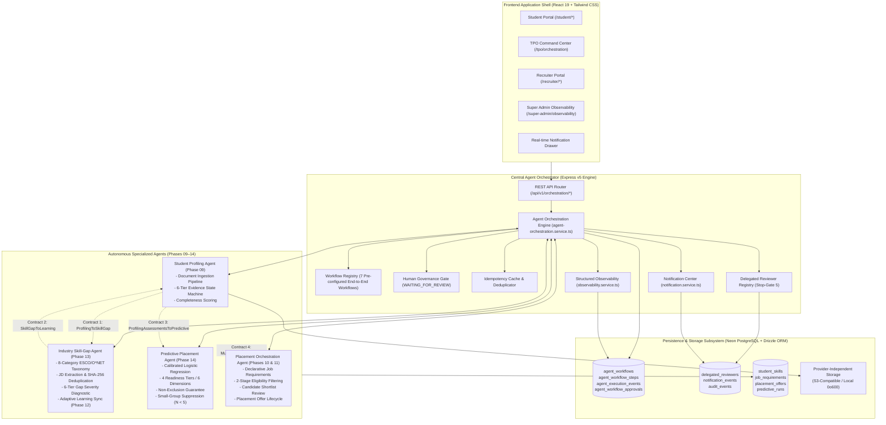
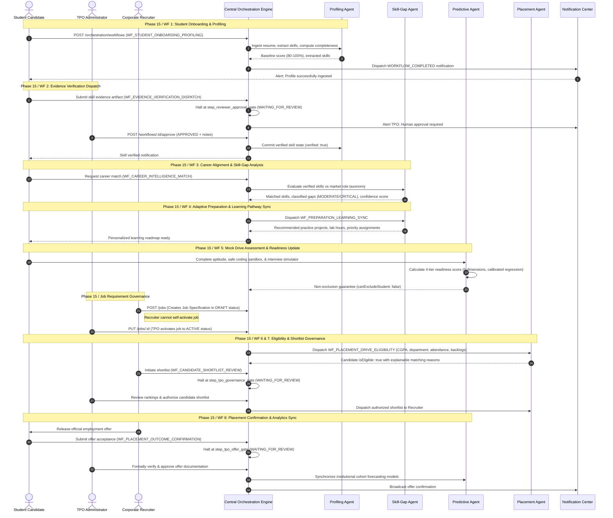
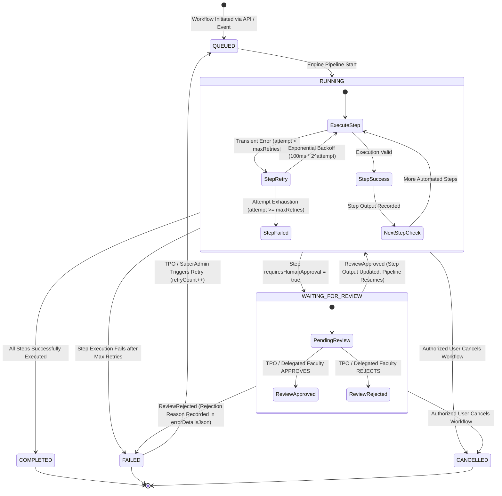
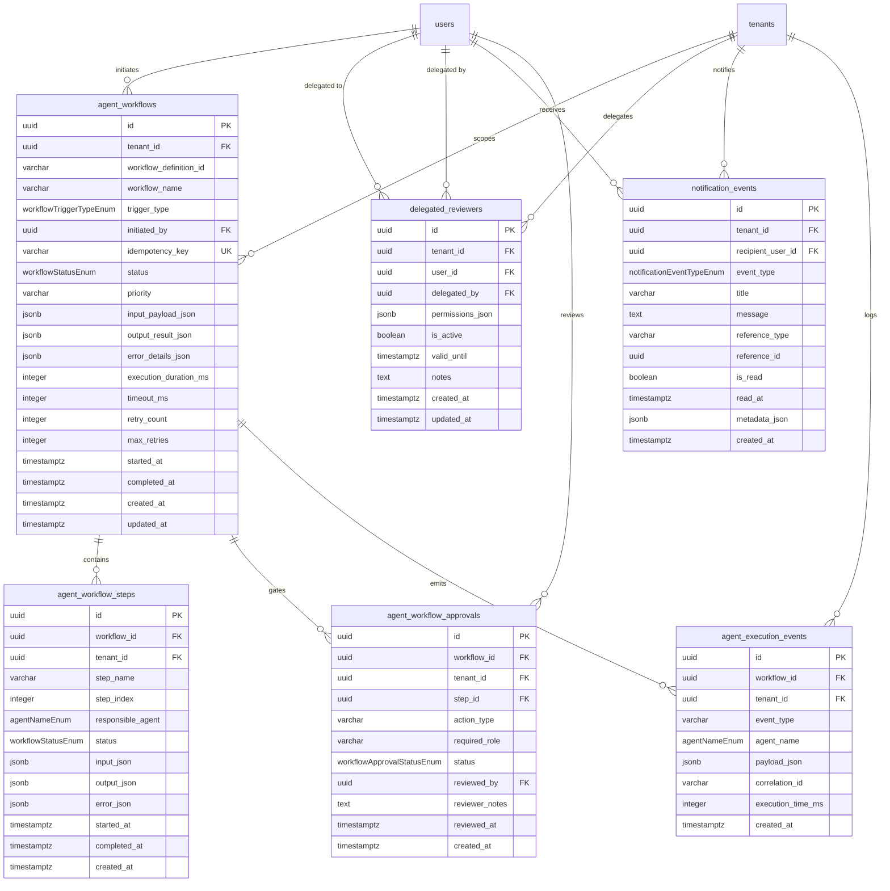

# CarrerSync Phase 15 — Unified Multi-Agent Orchestration Architecture
## System Architecture, End-to-End Pipeline Topology, Governance State Machine, and Relational Data Models

**Document Version:** 1.0.0  
**Phase:** Phase 15 — Cross-Agent Integration, End-to-End Workflow & Platform Reliability  
**Date:** November 15, 2026  
**Audience:** Platform Architects, Backend Engineers, Security Auditors, TPO Leadership  
**Classification:** Canonical Architecture Specification  

---

## 1. Architectural Overview & Design Philosophy

CarrerSync Phase 15 establishes the **Central Agent Orchestration Engine**, seamlessly integrating the four specialized autonomous agents developed across Phases 09 through 14 into a cohesive, deterministic, and auditable end-to-end recruitment intelligence platform.

### Core Architectural Principles:
1. **Deterministic Execution over Generative Ambiguity**:
   Authorization decisions, workflow transitions, eligibility gates, and data handoffs are strictly hardcoded in validated TypeScript code and Zod schemas. Non-deterministic Large Language Models (LLMs) are restricted to assistive advisory tasks (e.g. resume extraction assistance, qualitative JD parsing, mock interview simulations); they **never decide platform authorization or candidate eligibility**.
2. **Mandatory Human-in-the-Loop Governance Gates**:
   High-consequence placement decisions—including skill verification, recruiter candidate shortlists, mock practice reviews, and formal offer acceptance—halt at formal human approval gates (`WAITING_FOR_REVIEW`), requiring authorized Training and Placement Officer (TPO) or explicitly delegated faculty sign-off.
3. **Multi-Tenant Cryptographic Isolation**:
   Every workflow instance, step, event, notification, and reviewer delegation is strictly scoped to a validated institutional tenant UUID (`tenantId`). Cross-tenant access is rejected at the API boundary with `403 TENANT_SPOOFING_REJECTED` and at the database layer via PostgreSQL Row-Level Security (RLS) context helpers (`withTenantContext`).
4. **Idempotent & Self-Healing Pipeline**:
   All workflows accept a unique `idempotencyKey`. Duplicate submissions return the existing workflow instance without re-executing steps or re-emitting notifications. Transient step failures automatically execute exponential backoff retries within strict timeout bounds.
5. **Decentralized Revocable Reviewer Delegation (Stop-Gate 5 Resolution)**:
   TPO administrators can delegate granular evidence review and workflow authorization permissions to departmental faculty coordinators. Revocation is instantaneous, auditable, and immediately terminates review authority across all active and pending workflows.
6. **Zero-PII Platform Observability**:
   Platform telemetry tracks end-to-end execution latency, retry rates, correlation IDs (`corr-${uuid}`), and agent health while actively sanitizing and purging all student PII, credentials, resumes, and confidential recruiter notes.

---

## 2. Unified 4-Agent Collective Topology

---

## 3. End-to-End Student Journey Sequence

The following sequence diagram details the complete lifecycle of a student across the 7 integrated workflows from initial onboarding to verified placement confirmation.

---

## 4. Human-in-the-Loop Governance State Machine

---

## 5. Relational Schema Architecture (Drizzle ORM)

The Phase 15 schema introduces 6 normalized relational tables and 5 PostgreSQL enum types, defined additively in `server/src/db/schema.ts` and generated in migration `server/drizzle/0005_nappy_ego.sql`.

### Relational Entity-Relationship Diagram:

---

## 6. Execution Lifecycle, Retry & Idempotency Specifications

### 6.1 Idempotency Key Semantics
- When initiating a workflow, clients may supply an optional `idempotencyKey` string (e.g. `idem-profile-33333333-20261115`).
- The engine checks for an existing record with matching `tenantId` and `idempotencyKey`.
- If found, the existing hydrated workflow instance is immediately returned with HTTP `200 OK` and `{ isIdempotentReplay: true }`.
- Duplicate executions, duplicate steps, and duplicate in-app notifications are strictly prevented.

### 6.2 Exponential Backoff Retry Policy
- Each workflow definition specifies a `maxRetries` threshold (default 2 to 3) and `timeoutMs` (default 60,000ms to 180,000ms).
- When an automated step throws an unhandled exception:
  $$\text{Backoff Duration} = \min\left(100 \times 2^{\text{attempt}}, 1000\right) \text{ ms}$$
- If attempts exceed `maxRetries`, the step is marked `FAILED`, the workflow transitions to `FAILED`, an error payload is recorded in `errorDetailsJson`, and a `WORKFLOW_FAILED` notification is dispatched to the user.
- TPO or SuperAdmin users can manually recover failed workflows via `POST /api/v1/orchestration/workflows/:id/retry`, which increments `retryCount`, resets failed steps to `PENDING`, and re-triggers execution.

---

## 7. Compliance with Master Policies

| Policy Mandate | Implementation Guarantee |
| :--- | :--- |
| **Strict ₹0 Zero-Cost Architecture** | 100% free-tier and self-contained runtime: Node.js Express v5, Neon PostgreSQL Free Tier, in-memory resilient fallback repositories, and Vite React frontend. Zero paid third-party orchestrator APIs (e.g. Temporal Cloud, AWS Step Functions, or paid Zapier/Make APIs). |
| **Deterministic Rule-Based Governance** | Critical decisions (eligibility, verified skills, reviewer authorization) are executed via pure deterministic TypeScript code. LLMs provide assistive suggestions only. |
| **No Auto-Verification Policy** | Completing mock tests, assessment modules, or learning tasks *never* auto-promotes skills to `VERIFIED`. Human TPO verification remains mandatory. |
| **Zero PII Egress to AI Models** | Local regex filter (`pii-filter.ts`) scrub phone numbers, emails, addresses, and national IDs. Observability telemetry deeply sanitizes all payloads. |
| **Multi-Tenant RLS Compliance** | All relational tables include `tenant_id` foreign keys with cascade deletion and btree indexing. Express middleware and connection pool context enforce tenant boundary checks. |
