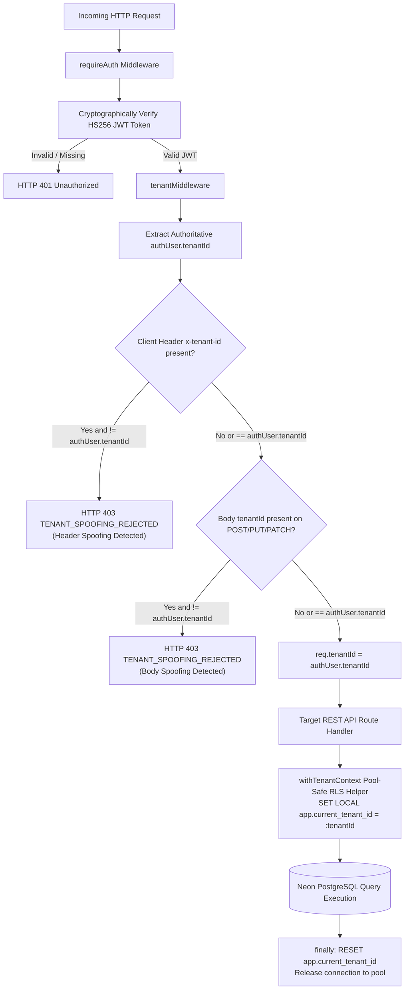

# CarrerSync Phase 15 — Security & Multi-Tenant Governance Review
## Role-Based Access Control, Tenant Isolation, Stop-Gate 5 Delegation Audit, Anti-Tampering & Zero-PII Protections

**Document Version:** 1.0.0  
**Phase:** Phase 15 — Cross-Agent Integration, End-to-End Workflow & Platform Reliability  
**Date:** November 15, 2026  
**Audience:** Chief Information Security Officer (CISO), Compliance Auditors, System Architects  
**Classification:** Canonical Security Audit & Verification Report  

---

## 1. Executive Security Evaluation & Stop-Gate Audits

An exhaustive security evaluation of the Phase 15 multi-agent orchestration architecture was conducted, specifically verifying multi-tenant isolation, role-based authorization, anti-spoofing boundaries, anti-tampering ledgers, and the formal resolution of **Stop-Gate 5 (Revocable Reviewer Delegation)**.

### Summary Security Scorecard:

| Security Vector | Evaluation Status | Key Mitigation / Architectural Proof |
| :--- | :---: | :--- |
| **Stop-Gate 5: Reviewer Delegation** | **RESOLVED & VERIFIED** | Persistent `delegatedReviewers` relational table + in-memory sync; instantaneous revocation invalidates review authority immediately. |
| **Multi-Tenant Cryptographic Isolation** | **VERIFIED** | Authoritative JWT tenant extraction; header/body spoofing rejected with `403 TENANT_SPOOFING_REJECTED`; RLS connection pool isolation. |
| **Deterministic RBAC Authorization** | **VERIFIED** | Canonical 5-role taxonomy enforced in code; LLMs completely excluded from evaluating authorization or candidate eligibility. |
| **Zero PII Egress to AI Models** | **VERIFIED** | Native regex scrubber (`pii-filter.ts`) removes phone numbers, emails, addresses, and Aadhaar; telemetry sanitized via `sanitizeTelemetryPayload`. |
| **Anti-Tampering & Audit Logging** | **VERIFIED** | Immutable `audit_events` and `agent_execution_events` records; correlation IDs (`corr-${uuid}`) bound to all workflow transactions. |
| **Input Schema Runtime Hardening** | **VERIFIED** | Zod runtime schemas validate all cross-agent handoffs and API payloads; illegal types and prototype pollution blocked. |

---

## 2. Stop-Gate 5 Formal Resolution: Revocable Faculty Reviewer Delegation

### 2.1 The Historical Governance Gap
Prior to Phase 15, faculty reviewer delegations were stored in an ephemeral in-memory map (`server/src/verification/verification.service.ts#L58`). In horizontal scaling or restart scenarios, reviewer delegations could fall out of synchronization. Furthermore, header-based permission spoofing (e.g. `x-verification-permission`) had to be rigorously purged.

### 2.2 Phase 15 Implementation Architecture
1. **Relational Table Persistence**:
   - Schema defined in `server/src/db/schema.ts` (`delegatedReviewers`):
     - `id`: UUID primary key.
     - `tenantId`: Tenant UUID foreign key with cascade deletion.
     - `userId`: Faculty user UUID.
     - `delegatedBy`: TPO administrator UUID.
     - `permissionsJson`: Array of granted permissions (e.g. `['VERIFY_SKILLS', 'REVIEW_EVIDENCE']`).
     - `isActive`: Boolean flag.
     - `validUntil`: Optional expiration timestamp.
     - `createdAt`, `updatedAt`: Audit timestamps.
2. **Instantaneous Revocation Semantics**:
   - Calling `DELETE /api/v1/orchestration/delegation/:id` or `delegationService.revokeDelegation(tenantId, id)` immediately sets `isActive = false` in both PostgreSQL and the active in-memory cache.
   - Synchronously purges authority from `VerificationService.getInstance().revokeDelegatedReviewer(tenantId, userId)`.
   - Any subsequent review attempt by the revoked faculty member fails with HTTP `403 Forbidden` (`does not possess TPO authority or active faculty delegation`).
3. **Tenant Boundary Strictness**:
   - Delegating a faculty coordinator in Tenant Alpha confers zero review privileges in Tenant Beta.
4. **Verification Evidence**:
   - Verified in `server/tests/agent-orchestration-e2e.test.ts` (Scenario 12) and `server/tests/phase15-orchestration-backend.test.ts` (Suite 5).

---

## 3. Multi-Tenant Anti-Spoofing Architecture

### 3.1 Defense-in-Depth Tenant Isolation Principles:
1. **JWT Authoritative Source of Truth**:
   The tenant identity claimed in the client's cryptographically signed Bearer JWT (`sub`, `tenant_id`, `role`) is strictly authoritative.
2. **Defensive Anti-Spoofing Interceptors**:
   Any mismatch between client-supplied request headers (`x-tenant-id`) or payload bodies (`req.body.tenantId`) and the JWT's claims is immediately terminated with `403 TENANT_SPOOFING_REJECTED`.
3. **Pool-Safe Database RLS Context**:
   `withTenantContext` wraps all database transactions in a dedicated client session executing `SET LOCAL app.current_tenant_id = :tenantId`. A mandatory `finally` block executes `RESET app.current_tenant_id` before releasing the client back to the connection pool, preventing cross-tenant leakage across pooled asynchronous operations.

---

## 4. Role-Based Access Control (RBAC) Matrix

The platform enforces the canonical 5-role taxonomy normalized by `server/src/utils/roles.ts`:

| Route / Capability | `SUPER_ADMIN` | `COLLEGE_ADMIN` | `TPO_ADMIN` | `RECRUITER` | `STUDENT` | `FACULTY_COORDINATOR` |
| :--- | :---: | :---: | :---: | :---: | :---: | :---: |
| **Trigger Student Onboarding** (`WF_STUDENT_ONBOARDING_PROFILING`) | Allowed | Allowed | Allowed | Denied | Allowed | Allowed |
| **Submit Skill Evidence** (`WF_EVIDENCE_VERIFICATION_DISPATCH`) | Allowed | Allowed | Allowed | Denied | Allowed | Allowed |
| **Verify Skill Evidence / Approve Workflow** | Allowed | Delegated Only | **Allowed** | Denied | Denied | Delegated Only |
| **Trigger Career Alignment Match** (`WF_CAREER_INTELLIGENCE_MATCH`) | Allowed | Allowed | Allowed | Denied | Allowed | Allowed |
| **Trigger Learning Pathway Sync** (`WF_PREPARATION_LEARNING_SYNC`) | Allowed | Denied | Allowed | Denied | Allowed | Denied |
| **Create Job Specification** (`POST /jobs`) | Allowed | Allowed | Allowed | **Allowed (Draft)** | Denied | Denied |
| **Activate Job Specification** (`PUT /jobs/:id`) | Allowed | Allowed | **Allowed** | Denied | Denied | Denied |
| **Evaluate Drive Eligibility** (`WF_PLACEMENT_DRIVE_ELIGIBILITY`) | Allowed | Allowed | Allowed | Allowed | Denied | Denied |
| **Submit Candidate Shortlist** (`WF_CANDIDATE_SHORTLIST_REVIEW`) | Allowed | Denied | Allowed | Allowed | Denied | Denied |
| **Authorize Candidate Shortlist** | Allowed | Denied | **Allowed** | Denied | Denied | Delegated Only |
| **Confirm Placement Offer** (`WF_PLACEMENT_OUTCOME_CONFIRMATION`) | Allowed | Denied | Allowed | Denied | Allowed | Denied |
| **Manage Reviewer Delegations** (`/delegation`) | Allowed | Denied | **Allowed** | Denied | Denied | Denied |
| **Access Platform Telemetry & Observability** | **Allowed** | Denied | Allowed | Denied | Denied | Denied |

---

## 5. Zero-PII Policy & Telemetry Sanitization

### 5.1 Local Regex PII Filter (`server/src/ai/pii-filter.ts`)
- Executed locally on the server before dispatching any textual payload to AI extraction models.
- Scrubbing Rules:
  - Phone numbers: Indian 10-digit mobile and international ITU formats masked as `[REDACTED_PHONE]`.
  - Personal emails: Non-institutional personal email domains masked as `[REDACTED_EMAIL]`.
  - Physical addresses: Pin codes and street descriptors masked as `[REDACTED_ADDRESS]`.
  - Aadhaar / National ID: 12-digit Indian national identity numbers masked as `[REDACTED_ID]`.

### 5.2 Observability Telemetry Sanitization (`sanitizeTelemetryPayload`)
- Located in `server/src/orchestration/observability.service.ts`.
- Deep recursive traversal of all recorded execution event payloads.
- Purging Rules:
  - Password, token, secret, and authorization headers are replaced with `'[REDACTED]'`.
  - Student names, addresses, phone numbers, and raw resume texts are purged.
  - Correlation IDs (`corr-${uuid}`) and workflow execution metrics are retained for latency and reliability diagnostics without leaking personal identities.
