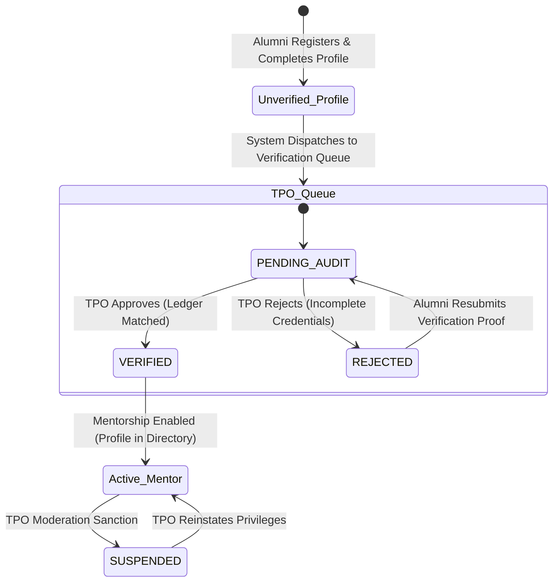
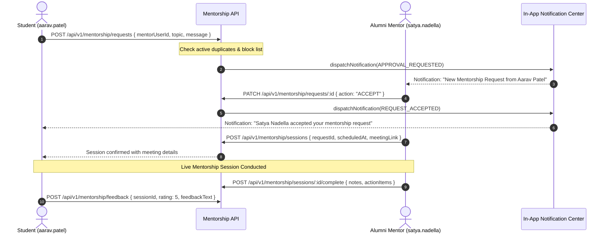

# CarrerSync Phase 16 — Alumni Mentorship Network Specification
## Comprehensive Guide to Alumni Onboarding, Verification, Discovery, Booking Lifecycles, and Institutional Analytics

**Document Version:** 1.0.0  
**Phase:** Phase 16 — Alumni Mentorship Network, Live Peer Mock Interviews & Realtime Collaboration  
**Date:** November 15, 2026  
**Audience:** Platform Architects, Alumni Coordinators, TPO Officers, Full-Stack Engineers  
**Classification:** Canonical Domain Specification  

---

## 1. Overview & Strategic Mission

The **Alumni Mentorship Network** bridges the transition between academic coursework and industry employment. By engaging verified graduates of the institution, CarrerSync enables current students to receive direct career guidance, resume reviews, portfolio feedback, and industry preparation advice.

### Key Tenets:
1. **Alma Mater Binding**: Alumni accounts are tied to the college tenant (`users.tenantId -> tenants.id`). An alumnus from College A mentors students from College A, protecting institutional student privacy.
2. **Mandatory TPO Verification**: Unverified alumni never appear in discovery directories. TPOs verify alumni credentials against graduation rolls before mentorship privileges are activated.
3. **Platform-Mediated Communication (Zero PII Exposure)**: Contact info (personal email, phone) is never exposed to students. All scheduling, requests, video/audio rooms, and notes occur on-platform.
4. **Explainable Match Scoring**: Recommendations rank mentors based strictly on skill overlap, target roles, and departments. Generative models and protected demographic attributes are prohibited from scoring.
5. **Duplicate Request Prevention**: The state machine strictly prevents students from spamming multiple active requests to the same mentor.

---

## 2. Alumni Profile Lifecycle & Verification Workflow



### 2.1 Verification States
- `PENDING`: Initial state upon profile creation. Profile is invisible in the public mentor directory.
- `VERIFIED`: Granted by authorized TPO Administrator (`TPO_ADMIN`, `COLLEGE_ADMIN`, `SUPER_ADMIN`). Alumni appears in directory, can receive requests, and host sessions.
- `REJECTED`: Application denied. Alumni notified of deficiency; can resubmit credentials.
- `SUSPENDED`: Privileges halted due to conduct violation or student report. Immediately removed from directory; pending requests cancelled.

### 2.2 Profile Attributes
- **Professional Metadata**: Current company, current designation, industry domain, graduation batch, department, years of professional experience, LinkedIn URL, portfolio link.
- **Mentorship Settings**: Mentorship enabled flag (`boolean`), maximum active mentees capacity (`default: 5`), mentorship topic areas, spoken languages.
- **Verification Audit**: `verifiedBy` (UUID of TPO user), `verifiedAt` (timestamp), `verificationNotes` (institutional record).

---

## 3. Mentor Discovery & Explainable Recommendation Engine

Students explore alumni mentors via multi-faceted filtering and an explainable ranking algorithm (`discoverMentors`):

### 3.1 Supported Filter Dimensions
- **Industry & Domain**: Fintech, Healthtech, Cloud Infrastructure, EdTech, Cybersecurity, Semiconductor.
- **Role & Seniority**: SDE I/II/III, Engineering Manager, Product Manager, Data Scientist, DevOps Engineer.
- **Graduation Year**: Graduation cohort matching (e.g., Class of 2020–2024).
- **Technical Skills**: React, Node.js, Go, Python, AWS, Kubernetes, Machine Learning, System Design.
- **Mentorship Topics**: Resume Review, Mock Technical Interview, System Design, Career Transition, Higher Studies.
- **Availability**: Only mentors with active upcoming time slots.

### 3.2 Explainable Recommendation Algorithm
The match score ($S \in [50, 100]$) is computed deterministically:
$$S = 50 + S_{\text{skills}} + S_{\text{role}} + S_{\text{department}}$$

1. **Baseline Score**: 50 points for all verified alumni in good standing.
2. **Skill Overlap ($S_{\text{skills}} \le 25$)**: Each overlapping skill between student target skills and alumni expertise adds 10 points (capped at 25 points).
   * *Match Reason*: `"Shares 3 of your target skills: React, TypeScript, System Design"`.
3. **Target Role Relevance ($S_{\text{role}} = 15$)**: Match between student desired role and alumni current designation.
   * *Match Reason*: `"Currently employed as Senior Software Engineer at Microsoft"`.
4. **Department Affinity ($S_{\text{department}} = 10$)**: Match between student department and alumni alma mater department.
   * *Match Reason*: `"Alumni from your department (Computer Science & Engineering)"`.

---

## 4. Mentorship Booking & Scheduling State Machine



### 4.1 Request States
- `PENDING`: Request submitted by student, awaiting alumni response.
- `ACCEPTED`: Alumni agreed to mentor; session scheduling unlocked.
- `DECLINED`: Alumni declined request with optional reason (e.g., at capacity).
- `RESCHEDULE_REQUESTED`: Either party proposed alternate date/time.
- `CANCELLED`: Student withdrew request prior to confirmation.
- `COMPLETED`: Session fulfilled and feedback recorded.

### 4.2 Duplicate Request Protection
If an active request (`PENDING`, `ACCEPTED`, or `RESCHEDULE_REQUESTED`) exists between the same student and alumni in the same tenant, any subsequent request attempt is rejected with:
```json
{
  "success": false,
  "error": "An active mentorship request already exists with this mentor. Please await their response or complete your active session."
}
```

---

## 5. Structured Feedback & Institutional Oversight

Following session completion, participants submit structured feedback:
- **Numerical Rating**: 1 to 5 stars.
- **Target**: `ALUMNI` (student evaluating mentor) or `STUDENT` (mentor evaluating student).
- **Topics Covered**: Specific agenda items addressed during the session.
- **Action Items**: Next steps for student interview preparation.
- **Institutional Audit**: All session ratings, completion rates, and feedback logs are accessible to TPO administrators.

---

## 6. REST API Endpoint Reference

### 6.1 Alumni Directory & Profiles (`/api/v1/alumni`)
- `GET /api/v1/alumni`: Search verified mentors with multi-faceted filtering.
- `GET /api/v1/alumni/:id`: Fetch public mentor profile (PII sanitized).
- `POST /api/v1/alumni/profile`: Create/update authenticated alumni profile.
- `GET /api/v1/alumni/requests`: Alumni views incoming mentorship requests queue.
- `POST /api/v1/alumni/:id/verify`: TPO Admin verifies alumni profile (`TPO_ADMIN` only).
- `POST /api/v1/alumni/:id/suspend`: TPO Admin suspends alumni profile (`TPO_ADMIN` only).

### 6.2 Mentorship Lifecycle (`/api/v1/mentorship`)
- `POST /api/v1/mentorship/requests`: Student sends mentorship request (prevents duplicates).
- `GET /api/v1/mentorship/requests/student`: Student views their own request history.
- `PATCH /api/v1/mentorship/requests/:id`: Transition request (`ACCEPT`, `DECLINE`, `RESCHEDULE`, `CANCEL`).
- `POST /api/v1/mentorship/sessions`: Schedule confirmed mentorship session.
- `POST /api/v1/mentorship/sessions/:id/complete`: Conclude session with notes and action items.
- `POST /api/v1/mentorship/feedback`: Submit structured 1–5 star rating and review.

### 6.3 TPO Institutional Governance (`/api/v1/tpo/alumni`)
- `GET /api/v1/tpo/alumni/analytics`: Institutional analytics (total mentors, verified count, sessions held, average rating).
- `GET /api/v1/tpo/alumni/pending`: Queue of unverified alumni awaiting institutional verification.
