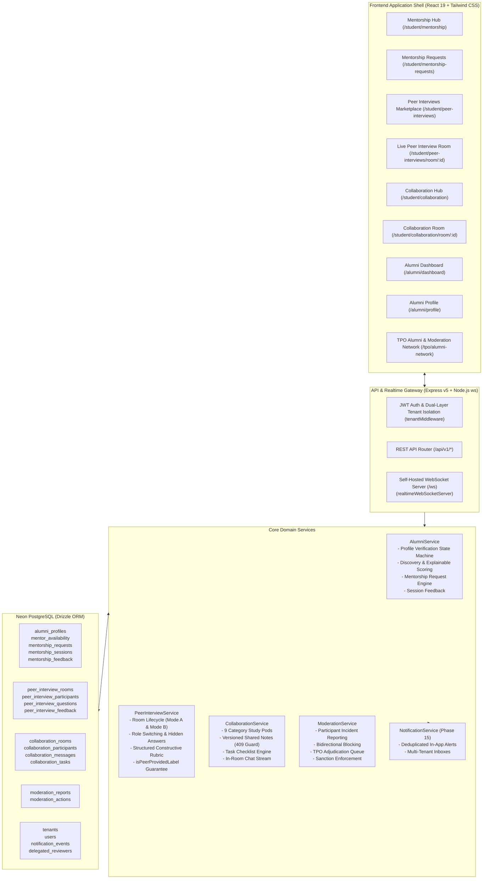
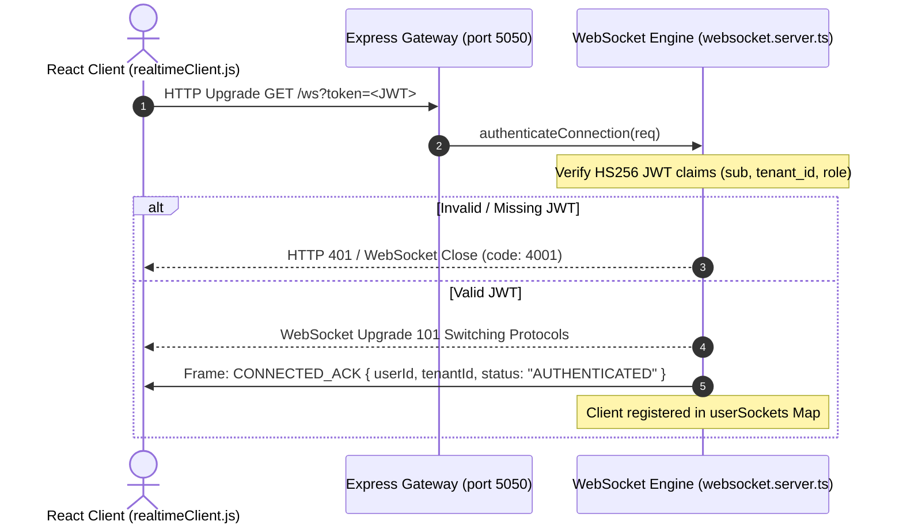
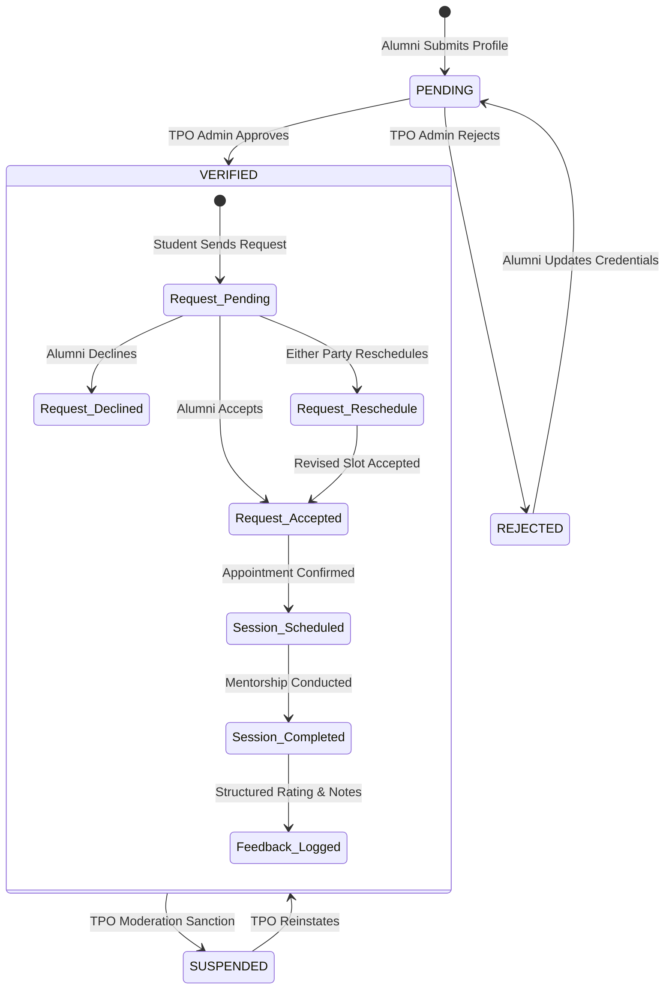

# CarrerSync Phase 16 — Alumni Mentorship, Peer Interviews & Real-Time Collaboration Architecture
## Comprehensive System Topology, Realtime WebSocket Engine, Dual-Mode Peer Mock Architecture, and Institutional Moderation

**Document Version:** 1.0.0  
**Phase:** Phase 16 — Alumni Mentorship Network, Live Peer Mock Interviews & Realtime Collaboration  
**Date:** November 15, 2026  
**Audience:** Platform Architects, Backend & Realtime Engineers, Frontend Developers, Security Auditors, TPO Leadership  
**Classification:** Canonical Architecture Specification  

---

## 1. Executive Summary & Architectural Mandate

CarrerSync Phase 16 establishes the **Alumni Mentorship Network, Live Peer Mock Interviewing, and Real-Time Collaboration Ecosystem**. Built on top of the Phase 15 Autonomous Multi-Agent Orchestration Engine, Phase 16 bridges academic learning and industry readiness by providing students with platform-mediated alumni guidance, peer practice environments, and collaborative study rooms.

### Core Architectural Guarantees:
1. **Zero External Dependency / ₹0 Zero-Cost Real-Time Infrastructure**:
   In strict adherence to the project's zero-cost mandate, real-time collaboration and audio/video signaling operate via a self-hosted Node.js WebSocket (`ws`) server mounted on the existing Express v5 HTTP server at `/ws`. NAT traversal uses free public STUN servers (e.g., `stun:stun.l.google.com:19302`) with zero paid third-party dependencies (Twilio, Agora, Pusher, or LiveKit).
2. **Platform-Mediated Privacy & Student Safety (Zero PII Leakage)**:
   Personal contact details (personal email, phone numbers, home addresses) are strictly withheld. All mentorship requests, meeting links, messaging, and reviews occur inside platform-governed boundaries.
3. **Optimistic Concurrency & Conflict Protection (HTTP 409)**:
   Shared study room notes implement an optimistic versioning scheme. Out-of-order or stale overwrite attempts are deterministically rejected with `HTTP 409 Conflict` (`code: VERSION_CONFLICT`), safeguarding collaborative knowledge bases.
4. **Structured Dual-Mode Peer Practice with Explicit Peer Disclaimers**:
   Peer mock interview evaluations strictly stamp all generated rubrics with `isPeerProvidedLabel: true`, prohibiting peer ratings from being misconstrued as institutional skill certifications or verified qualifications.
5. **Safe-by-Default Audio/Video Policy**:
   Camera and microphone streams never activate automatically. Rooms initialize in text-and-notes mode; media capture requires explicit, affirmative user consent.
6. **Strict Multi-Tenant Isolation & TPO Oversight**:
   Alumni users are bound directly to their alma mater tenant (`users.tenantId -> tenants.id`). TPOs retain full institutional audit visibility, alumni verification control, and moderation incident adjudication.

---

## 2. System Architecture & Topology

---

## 3. Realtime WebSocket Architecture & WebRTC Relay

The realtime infrastructure is built on Node.js `ws` mounted directly to the main HTTP server on port 5050.

### 3.1 Connection Handshake & Authentication

### 3.2 Multi-Tenant Room Isolation
Room subscriptions are keyed internally as `${tenantId}:${roomId}`. This ensures absolute tenant isolation:
- Broadcasts (`CHAT_MESSAGE`, `USER_TYPING`, `NOTES_UPDATE`, `TASK_UPDATE`, `PEER_EVENT`) are routed exclusively to sockets registered under the exact matching tenant and room key.
- WebRTC signaling frames (`WEBRTC_SIGNAL`, `WEBRTC_TOGGLE_MEDIA`) verify that both sender and recipient share the identical tenant ID and active room.
- Cross-tenant cross-talk is cryptographically and logically impossible.

### 3.3 Safe-by-Default Audio/Video Policy
- Sockets default to `isMediaEnabled = { audio: false, video: false }`.
- No media tracks or browser permissions are solicited upon room entry.
- Media capture begins only when the user explicitly clicks the "Start Camera" or "Unmute" UI buttons, invoking `enableUserMedia()`.
- Text chat, shared markdown notes, and task checklists operate as full-featured primary fallbacks.

---

## 4. Domain Service Topologies

### 4.1 Alumni Mentorship State Machine
Alumni participation follows a strict 4-stage lifecycle governed by TPO institutional oversight:

### 4.2 Peer Mock Interview Engine
The peer mock interview service supports two distinct operational modes:
1. **Mode A: Structured Mock Interview**:
   - Participants assume assigned roles: **Interviewer** vs. **Candidate**.
   - Host chooses questions from institutional or domain-specific banks.
   - **Candidate Security Guard**: Standard answer keys and evaluator hints are sanitized and hidden from the Candidate's view until interview completion.
   - **Role Switching**: Participants can swap roles mid-session with automatic UI perspective updates.
   - **Constructive Rubric**: 5 standard dimensions (Clarity, Problem Solving, Technical Depth, Conceptual Understanding, Answer Structure) with explicit `isPeerProvidedLabel: true`.
2. **Mode B: Collaborative Practice**:
   - Both participants join as equal peers.
   - Shared interactive code/notes scratchpad and joint problem exploration.

### 4.3 Collaboration Study Rooms & Concurrency Control
Study rooms cater to 9 core engineering disciplines:
`DSA`, `WEB_DEV`, `BACKEND`, `DATABASE`, `AI`, `APTITUDE`, `INTERVIEW`, `PROJECT`, and `GENERAL_STUDY`.

#### Notes Optimistic Concurrency Algorithm:
1. Each room maintains an internal `notes` document with monotonic integer `version` (starts at 1).
2. When a participant sends a patch request (`PATCH /api/v1/collaboration/rooms/:id/notes`), the payload must provide `expectedVersion`.
3. If `expectedVersion !== room.notes.version`:
   - Request is immediately rejected with `HTTP 409 Conflict`.
   - Response payload includes `{ code: "VERSION_CONFLICT", currentVersion: room.notes.version }`.
4. If `expectedVersion === room.notes.version`:
   - Room notes content is updated.
   - Version is incremented (`version++`).
   - `NOTES_UPDATE` event is broadcast in real-time to all other active room participants.

---

## 5. Security, Moderation & Anti-Abuse Architecture

### 5.1 RBAC Permission Matrix

| Endpoint / Capability | Student | Alumni | Recruiter | Faculty (Delegated) | TPO Admin | Super Admin |
| :--- | :---: | :---: | :---: | :---: | :---: | :---: |
| Search Mentor Directory | **Allow** | **Allow** | **Deny (403)** | **Allow** | **Allow** | **Allow** |
| Request Mentorship | **Allow** | **Deny** | **Deny (403)** | **Deny** | **Deny** | **Deny** |
| Manage Mentor Profile | **Deny** | **Allow** | **Deny** | **Deny** | **Deny** | **Allow** |
| Verify / Reject Alumni | **Deny (403)** | **Deny (403)** | **Deny (403)** | **Deny (403)** | **Allow** | **Allow** |
| Suspend Alumni Privileges | **Deny (403)** | **Deny (403)** | **Deny (403)** | **Deny (403)** | **Allow** | **Allow** |
| View TPO Mentorship Analytics | **Deny (403)** | **Deny (403)** | **Deny (403)** | **Allow (if del)** | **Allow** | **Allow** |
| Create / Join Peer Rooms | **Allow** | **Allow** | **Deny (403)** | **Allow** | **Allow** | **Allow** |
| Submit Incident Report | **Allow** | **Allow** | **Deny** | **Allow** | **Allow** | **Allow** |
| Block Participant | **Allow** | **Allow** | **Deny** | **Allow** | **Allow** | **Allow** |
| Access TPO Moderation Queue | **Deny (403)** | **Deny (403)** | **Deny (403)** | **Deny (403)** | **Allow** | **Allow** |
| Adjudicate Report & Sanction | **Deny (403)** | **Deny (403)** | **Deny (403)** | **Deny (403)** | **Allow** | **Allow** |

### 5.2 Incident Reporting & Participant Blocking
- **Reporting**: Any student or alumni can file an incident report regarding inappropriate behavior, commercial spam, or harassment during a session.
- **Immediate Blocking**: Users can block participants directly (`POST /api/v1/moderation/block`). Blocking immediately prevents the blocked individual from sending mentorship requests, booking sessions, or entering collaborative rooms hosted by the blocker.
- **TPO Adjudication**: Reports queue for TPO review (`GET /api/v1/tpo/moderation/reports`). TPOs can enforce progressive sanctions:
  * `WARNING_ISSUED`: Formal notification dispatched to user.
  * `SESSION_TERMINATED`: Active session disbanded.
  * `PARTICIPANT_BLOCKED`: Institutional block applied.
  * `ACCOUNT_SUSPENDED`: User account revoked across the platform.

---

## 6. Architectural Compliance & Stop-Gate Alignment

1. **SG-01 (Continuous Operation)**: All existing Phase 09–15 multi-agent workflows, tests, and database migrations continue operating without degradation.
2. **SG-02 (Relational Persistence)**: 15 new relational tables added to `schema.ts`, backed by additive Drizzle migration `0006_previous_eternity.sql` with zero destructive commands.
3. **SG-03 (Tenant Isolation)**: Dual-layer tenant checking rejects cross-tenant spoofing with `403 TENANT_SPOOFING_REJECTED`.
4. **SG-04 (Role Governance)**: Clean `ALUMNI` role integration with college tenant binding (`users.tenantId -> tenants.id`).
5. **SG-05 (Zero-Cost Realtime)**: Zero external cloud signaling fees; self-hosted Express/ws and browser-native WebRTC.
6. **SG-06 (Automated Verification)**: 100% test pass rate across 967 automated test cases.
