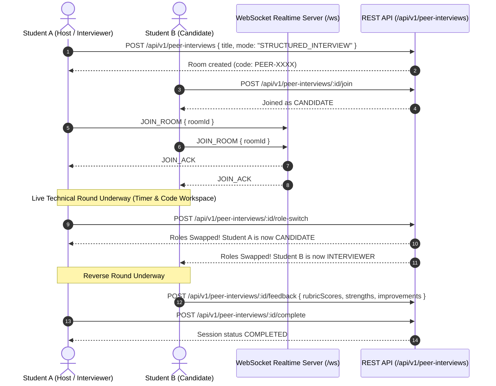

# CarrerSync Phase 16 — Live Peer Mock Interviewing Specification
## Dual-Mode Peer Mock Architecture, Question Bank Security, Hidden Evaluator Keys, and Structured Constructive Rubrics

**Document Version:** 1.0.0  
**Phase:** Phase 16 — Alumni Mentorship Network, Live Peer Mock Interviews & Realtime Collaboration  
**Date:** November 15, 2026  
**Audience:** Platform Architects, Frontend Engineers, Realtime Developers, Assessment Leads  
**Classification:** Canonical Technical Specification  

---

## 1. Overview & Pedagogical Philosophy

The **Live Peer Mock Interview Engine** provides students with a risk-free, authentic environment to practice technical, behavioral, and system design interviews with peers from their own institution. 

### Architectural Tenets:
1. **Dual Operational Modes**:
   - **Mode A: Structured Mock Interview**: Simulates formal industry interviews with assigned Interviewer and Candidate roles, hidden evaluator answer keys, and structured evaluation rubrics.
   - **Mode B: Collaborative Practice**: A collaborative problem-solving environment where both participants work simultaneously on coding problems and whiteboard questions.
2. **Hidden Answer Key Security Guard**:
   In Mode A, standard solution keys, optimal time/space complexity notes, and edge-case hints are delivered exclusively to the Interviewer. The Candidate's API payload sanitizes `standardAnswer` to `null` to ensure interview integrity.
3. **Instant Role Switching**:
   Participants can swap roles (Interviewer $\leftrightarrow$ Candidate) with a single click, instantly reversing UI permissions and question key visibility without disconnecting from the session.
4. **Constructive Peer Rubric & Disclaimer Guarantee**:
   All peer evaluations enforce a structured 5-dimension constructive rubric. Crucially, all evaluations carry an immutable `isPeerProvidedLabel: true` property, preventing peer practice results from ever being conflated with verified skills or official recruiter assessments.
5. **Safe-by-Default Audio/Video**:
   Video and audio never turn on automatically. Sessions start with text, code, and shared notes, with optional P2P WebRTC media requiring explicit user activation.

---

## 2. Dual-Mode Topology & Roles

```mermaid
flowchart TD
    subgraph ModeSelection["Room Operational Mode"]
        ModeA["Mode A: STRUCTURED_INTERVIEW\n(Simulated Interview)"]
        ModeB["Mode B: COLLABORATIVE_PRACTICE\n(Joint Study / Pair Programming)"]
    end

    subgraph ModeARoles["Mode A Roles & Capabilities"]
        Role_Interviewer["Role: INTERVIEWER\n- Views full questions & standardAnswer\n- Asks questions & guides candidate\n- Grades structured rubric\n- Submits evaluation"]
        Role_Candidate["Role: CANDIDATE\n- Standard answer sanitized to NULL\n- Writes code in shared scratchpad\n- Explains thought process\n- Receives constructive feedback"]
        RoleSwitch["Instant Role Switch\n(Interviewer <--> Candidate)"]
    end

    subgraph ModeBRoles["Mode B Roles & Capabilities"]
        Role_Peer1["Role: PEER (Host)\n- Shared problem solving\n- Joint notes & code"]
        Role_Peer2["Role: PEER (Partner)\n- Shared problem solving\n- Joint notes & code"]
    end

    ModeA --> Role_Interviewer
    ModeA --> Role_Candidate
    Role_Interviewer <-->|switchRoles()| RoleSwitch
    RoleSwitch <--> Role_Candidate
    ModeB --> Role_Peer1
    ModeB --> Role_Peer2
```

---

## 3. Question Bank & Answer Key Security

The peer mock system integrates a curated bank of approved technical and behavioral questions across disciplines:
- **Technical Domains**: Data Structures & Algorithms, Backend Engineering, Web Development, Database Architecture, System Design, Operating Systems, Computer Networks.
- **Behavioral & HR**: STAR Methodology Prompts, Conflict Resolution, Project Explanations, Culture Fit.
- **Difficulty Tiers**: `EASY`, `MEDIUM`, `HARD`.

### Candidate Perspective Data Sanitization
When a participant requests room details (`GET /api/v1/peer-interviews/:id` or `getRoomDetails`):
```typescript
const isInterviewer = participant?.role === 'INTERVIEWER';
const questions = room.questions.map((q) => ({
  id: q.id,
  questionTitle: q.questionTitle,
  questionDescription: q.questionDescription,
  difficulty: q.difficulty,
  // Standard answer is strictly hidden from candidate!
  standardAnswer: isInterviewer ? q.standardAnswer : null,
  orderIndex: q.orderIndex
}));
```
This guarantees that candidate clients never have access to standard answers via developer tools or network inspection.

---

## 4. Structured Constructive Feedback Rubric

Following an interview round, the Interviewer submits an evaluation across 5 standardized dimensions:

| Dimension | Scale | Focus Area |
| :--- | :---: | :--- |
| **Communication Clarity** | 1–5 | Articulation, active listening, structured explanation (e.g. STAR framework). |
| **Problem Solving** | 1–5 | Analytical decomposition, edge-case identification, complexity analysis. |
| **Technical Explanation** | 1–5 | Depth of core engineering concepts, algorithmic accuracy, API knowledge. |
| **Conceptual Understanding**| 1–5 | Mastery of fundamental computer science principles. |
| **Code / Solution Structure**| 1–5 | Clean code conventions, modularity, readability, maintainability. |

### The `isPeerProvidedLabel: true` Disclaimer Guarantee
To prevent students, faculty, or recruiters from treating peer mock scores as verified institutional qualifications, the database schema and API enforce:
```json
{
  "id": "eval-8921",
  "overallRating": 4,
  "technicalScore": 4,
  "communicationScore": 5,
  "problemSolvingScore": 4,
  "codeQualityScore": 4,
  "strengthsText": "Excellent articulation using the STAR methodology.",
  "improvementsText": "Be more concise when explaining background context.",
  "isPeerProvidedLabel": true
}
```
**Compliance Rule**: Frontend dashboards and reporting engines must visually display the *"Peer Mock Practice — Not Verified by Institution"* badge on all peer interview scorecards.

---

## 5. Live Session Lifecycle & WebSocket Signaling Relay



---

## 6. REST API Endpoint Reference

### `/api/v1/peer-interviews`
- `GET /api/v1/peer-interviews`: Discover open peer interview rooms in current college tenant.
- `POST /api/v1/peer-interviews`: Create a new peer interview room (Host auto-assigned as Interviewer in Mode A).
- `GET /api/v1/peer-interviews/:id`: Retrieve room details, participant roster, and role-sanitized questions.
- `POST /api/v1/peer-interviews/:id/join`: Join session (auto-assigned as Candidate in Mode A, or Peer in Mode B).
- `POST /api/v1/peer-interviews/:id/leave`: Leave session gracefully.
- `POST /api/v1/peer-interviews/:id/role-switch`: Swap roles between interviewer and candidate.
- `POST /api/v1/peer-interviews/:id/feedback`: Submit structured constructive rubric with `isPeerProvidedLabel: true`.
- `POST /api/v1/peer-interviews/:id/complete`: Conclude interview session and archive room.
- `GET /api/v1/peer-interviews/history`: View personal past peer mock interview history and received rubrics.
