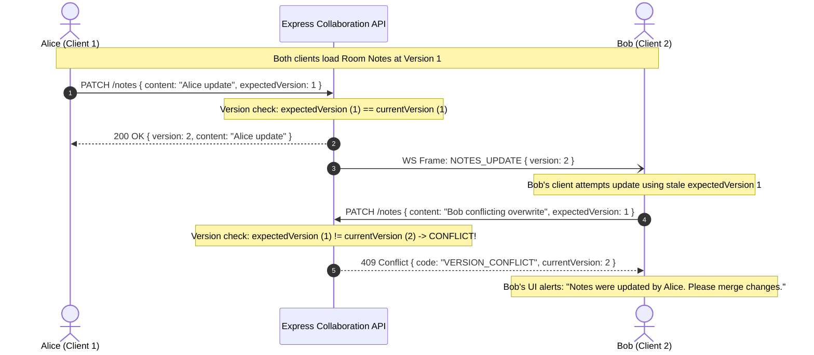

# CarrerSync Phase 16 — Real-Time Learning Collaboration Specification
## Self-Hosted WebSocket Engine, Shared Notes Versioning (HTTP 409 Guard), Study Pods, and WebRTC P2P Relay

**Document Version:** 1.0.0  
**Phase:** Phase 16 — Alumni Mentorship Network, Live Peer Mock Interviews & Realtime Collaboration  
**Date:** November 15, 2026  
**Audience:** Platform Architects, Realtime Engineers, Frontend Developers, Security Auditors  
**Classification:** Canonical Technical Specification  

---

## 1. Overview & Architectural Mission

The **Real-Time Learning Collaboration Subsystem** equips students with synchronized virtual study rooms across 9 core engineering disciplines. It enables groups of up to 10 peers to study together, maintain shared notes, track milestone tasks, and share code snippets.

### Architectural Commitments:
1. **₹0 Zero-Cost Real-Time Infrastructure**:
   Utilizes a self-hosted Node.js WebSocket (`ws`) server running on the existing Express v5 server (port 5050). No reliance on paid message brokers, Pusher, Agora, or Firebase.
2. **Deterministic Optimistic Concurrency (HTTP 409 Conflict)**:
   Shared notes use an explicit version-checking protocol. Out-of-order edits from lagging clients are rejected with `HTTP 409 Conflict`, completely preventing silent data loss.
3. **Safe-by-Default Media & Privacy**:
   Cameras and microphones remain powered off by default. Audio/video activation requires explicit user consent, with text chat and markdown notes serving as robust primary fallbacks.
4. **Resilient Auto-Reconnection**:
   The client architecture features automatic exponential backoff reconnection (1s $\to$ 2s $\to$ 4s $\to$ 8s $\to$ 16s, capped at 30s) to withstand campus network fluctuations.

---

## 2. 9 Disciplines Study Pod Directory

Study rooms are organized across 9 core engineering domains:
1. `DSA`: Data Structures, Algorithms, LeetCode sprints, Competitive Programming.
2. `WEB_DEV`: React, Next.js, CSS, Browser APIs, Frontend Architecture.
3. `BACKEND`: Node.js, Express, Go, Python, Microservices, API Design.
4. `DATABASE`: PostgreSQL, SQL optimization, Indexing, ACID, NoSQL.
5. `AI`: Machine Learning, Deep Learning, Prompt Engineering, Model Deployment.
6. `APTITUDE`: Quantitative Aptitude, Logical Reasoning, Verbal Ability.
7. `INTERVIEW`: Company-specific interview prep, behavioral practice, HR rounds.
8. `PROJECT`: Capstone projects, hackathons, team coding sessions.
9. `GENERAL_STUDY`: Exam preparation, lecture discussions, open office hours.

Rooms support public discovery within the college tenant or private invite-only access guarded by secret passcodes.

---

## 3. Self-Hosted WebSocket Realtime Server

### 3.1 Server Architecture (`websocket.server.ts`)
- Mounted on the existing Express 5 HTTP server at `/ws`.
- Authenticates inbound connections via query parameter `?token=<JWT>`, `Authorization: Bearer <JWT>`, or `Sec-WebSocket-Protocol`.
- Tracks active socket connections in an in-memory index: `userSockets: Map<userId, Set<WebSocket>>` and `rooms: Map<"${tenantId}:${roomId}", Set<WebSocket>>`.
- Maintains a 30-second heartbeat ping/pong interval to clean up stale sockets.

### 3.2 Supported Message Frames

| Message Type | Direction | Payload Structure | Purpose |
| :--- | :---: | :--- | :--- |
| `JOIN_ROOM` | Inbound | `{ roomId }` | Registers socket in room and broadcasts join event. |
| `JOIN_ACK` | Outbound | `{ roomId, activeParticipants }` | Confirms room membership to the connecting client. |
| `LEAVE_ROOM` | Inbound | `{ roomId }` | Removes socket from room and broadcasts departure. |
| `CHAT_MESSAGE` | Bidirectional | `{ content, messageType, codeSnippetJson? }` | Broadcasts real-time chat message or code snippet. |
| `USER_TYPING` | Bidirectional | `{ isTyping: boolean }` | Ephemeral typing indicator relay. |
| `NOTES_UPDATE` | Bidirectional | `{ content, expectedVersion, version }` | Synchronizes notes changes across connected clients. |
| `TASK_UPDATE` | Bidirectional | `{ task: CollaborationTask }` | Broadcasts task creation or completion. |
| `PEER_EVENT` | Bidirectional | `{ eventType, data }` | Relays peer interview round events and role swaps. |
| `WEBRTC_SIGNAL` | Bidirectional | `{ targetUserId, signalType, data }` | P2P WebRTC signaling relay (offer, answer, ICE). |
| `WEBRTC_TOGGLE_MEDIA`| Bidirectional| `{ audio: boolean, video: boolean, active: boolean }` | Broadcasts affirmative media activation consent. |

---

## 4. Shared Notes Versioning & Conflict Protection (HTTP 409)

To ensure that simultaneous edits do not silently clobber each other, the collaboration service implements optimistic version concurrency:



### Server-Side Implementation (`collaboration.service.ts`):
```typescript
if (input.expectedVersion !== undefined && input.expectedVersion !== roomNotes.version) {
  const err: any = new Error(
    `Notes version conflict: expected version ${input.expectedVersion}, but current version is ${roomNotes.version}.`
  );
  err.statusCode = 409;
  err.code = 'VERSION_CONFLICT';
  err.currentVersion = roomNotes.version;
  throw err;
}

roomNotes.content = input.content;
roomNotes.version += 1;
roomNotes.lastModifiedBy = userId;
roomNotes.updatedAt = new Date();
```

---

## 5. Task Checklist & In-Room Chat Stream

### 5.1 Collaborative Task Checklist
Each study pod features a persistent task checklist:
- **Priority Levels**: `LOW`, `MEDIUM`, `HIGH`.
- **Status Progression**: `TODO` $\to$ `IN_PROGRESS` $\to$ `COMPLETED`.
- **Audit Trails**: Stamped with `createdBy`, `assignedTo`, `completedAt`.

### 5.2 Rich In-Room Chat Stream
- **Standard Text**: Markdown-compatible text messages.
- **Code Snippets**: Formatted programming code with syntax highlighting (SQL, JavaScript, TypeScript, Python, Go, C++, Java).
- **Resource Links**: Shared documentation and reference URLs.

---

## 6. Client Realtime Integration (`realtimeClient.js`)

The frontend interacts with the WebSocket server through a singleton client:
- **Automatic Reconnection**: Employs exponential backoff with jitter on network dropouts.
- **Event Bus**: Extends a lightweight EventEmitter pattern (`on`, `off`, `emit`).
- **WebRTC Optional P2P Media**:
  * Free STUN server configuration: `stun:stun.l.google.com:19302`.
  * Explicit user media gating via `enableUserMedia(audio, video)`.
  * Proper peer teardown and track release on component unmount (`stopMediaTracks()`).

---

## 7. REST API Endpoint Reference

### `/api/v1/collaboration`
- `GET /api/v1/collaboration/rooms`: List study rooms with optional filters (`category`, `search`, `status`).
- `POST /api/v1/collaboration/rooms`: Create a new study room (name, category, private passcode, max members).
- `GET /api/v1/collaboration/rooms/:id`: Get full room details, active participants, notes, and task lists.
- `POST /api/v1/collaboration/rooms/:id/join`: Join room (validates passcode for private rooms).
- `POST /api/v1/collaboration/rooms/:id/leave`: Leave room gracefully.
- `GET /api/v1/collaboration/rooms/:id/messages`: Retrieve historical chat messages.
- `POST /api/v1/collaboration/rooms/:id/messages`: Post chat message or code snippet.
- `PATCH /api/v1/collaboration/rooms/:id/notes`: Update shared notes with optimistic version checking (HTTP 409).
- `POST /api/v1/collaboration/rooms/:id/tasks`: Create checklist task.
- `PATCH /api/v1/collaboration/rooms/:id/tasks/:taskId`: Update task status or priority.
