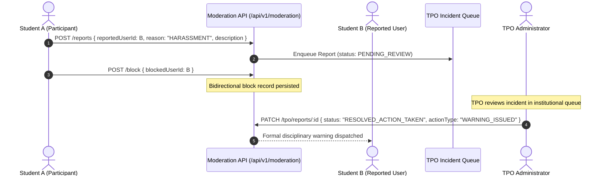

# CarrerSync Phase 16 — Security, Safety & Moderation Specification
## Comprehensive Student Protection, Anti-Harassment Safeguards, TPO Incident Triage, and Cryptographic Multi-Tenant Isolation

**Document Version:** 1.0.0  
**Phase:** Phase 16 — Alumni Mentorship Network, Live Peer Mock Interviews & Realtime Collaboration  
**Date:** November 15, 2026  
**Audience:** Platform Architects, Security Officers, TPO Leadership, Compliance Auditors  
**Classification:** Canonical Security Specification  

---

## 1. Overview & Security Mandate

CarrerSync Phase 16 introduces human-to-human collaboration across students and graduates. Because open communication channels introduce risks of harassment, commercial solicitation, and privacy violations, Phase 16 implements an **uncompromising security, safety, and moderation framework**.

### Core Safety Guarantees:
1. **Zero-PII Platform-Mediated Communication**:
   Students and alumni interact strictly within the CarrerSync platform. Personal phone numbers, personal email addresses, and physical locations are never exposed in user profiles or directory listings.
2. **Safe-by-Default Audio/Video Policy**:
   WebRTC media capture never begins automatically. All rooms default to text chat and shared notes. Audio and video activate only upon affirmative, explicit user interaction.
3. **Instantaneous Bidirectional Participant Blocking**:
   Any user can block another user immediately. Blocking instantaneously terminates active interactions and prevents the blocked party from sending mentorship requests or entering collaborative rooms hosted by the blocker.
4. **TPO Institutional Adjudication & Progressive Sanctions**:
   Incident reports queue directly for institutional TPO review. TPOs possess exclusive authority to issue formal warnings, terminate sessions, enforce institutional blocks, or suspend user accounts.
5. **Recruiter Isolation Barrier**:
   Recruiters are strictly excluded from mentorship directories, student practice rooms, and moderation queues. Peer practice is educational; recruiters have zero access to peer mock scorecards or mentorship requests.
6. **Dual-Layer Multi-Tenant Cryptographic Isolation**:
   Mismatched tenant headers or cross-tenant route requests are rejected with `403 TENANT_SPOOFING_REJECTED`.

---

## 2. Participant Incident Reporting Workflow



### 2.1 Standardized Incident Reason Taxonomy
- `HARASSMENT`: Inappropriate language, intimidation, or aggressive behavior.
- `INAPPROPRIATE_BEHAVIOR`: Unprofessional conduct during interview or mentoring.
- `COMMERCIAL_SOLICITATION`: Posting commercial course links, fee-based services, or Discord servers.
- `SPAM_PROMOTION`: Unsolicited promotional messaging or repetitive text dumping.
- `OFFENSIVE_CONTENT`: Explicit, abusive, or discriminatory content.
- `OTHER`: Policy violations not covered by standard categories.

---

## 3. Bidirectional Participant Blocking Engine

When User A blocks User B via `POST /api/v1/moderation/block`:
1. **Persistent Block Record**: Stored in PostgreSQL `moderationActions` with `actionType = 'PARTICIPANT_BLOCKED'`.
2. **Immediate Interactivity Severance**:
   - Mentorship: User B cannot send requests to User A, and User A cannot request User B (`Interaction is blocked between these participants`).
   - Peer Interviews: User B cannot join private or public peer rooms created by User A.
   - Study Rooms: User B cannot enter collaboration study pods where User A is the host.
3. **Lookup Guarantee**: The `moderationService.isBlocked(tenantId, user1, user2)` helper performs an indexed bidirectional check in $O(1)$ memory time or direct SQL indexed query.

---

## 4. TPO Administrative Adjudication & Sanctions

Only authorized institutional personnel (`TPO_ADMIN`, `COLLEGE_ADMIN`, `SUPER_ADMIN`) can access the moderation queue. Students and alumni attempting to access the review queue receive an immediate `403 Forbidden` (`code: TPO_AUTHORITY_REQUIRED`).

### Progressive Sanction Levels:

| Sanction Type | Operational Impact | Authority Level |
| :--- | :--- | :---: |
| `NO_ACTION` | Report investigated and deemed unsubstantiated. Closed with audit note. | TPO Admin |
| `WARNING_ISSUED` | Formal policy violation warning dispatched to user's in-app inbox. | TPO Admin |
| `SESSION_TERMINATED` | Current active session or collaboration room is immediately closed. | TPO Admin |
| `PARTICIPANT_BLOCKED` | Institutional block enforced across all collaborative features for user. | TPO Admin |
| `ACCOUNT_SUSPENDED` | User account deactivated platform-wide (`users.isActive = false`). | TPO / Super Admin |

---

## 5. Multi-Tenant Cryptographic Boundaries

### 5.1 Dual-Layer Anti-Spoofing Architecture
All incoming requests pass through `tenantMiddleware` in `server/src/middleware/tenant.ts`:
1. **Layer 1: JWT Authoritative Claim**: The token's cryptographic payload contains `tenant_id`.
2. **Layer 2: Header / Body Reconciliation**:
   - If a client passes an `x-tenant-id` header or body `tenantId` that differs from the JWT claim:
   - The request is immediately rejected with `403 Forbidden`:
     ```json
     {
       "success": false,
       "error": "Tenant access forbidden: tenant spoofing detected",
       "code": "TENANT_SPOOFING_REJECTED"
     }
     ```
3. **Layer 3: Row-Level Security Scoping**: All SQL queries and in-memory caches include explicit `eq(table.tenantId, tenantId)` predicates.

---

## 6. Comprehensive RBAC Matrix across 6 Roles

| Feature / Action | Student | Alumni | Recruiter | Faculty Coordinator | TPO Admin | Super Admin |
| :--- | :---: | :---: | :---: | :---: | :---: | :---: |
| Browse Verified Mentors | **Allow** | **Allow** | **Deny (403)** | **Allow** | **Allow** | **Allow** |
| Send Mentorship Request | **Allow** | **Deny** | **Deny (403)** | **Deny** | **Deny** | **Deny** |
| Accept / Decline Requests | **Deny** | **Allow** | **Deny** | **Deny** | **Deny** | **Deny** |
| Verify Alumni Profile | **Deny (403)** | **Deny (403)** | **Deny (403)** | **Deny (403)** | **Allow** | **Allow** |
| Suspend Alumni Profile | **Deny (403)** | **Deny (403)** | **Deny (403)** | **Deny (403)** | **Allow** | **Allow** |
| View Mentorship Analytics | **Deny (403)** | **Deny (403)** | **Deny (403)** | **Allow (if del)** | **Allow** | **Allow** |
| Host Peer Mock Interview | **Allow** | **Allow** | **Deny (403)** | **Allow** | **Allow** | **Allow** |
| Submit Constructive Rubric | **Allow** | **Allow** | **Deny (403)** | **Allow** | **Allow** | **Allow** |
| Create Collaboration Pod | **Allow** | **Allow** | **Deny (403)** | **Allow** | **Allow** | **Allow** |
| Submit Incident Report | **Allow** | **Allow** | **Deny** | **Allow** | **Allow** | **Allow** |
| Block Other User | **Allow** | **Allow** | **Deny** | **Allow** | **Allow** | **Allow** |
| View Moderation Reports Queue | **Deny (403)** | **Deny (403)** | **Deny (403)** | **Deny (403)** | **Allow** | **Allow** |
| Adjudicate Report & Sanction | **Deny (403)** | **Deny (403)** | **Deny (403)** | **Deny (403)** | **Allow** | **Allow** |

---

## 7. REST API Endpoint Reference

### `/api/v1/moderation`
- `POST /api/v1/moderation/reports`: Submit incident report (any authenticated student or alumni).
- `POST /api/v1/moderation/block`: Block participant directly (bidirectional enforcement).

### `/api/v1/tpo/moderation`
- `GET /api/v1/tpo/moderation/reports`: TPO review queue for unresolved incident reports.
- `PATCH /api/v1/tpo/moderation/reports/:id`: Resolve incident report and apply administrative sanction.
