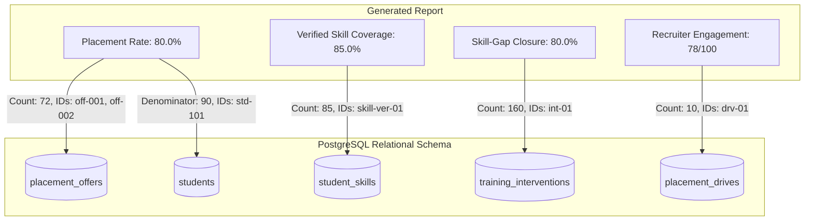

# Phase 17 — Accreditation Reporting & Evidence Traceability

## 1. Executive Summary

CarrerSync's **Accreditation Reporting Suite** automates the generation, validation, and auditing of institutional compliance reports required by higher education statutory accreditation bodies, including **NAAC** (National Assessment and Accreditation Council), **NIRF** (National Institutional Ranking Framework), and **NBA** (National Board of Accreditation).

Rather than compiling spreadsheets manually at the end of each academic cycle, institutions use CarrerSync to produce real-time, audit-ready compliance dossiers. Every aggregated number in a generated report is backed by an **Evidence Traceability Matrix**, which explicitly maps the figure to its source PostgreSQL relational table, record count, and sample row IDs.

---

## 2. Statutory Regulatory Disclosure

All accreditation reports generated by CarrerSync incorporate a non-waivable statutory disclaimer:

> **STATUTORY REPORTING AID NOTICE**: This document is generated as an internal institutional data-compilation and reporting aid. While all metrics are derived empirically from verified relational database rows, this document does NOT constitute official accreditation certification, ranking endorsement, or statutory validation by NAAC, NIRF, NBA, or any governmental regulatory authority. Formal submissions must be reviewed and officially signed by authorized institutional officials.

---

## 3. Fourteen Standard Report Categories & Templates

The platform ships with pre-configured templates covering 14 standard regulatory and institutional categories:

| # | Template Code | Report Category | Regulatory Framework | Key Metrics Covered |
|:---|:---|:---|:---|:---|
| 1 | `NAAC_5_2_1` | Placement Statistics (Criterion 5.2.1) | NAAC | Total eligible students, verified placed students, placement percentage, employer list. |
| 2 | `NIRF_GO_OUTCOMES` | Graduation Outcomes (Metric 5.2.1 & 5.2.2) | NIRF | Placements, median salary, mean CTC, higher studies progression, accredited programs. |
| 3 | `NBA_CRITERION_10` | Placement & Industry Interaction (Crit 10) | NBA | Departmental placement trends, average package, recruiter participation, core engineering share. |
| 4 | `BRANCH_WISE_SUMMARY` | Branch-Wise Placement Outcomes | Institutional Internal | Department breakdown, conversion funnel drop-offs, highest & average CTC per branch. |
| 5 | `COMPANY_PARTICIPATION` | Company & Recruiter Participation | Institutional Internal | Active recruiter count, drive schedules, offers per corporate tier, recruitment retention. |
| 6 | `SALARY_DISTRIBUTION` | Salary & Offer Compensation Distribution | Institutional Internal | CTC histograms (median, mean, 25th/75th percentiles, highest package, stipend stats). |
| 7 | `HIGHER_EDUCATION` | Higher Studies & Competitive Exams | NAAC / NIRF | Students qualifying for GATE, GRE, CAT, GMAT, TOEFL, and admitted to higher degree programs. |
| 8 | `ENTREPRENEURSHIP` | Student Startups & Entrepreneurship | NAAC / NIRF | Student-founded ventures, incubation support, funding raised, intellectual property filings. |
| 9 | `VERIFIED_SKILL_COVERAGE` | Verified Skill Coverage Rate | Institutional Internal | Cohort percentage with $\ge 1$ verified skill, average verified skills per student. |
| 10 | `SKILL_GAP_CLOSURE` | Industry Skill-Gap Closure Rate | Institutional Internal | Diagnosed curricular skill deficits vs verified closed gaps post-intervention. |
| 11 | `TRAINING_INTERVENTIONS` | Remedial Upskilling Interventions | NAAC Criterion 2 | Bootcamps conducted, attendance vs verified project mastery, improvement rate. |
| 12 | `MOCK_ASSESSMENT_PERFORMANCE` | Student Assessment & Readiness | Institutional Internal | Cognitive aptitude scores, coding benchmarks, mock interview performance metrics. |
| 13 | `ALUMNI_MENTORSHIP` | Alumni Mentorship & Peer Engagement | NAAC Criterion 5.4 | Active alumni mentors, mock interview sessions conducted, student feedback scores. |
| 14 | `ACADEMIC_YEAR_COMPARISON` | Multi-Year Longitudinal Trends | NIRF / Internal | 3-year to 5-year longitudinal trends in placement %, median package, and recruiter appeal. |

---

## 4. Evidence Traceability & Audit Matrix

A critical differentiator of CarrerSync is **Evidence Traceability**. Standard reporting tools output opaque summary tables; CarrerSync outputs an audit ledger linking every aggregate metric to its exact database origin:



### Traceability Schema
Each traceable metric item exposes:
```ts
export interface TraceableMetricItem {
  metricKey: string;             // e.g. "placementRate"
  metricLabel: string;           // "Empirical Placement Rate (%)"
  value: number | string | null; // 80.0
  sourceTable: string;           // "placement_offers"
  recordCount: number;           // 72
  sampleRecordIds: string[];     // ["off-1111-001", "off-1111-002", "off-1111-003"]
}
```

This guarantees institutional compliance auditors can independently pull underlying records from PostgreSQL, verifying that reported figures are 100% authentic and un-manipulated.

---

## 5. Multi-Format Export Engine & Security

### 5.1 Export Formats
Reports can be generated and exported in four formats:
1. **JSON (`application/json`)**: Full structured machine-readable payload including preview metadata, summary metrics, evidence traceability array, and completeness scores.
2. **CSV (`text/csv`)**: Tabular export ready for Excel or government data ingestion, with separate sections for metric traceability and departmental breakdowns.
3. **Formatted Text / PDF Representation (`application/pdf` / `text/plain`)**: Pre-formatted, audit-headered document ready for printing, institutional archiving, or formal submission.

### 5.2 Security, Multi-Tenant Scoping & Permissions
- **RBAC**: Generating and viewing reports is restricted strictly to `TPO_ADMIN`, `COLLEGE_ADMIN`, and `SUPER_ADMIN`. Requests from `STUDENT` or `RECRUITER` users are rejected with `403 Forbidden` (`FORBIDDEN_INSUFFICIENT_ROLE`).
- **Cross-Tenant Isolation**: Generated reports record their originating `tenantId`. Retrieving a report belonging to another institution returns `403 Forbidden` (`FORBIDDEN_TENANT_ACCESS`), ensuring zero leakage of confidential placement records between institutions.

---

## 6. Frontend Integration

Implemented in `client/src/pages/tpo/AccreditationReports.jsx`:
- **Report Template Catalog**: Visual card grid of all 14 accreditation templates with search, category filtering, and statutory disclaimers.
- **Pre-flight Report Preview Modal**: Calculates completeness score, highlights missing required parameters, and displays the granular evidence traceability matrix prior to export.
- **One-Click Export Toolbar**: Direct download buttons for CSV, Excel XLSX, and formatted PDF.
- **Historical Reports Archive**: Immutable log of past generated reports with timestamps, generating user, and SHA-256 audit hashes.
