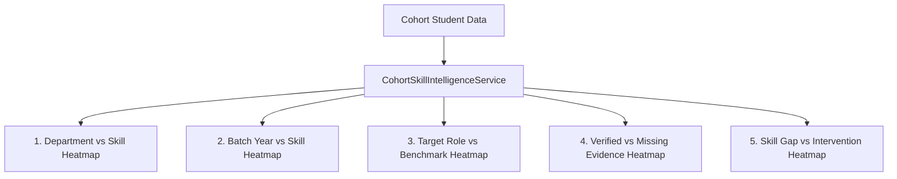
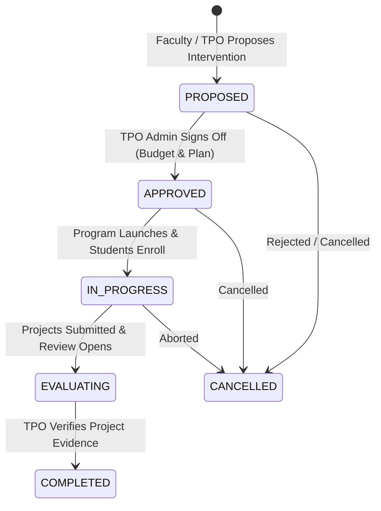

# Phase 17 — Cohort Skill Analytics & Training Interventions

## 1. Executive Summary

CarrerSync's **Cohort Skill Analytics & Training Intervention Engine** bridges the gap between aggregate academic performance and individual technical competency. While standard academic dashboards report high-level CGPA figures, this subsystem models verified technical abilities, tracks departmental skill gaps against live employer requirements, and facilitates evidence-driven upskilling programs.

Crucially, the platform enforces two foundational educational principles:
1. **Course attendance alone does not equal skill mastery**: Attending a workshop or training course is insufficient to claim competency; students must submit tangible, verifiable project evidence that undergoes institutional review before a skill gain is recorded.
2. **Supportive, non-stigmatizing classification**: The platform strictly prohibits public student rankings, "at-risk" stigmatizing labels, or automated punitive actions. Students needing assistance receive constructive support recommendations with actionable remedial pathways.

---

## 2. Interactive Cohort Skill Heatmaps

The cohort intelligence engine produces interactive matrix heatmaps across five distinct analytical dimensions, allowing TPOs and Department Heads to rapidly pinpoint institutional strengths and curricular deficits:



### 2.1 Heatmap Dimensions

| Dimension | Primary Axis (Rows) | Secondary Axis (Columns) | Metric Evaluated | Purpose |
|:---|:---|:---|:---|:---|
| **Department vs Skill** | Academic Department | Core Industry Skill | Coverage Rate (%) & Gap Density | Identifies which engineering branches excel or lag in specific technical stacks. |
| **Batch vs Skill** | Graduation Year | Core Industry Skill | Multi-Year Progression Rate | Evaluates curriculum improvements across incoming and graduating cohorts. |
| **Target Role vs Benchmark** | Target Role Profile | Required Competency | Readiness Benchmark Delta | Compares cohort preparation against active employer job requirements. |
| **Verified vs Missing Evidence** | Skill Category | Verification Evidence Type | Evidence Submission Ratio | Flags self-declared claims lacking GitHub, project, or assessment proof. |
| **Gap vs Intervention** | Diagnosed Skill Deficit | Remedial Intervention | Resolution Percentage | Measures efficacy of specific training interventions in closing targeted gaps. |

### 2.2 Heatmap Cell Structure
Each cell in a generated heatmap contains:
- `rowKey` & `colKey`: Identifiers for the intersecting dimensions.
- `value`: Normalized numerical score (0.0 to 100.0%).
- `studentCount`: Number of students evaluated in the intersection.
- `evidenceCount`: Verified artifacts submitted.
- `status`: Classified as `CRITICAL_GAP` (<40%), `MODERATE_GAP` (40–69%), or `STRENGTH` (≥70%).
- `isSuppressed`: Active when sample size $N < 5$, preventing statistical distortions in niche specializations.

---

## 3. Training Intervention Management Lifecycle

The platform provides a structured lifecycle for organizing, approving, executing, and evaluating targeted institutional upskilling bootcamps.



### 3.1 The "Attendance != Mastery" Policy Gate
In many institutions, certificates and skill credits are awarded merely for physical or online presence in lecture halls. CarrerSync enforces programmatic adherence to genuine competency:

- **Attendance Tracking**: The system records whether a participant attended the intervention sessions (`attendanceVerified: boolean`).
- **Mandatory Project Evidence**: The participant must submit a public repository, deployment URL, or portfolio artifact (`projectEvidenceUrl: string`, `projectEvidenceDescription: string`).
- **TPO Verification Requirement**: An authorized faculty reviewer or TPO administrator must evaluate the submitted artifact and toggle `tpoVerified: true`.
- **Enforcement Mechanism**: If an administrator attempts to verify a student who only attended without submitting demonstrable project evidence, `CohortSkillIntelligenceService` immediately halts the operation and throws an explicit `Policy Violation`:
  ```ts
  if (verified && !participant.projectEvidenceSubmitted) {
    throw new Error(
      `Policy violation: Course attendance alone cannot certify skill mastery for student ${studentId}. ` +
      `Demonstrable project evidence must be submitted and verified.`
    );
  }
  ```

---

## 4. Supportive, Non-Stigmatizing Student Classifications

To support student well-being and eliminate toxic competitive pressure, CarrerSync rejects punitive labeling, public leaderboard rankings, and deterministic automated rejections:

### 4.1 Permitted Classification Taxonomies

| Classification | Meaning | Institutional Action Triggered |
|:---|:---|:---|
| `SUPPORT_RECOMMENDED` | Student exhibits diagnosed skill gaps across fundamental requirements. | Recommends participation in optional faculty clinics and peer study pods. |
| `ADDITIONAL_PRACTICE_SUGGESTED` | Student has foundational knowledge but lacks verified project artifacts. | Suggests guided mock interview drills and open-source project contributions. |
| `INSUFFICIENT_DATA` | Student recently joined or has completed fewer than minimum assessments ($N < 3$). | Encourages profile completion without imposing negative performance flags. |
| `PROGRESSING` | Student is actively closing diagnosed gaps and building verified evidence. | Acknowledges upward learning trajectory. |
| `NO_ACTION_REQUIRED` | Student satisfies all target role benchmarks with verified evidence. | Cleared for Tier-1 recruiter drives. |

### 4.2 Ethical Safeguards
- **Zero Public Rankings**: Student support profiles are visible exclusively to designated TPO counselors and the individual student.
- **Explainable Reasons**: Every classification contains an explicit, human-readable rationale (e.g., *"Student has foundational knowledge in Java but lacks verified full-stack project evidence for Backend Developer roles"*).
- **Prohibition of Automated Exclusion**: A classification of `SUPPORT_RECOMMENDED` can never automatically de-register or bar a student from applying to open placement drives.

---

## 5. UI and Frontend Integration

Implemented in `client/src/pages/tpo/CohortSkillIntelligence.jsx`:
- **Heatmap Viewer**: Interactive grid displaying department/batch coverage with color-coded gap intensities and cell inspection dialogs.
- **Intervention Builder Modal**: Modal to define intervention title, target skill, department, batch, budget, and structured action plan.
- **Participant Ledger**: Table tracking participant enrollment, attendance, project links, TPO verification status, and recorded skill gain.
- **Student Support Queue**: Dedicated view showing students categorized under supportive labels with direct actions to invite them to targeted workshops.
