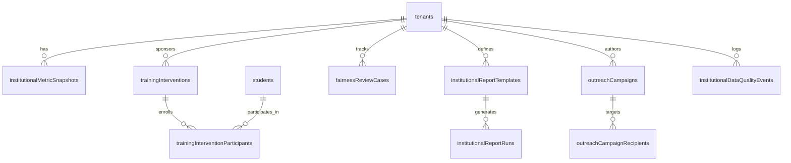

# Phase 17 — Database Schema & Express 5 REST API Specifications

## 1. Executive Summary

Phase 17 expands the CarrerSync database architecture with five authoritative PostgreSQL enums, nine production relational tables (bringing the platform schema to 104 tables), comprehensive Drizzle relations, and an additive migration (`0007_hot_human_fly.sql`). All tables enforce multi-tenant isolation via mandatory foreign key constraints to `tenants.id` with `ON DELETE cascade`.

The accompanying Express 5 REST API suite exposes modular endpoints for institutional intelligence, cohort heatmaps, training interventions, algorithmic fairness governance, accreditation reporting, and recruiter outreach.

---

## 2. Database Schema Extensions (`server/src/db/schema.ts`)

### 2.1 Domain Enums

```sql
-- 1. Training Intervention Status
CREATE TYPE "intervention_status" AS ENUM (
  'PROPOSED', 'APPROVED', 'IN_PROGRESS', 'EVALUATING', 'COMPLETED', 'CANCELLED'
);

-- 2. Algorithmic Fairness Review Status
CREATE TYPE "fairness_review_status" AS ENUM (
  'FLAGGED', 'UNDER_REVIEW', 'EXPLANATION_REQUESTED', 'RESOLVED', 'ESCALATED'
);

-- 3. Accreditation Report Export Formats
CREATE TYPE "report_format" AS ENUM (
  'PDF', 'EXCEL', 'CSV', 'JSON'
);

-- 4. Regulatory & Institutional Report Categories
CREATE TYPE "report_category" AS ENUM (
  'PLACEMENT_STATISTICS', 'BRANCH_WISE_OUTCOMES', 'COMPANY_PARTICIPATION',
  'SALARY_DISTRIBUTION', 'VERIFIED_SKILL_COVERAGE', 'SKILL_GAP_CLOSURE',
  'TRAINING_INTERVENTIONS', 'MOCK_ASSESSMENT_PERFORMANCE', 'ALUMNI_MENTORSHIP',
  'ACADEMIC_YEAR_COMPARISON'
);

-- 5. Recruiter Outreach Campaign Status
CREATE TYPE "outreach_campaign_status" AS ENUM (
  'DRAFT', 'UNDER_REVIEW', 'APPROVED', 'QUEUED', 'SENT',
  'PARTIALLY_SENT', 'FAILED', 'CANCELLED'
);
```

---

### 2.2 Relational Tables (Tables 96–104)



#### Table 96: `institutionalMetricSnapshots`
Stores longitudinal institutional KPI snapshots across academic years and cohorts.
- `id`: UUID (Primary Key)
- `tenantId`: UUID (FK $\to$ `tenants.id`, CASCADE)
- `reportingYear`: Integer (e.g., 2025)
- `academicCycle`: Varchar(64) (e.g., "2024-2025")
- `totalStudents`: Integer
- `eligibleStudents`: Integer (Denominator)
- `placedStudents`: Integer (Numerator)
- `placementRate`: Real
- `medianSalary`: Real
- `meanSalary`: Real
- `verifiedSkillCoverageRate`: Real
- `skillGapClosureRate`: Real
- `recruiterEngagementScore`: Real
- `completenessScore`: Real
- `metadata`: JSONB
- `createdAt`, `updatedAt`: Timestamps

#### Table 97: `trainingInterventions`
Targeted upskilling workshops and bootcamps to close diagnosed industry gaps.
- `id`: UUID (Primary Key)
- `tenantId`: UUID (FK $\to$ `tenants.id`, CASCADE)
- `title`: Varchar(256)
- `description`: Text
- `targetSkill`: Varchar(128)
- `targetDepartment`: Varchar(128)
- `targetBatch`: Integer
- `status`: `intervention_status` enum (Default: `PROPOSED`)
- `proposedBy`: UUID (FK $\to$ `users.id`)
- `approvedBy`: UUID (FK $\to$ `users.id`)
- `actionPlan`: Text
- `budget`: Real
- `enforceEvidenceMastery`: Boolean (Default: `true`)
- `startDate`, `endDate`: Timestamps
- `createdAt`, `updatedAt`: Timestamps

#### Table 98: `trainingInterventionParticipants`
Enrolled student tracking enforcing that attendance alone does not equal mastery.
- `id`: UUID (Primary Key)
- `interventionId`: UUID (FK $\to$ `trainingInterventions.id`, CASCADE)
- `studentId`: UUID (FK $\to$ `students.id`, CASCADE)
- `attendanceVerified`: Boolean (Default: `false`)
- `projectEvidenceUrl`: Varchar(512)
- `projectEvidenceDescription`: Text
- `tpoVerified`: Boolean (Default: `false`)
- `verifiedBy`: UUID (FK $\to$ `users.id`)
- `verifiedSkillGainRecorded`: Boolean (Default: `false`)
- `supportClassification`: Varchar(64)
- `createdAt`, `updatedAt`: Timestamps

#### Table 99: `fairnessReviewCases`
Algorithmic fairness tracking EEOC Four-Fifths benchmark disparities.
- `id`: UUID (Primary Key)
- `tenantId`: UUID (FK $\to$ `tenants.id`, CASCADE)
- `metricName`: Varchar(256)
- `affectedGroup`: Varchar(128)
- `referenceGroup`: Varchar(128)
- `groupSelectionRate`: Real
- `referenceGroupSelectionRate`: Real
- `disparityRatio`: Real
- `isSuppressed`: Boolean (Default: `false`, $N < 5$)
- `status`: `fairness_review_status` enum (Default: `FLAGGED`)
- `assignedReviewerId`: UUID (FK $\to$ `users.id`)
- `explanation`: Text
- `resolutionReason`: Text
- `auditTrail`: JSONB
- `createdAt`, `updatedAt`: Timestamps

#### Table 100: `institutionalReportTemplates`
Pre-configured and custom regulatory compliance templates (NAAC, NIRF, NBA).
- `id`: UUID (Primary Key)
- `tenantId`: UUID (FK $\to$ `tenants.id`, CASCADE)
- `code`: Varchar(64)
- `name`: Varchar(256)
- `category`: `report_category` enum
- `framework`: Varchar(64)
- `supportedFormats`: JSONB
- `requiredFields`: JSONB
- `disclaimer`: Text
- `isBuiltIn`: Boolean (Default: `true`)
- `createdAt`, `updatedAt`: Timestamps

#### Table 101: `institutionalReportRuns`
Generated audit reports with evidence traceability linking to database rows.
- `id`: UUID (Primary Key)
- `tenantId`: UUID (FK $\to$ `tenants.id`, CASCADE)
- `templateCode`: Varchar(64)
- `format`: `report_format` enum
- `parameters`: JSONB
- `completenessScore`: Real
- `evidenceTraceability`: JSONB
- `summaryMetrics`: JSONB
- `sha256AuditHash`: Varchar(64)
- `generatedBy`: UUID (FK $\to$ `users.id`)
- `createdAt`: Timestamp

#### Table 102: `outreachCampaigns`
Recruiter invitation campaigns requiring mandatory human approval.
- `id`: UUID (Primary Key)
- `tenantId`: UUID (FK $\to$ `tenants.id`, CASCADE)
- `title`: Varchar(256)
- `subject`: Varchar(512)
- `bodyTemplate`: Text
- `targetAudience`: JSONB
- `status`: `outreach_campaign_status` enum (Default: `DRAFT`)
- `approvedBy`: UUID (FK $\to$ `users.id`)
- `approvalNotes`: Text
- `sentAt`: Timestamp
- `createdBy`: UUID (FK $\to$ `users.id`)
- `createdAt`, `updatedAt`: Timestamps

#### Table 103: `outreachCampaignRecipients`
Individual contact targets with unique composite index preventing duplicate emails.
- `id`: UUID (Primary Key)
- `campaignId`: UUID (FK $\to$ `outreachCampaigns.id`, CASCADE)
- `recipientEmail`: Varchar(256)
- `companyName`: Varchar(256)
- `contactPerson`: Varchar(256)
- `status`: Varchar(64) (e.g., 'SENT', 'SUPPRESSED', 'DUPLICATE_SKIPPED')
- `sentAt`: Timestamp
- **Unique Constraint**: `UNIQUE (campaignId, recipientEmail)`

#### Table 104: `institutionalDataQualityEvents`
Audit ledger tracking data quality anomalies, small-group suppressions, and missing filters.
- `id`: UUID (Primary Key)
- `tenantId`: UUID (FK $\to$ `tenants.id`, CASCADE)
- `eventType`: Varchar(128)
- `details`: JSONB
- `observationCount`: Integer
- `completenessScore`: Real
- `createdAt`: Timestamp

---

## 3. 100% Additive Drizzle Migration (`0007_hot_human_fly.sql`)

The migration generated via `npm run db:generate --prefix server` is strictly additive:
- **ZERO `DROP TABLE`**
- **ZERO `DROP COLUMN`**
- **ZERO `TRUNCATE`**
- All 9 new tables feature explicit multi-tenant foreign keys referencing `tenants.id` with `ON DELETE cascade`.

---

## 4. Complete REST API Endpoint Catalog

All routes are mounted in `server/src/app.ts` protected by `requireAuth`, `tenantMiddleware`, and `requireTpoAuthority` (or `requireRole(['college_admin', 'superadmin'])`).

### 4.1 Institutional KPI Routes (`/api/v1/tpo/institutional/` & `/api/v1/college-admin/institutional/`)
- `GET /api/v1/tpo/institutional/overview`: Retrieves executive KPI metrics (placement rate, skill coverage, gap closure, shortlist-to-offer ratio, time-to-shortlist, recruiter engagement, departmental breakdowns).
- `GET /api/v1/tpo/institutional/cohort`: Retrieves supportive non-stigmatizing student support profiles.
- `GET /api/v1/tpo/institutional/skills?type=...`: Generates matrix heatmaps across the 5 dimensions.
- `GET /api/v1/tpo/institutional/placements`: Returns placement conversion funnels and salary distributions.
- `GET /api/v1/tpo/institutional/recruiters`: Returns recruiter engagement score and drive statistics.
- `GET /api/v1/college-admin/institutional/overview`: High-level institutional dashboard for college leadership.

### 4.2 Training Intervention Routes (`/api/v1/tpo/interventions`)
- `GET /api/v1/tpo/interventions`: List upskilling programs (filterable by status).
- `POST /api/v1/tpo/interventions`: Propose new training intervention.
- `GET /api/v1/tpo/interventions/:id`: Get intervention details and participant progress.
- `PATCH /api/v1/tpo/interventions/:id`: Update intervention status (e.g. `APPROVED`, `IN_PROGRESS`).
- `POST /api/v1/tpo/interventions/:id/participants`: Submit student project evidence.
- `POST /api/v1/tpo/interventions/:id/verify`: TPO human verification of student project evidence.

### 4.3 Algorithmic Fairness Routes (`/api/v1/tpo/fairness`)
- `GET /api/v1/tpo/fairness`: Multi-stage selection funnel analysis, Four-Fifths disparity evaluations, and active review cases queue.
- `POST /api/v1/tpo/fairness/reviews`: Create new fairness review adjudication case.
- `PATCH /api/v1/tpo/fairness/reviews/:id`: Advance case workflow (`UNDER_REVIEW`, `EXPLANATION_REQUESTED`, `RESOLVED`, `ESCALATED`).

### 4.4 Accreditation Reporting Routes (`/api/v1/tpo/accreditation`)
- `GET /api/v1/tpo/accreditation/templates`: List 14 pre-configured regulatory templates.
- `POST /api/v1/tpo/accreditation/reports/preview`: Pre-flight report preview with completeness scoring and evidence traceability matrix.
- `POST /api/v1/tpo/accreditation/reports/export`: Export compliance report in JSON, CSV, or formatted PDF.
- `GET /api/v1/tpo/accreditation/reports/:id`: Retrieve previously exported report artifact (strictly tenant-isolated).

### 4.5 Recruiter Outreach Routes (`/api/v1/tpo/outreach`)
- `GET /api/v1/tpo/outreach/campaigns`: List outreach campaigns across lifecycle.
- `POST /api/v1/tpo/outreach/campaigns`: Create campaign draft with dynamic placeholders.
- `POST /api/v1/tpo/outreach/campaigns/:id/preview`: Recipient preview, deduplication check, and rendered copy inspection.
- `POST /api/v1/tpo/outreach/campaigns/:id/approve`: Mandatory human approval gate.
- `POST /api/v1/tpo/outreach/campaigns/:id/send`: Dispatch approved campaign (blocks unapproved campaigns).
- `GET /api/v1/tpo/outreach/campaigns/:id/export`: Download ₹0 cardless mail merge CSV.
- `GET /api/v1/tpo/outreach/contacts`: List corporate recruiter contacts.
- `POST /api/v1/tpo/outreach/contacts`: Register new recruiter contact.
