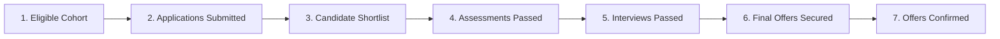
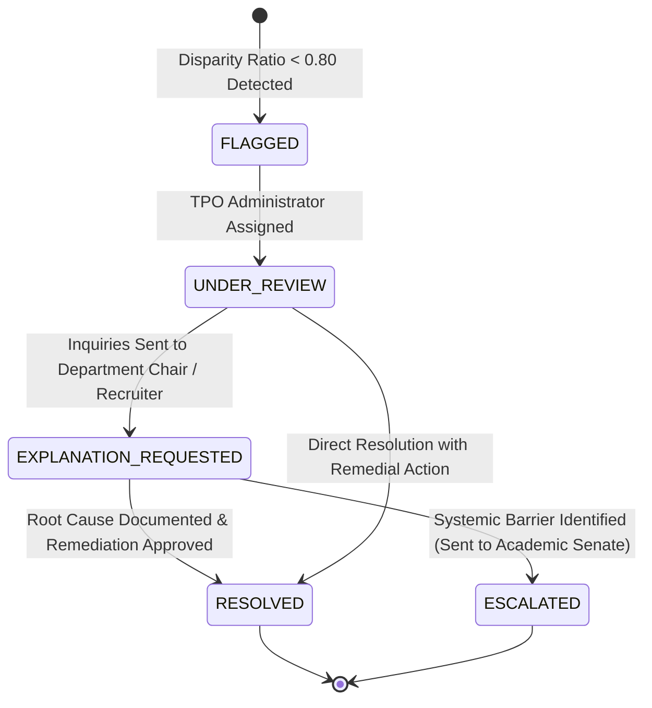

# Phase 17 — Algorithmic Fairness & Selection Governance

## 1. Executive Summary

CarrerSync's **Algorithmic Fairness Governance Suite** establishes a rigorous, transparent framework to detect, monitor, and remediate selection disparities across campus recruitment drives. As automated candidate screening and AI-driven assessments proliferate, institutions bear a legal, ethical, and accreditation responsibility to ensure selection funnels remain fair, equitable, and accountable.

This module adapts the internationally recognized **EEOC Uniform Guidelines on Employee Selection Procedures (Four-Fifths Rule)** for higher education placement funnels. It pairs mathematical screening with strict human-in-the-loop governance: algorithmic flags never constitute automated legal findings; rather, they serve as non-punitive screening alerts that route cases to human TPO administrators and department chairs for review and curriculum support.

---

## 2. Selection Funnel Architecture

Recruitment pipelines are evaluated across seven granular stages, identifying exactly where candidate attrition or disparity manifests:

### Stage Conversion Metrics
For each cohort or demographic group, the engine computes:
- **Application Rate**: $\frac{N_{\text{applications}}}{N_{\text{eligible}}}$
- **Shortlist Rate**: $\frac{N_{\text{shortlisted}}}{N_{\text{applications}}}$
- **Assessment Pass Rate**: $\frac{N_{\text{assessments\_passed}}}{N_{\text{shortlisted}}}$
- **Interview Pass Rate**: $\frac{N_{\text{interviews\_passed}}}{N_{\text{assessments\_passed}}}$
- **Offer Conversion Rate**: $\frac{N_{\text{offers}}}{N_{\text{interviews\_passed}}}$
- **Final Confirmation Rate**: $\frac{N_{\text{confirmed}}}{N_{\text{offers}}}$

---

## 3. Mathematical Benchmark: The Four-Fifths (80%) Rule

### 3.1 Mathematical Definition
Under the Four-Fifths Rule, a selection rate for any group that is less than four-fifths (80%) of the rate for the group with the highest selection rate is considered an indicator of potential adverse impact:

$$\text{Selection Rate of Group } A = \frac{N_{\text{selected}, A}}{N_{\text{applicants}, A}}$$

$$\text{Reference Selection Rate} = \max_{G \in \text{Eligible Groups}} (\text{Selection Rate}_G)$$

$$\text{Disparity Ratio} = \frac{\text{Selection Rate of Group } A}{\text{Reference Selection Rate}}$$

$$\text{Threshold Condition: } \text{Disparity Ratio} < 0.80 \implies \text{FLAGGED FOR HUMAN REVIEW}$$

### 3.2 Reference Group Selection Standard
- The reference group is established empirically as the group with the highest selection rate that also satisfies the minimum statistical threshold of $N \ge 5$.
- Groups with $N < 5$ cannot serve as reference benchmarks, eliminating statistical distortions caused by outlier micro-samples.

### 3.3 Statutory Screening Advisory (Non-Discrimination Finding Disclaimer)
Every API response and frontend dashboard displaying Four-Fifths evaluations includes a mandatory, non-waivable statutory disclaimer:

> **STATUTORY SCREENING ADVISORY**: A disparity ratio below 0.80 serves strictly as an institutional screening indicator to prompt human review and educational remediation. It does NOT constitute an automated finding of bias, unlawful discrimination, or intentional exclusion. Disparities frequently stem from prerequisite curriculum sequencing, regional language barriers, or uneven mock interview preparation, which require supportive academic interventions rather than punitive blame.

---

## 4. Privacy & Ethical Guardrails

### 4.1 Small-Group Suppression ($N < 5$)
When a departmental or program sub-group has fewer than 5 applicants in a given evaluation period:
- `isSuppressed` is toggled to `true`.
- `groupSelectionRate` and `disparityRatio` are set to `null`.
- `requiresHumanReview` is set to `false`.
- `reviewFlagReason` explicitly states: *"Sample size N < 5 is suppressed pursuant to small-group privacy protection standards."*
- **Purpose**: Prevents deanonymization of individual students in small branches and avoids generating false-positive statistical flags on micro-populations.

### 4.2 Absolute Prohibition on Sensitive Attributes
CarrerSync enforces absolute architectural boundaries regarding sensitive demographic data:
1. **Zero Sensitive Attribute Collection in Placement Funnel**: The platform never collects, stores, or processes caste, religion, ethnicity, political affiliation, or socio-economic markers in recruitment screening engines.
2. **Zero Automated Ranking by Demographic Variables**: Algorithms are strictly prohibited from scoring, sorting, filtering, or ranking candidates based on gender, age, disability, or protected attributes.
3. **Academic Evaluation Only**: Disparity evaluations in CarrerSync operate exclusively across observable, remediable educational dimensions (academic branches, curriculum tracks, graduation batches, and prerequisite technical competencies).

---

## 5. Fairness Review Adjudication Workflow

When a disparity ratio falls below 0.80, the platform automatically opens a structured review case requiring explicit human deliberation:

### 5.1 Case Audit Trail
Every transition within a fairness review case records:
- `timestamp`: ISO-8601 creation time.
- `performedBy`: User ID of the acting administrator.
- `previousStatus` $\to$ `newStatus`.
- `actionNotes`: Justification, explanation summary, or remedial action plan.
- The case cannot transition to `RESOLVED` without an explicit, audit-logged `resolutionReason` documenting the remedial steps taken (e.g., approving targeted coding clinics, adjusting assessment time allocations, or auditing recruiter screening criteria).

---

## 6. Service & UI Integration

- **Backend**: `server/src/institutional/fairness-governance.service.ts` provides singleton instance `FairnessGovernanceService` handling funnel calculations, disparity evaluations, suppression logic, and review case persistence.
- **API**: Exposed via `/api/v1/tpo/fairness` (GET overview, POST new review case, PATCH case workflow).
- **Frontend**: Rendered in `client/src/pages/tpo/FairnessGovernance.jsx` featuring stage disparity charts, Four-Fifths benchmark gauges, small-group badges, and the interactive case adjudication queue.
