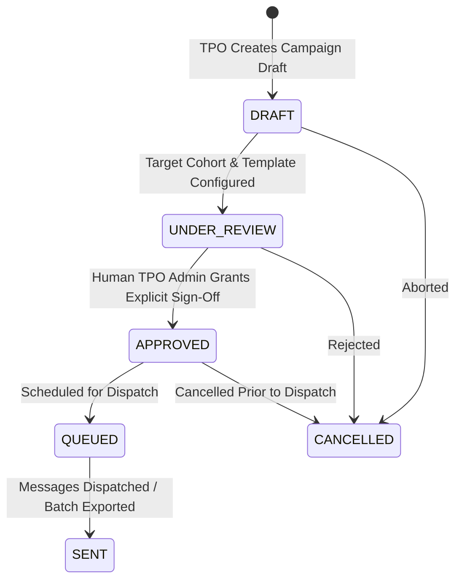

# Phase 17 — Recruiter Outreach & ₹0 Cardless Campaign System

## 1. Executive Summary

CarrerSync's **Recruiter Outreach Engine** empowers college Training & Placement Offices (TPOs) to organize, personalize, and orchestrate targeted campus placement invitation campaigns to enterprise hiring partners.

Designed strictly under CarrerSync's **₹0 Cardless Policy**, this system requires zero paid third-party email delivery services (no mandatory SendGrid, Mailgun, or AWS SES subscriptions) and zero corporate credit card dependencies. The system provides both direct in-app SMTP dispatching with batch rate limits and a built-in **CSV Mail Merge Export Fallback**, enabling colleges to leverage standard institutional email infrastructure (e.g., Google Workspace for Education / Microsoft 365) at zero incremental cost.

---

## 2. Campaign Lifecycle & Governance

To prevent unauthorized mass communications or embarrassing institutional email blunders, outreach campaigns progress through a strictly enforced five-stage lifecycle:

### 2.1 The Mandatory Human Approval Gate
- **Enforcement**: Campaign dispatch (`POST /api/v1/tpo/outreach/campaigns/:id/send`) is strictly prohibited while a campaign is in `DRAFT` or `UNDER_REVIEW` status.
- **Error Code**: Any dispatch attempt prior to human approval immediately returns `422 Unprocessable Entity` with error `CAMPAIGN_NOT_APPROVED: Campaign status is 'DRAFT'. Mandatory human TPO approval required before dispatch.`
- **Approval Signature**: Approval requires an authenticated TPO Administrator (`approveCampaign()`) to record their user ID, verification notes, and confirmation timestamp.

---

## 3. Contact Directory, Deduplication & Suppression

### 3.1 Recruiter Directory Management
Institutions maintain a tenant-scoped directory of verified corporate talent acquisition partners with attributes including `companyName`, `contactName`, `email`, `designation`, `industry`, `verificationStatus`, and `pastDriveCount`.

### 3.2 Duplicate Email Recipient Prevention
A frequent source of recruiter irritation is receiving duplicate invitation emails when multiple HR contacts share an inbox or when a company has multiple representatives on file.
- The outreach engine applies a canonical lowercase email filter: `seenEmails.has(emailLower)`.
- If multiple contacts share the same email address within a targeted campaign, only the primary contact is retained; subsequent entries increment `duplicateContactsCount` and are safely skipped.
- The PostgreSQL relational table `outreachCampaignRecipients` enforces a unique composite index `(campaignId, recipientEmail)`.

### 3.3 Unsubscribe & Suppression List Handling
In compliance with international anti-spam standards (CAN-SPAM Act, GDPR, India DPDP Act):
- Recruiters can unsubscribe from future outreach campaigns via single-click opt-out.
- Contacts with `isUnsubscribed = true` or emails present on the tenant suppression list are automatically pruned during campaign preview and dispatch.
- Every outgoing template includes an unsubscribe link and institutional physical address footer.

---

## 4. Personalization Engine & Placeholders

Campaign body templates support real-time token interpolation, rendering individualized messages for each hiring partner:

| Token Placeholder | Interpolated Value | Example Output |
|:---|:---|:---|
| `{{contactName}}` | Target recruiter's full name | *"Dear Ms. Ananya Sharma,"* |
| `{{companyName}}` | Target enterprise organization | *"Google Cloud India"* |
| `{{tpoName}}` | Authenticated TPO officer name | *"Dr. Vikram Mehta"* |
| `{{institutionName}}` | Name of the college/university | *"National Institute of Technology"* |
| `{{batchYear}}` | Graduating cohort year | *"Class of 2025"* |
| `{{placementSeason}}` | Current academic placement season | *"Autumn Placement Season 2024-25"* |

Before dispatch, administrators can generate a full campaign preview displaying the exact rendered copy of sample recipients and verifying token resolution.

---

## 5. The ₹0 Cardless Strategy: Mail Merge Fallback

For colleges operating with zero software budget or institutions lacking dedicated transactional email servers, CarrerSync provides a built-in **CSV Mail Merge Export Fallback**:

1. TPO configures campaign criteria, filters target industries, and approves the template.
2. Clicking **"Export Mail Merge CSV"** (`GET /api/v1/tpo/outreach/campaigns/:id/export`) generates a pre-formatted CSV file containing:
   - `Contact ID`
   - `Company Name`
   - `Contact Person`
   - `Email`
   - `Subject` (with dynamic placeholders resolved)
   - `Personalized Body` (with full markdown/plaintext resolved copy)
3. The TPO imports this CSV directly into free mail merge tools (e.g., Google Sheets + Gmail Mail Merge, Thunderbird, or Microsoft Outlook) to dispatch personalized emails directly from the official institutional mailbox (`tpo@college.edu`) with **zero monthly fees** and **zero external vendor lock-in**.

---

## 6. Service & REST API Reference

Implemented in `server/src/institutional/recruiter-outreach.service.ts` and mounted in `server/src/routes/outreach.routes.ts`:
- `GET /api/v1/tpo/outreach/campaigns`: List campaigns filtered by status.
- `POST /api/v1/tpo/outreach/campaigns`: Create campaign draft.
- `POST /api/v1/tpo/outreach/campaigns/:id/preview`: Preview recipient count, resolved copy, and suppression warnings.
- `POST /api/v1/tpo/outreach/campaigns/:id/approve`: Human TPO approval gate.
- `POST /api/v1/tpo/outreach/campaigns/:id/send`: Dispatch approved campaign.
- `GET /api/v1/tpo/outreach/campaigns/:id/export`: Download ₹0 cardless mail merge CSV.
- `GET /api/v1/tpo/outreach/contacts`: List verified corporate recruiter directory.
- `POST /api/v1/tpo/outreach/contacts`: Add corporate recruiter contact.
