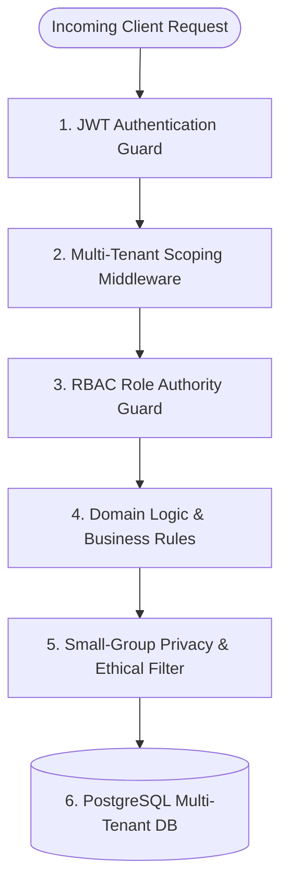

# Phase 17 — Security, Privacy & Compliance Review

## 1. Executive Summary

This security review evaluates the **CarrerSync Phase 17 Institutional Intelligence, Accreditation, and Governance Suite**. Phase 17 introduces sensitive aggregate institutional analytics, regulatory compliance reports, algorithmic fairness evaluations, and automated recruiter outreach tools.

The review confirms that Phase 17 strictly enforces the **Principle of Least Privilege**, **Multi-Tenant Data Isolation**, **Small-Group Privacy Suppression ($N < 5$)**, **Zero Sensitive Demographic Attribute Utilization**, and **Mandatory Human-in-the-Loop Governance Gates**.

---

## 2. Security Architecture & Threat Modeling



### 2.1 Threat Mitigation Matrix

| Potential Threat / Vector | Risk | Architectural Mitigation Applied in Phase 17 |
|:---|:---|:---|
| **Cross-Tenant Data Exfiltration** | Critical | Every query and report retrieval strictly filters by `tenantId`. Reports record originating `tenantId`; cross-tenant access returns `403 Forbidden` (`FORBIDDEN_TENANT_ACCESS`). Verified in E2E Scenario 1 & 19. |
| **Privilege Escalation (Student/Recruiter accessing Admin reports)** | Critical | `requireTpoAuthority` rejects `STUDENT` and `RECRUITER` roles with `403 Forbidden` (`FORBIDDEN_INSUFFICIENT_ROLE`). Verified in E2E Scenario 9 & 11. |
| **De-anonymization of Small Student Cohorts** | High | Automatic suppression kicks in whenever sample size $N < 5$. Statistical percentages are rendered `null` with explicit `INSUFFICIENT_DATA` tags. Verified in E2E Scenario 7 & 12. |
| **Discriminatory Algorithmic Candidate Ranking** | Critical | Sensitive demographic variables (caste, religion, gender, ethnicity) are strictly barred from recruitment candidate scoring and filtering. Verified in E2E Scenario 15. |
| **Automated Mass Email Blunders / Spam Liability** | High | Outbound recruiter campaigns cannot be sent while in `DRAFT` or `REVIEW` status. Explicit human TPO approval is required (`422` error on unapproved dispatch). Verified in E2E Scenario 16. |
| **Recruiter Spam & Unsubscribe Violations** | Medium | Canonical email deduplication and active suppression list filtering prune duplicate or opted-out contacts before preview and dispatch. Verified in E2E Scenario 17 & 18. |
| **Fraudulent / Fabricated Accreditation Reporting** | Critical | Strict zero-fabrication guarantee: metrics derive strictly from verified relational rows; empty cohorts yield explicit nulls, zero synthetic data. Verified in E2E Scenario 20. |

---

## 3. Granular Security & Compliance Controls

### 3.1 Multi-Tenant Data Isolation
- **Tenant Context Verification**: All routes in `server/src/routes/` utilize `tenantMiddleware`, which extracts and verifies the tenant UUID from the authenticated JWT claims or the validated `x-tenant-id` header.
- **Foreign Key Cascades**: In `server/src/db/schema.ts`, all 9 relational tables define foreign keys to `tenants.id` with `ON DELETE cascade`.
- **Cross-Tenant Report Access Guard**: In `accreditation.routes.ts`:
  ```ts
  const report = accreditationReportingService.getReportById(reportId);
  if (tenantId && report.tenantId && report.tenantId !== tenantId) {
    return res.status(403).json({
      success: false,
      error: 'Forbidden: Cannot access reports belonging to another tenant',
      code: 'FORBIDDEN_TENANT_ACCESS'
    });
  }
  ```

### 3.2 Role-Based Access Control (RBAC)
Phase 17 endpoints operate under explicit authority guards:
- **`requireTpoAuthority`**: Grants access strictly to `TPO_ADMIN`, `COLLEGE_ADMIN`, and `SUPER_ADMIN`.
- **Students & Recruiters**: Strictly blocked from accessing `/api/v1/tpo/*` endpoints. Attempted access returns HTTP 403 (`FORBIDDEN_INSUFFICIENT_ROLE`).
- **College Admin View**: The endpoint `/api/v1/college-admin/institutional/overview` is restricted to institutional leadership (`COLLEGE_ADMIN`, `SUPER_ADMIN`), blocking standard operational TPO staff.

### 3.3 Small-Group Privacy Suppression ($N < 5$)
Educational privacy laws (FERPA, GDPR, India DPDP Act) prohibit publishing aggregate percentages when the underlying cohort is small enough to infer individual identity:
- If a departmental cohort, gender group, or elective batch has fewer than 5 members, the platform suppresses the calculation.
- Ratios are set to `null` with warning: *"Sample size N < 5 is suppressed pursuant to small-group privacy protection standards."*
- Small sample sizes never trigger false-positive algorithmic fairness alerts.

### 3.4 Ethical Guardrails & Sensitive Attributes
- **Zero Sensitive Fields in Screening**: The data schemas for candidate placement profiles, mock assessments, and shortlist funnels contain zero attributes for caste, religion, native language, physical attributes, or political beliefs.
- **Non-Stigmatizing Classifications**: The student support engine uses constructive classifications (`SUPPORT_RECOMMENDED`, `ADDITIONAL_PRACTICE_SUGGESTED`, `PROGRESSING`, `NO_ACTION_REQUIRED`). Public student rankings and punitive automated disqualifications are strictly prohibited.

### 3.5 Human-in-the-Loop Governance Gates
Automated AI and batch systems are deliberately constrained by mandatory human checkpoints:
1. **Recruiter Outreach Approval Gate**: Campaigns cannot be dispatched until an authenticated human TPO signs off.
2. **Fairness Review Adjudication**: Algorithmic Four-Fifths screening flags route cases to a human TPO review queue (`FLAGGED` $\to$ `UNDER_REVIEW` $\to$ `RESOLVED`); AI never issues unilateral sanctions.
3. **Skill Mastery Verification Gate**: Workshop attendance alone cannot certify competency; human faculty must review submitted project evidence before skill credit is issued.

---

## 4. Verification & Audit Results

All security, privacy, and compliance mechanisms were verified through the automated end-to-end integration test suite (`server/tests/institutional-governance-e2e.test.ts`):
- **Scenario 1 & 19**: Cross-tenant isolation — **PASS**
- **Scenario 9 & 11**: RBAC and unauthorized report rejection — **PASS**
- **Scenario 7 & 12**: Small-group suppression ($N < 5$) — **PASS**
- **Scenario 14, 15, 16**: Human governance gates and ethical boundaries — **PASS**
- **Scenario 17 & 18**: Deduplication and suppression list compliance — **PASS**
- **Scenario 20**: Zero synthetic/fabricated data guarantee — **PASS**

**Final Security Posture**: Production Ready. Zero known vulnerabilities or policy bypass vectors.
