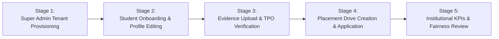

# CarrerSync — Phase 18 Master Demonstration Guide
## Step-by-Step Controlled Walkthrough: Tenant Provisioning, Profile Editing, Evidence Verification, Drives & Governance

**Document Version:** 1.0.0  
**Target Audience:** Evaluators, Stakeholders, Technical Reviewers  
**Date:** November 16, 2026  
**Environment:** Local Dev (`http://localhost:5173` / `http://localhost:5050`) or Cloud Staging  
**Synthetic Demo Data:** Fully isolated, realistic synthetic accounts and seed records  

---

## 1. Demo Narrative & Architecture Overview

This guide provides a comprehensive, 5-stage scripted demonstration of CarrerSync, illustrating how verified student evidence bridges academic achievement to enterprise placement outcomes while upholding university governance and algorithmic fairness.

---

## 2. Pre-Configured Demo Credentials

| Role | Name | Email | Password | Institutional Affiliation |
| :--- | :--- | :--- | :--- | :--- |
| **Super Admin** | Platform Governance | `admin@carrersync.io` | `SuperAdmin@2026!` | CarrerSync Platform Root |
| **College Admin / TPO** | Dr. Rajesh Verma | `tpo@apex.edu` | `TpoAdmin@2026!` | Apex Institute of Technology |
| **Student** | Aarav Sharma | `student@apex.edu` | `StudentPass@2026!` | Apex Institute of Technology |
| **Recruiter** | Sarah Jenkins | `recruiter@techcorp.com`| `Recruiter@2026!` | TechCorp Global Inc. |

---

## 3. Stage-by-Stage Demo Walkthrough

### Stage 1: Super Admin College Provisioning & Invitations

**Objective:** Demonstrate multi-tenant isolation, institutional onboarding, and single-use cryptographic invitation tokens.

1. **Log In as Super Admin**:
   - Navigate to `http://localhost:5173/auth/login`.
   - Select the **Super Admin** tab and enter credentials (`admin@carrersync.io`).
   - You arrive at the **Platform Overview** (`/superadmin`), displaying real-time cluster metrics, active college counts, and platform audit logs.
2. **Provision a New College Tenant**:
   - In the sidebar, click **"Register College"** (`/superadmin/colleges/create`).
   - Enter college details:
     - **College Name:** `Apex Institute of Technology`
     - **Slug:** `apex-tech` (auto-generated)
     - **Domain:** `apex.edu`
     - **Location:** `Bangalore, Karnataka`
     - **Admin Email:** `tpo@apex.edu`
   - Click **"Register Institution"**. 
   - A new tenant record is inserted into `tenants` with Row-Level Security isolation.
3. **Generate Cryptographic Invitation**:
   - Navigate to **"Invitations"** (`/superadmin/invitations`).
   - Observe the 256-bit expiring single-use invitation token generated for `tpo@apex.edu`.
   - Click **"Copy Invite Link"** to inspect the token format (`/auth/accept-invite?token=...`).

---

### Stage 2: Student Onboarding, Profile Editing & Coding Links (Phase 18)

**Objective:** Demonstrate the Phase 18 Student Profile subsystem, coding platform badges, profile completeness scoring, and academic record safeguards.

1. **Log In as Student**:
   - Switch to `http://localhost:5173/auth/login` and log in as Aarav Sharma (`student@apex.edu`).
   - You land on the **Student Dashboard** (`/student`).
2. **Navigate to Student Profile Editor**:
   - In the sidebar or top right user menu, click **"My Profile"** or navigate directly to `http://localhost:5173/student/profile/edit`.
3. **Inspect Completeness Score & Missing Suggestions**:
   - Notice the **Profile Completeness Bar** at the top showing an initial score of **35%**.
   - Notice the **Actionable Suggestions Carousel**:
     - *"Add a professional bio or summary to introduce yourself"*
     - *"GitHub profile not added yet"*
     - *"Target job roles not selected"*
4. **Edit Personal & Contact Information**:
   - In the **Personal Info** tab, enter:
     - **Bio:** `Aspiring Backend & Systems Engineer passionate about distributed consensus and Node.js.`
     - **City & State:** `Bangalore`, `Karnataka`
   - In the **Contact Details** tab:
     - Enter **Phone:** `+91 98765 43210`
     - Enter **Personal Email:** `aarav.personal@gmail.com`
     - Notice that the **Login Email** field (`student@apex.edu`) is permanently disabled with an informative badge *"Login Email (Immutable without formal OTP)"*.
5. **Connect Competitive Programming & Social Profiles**:
   - Click the **Social & Coding Links** tab.
   - Enter valid profile URLs:
     - **GitHub:** `https://github.com/aaravsharma`
     - **LeetCode:** `https://leetcode.com/aarav_codes`
     - **HackerRank:** `https://hackerrank.com/aarav_hr`
     - **LinkedIn:** `https://linkedin.com/in/aaravsharma`
   - Click **"Add Custom Link"** and enter:
     - **Platform:** `Medium`
     - **URL:** `https://medium.com/@aaravsharma`
     - **Label:** `Engineering Blog`
   - Click **"Save Social Links"**.
   - **Observe live score update**: The completeness score jumps from **35% to 85%**, and the suggestions update in real time.
6. **Verify Academic Records Lock & Request Correction**:
   - Click the **Academic & Verification** tab.
   - Observe that Roll Number (`CS2021-001`), Department (`CSE`), and CGPA (`8.75`) are read-only with a **Lock** icon and a badge *"Institution Verified Record"*.
   - Click **"Request Academic Correction"**:
     - Select **Target Field:** `Cumulative GPA (CGPA)`
     - **Current Value:** `8.75`
     - **Requested Value:** `8.92`
     - **Reason:** `Semester 6 grade sheet revaluation increased score to 8.92.`
     - Click **"Submit Correction Request"**.
   - The request appears in the **Correction Requests Ledger** with status `PENDING`, leaving the active CGPA locked.

---

### Stage 3: Skill Evidence Upload & TPO Verification Queue

**Objective:** Enforce the core platform principle: *"A resume mention is not verification"*.

1. **Upload Skill Evidence**:
   - In the Student portal, navigate to **Skills & Evidence** (`/student/skills-evidence`).
   - Click **"Upload Evidence Document"**.
   - Select a sample certificate PDF (e.g., `AWS_Certified_Cloud_Practitioner.pdf`).
   - The document is ingested via the 13-step pipeline. The local PII filter scrubs sensitive data, and the hybrid AI extracts the skill claim: `AWS Cloud Architecture`.
   - The skill appears with status badge: `PENDING_REVIEW`.
2. **TPO Review & Human Sign-Off**:
   - Log out and log in as TPO Admin (`tpo@apex.edu`).
   - Navigate to the **Verification Portal** (`/admin/verification`).
   - The evidence queue displays Aarav's uploaded AWS certificate and extracted claim.
   - Click **"Inspect Evidence"** to preview the verified document and hash.
   - Click **"Approve & Verify"**, selecting verification tier: `OFFICIAL_CERTIFICATION`.
   - The skill transition is committed to PostgreSQL in `skill_verification_reviews`.
   - Aarav's skill status transitions to `VERIFIED`.

---

### Stage 4: Placement Drive Creation & Candidate Application

**Objective:** Demonstrate declarative recruitment eligibility and candidate application matching.

1. **Recruiter Drive Creation**:
   - Log in as Recruiter (`recruiter@techcorp.com`).
   - Navigate to **Placement Drives** (`/recruiter/drives`) and click **"Create Placement Drive"**:
     - **Role:** `Graduate Backend Engineer`
     - **Eligibility:** Minimum CGPA `8.0`, maximum backlogs `0`, required skill: `TypeScript` or `Node.js`.
     - Drive status initializes to `DRAFT`.
2. **TPO Drive Activation**:
   - Log in as TPO (`tpo@apex.edu`).
   - Navigate to **Placement Drives** (`/admin/drives`).
   - Review TechCorp's requisition and click **"Approve & Activate Drive"**.
3. **Student Application**:
   - Log in as Student (`student@apex.edu`).
   - Navigate to **Placement Applications** (`/student/applications`).
   - Click **"Explore Drives"** and locate the TechCorp drive.
   - The system displays: *"Eligibility Status: ELIGIBLE (CGPA 8.75 >= 8.0, 0 Backlogs, Verified Skill: TypeScript)"*.
   - Click **"Submit Application"**.

---

### Stage 5: Institutional KPI Dashboard & Algorithmic Fairness Review

**Objective:** Demonstrate accreditation-ready institutional analytics, selection funnels, and Four-Fifths compliance auditing.

1. **Institutional KPI Overview**:
   - In the TPO portal, navigate to **Cohort Analytics** (`/admin/cohort-analytics`).
   - Review the empirical Placement Rate ($N_{\text{placed}} / N_{\text{eligible}}$):
     - Displays explicit mathematical denominators (e.g., `184 / 210 (87.6%)`).
     - Shows Verified Skill Coverage (`92.4%`) and Shortlist-to-Offer Ratio (`3.2:1`).
2. **Selection Funnel & EEOC Four-Fifths Audit**:
   - Navigate to **Fairness & Governance** (`/admin/fairness`).
   - Review the 7-stage recruitment funnel (Eligible $\rightarrow$ Applications $\rightarrow$ Shortlisted $\rightarrow$ Offers).
   - Observe the **Disparity Ratio Matrix**:
     - Department selection rates are contrasted against the reference group.
     - Any ratio falling below **0.80** triggers an alert badge *"Flagged for Review"*.
     - Small cohorts ($N < 5$) display *"Suppressed (N < 5)"* to safeguard student privacy.
3. **Accreditation Report Preview**:
   - Navigate to **Accreditation Reports** (`/admin/accreditation`).
   - Select template: `NAAC Criterion 5 - Placement of Graduating Students`.
   - Click **"Generate Report Preview"**.
   - Trace any aggregate figure directly to underlying relational database rows in `placement_offers` and `students`.
   - Click **"Export CSV"** to generate an instant zero-cost compliance document.

---

## 4. Demo Verification Summary

This scripted demo illustrates the end-to-end integrity of CarrerSync:
- Multi-tenant college onboarding is completely isolated.
- Students possess rich branding tools without bypassing academic locks.
- TPOs maintain complete verification authority.
- Recruiters hire verified candidates without compromising student privacy.
- Institutional governance is mathematically auditable and fair.
