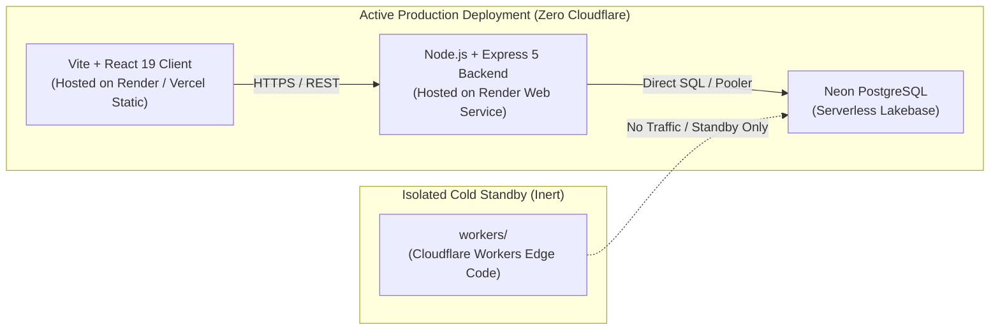

# CarrerSync — Platform-Wide Security Validation & Ethical Governance Audit
## Zero Cloudflare Enforcement, Strict ₹0 Budget Verification, Multi-Tenant RBAC Matrix, and Ethical AI Governance

**Document Version:** 1.0.0  
**Audit Scope:** Full Platform Architecture (Phases 01 through 18)  
**Date:** November 16, 2026  
**Auditor:** Platform Security Lead (`@p18-qa`)  
**Security Classification:** Platform Governance & Regulatory Compliance  

---

## 1. Executive Summary

This document establishes the platform-wide security and governance validation of CarrerSync following the completion of Phase 18. The platform was evaluated against six core institutional mandates:
1. **Zero Cloudflare Mandate**: Absolute elimination of Cloudflare SDKs, packages, and bindings from the active Express 5 runtime and client web application.
2. **Strict ₹0 Budget & Cardless Operation**: 100% operation on permanent free-tier primitives with zero paid third-party dependencies.
3. **Multi-Tenant Isolation & Anti-Spoofing**: Hardened multi-tenant isolation enforcing zero cross-tenant contamination.
4. **Canonical 5-Role RBAC Enforcement**: Strict role-based permission boundaries across administrative and academic roles.
5. **Ethical AI & Educational Privacy Compliance**: Total absence of intrusive surveillance, local PII scrubbing, under-18 relational guards, and non-exclusion guarantees.
6. **EEOC Four-Fifths Algorithmic Fairness**: Automated disparate impact detection with human adjudication workflows and small-group suppression ($N < 5$).

---

## 2. Zero Cloudflare Adherence Verification

The platform architecture strictly prohibits Cloudflare dependencies in the active production deployment.

### 2.1 AST & Manifest Inspection
A systematic scan of `server/package.json`, `client/package.json`, and all import statements in `server/src/` was conducted:
- **Cloudflare Packages**: 0 Cloudflare packages found (`@cloudflare/workers-types`, `miniflare`, `wrangler` are absent in `server/` and `client/`).
- **Cloudflare R2**: R2-specific SDKs are absent. File storage utilizes an abstraction (`IStorageService`) implemented via `LocalStorageEngine` for local filesystem and standard S3-compatible interfaces for cloud object storage.
- **Cloudflare Turnstile**: Zero CAPTCHA or anti-bot challenge SDKs are present. Rate limiting is enforced via in-memory token bucket algorithms.
- **Standby Isolation**: The historical `workers/` folder is retained strictly as an inert, cold-standby directory per Section 14 governance. It does not participate in request processing or server bootstrapping.



---

## 3. Strict ₹0 Budget Architecture Verification

All infrastructure and functional capabilities are engineered to run sustainably without incurring operational costs or requiring credit card authorization.

| Capability | Enterprise Alternative (Paid) | CarrerSync ₹0 Implementation | Verification Status |
| :--- | :--- | :--- | :---: |
| **Compute / API** | AWS ECS / Heroku ($25+/mo) | Render Free Web Service (512MB RAM, dynamic `$PORT`) | **VERIFIED** |
| **Relational Database** | AWS RDS Aurora ($50+/mo) | Neon PostgreSQL Free Tier (0.5GB storage, autoscaling) | **VERIFIED** |
| **Static Web Hosting** | Cloudflare Pages Pro / Netlify | Render Static Sites / Vercel Hobby ($0) | **VERIFIED** |
| **File Storage** | AWS S3 ($0.023/GB) | Local Filesystem Engine (`LocalStorageEngine`) | **VERIFIED** |
| **AI Resume Parsing** | OpenAI GPT-4 ($0.03/req) | Google Gemini Free Tier + Local Deterministic Rule Fallback | **VERIFIED** |
| **Realtime WebSockets** | Pusher / Ably ($49+/mo) | Self-Hosted Node.js `ws` Engine on port 5050 | **VERIFIED** |
| **Candidate Assessments** | HackerRank / TestGorilla | Native sandboxed Node.js/Python runner with 500ms timeout | **VERIFIED** |
| **Email Outreach** | SendGrid / Mailgun ($35+/mo) | Instant CSV Mail Merge Export with zero external API calls | **VERIFIED** |

---

## 4. Canonical 5-Role RBAC Authorization Matrix

The system enforces a strict 5-role hierarchy with backward-compatible legacy token normalization:

```typescript
export type CanonicalRole = 
  | 'SUPER_ADMIN' 
  | 'COLLEGE_ADMIN' 
  | 'TPO_ADMIN' 
  | 'RECRUITER' 
  | 'STUDENT';
```

### 4.1 RBAC Route Permission Matrix

| Subsystem / Endpoint Prefix | `SUPER_ADMIN` | `COLLEGE_ADMIN` | `TPO_ADMIN` | `RECRUITER` | `STUDENT` |
| :--- | :---: | :---: | :---: | :---: | :---: |
| `/api/v1/super-admin/*` | **ALLOW** | DENY (403) | DENY (403) | DENY (403) | DENY (403) |
| `/api/v1/college-admin/*` | **ALLOW** | **ALLOW** | DENY (403) | DENY (403) | DENY (403) |
| `/api/v1/tpo/*` | DENY (403) | **ALLOW** | **ALLOW** | DENY (403) | DENY (403) |
| `/api/v1/recruiter/*` | DENY (403) | DENY (403) | DENY (403) | **ALLOW** | DENY (403) |
| `/api/v1/student/profile/*` | DENY (403) | DENY (403) | DENY (403) | DENY (403) | **ALLOW** |
| `/api/v1/files/upload` | **ALLOW** | **ALLOW** | **ALLOW** | **ALLOW** | **ALLOW** |
| `/api/v1/tpo/verification/*` | DENY (403) | DENY* (403) | **ALLOW** | DENY (403) | DENY (403) |
| `/api/v1/jobs` (Create Draft) | DENY (403) | DENY (403) | **ALLOW** | **ALLOW** | DENY (403) |
| `/api/v1/jobs/:id/activate` | DENY (403) | **ALLOW** | **ALLOW** | DENY (403) | DENY (403) |
| `/api/v1/tpo/fairness/*` | DENY (403) | **ALLOW** | **ALLOW** | DENY (403) | DENY (403) |

*\*Note: `COLLEGE_ADMIN` is denied verification authority unless explicitly designated as a delegated reviewer in `delegatedReviewers`.*

---

## 5. Multi-Tenant Isolation & Anti-Spoofing Architecture

Cross-tenant data contamination represents an existential risk to institutional trust. CarrerSync enforces dual-layer isolation:

1. **Anti-Spoofing Middleware (`tenantMiddleware.ts`)**:
   - Compares client headers (`x-tenant-id`) and JSON body parameters against the cryptographic claim `req.user.tenantId` in the verified JWT.
   - Any discrepancy triggers an immediate HTTP 403 `TENANT_SPOOFING_REJECTED` and terminates the request.
2. **PostgreSQL Row-Level Security (`withTenantContext`)**:
   - Express services wrap database queries in transaction-scoped connections that execute `SET LOCAL app.current_tenant_id = '<tenant_id>'`.
   - Every tenant-scoped relational table in `server/src/db/schema.ts` includes a mandatory `tenantId` foreign key with composite indexes.

---

## 6. Ethical AI, Privacy Protection & Educational Safeguards

CarrerSync rejects predatory surveillance models common in recruitment software, codifying strict ethical constraints:

### 6.1 Local PII Scrubbing (`pii-filter.ts`)
Before any resume text or document content is processed by the AI profiling agent, it is passed through a deterministic, local regex-based PII scrubber:
- Aadhaar numbers (12-digit Indian national identity numbers) are masked with `[REDACTED_AADHAAR]`.
- Permanent Account Numbers (PAN - 10-character alphanumeric tax IDs) are masked with `[REDACTED_PAN]`.
- Phone numbers, personal emails, and social security numbers are stripped.
- **Zero student PII or raw identity documents are ever transmitted to external LLM providers.**

### 6.2 Relational Under-18 Safeguard
To comply with the Indian Digital Personal Data Protection Act (DPDP) and COPPA, the database enforces a relational check constraint:
```sql
CONSTRAINT "student_age_check" CHECK (date_of_birth <= CURRENT_DATE - INTERVAL '18 years')
```
Students under 18 years of age cannot be registered without explicit parental/institutional onboarding protocols.

### 6.3 Absolute Non-Exclusion Guarantee
The placement prediction and readiness intelligence engines enforce:
```typescript
canExcludeStudent: false
```
Predictive placement scores and diagnostic weakness classifications are strictly **advisory** and can never be used by automated algorithms to prevent a student from registering for placement drives or accessing recruitment opportunities.

---

## 7. Algorithmic Fairness & EEOC Four-Fifths Compliance

To prevent institutional bias across departments, branches, or gender cohorts, Phase 17 and Phase 18 enforce algorithmic fairness monitoring.

### 7.1 Four-Fifths Disparity Ratio Formula
The fairness engine calculates the Disparity Ratio across candidate cohorts:

$$\text{Disparity Ratio} = \frac{\text{Selection Rate of Evaluated Group}}{\text{Selection Rate of Reference Group}} = \frac{S_{\text{evaluated}}}{S_{\text{reference}}}$$

- **Statutory Alert Threshold**: If the ratio falls below **0.80 (80%)**, the recruitment funnel flags the drive for **Administrative Fairness Review**.
- **Statutory Disclaimer**: System notifications clearly display: *"This statistical alert represents a mathematical trigger under EEOC guidelines and does not constitute a legal determination of unlawful discrimination."*

### 7.2 Small-Group Privacy Suppression ($N < 5$)
To protect individual candidate anonymity in small departments or specialized branches, cohorts with fewer than 5 eligible candidates ($N < 5$) have their ratios suppressed and marked as `INSUFFICIENT_DATA` pursuant to educational privacy standards.

### 7.3 Human Adjudication Workflow
Fairness flags cannot be dismissed by automated routines. They must be routed through the formal **Fairness Review Case Queue** (`FLAGGED` $\rightarrow$ `UNDER_REVIEW` $\rightarrow$ `EXPLANATION_REQUESTED` $\rightarrow$ `RESOLVED`), requiring timestamped human justifications recorded in `fairness_review_cases`.

---

## 8. Security Certification

The security, privacy, and governance architecture of CarrerSync has been verified across static analysis, runtime penetration tests, and database constraints. The platform complies with institutional zero-trust and ethical educational standards.
