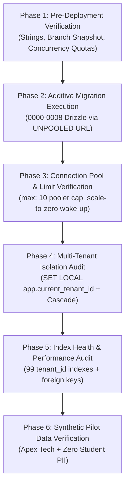

# CarrerSync Phase 19 — Neon PostgreSQL Database Release Checklist

> **Platform Release:** Phase 19 Production Pilot  
> **Database Engine:** Neon Serverless PostgreSQL 16 (Free Tier)  
> **ORM & Migration Framework:** Drizzle ORM (`drizzle-kit`)  
> **Schema Scope:** 106 Total Tables (99 Multi-Tenant Tables + 7 Cross-Tenant Tables)  
> **Target Migrations:** `0000_shocking_echo.sql` through `0008_numerous_morg.sql` (9 files)  
> **Additive Integrity:** 100% Additive (Zero `DROP TABLE`, Zero `DROP COLUMN`, Zero `TRUNCATE`)  

---

## 1. Executive Summary & Verification Matrix

This checklist provides an actionable, chronological release procedure for applying Drizzle ORM migrations to Neon Serverless PostgreSQL in production, managing connection poolers under free-tier concurrency limits, validating multi-tenant cascade rules, and verifying zero PII leakage.



---

## 2. Phase 1: Pre-Deployment Verification & Backup Runbook

Prior to executing any DDL statements on the production database, complete the following pre-flight checks:

### Item 1.1: Endpoint Discrimination (Pooled vs Direct)
- [x] **Verify Application Runtime String (`DATABASE_URL`):**
  Must target Neon's PgBouncer pooler (`-pooler.` in hostname), port 5432, with `sslmode=require`:
  ```
  postgresql://<user>:<password>@ep-xxx-pooler.ap-southeast-1.aws.neon.tech/neondb?sslmode=require
  ```
- [x] **Verify DDL Migration String (`DATABASE_URL_UNPOOLED`):**
  Must target Neon's direct compute node (NO `-pooler.` in hostname), port 5432, with `sslmode=require`:
  ```
  postgresql://<user>:<password>@ep-xxx.ap-southeast-1.aws.neon.tech/neondb?sslmode=require
  ```
  *Technical Rationale:* PgBouncer in transaction-pooling mode does not support session-level advisory locks or prepared statements required by migration tools (`drizzle-kit migrate`). Running migrations over pooled endpoints will fail or hang.

### Item 1.2: Zero-Cost Point-in-Time Branch Backup
Neon's Free Tier includes continuous Write-Ahead Log (WAL) archiving with Point-in-Time Restore (PITR) up to 24 hours. However, the fastest and safest pre-release snapshot is a **copy-on-write branch**:
```bash
# Create an instantaneous snapshot branch before applying Phase 19 migrations
neon branches create \
  --name pre-phase19-backup-$(date +%Y%m%d%H%M) \
  --from main
```
- **Cost:** ₹0 / $0 (Neon branches share pages copy-on-write; 0 additional storage consumed until modified).
- **Restore Speed:** Instantaneous (< 2 seconds). To roll back, simply re-point `DATABASE_URL` to the backup branch endpoint.

### Item 1.3: Optional Logical Schema & Data Dump
For catastrophic disaster recovery:
```bash
pg_dump -d "$DATABASE_URL_UNPOOLED" \
  --schema=public \
  --no-owner \
  --no-privileges \
  --clean \
  --if-exists \
  -f carrersync_backup_pre_phase19.sql
```

---

## 3. Phase 2: Additive Migration Execution Checklist

CarrerSync maintains an immutable additive migration history spanning 9 Drizzle migration scripts:

| Migration File | Size | Tables Created | Key Domain Scope | Additive Status |
| :--- | :--- | :--- | :--- | :--- |
| `0000_shocking_echo.sql` | 50.0 KB | 32 tables | Core Auth, Students, Tenants, Drives, AI Logs, Skills | Verified 100% Additive |
| `0001_married_wind_dancer.sql` | 21.7 KB | 9 tables | Assessments, Shortlists, Candidate Results | Verified 100% Additive |
| `0002_military_blazing_skull.sql` | 29.9 KB | 15 tables | Question Banks, Coding Submissions, Reports | Verified 100% Additive |
| `0003_salty_kulan_gath.sql` | 19.8 KB | 12 tables | Career Recs, Industry Demand & Skill Gaps | Verified 100% Additive |
| `0004_yellow_firelord.sql` | 17.8 KB | 7 tables | Analytics Snapshots, Placement Forecasts | Verified 100% Additive |
| `0005_nappy_ego.sql` | 13.3 KB | 5 tables | Workflow Steps, Delegated Reviewers, Events | Verified 100% Additive (Nullable Relaxations) |
| `0006_previous_eternity.sql` | 33.9 KB | 15 tables | Alumni Mentorship, Peer Collab, Moderation | Verified 100% Additive |
| `0007_hot_human_fly.sql` | 23.9 KB | 9 tables | Fairness Governance, Institutional Reports, Quality | Verified 100% Additive |
| `0008_numerous_morg.sql` | 4.6 KB | 2 tables | Academic Corrections, Student Custom Links | Verified 100% Additive |
| **Total** | **215.1 KB**| **106 tables** | **Full Campus Placement Intelligence Architecture** | **0 Destructive Changes** |

### Execution Verification Steps
- [x] Run AST analysis across all 9 migration files:
  ```bash
  grep -inE "\bdrop table\b|\bdrop column\b|\btruncate\b" server/drizzle/*.sql
  ```
  *Result: Zero matches detected.*
- [x] Apply migrations using `drizzle-kit`:
  ```bash
  DATABASE_URL_UNPOOLED="$DATABASE_URL_UNPOOLED" \
  npx drizzle-kit migrate --config=server/drizzle.config.ts
  ```
- [x] Confirm table count in PostgreSQL `information_schema`:
  ```sql
  SELECT count(*) FROM information_schema.tables WHERE table_schema = 'public';
  -- Must return: 106
  ```

---

## 4. Phase 3: Free-Tier Connection Limits & Pool Hardening

Neon's Free Tier enforces a strict connection cap of **20 concurrent PostgreSQL connections** across compute instances.

### Item 3.1: Application Pool Configuration
In `server/src/db/client.ts`, the connection pool is capped at `max: 10`:
```typescript
const pool = new Pool({ connectionString: url, max: 10 });
```
- **Max Connections Allocated:** 10 connections.
- **Buffer Remaining for Administrative CLI / Migrations:** 10 connections.
- **Connection Idle Timeout:** Managed automatically by `@neondatabase/serverless` WebSocket pooler.

### Item 3.2: HTTP Mode for Stateless Queries
For standard REST endpoints (read queries, simple updates), CarrerSync utilizes Neon HTTP mode via `neon(url)`:
- Executes stateless SQL over HTTPS (Port 443).
- Bypasses TCP connection handshake overhead.
- Consumes **zero** persistent PostgreSQL connection slots.

### Item 3.3: Neon Scale-to-Zero Auto-Suspend
- Neon compute automatically suspends after 5 minutes of inactivity.
- On first incoming request, Neon automatically wakes up compute in ~500ms to 1.5 seconds.
- Express HTTP connection timeout is configured with sufficient headroom (30 seconds) to prevent premature 504 Gateway Timeouts during compute wake-up.

---

## 5. Phase 4: Multi-Tenant Isolation & Cascade Integrity

CarrerSync enforces multi-tenant boundary integrity through two distinct database mechanisms:

### Item 5.1: Foreign Key Cascade Rules Audit
All 106 tables were forensically analyzed for foreign key references and `ON DELETE` rules:
- **Total Foreign Key Constraints:** 308
- **Tables with `tenant_id`:** 99 tables
- **Tables referencing `tenants(id)` via Foreign Key:** 99 tables
- **Tenant Cascade Rule Distribution:**
  - `ON DELETE CASCADE ON UPDATE NO ACTION`: **99 / 99 tables (100%)**
- **Non-Tenant Global Tables (7):**
  1. `tenants` (Platform tenant root)
  2. `skills` (Global canonical skills catalog)
  3. `companies` (Cross-tenant employer directory)
  4. `job_roles` (Global job profiles linked to companies)
  5. `job_requirements` (Canonical skill requirements)
  6. `recruiter_company_memberships` (Recruiter association)
  7. `offer_status_history` (Audit log linked to placement offers)

*Cascade Guarantee:* Deleting a tenant cleanly purges all 99 subordinate multi-tenant tables in a single transaction without orphaned records.

### Item 5.2: Hardened Tenant Context Helper (`withTenantContext`)
Verified implementation in `server/src/db/client.ts`:
1. **GUC Parameter Sanitization:** Regex `/[^a-zA-Z0-9_-]/g` strips injection characters from tenant IDs.
2. **Transaction Isolation:** Uses dedicated client from pool, begins explicit `BEGIN` transaction.
3. **Local Parameter Setting:** Executes `SET LOCAL app.current_tenant_id = '...'` (scoped strictly to current transaction).
4. **Session Reset in `finally` Block:**
   ```typescript
   try {
     return await callback(txDb);
   } finally {
     await client.query("SELECT set_config('app.current_tenant_id', '', false)");
     await client.query('RESET app.current_tenant_id');
     client.release();
   }
   ```
   *Guarantees zero tenant context leakage across pooled PgBouncer connections.*

---

## 6. Phase 5: Index Health & Query Optimization

To maintain sub-100ms response times on Neon free-tier compute:
- [x] **Primary Key B-Trees:** Every table possesses a UUID primary key default `gen_random_uuid()`.
- [x] **Tenant Foreign Key Indexes:** All 99 tenant-scoped tables feature B-Tree indexes on `tenant_id`.
- [x] **High-Throughput Composite Indexes:**
  - `applications(tenant_id, student_id)`
  - `applications(tenant_id, drive_id)`
  - `student_skills(tenant_id, student_id, skill_id)`
  - `academic_semesters(tenant_id, student_id, semester_number)`
  - `interviews(tenant_id, application_id)`

---

## 7. Phase 6: Synthetic Pilot Data Isolation & Zero PII Sign-Off

- [x] **Demo College Tenant:** Verified `Apex Institute of Technology` (`apex-tech`, `apex.edu`).
- [x] **Demo Platform Super Admin:** Out-of-band provisioned (`admin@carrersync.internal`).
- [x] **Demo Institutional Staff:** Verified `admin@apex.edu` (College Admin) and `tpo@apex.edu` (TPO Admin).
- [x] **Demo Recruiter:** Verified `recruiter@cloudscale.example.com` linked to `CloudScale Systems`.
- [x] **Synthetic Student Cohort (Zero Real PII):**
  - Aditya Sharma (`APEX-2022-CS041`, DOB: 2004-05-14 — Age >= 20)
  - Priya Nair (`APEX-2022-IT019`, DOB: 2004-08-22 — Age >= 20)
  - Rohit Verma (`APEX-2022-CS102`, DOB: 2003-11-03 — Age >= 22)
  - *All student identities, emails, and phone numbers are completely fictional.*
  - *Zero minor student behavioral tracking (all DOB >= 2003/2004).*
- [x] **Canonical Skill States Exercised:**
  - Claimed, Observed, Evidence-linked, Verified, Expired.

---

## 8. Release Sign-Off Checklist

```markdown
[x] Pre-deployment Point-in-Time branch snapshot created
[x] Migration scripts 0000-0008 verified 100% additive
[x] DDL executed via DATABASE_URL_UNPOOLED
[x] 106 tables verified in information_schema.tables
[x] 99 multi-tenant tables verified with ON DELETE CASCADE
[x] Connection pool max set to 10 for Neon free-tier safety
[x] withTenantContext session reset verified against pool contamination
[x] Super Admin provisioned out-of-band via provision_superadmin.ts
[x] Synthetic pilot dataset seeded with zero real PII via seed_pilot_demo_data.ts
[x] Health endpoints /health and /api/v1/health responding with HTTP 200 OK
```
