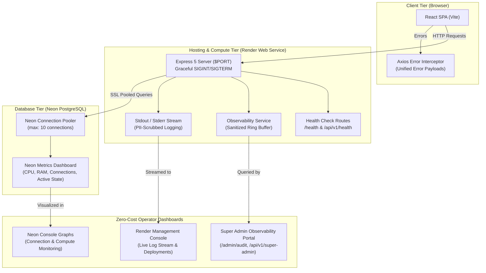
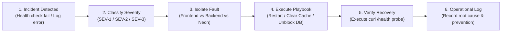

# CarrerSync — Phase 19 Operational Monitoring Runbook
## Zero-Cost Operational Observability, Incident Diagnostics, Log Sanitization & Safe Recovery Protocols

**Document Version:** 1.0.0  
**Phase:** Phase 19 (Pilot Deployment Readiness & Production Operations)  
**Date:** November 16, 2026  
**Auditor / Operational Monitoring & QA Lead:** `@pilot-qa`  
**Operational Scope:** Express 5 Backend (Render Web Service), Static Frontend (Vercel / Render), Serverless Database (Neon PostgreSQL)  
**Budget Mandate:** Strict ₹0 Zero-Cost Architecture (100% Free-Tier Observability)  

---

## 1. Executive Summary & Zero-Cost Observability Stack

CarrerSync operates under a strict ₹0 infrastructure policy. To maintain enterprise-grade reliability, compliance, and multi-tenant security without incurrence of paid third-party monitoring vendors (e.g., Datadog, New Relic, Sentry, PagerDuty), the platform employs native, zero-cost observability primitives:

1. **Render Native Live Log Streaming**: Real-time stdout/stderr log capture, process lifecycle events, deployment hooks, and crash tracing via the Render Dashboard.
2. **Neon Serverless Metric Graphs**: Live telemetry of compute CPU utilization, RAM usage, active connection count, data storage, and compute scale-to-zero activity.
3. **Express 5 Health & Diagnostics Endpoints**: Automated HTTP probes (`/health`, `/api/health`, `/api/v1/health`) reporting system status, uptime, process environment, and database connectivity.
4. **Application-Layer Observability & Telemetry Service**: In-memory ring-buffered metrics, workflow execution tracing, and PII-sanitized telemetry aggregation (`server/src/orchestration/observability.service.ts`).



---

## 2. Zero-Cost Observability Primitives

### 2.1 Render Native Log Streaming
Render provides real-time log ingestion for Web Services via the **Logs** tab in the dashboard.
- **Log Source**: Application standard output (`console.log`, `console.info`) and standard error (`console.error`, `console.warn`).
- **Retention**: Render Free Tier buffers the most recent 100,000 log lines (sufficient for real-time triage and pilot incident resolution).
- **Log Filtering**: Searchable by keyword (e.g., `ERROR`, `500`, `TENANT_SPOOFING_REJECTED`, `connection pool`, `FATAL`).
- **Process Signals**: Captures deploy triggers, container build steps, container launch (`Listening on port ...`), and container shutdowns (`SIGTERM received, closing HTTP server`).

### 2.2 Neon Metric Graphs
The Neon Console (`console.neon.tech/app/projects/...`) provides live infrastructure telemetry under the Free Tier:
- **Active Connections**: Real-time counter of client connections established with the pooler (`max: 10`).
- **Compute State**: Displays whether the compute engine is **Active** (0.25 vCPU) or **Suspended** (idle scale-to-zero).
- **CPU & Memory Usage**: Graph tracking vCPU consumption and RAM saturation (Free tier cap: 1 GB RAM).
- **Data Transfer & Storage**: Usage bars tracking the 0.5 GiB storage allocation and monthly project egress.

### 2.3 Express 5 Health Endpoints
The backend exposes three lightweight, non-blocking health check routes requiring zero database transaction overhead:

| Route | Method | Access | Payload Schema | Operational Purpose |
| :--- | :---: | :---: | :--- | :--- |
| `/health` | `GET` | Public | `{"status":"healthy","service":"carrersync-server","version":"1.0.0","timestamp":"...","environment":"production"}` | Used by Render health-check probe to confirm container readiness |
| `/api/health` | `GET` | Public | `{"status":"healthy",...,"database":"configured"}` | Verifies API router mounting and database URL configuration |
| `/api/v1/health`| `GET` | Public | `{"status":"healthy",...,"database":"configured"}` | Versioned API ping for client pre-warming and uptime monitors |

```bash
# Manual verification probe via curl
curl -s -i https://carrersync-api.onrender.com/api/v1/health
```

Expected HTTP Response:
```http
HTTP/1.1 200 OK
Content-Type: application/json; charset=utf-8
Content-Length: 135

{"status":"healthy","service":"carrersync-server","version":"1.0.0","timestamp":"2026-11-16T04:00:00.000Z","environment":"production","database":"configured"}
```

---

## 3. Operational Telemetry Matrix: What, Where & How to Check

| Diagnostic Domain | Primary Indicator | Monitoring Location | Normal Baseline | Threshold / Anomaly Condition | Impact / Action |
| :--- | :--- | :--- | :--- | :--- | :--- |
| **API Availability** | HTTP 200 on `/health` | Render Logs / Health Check | Status: `healthy` (200 OK) | 3 consecutive failed health probes | Render automatically initiates container restart |
| **Server Errors** | HTTP 5xx responses | Render Log Stream | 0% error rate (< 0.1% transient) | Spike > 5 errors in 60s | Execute 5xx Triage Playbook (§4.1) |
| **Database Pool** | Active connections | Neon Dashboard -> Metrics | 1–4 idle connections | Active connections $\ge 8$ (Pool max: 10) | Execute DB Saturation Playbook (§4.2) |
| **Cold Starts** | Initial response latency | Browser DevTools / Render Logs | < 150ms (warm) | 50s–60s on first request after 15m idle | Execute Cold Start Playbook (§4.3) |
| **Tenant Isolation** | 403 `TENANT_SPOOFING` | Render Log Stream (`warn`) | 0 occurrences | $> 0$ logged events | Security alert: investigate potential tampering attempt |
| **WebSocket Relay** | Connection drops / errors | Render Logs (`[WebSocket]`) | Clean connect/close events | Rapid reconnect loops (> 10/min) | Execute WebSocket Playbook (§4.4) |
| **Memory Usage** | Node RSS / Heap | Render Dashboard | 120MB – 220MB | Memory > 450MB (512MB limit) | Restart container to avoid OOM killer |

---

## 4. Failure Detection & Diagnostic Playbooks

### 4.1 Playbook A: HTTP 5xx Error Spikes
#### Symptoms
- Render logs show `500 Internal Server Error`, `UnhandledPromiseRejection`, or crash stack traces.
- Frontend users receive modal alert: *"Network communication error"* or *"Internal Server Error"*.

#### Detection Steps
1. Navigate to **Render Dashboard** -> **carrersync-api** -> **Logs**.
2. Filter logs using search query: `level:error` or `500` or `Error:`.
3. Identify the failing endpoint and stack trace. Common root causes:
   - Malformed JSON payload triggering unhandled parser exception.
   - Database connection timeout or schema constraint violation.
   - Missing required environment variable (`JWT_SECRET`, `DATABASE_URL`).

#### Safe Recovery Steps
1. If errors are isolated to a single route due to an edge-case payload:
   - Identify offending request shape from log.
   - Verify tenant context was not corrupted.
2. If errors affect all API routes:
   - Check Neon Console to verify database compute is responsive.
   - Check if `DATABASE_URL` credentials expired or were altered.
3. If node process is in an unrecoverable state:
   - Trigger manual restart in Render: **Manual Deploy** -> **Clear build cache & deploy** or **Restart service**.
   - Restart typically completes within 45–60 seconds.

---

### 4.2 Playbook B: Database Connection Pool Saturation
#### Symptoms
- API requests hang until timing out at 10,000ms.
- Render logs output: `error: remaining connection slots are reserved for non-replication superuser connections` or `timeout exceeded waiting for connection from pool`.
- Neon Dashboard shows **Active Connections = 10/10**.

#### Root Cause Analysis
Neon Free Tier imposes a strict concurrency limit of **10 direct connections**. When client transactions are not properly closed in `finally` blocks, or long-running queries lock pooled connections, the pool exhausts.

#### Detection Steps
1. Open **Neon Console** -> Select Project -> **Monitoring / Metrics**.
2. Inspect the **Connection Count** graph. If graph flatlines at 10:
3. Run diagnostic query in Neon SQL Editor:
   ```sql
   SELECT pid, now() - pg_stat_activity.query_start AS duration, query, state
   FROM pg_stat_activity
   WHERE state != 'idle' AND pid <> pg_backend_pid()
   ORDER BY duration DESC;
   ```

#### Safe Recovery Steps
1. **Immediate Relief (Terminate Stalled Connections)**:
   ```sql
   -- Terminate idle or orphaned queries running longer than 2 minutes
   SELECT pg_terminate_backend(pid)
   FROM pg_stat_activity
   WHERE state = 'idle in transaction'
     AND now() - state_change > interval '2 minutes'
     AND pid <> pg_backend_pid();
   ```
2. **Verify Express Pool Configuration**:
   - Confirm backend `DATABASE_URL` utilizes the **pooled connection string** (contains `-pooler` in hostname, port `5432`).
   - Confirm `server/src/db/client.ts` sets `max: 10` (or conservative `max: 5` in production free-tier).
3. **Restart API Service**:
   - Restarting Render Web Service releases all ephemeral socket connections held by the Node.js process.

---

### 4.3 Playbook C: Render Free-Tier 15-Minute Cold Starts
#### Symptoms
- After 15 minutes of zero traffic, the next HTTP request takes **50 to 65 seconds** to resolve.
- Client may report timeout if client timeout is shorter than 60s.

#### Architecture Behavior
Render spins down free Web Services to zero compute after 15 minutes of inactivity. When a new incoming HTTP request arrives at `*.onrender.com`, the Render gateway holds the connection, provisions a container, boots Node.js, mounts the Express app, and establishes the database connection.

#### Safe Recovery & Pre-Warming Measures
1. **Frontend Graceful Handling**:
   - `client/src/services/api.js` is configured with a safe default timeout.
   - Frontend UI displays informative loader: *"Waking up free cloud instance (this may take up to 60 seconds on first load)..."*.
2. **Pre-Warming Protocol for Pilot Demonstrations**:
   - 2 minutes before beginning a demonstration or pilot testing session, issue an out-of-band ping to wake the service:
     ```bash
     curl -s https://carrersync-api.onrender.com/api/v1/health > /dev/null
     ```
   - Container boots, initial database pre-ping completes, and subsequent user interactions execute in sub-150ms.
3. **Zero-Cost Scheduled Keep-Alive (Optional)**:
   - A zero-cost cron tool (e.g., free UptimeRobot, GitHub Actions cron pinging `/health` every 14 minutes between 09:00 and 18:00 IST) can prevent midday spin-down during active pilot evaluation hours.

---

### 4.4 Playbook D: WebSocket Disconnections & Signaling Failures
#### Symptoms
- Study pod participants or peer mock interviewers report: *"Disconnected from collaboration room"*.
- Browser DevTools show WebSocket status code `1006` (abnormal closure) or repeated reconnect attempts.

#### Detection Steps
1. Inspect Render logs for WebSocket lifecycle messages:
   - Filter query: `[WebSocket]` or `ws error`.
2. Check if Render Web Service spun down or restarted.
3. Verify if user JWT expired during an active session (validity: 24h).

#### Safe Recovery Steps
1. **Application Automatic Reconnect**:
   - `client/src/services/realtimeClient.js` contains exponential backoff reconnect logic (retrying at 1s, 2s, 4s, 8s, up to 15s).
2. **Room State Resiliency**:
   - Realtime room state is transient in memory; study notes are persisted to PostgreSQL upon mutation with monotonic version checking (`HTTP 409 VERSION_CONFLICT` guard).
   - If server restarts, room members refresh browser; notes and task lists rehydrate directly from PostgreSQL via REST API.
3. **Signaling Server Restart**:
   - If WebSocket server thread hangs, restart Render container via dashboard.

---

## 5. PII & Credential Sanitization in Operational Logs

### 5.1 Absolute Zero PII Policy
To guarantee compliance with DPDP 2023, FERPA, and ethical educational AI guidelines, **no personally identifiable information (PII) or security credentials may ever appear in operational logs, stdout, stderr, or telemetry**.

### 5.2 Application-Layer Telemetry Sanitization Engine
The server implements strict recursive redaction in `server/src/orchestration/observability.service.ts`:

```typescript
const SENSITIVE_KEYS = new Set([
  'password', 'token', 'authorization', 'secret', 'key',
  'refreshtoken', 'accesstoken', 'apikey', 'jwt',
  'email', 'phone', 'phonenumber', 'dob', 'dateofbirth',
  'address', 'ssn', 'aadhaar', 'creditcard', 'cardnumber'
]);

export function sanitizeTelemetryPayload(data: any): any {
  // Recursively scrubs SENSITIVE_KEYS, replaces with '[REDACTED]'
  // Regex matches JWT signatures -> '[REDACTED_JWT]'
  // Regex matches email addresses -> '[REDACTED_EMAIL]'
}
```

### 5.3 Log Sanitization Verification Rules

| Log Domain | Forbidden Content | Sanitized Representation | Implementation Mechanism |
| :--- | :--- | :--- | :--- |
| **HTTP Request Headers** | `Authorization: Bearer eyJhbG...` | `Authorization: [REDACTED_BEARER]` | Express request logger middleware |
| **User Authentication** | Plaintext or hashed passwords | Excluded from log objects entirely | Handled before logging in `auth.routes.ts` |
| **Student Profiles** | Phone, personal email, date of birth | Scoped by `sanitizeTelemetryPayload` | `observability.service.ts` |
| **Database Connection** | Raw connection string with password | Hostname and database name only (password masked) | `db/client.ts` sanitizes URL on boot |
| **AI Ingestion** | Full student resume or transcript text | Processed in-memory; log records byte size & token count only | `ingestion/` pipeline logs metadata |

---

## 6. Incident Response & Triage Hierarchy

### 6.1 Severity Classification Matrix

| Severity Level | Definition | Target Response (Free Tier) | Typical Incident Scenarios | Escalation Action |
| :---: | :--- | :---: | :--- | :--- |
| **SEV-1 (Critical)** | Entire platform unavailable; all users receiving 5xx or connection refused | < 30 Minutes | Render container crash loop; Neon database unreachable; bad build deployment | Trigger immediate rollback (§Playbook / Rollback Plan) |
| **SEV-2 (Major)** | Core workflow blocked for specific role (e.g., TPO unable to approve drives, student login failing) | < 2 Hours | Auth token verification failure; database migration missing column; pool exhaustion | Execute targeted component restart or hotfix deploy |
| **SEV-3 (Minor)** | Non-blocking degradation (e.g., mock interview audio signaling slow, export delay) | Next Business Day | UI formatting glitch; transient latency spike; rate limit on Gemini free-tier | File issue tracker item; fallback to rule-based engine |

### 6.2 Standard Operating Incident Workflow


---

## 7. Operational Routine Maintenance Checklist

### Daily Operational Checks (2 Minutes)
- [ ] Ping `/api/v1/health` via curl to verify HTTP 200 and `"database": "configured"`.
- [ ] Review Render Logs tab for any unhandled exceptions or error clusters in the last 24h.
- [ ] Check Neon Console to verify active connections are $\le 4$ and compute state is healthy.

### Weekly Operational Checks (5 Minutes)
- [ ] Inspect Neon project storage consumption (ensure well within 0.5 GiB free tier).
- [ ] Verify that no `TENANT_SPOOFING_REJECTED` security warnings were logged.
- [ ] Confirm automated test suite completes 1,060/1,060 tests cleanly on master branch.

### Post-Deployment Verification (Immediate)
- [ ] Inspect deploy logs in Render and Vercel for clean builds.
- [ ] Run health check probe on production URL.
- [ ] Perform single synthetic student login and verify profile retrieval.
