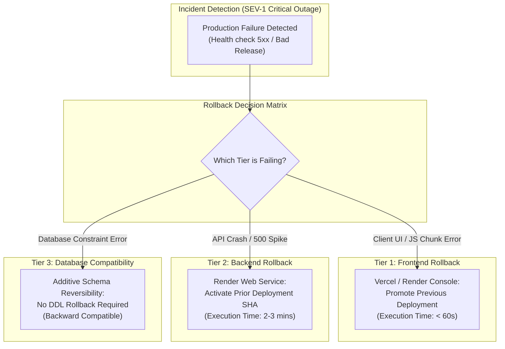

# CarrerSync — Phase 19 Production Rollback Plan
## Multi-Tier Rollback Procedures, Additive Migration Reversibility, Incident Decision Matrix & Rapid Recovery Playbooks

**Document Version:** 1.0.0  
**Phase:** Phase 19 (Pilot Deployment Readiness & Production Operations)  
**Date:** November 16, 2026  
**Auditor / Operational Monitoring & QA Lead:** `@pilot-qa`  
**Operational Scope:** Frontend (Vercel / Render Static), Backend (Render Web Service), Database (Neon PostgreSQL)  
**Target Recovery Metrics:** Recovery Time Objective (RTO) < 10 Minutes | Recovery Point Objective (RPO) = 0 Data Loss  

---

## 1. Executive Summary & Rollback Philosophy

In mission-critical educational platforms, release reversibility is as critical as release deployment. CarrerSync enforces a **zero-downtime, zero-data-loss rollback architecture** across all components.

The platform's architectural design guarantees clean reversibility through three foundational pillars:
1. **Frontend Decoupling**: The React Single Page Application (SPA) is hosted independently on static CDN distribution (Vercel / Render Static Sites). Rollbacks are instantaneous pointer updates requiring zero rebuild or cache invalidation delays.
2. **Stateless Backend Service**: The Express 5 REST API is containerized and stateless. Prior deployment artifacts remain permanently cached on Render, enabling one-click redeployment of any historical successful release.
3. **100% Additive Database Migrations**: All Drizzle migrations (`0000` through `0008`) are strictly non-destructive (0 `DROP TABLE`, 0 `DROP COLUMN`, 0 `TRUNCATE`). Because new columns are nullable or have defaults, a rolled-back backend binary continues to function flawlessly against the upgraded database schema without requiring destructive database rollbacks.



---

## 2. Recovery Objectives & Severity Matrix

### 2.1 Target Operational Recovery Metrics

| Metric | Target | Rationale |
| :--- | :---: | :--- |
| **Recovery Time Objective (RTO)** | **< 10 Minutes** | Time from rollback decision to operational restoration across all user tiers. |
| **Recovery Point Objective (RPO)** | **0 Data Loss** | Zero user data lost; non-destructive schema design preserves all committed transactions. |
| **Rollback Lead Time** | **< 2 Minutes** | Automated UI or CLI trigger duration. |

### 2.2 Rollback Decision Matrix

| Severity Level | Production Impact | Rollback Threshold | Authorized Decision Maker | Action Protocol |
| :---: | :--- | :--- | :--- | :--- |
| **SEV-1 (Critical)** | Core service down; all users unable to authenticate or access dashboards | Health check failing for > 3 minutes post-deploy | QA Lead / DevOps Operator | **Immediate Tier Rollback** (§3 or §4) |
| **SEV-2 (Major)** | Specific critical role blocked (e.g., TPO cannot approve drives); other roles unaffected | Error persists > 15 minutes; no immediate hotfix | QA Lead / Backend Lead | Rollback backend release or deploy hotfix commit |
| **SEV-3 (Minor)** | Visual artifact, localized copy defect, or non-blocking analytical formatting | Low user impact; core workflow intact | Product Owner / Tech Lead | Do NOT rollback; schedule hotfix in next standard release |

---

## 3. Tier 1: Frontend Rollback Procedure (Vercel / Render Static)

Because the frontend is a compiled, immutable static bundle (`client/dist`), rolling back is an instantaneous DNS/CDN alias reassignment.

### 3.1 Option A: Vercel Instant Deployment Rollback (Recommended)
Execution Time: **< 30 Seconds**

1. Log into the **Vercel Dashboard** (`vercel.com`).
2. Navigate to the **CarrerSync** project -> **Deployments** tab.
3. Locate the **previous stable deployment** (marked with a green checkmark prior to the failed release).
4. Click the three dots (`...`) menu on the right of the deployment row.
5. Select **Promote to Production** (or **Instant Rollback**).
6. Confirm the prompt.
7. **Verification**: Refresh browser at the production domain (`https://carrersync.vercel.app`) using hard refresh (`Cmd+Shift+R` / `Ctrl+F5`) to confirm the previous stable UI bundle loads immediately.

### 3.2 Option B: Render Static Sites Rollback
Execution Time: **< 60 Seconds**

1. Log into the **Render Dashboard** (`dashboard.render.com`).
2. Select the **carrersync-client** Static Site.
3. Navigate to the **Events** / **Deploys** tab.
4. Locate the last known good deploy.
5. Click **Roll back to this deploy**.
6. Render updates the edge CDN routing within 45 seconds.

### 3.3 Option C: Git Revert (Repository-Level Rollback)
Execution Time: **2–3 Minutes** (Triggers standard CI/CD)

```bash
# Clone or navigate to the master repository
cd /Users/user/CarrerSync

# Revert the offending commit cleanly
git revert --no-edit HEAD

# Push to trigger automated deployment on Vercel/Render
git push origin master
```

---

## 4. Tier 2: Backend Rollback Procedure (Render Web Service)

Render preserves container build artifacts for previous successful deployments, allowing immediate activation without re-running npm builds.

### 4.1 Step-by-Step Render Manual Rollback
Execution Time: **2–3 Minutes**

1. Open **Render Dashboard** -> Select **carrersync-api** (Web Service).
2. Click on the **Deploys** tab in the left sidebar navigation.
3. Review the deployment history table. Identify the last successful deployment prior to the incident:
   - Note the commit SHA and deployment timestamp.
4. Click the three dots icon (`...`) next to the desired stable deployment.
5. Click **Roll back to this deploy**.
6. Render provisions a new container with the previously cached container image and redirects traffic once the `/health` check responds with HTTP 200.
7. Monitor the deployment log stream in real time until the log confirms:
   ```text
   [CarrerSync API] Server listening on port 10000 in production mode
   [CarrerSync API] Health check: http://localhost:10000/api/v1/health
   ==> Service is live
   ```

### 4.2 Backend Environment Variable Reversal
If an incident was caused by an invalid or corrupted environment variable:
1. Navigate to **carrersync-api** -> **Environment** tab.
2. Revert the erroneous variable (e.g., restore previous `DATABASE_URL` or `JWT_SECRET`).
3. Click **Save Changes**.
4. Render automatically initiates a zero-downtime rolling restart with the corrected variables.

---

## 5. Tier 3: Database Additive Schema Reversibility

### 5.1 The Additive-Only Architecture Principle
CarrerSync strictly forbids destructive DDL modifications in production releases:
- **Zero DROP TABLE**: Obsolete tables are retained or marked deprecated; tables are never dropped during standard release cycles.
- **Zero DROP COLUMN**: Columns are never removed. If a column is deprecated, application code stops reading it, while database schema retains it.
- **Zero TRUNCATE / Destructive ALTER**: Column type alterations must be widening conversions only.
- **Nullable or Default Values for New Columns**: All newly added columns must either be `nullable` or provide a database-level `DEFAULT` value.

### 5.2 Why Database Rollback is Normally Unnecessary
Because all 9 Drizzle migrations (`0000` through `0008`) adhere to this additive-only contract:
- If Backend Release $N$ introduced migration `0008_numerous_morg.sql` (adding 28 optional student profile columns), and the backend is rolled back to Release $N-1$:
- **Release $N-1$ continues to run without error against the upgraded database!**
- The $N-1$ binary simply queries the columns it knows about and ignores the newly added columns.
- **No data loss occurs**, and no risky DDL rollback transactions are required.

### 5.3 Emergency Database Reversal Protocol (Down-Migration)
In the exceptionally rare event that an additive migration created an index or constraint that impairs database write throughput:

```sql
-- EMERGENCY SCHEMA CORRECTION RUNBOOK (Execute only via Neon SQL Console)

-- 1. Identify lock-inducing index or constraint
SELECT indexrelid::regclass AS index_name, relname AS table_name
FROM pg_stat_user_indexes
JOIN pg_statio_user_tables ON pg_stat_user_indexes.relid = pg_statio_user_tables.relid
WHERE schemaname = 'public';

-- 2. Safely drop non-blocking index CONCURRENTLY (avoids table locking)
DROP INDEX CONCURRENTLY IF EXISTS ix_problematic_index_name;

-- 3. In the event a constraint must be removed:
ALTER TABLE students DROP CONSTRAINT IF EXISTS chk_problematic_constraint;
```

> [!CAUTION]
> Never execute `DROP TABLE` or `TRUNCATE` in production. If a table was created erroneously, leave the empty table in place until a scheduled maintenance window.

---

## 6. Standby Workers Edge Runtime Fallback (Section 14 Safeguard)

Per the platform architecture specification, the standby Cloudflare Workers edge runtime is retained in `workers/` with identical 113/113 test parity.

If an catastrophic cloud outage affects Render's infrastructure in its entirety:
1. The standby runtime located in `workers/` can be instantly deployed to Cloudflare's global edge network via Wrangler:
   ```bash
   npm run deploy --prefix workers
   ```
2. The frontend `VITE_API_URL` environment variable is updated on Vercel to point to the edge worker URL (`https://carrersync-edge.workers.dev/api/v1`).
3. Platform availability is restored globally in sub-60 seconds.

---

## 7. Post-Rollback Verification & Health Checklist

Immediately following any rollback execution, the QA Lead must execute the following automated and manual validation sequence:

- [ ] **Health Endpoint Probe**:
  ```bash
  curl -s -i https://carrersync-api.onrender.com/api/v1/health
  # Must return HTTP 200 with "status": "healthy" and "database": "configured"
  ```
- [ ] **Render Log Inspection**:
  - Open Render Live Logs; confirm zero uncaught exceptions in the first 5 minutes post-rollback.
- [ ] **Synthetic Role Authentication Test**:
  - Log in as synthetic Student (`student@apex.edu`).
  - Log in as synthetic TPO (`tpo@apex.edu`).
  - Log in as synthetic Super Admin (`admin@carrersync.example.com`).
- [ ] **Tenant Isolation Check**:
  - Confirm requests from College A do not leak data from College B.
- [ ] **Incident Communication**:
  - Notify stakeholders that rollback is complete and service is nominal.
- [ ] **Schedule Post-Mortem**:
  - File incident report documenting root cause, timeline, and permanent preventive actions.
