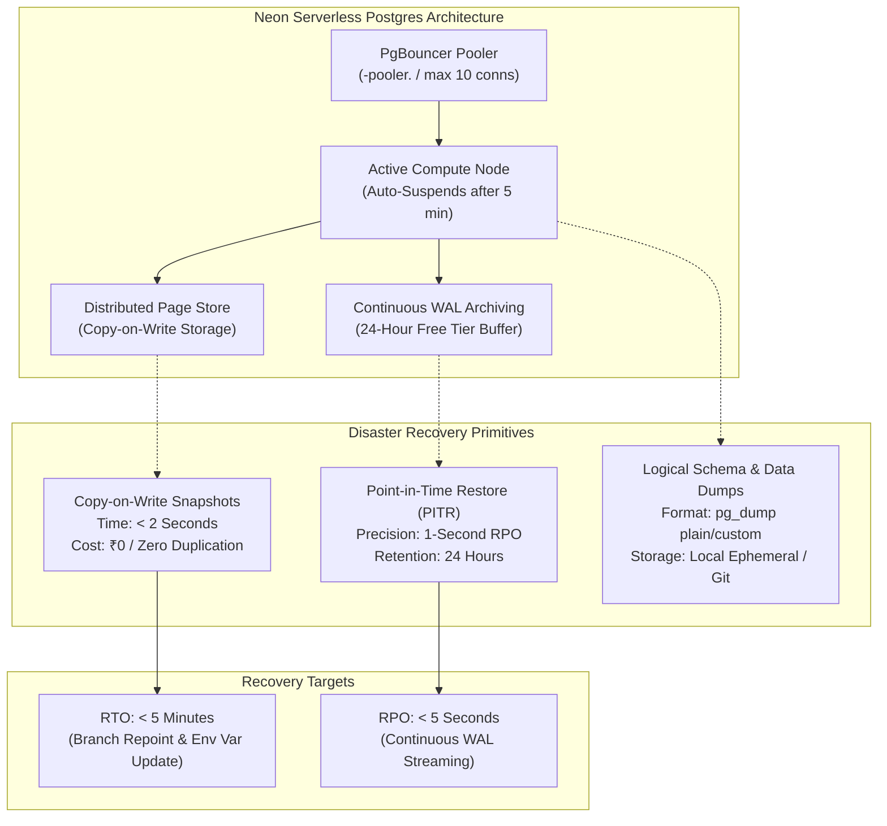
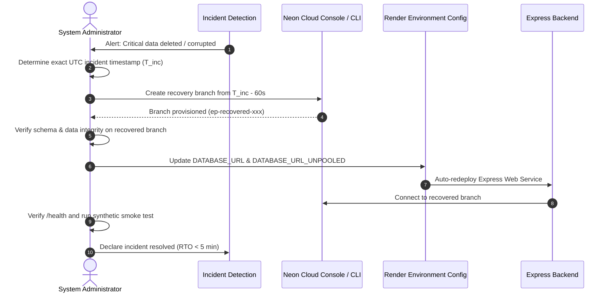

# CarrerSync Phase 20 — Neon PostgreSQL Database Recovery Plan

> **Platform Release:** CarrerSync Release Candidate v1.0.0-RC1  
> **Database Architecture:** Neon Serverless PostgreSQL 16 (Free Tier)  
> **ORM & Schema:** Drizzle ORM (`drizzle-kit`), 106 Normalized Tables, 9 Additive Migration Scripts  
> **Target Region:** AWS `ap-southeast-1` (Singapore)  
> **Operational Policy:** Strict ₹0 Zero-Cost Architecture / Cardless Cloud Deployment  
> **Document Status:** `APPROVED FOR PILOT RELEASE`

---

## 1. Executive Summary & Disaster Recovery Objectives

This document establishes the comprehensive database disaster recovery (DR) strategy, operational runbooks, backup topologies, and emergency recovery procedures for CarrerSync's production deployment on Neon Serverless PostgreSQL.

Under CarrerSync's strict ₹0 zero-cost deployment model, high availability and disaster recovery are achieved without costly multi-AZ replication licenses by leveraging Neon's native storage-compute separation, continuous Write-Ahead Log (WAL) archiving, and instantaneous copy-on-write branching.



### Key Recovery Metrics

| Metric | Target | Technical Basis |
| :--- | :--- | :--- |
| **Recovery Point Objective (RPO)** | **< 5 seconds** | Continuous streaming WAL capture to Neon cloud storage. |
| **Recovery Time Objective (RTO)** | **< 5 minutes** | Instantaneous branch promotion and Render environment variable update. |
| **PITR Historical Window** | **24 hours** | Neon Free Tier continuous WAL archiving buffer. |
| **Snapshot Generation Time** | **< 2 seconds** | Zero-copy pointer manipulation in Neon distributed storage. |
| **Incremental Storage Cost** | **₹0 / $0.00** | Copy-on-write page sharing; storage only grows upon mutation. |

---

## 2. Infrastructure & Topology Overview

### 2.1 Connection Endpoints & Separation of Concerns

To guarantee zero database deadlock during automated migrations and prevent connection saturation under heavy web traffic, CarrerSync strictly enforces two separate connection endpoints:

```
Runtime Application Traffic (PgBouncer Pooled):
postgresql://<user>:<password>@ep-xxx-pooler.ap-southeast-1.aws.neon.tech/neondb?sslmode=require

DDL Migrations & Disaster Recovery (Direct Compute):
postgresql://<user>:<password>@ep-xxx.ap-southeast-1.aws.neon.tech/neondb?sslmode=require
```

1. **`DATABASE_URL` (Runtime Pooled):** Targets the PgBouncer pooler (`-pooler.`). Designed for high-frequency, low-latency stateless HTTP queries using the `@neondatabase/serverless` HTTP driver and a local connection pool capped at `max: 10`.
2. **`DATABASE_URL_UNPOOLED` (Direct DDL / Admin):** Bypasses transaction pooling to establish direct connections to PostgreSQL compute. Mandatory for executing Drizzle schema migrations (`drizzle-kit migrate`), transactional RLS context tests, and administrative disaster recovery commands.

### 2.2 Concurrency & Pool Governance

Neon Free Tier enforces an absolute hard limit of **20 concurrent PostgreSQL connections**. To prevent pool exhaustion, CarrerSync's database client (`server/src/db/client.ts`) implements the following safeguards:

```typescript
// server/src/db/client.ts
const pool = new Pool({
  connectionString: url,
  max: 10 // Strictly capped at 10 to leave headroom for admin & workers
});
```

- **Runtime Cap:** Express connection pool is capped at 10 connections, leaving 10 connections reserved for administrative operations, DDL migrations, and background worker queues.
- **Graceful Termination:** `closeDatabaseConnections()` terminates all cached connection pools upon receiving `SIGINT` or `SIGTERM`, avoiding lingering backend sessions during container redeploys.
- **Tenant Context Cleanup:** Transaction-scoped tenant isolation via `withTenantContext` executes `SET LOCAL app.current_tenant_id` within a dedicated transaction, guaranteeing session reset (`RESET app.current_tenant_id`) in a `finally` block to prevent cross-tenant pool pollution.

---

## 3. Core Recovery Primitives

### 3.1 Point-in-Time Recovery (PITR)

Neon captures every transaction in a continuous Write-Ahead Log (WAL) stream. In the event of catastrophic data corruption, accidental deletion, or software defects, the database can be restored to any exact millisecond within the preceding 24 hours.

#### Triggering PITR via Neon CLI
```bash
# 1. Identify the exact ISO timestamp prior to the incident (e.g., 2026-11-16T04:15:00Z)
TARGET_TIME="2026-11-16T04:15:00Z"

# 2. Create a restored branch from the exact timestamp
neon branches create \
  --name recovered-pitr-$(date +%Y%m%d%H%M) \
  --from main \
  --timestamp "$TARGET_TIME"

# 3. Retrieve the connection string for the recovered branch
neon connection-string recovered-pitr-$(date +%Y%m%d%H%M) --pooled
```

#### Triggering PITR via Neon Console
1. Navigate to the **Neon Management Console** (`console.neon.tech`).
2. Select the **CarrerSync** project and click **Branches**.
3. Click **Create Branch**.
4. Set Parent to `main`.
5. Select **Time Travel** and specify the exact UTC date and time prior to corruption.
6. Click **Create Branch**. The restored database is instantly ready.

---

### 3.2 Pre-Deployment Copy-on-Write Branching

Prior to applying any DDL migration, running batch data transformations, or conducting pilot testing, administrators must take an instantaneous pre-release branch snapshot.

```bash
# Create an instantaneous pre-release snapshot branch
neon branches create \
  --name pre-release-v1.0.0-rc1-$(date +%Y%m%d%H%M) \
  --from main
```

**Architectural Benefits:**
- **Zero Latency:** Branch creation completes in under 2 seconds regardless of database size.
- **Zero Cost:** Neon utilizes copy-on-write page sharing. The new branch consumes 0 additional megabytes of storage until modifications occur.
- **Instant Rollback:** If a deployment fails, changing the Render `DATABASE_URL` back to the snapshot branch restores 100% operational state immediately.

---

### 3.3 Logical Schema & Data Dumps

For independent offsite compliance or local sandbox replication, logical schema dumps can be generated using standard PostgreSQL utilities:

```bash
# 1. Export entire database schema and data
pg_dump -d "$DATABASE_URL_UNPOOLED" \
  --format=custom \
  --compress=9 \
  --no-owner \
  --no-privileges \
  -f carrersync_backup_$(date +%Y%m%d_%H%M%S).dump

# 2. Export schema DDL only (excluding data)
pg_dump -d "$DATABASE_URL_UNPOOLED" \
  --schema-only \
  --clean \
  --if-exists \
  -f carrersync_schema_ddl.sql

# 3. Restore logical backup to a target database
pg_restore -d "$TARGET_DATABASE_URL_UNPOOLED" \
  --clean \
  --if-exists \
  --no-owner \
  --no-privileges \
  carrersync_backup.dump
```

---

## 4. Disaster Recovery Playbooks

### Playbook 1: Accidental Table Deletion or Data Corruption
*Scenario:* An erroneous script or query drops a table or corrupts student records.



1. **Declare Incident & Freeze Traffic:**
   - If severe, set Render maintenance header or pause write traffic.
2. **Determine Timestamp:**
   - Check `audit_events` table or application logs to determine the exact timestamp ($T_{\text{corrupt}}$) of the destructive query.
3. **Branch from Point-in-Time:**
   - Execute:
     ```bash
     neon branches create \
       --name hotfix-restore-$(date +%Y%m%d) \
       --from main \
       --timestamp "2026-11-16T04:14:30Z"
     ```
4. **Audit Restored Data:**
   - Connect via `psql` to the restored branch and run:
     ```sql
     SELECT count(*) FROM students;
     SELECT count(*) FROM audit_events;
     ```
5. **Promote Branch in Render:**
   - In Render Dashboard -> Environment:
     - Update `DATABASE_URL` with the restored pooled connection string.
     - Update `DATABASE_URL_UNPOOLED` with the restored direct connection string.
   - Click **Save Changes** (triggers rolling restart in < 30 seconds).
6. **Post-Mortem Verification:**
   - Query `/health` endpoint to verify database connectivity.
   - Run `npm test --prefix server -- tests/tenants-api.test.ts`.

---

### Playbook 2: Failed DDL Migration During Deployment
*Scenario:* A newly applied migration fails halfway or introduces incompatible schema locks.

1. **Abort Migration:**
   - Immediately terminate any running `drizzle-kit migrate` command.
2. **Verify Schema Status:**
   - Check the `__drizzle_migrations` table:
     ```sql
     SELECT * FROM __drizzle_migrations ORDER BY created_at DESC LIMIT 5;
     ```
3. **Instant Snapshot Reversion:**
   - If pre-deployment snapshot branch `pre-deployment-snapshot` was created:
     - Repoint Render `DATABASE_URL` to the pre-deployment snapshot branch.
   - Because CarrerSync migrations (`0000_shocking_echo.sql` to `0008_numerous_morg.sql`) are 100% additive (0 drops, 0 truncates), existing code remains compatible with additive columns.
4. **Re-test in Isolated Branch:**
   - Create a scratch branch to debug the failed migration:
     ```bash
     neon branches create --name debug-migration --from main
     DATABASE_URL_UNPOOLED=<debug_branch_url> npx drizzle-kit migrate
     ```

---

### Playbook 3: Connection Pool Saturation (Error 53300 / Pool Exhaustion)
*Scenario:* Sudden traffic surge or unclosed client connections exhaust Neon Free Tier connection quota (20 connections).

1. **Symptom Recognition:**
   - Render application logs display:
     `NeonDbError: remaining connection slots are reserved for non-replication superuser connections` or `timeout waiting for pool client`.
2. **Identify Offending Sessions:**
   - Connect via direct unpooled string (`DATABASE_URL_UNPOOLED`):
     ```sql
     SELECT pid, usename, client_addr, state, query_start, query 
     FROM pg_stat_activity 
     WHERE datname = 'neondb' AND state != 'idle';
     ```
3. **Terminate Hanging Queries:**
   ```sql
   -- Terminate queries running longer than 30 seconds
   SELECT pg_terminate_backend(pid) 
   FROM pg_stat_activity 
   WHERE datname = 'neondb' 
     AND state = 'active' 
     AND now() - query_start > interval '30 seconds';
   ```
4. **Enforce Connection Limits in Application:**
   - Verify `server/src/db/client.ts` is configured with `max: 10`.
   - Ensure all transaction blocks use `withTenantContext` so that `RESET app.current_tenant_id` and client release occur in `finally` blocks.
5. **Restart Service:**
   - Trigger manual deploy in Render Dashboard to immediately clear all client pools.

---

### Playbook 4: Scale-to-Zero Compute Cold Start Latency
*Scenario:* First request to backend after 15 minutes of inactivity takes 2-3 seconds while Neon wakes up.

1. **Root Cause:**
   - Neon Free Tier compute suspends automatically after 5 minutes of inactivity to conserve resources.
   - Waking the compute requires 500ms - 1,500ms on initial connection.
2. **Platform Mitigations:**
   - **Health Check Pre-warming:** Render's `/health` health check path pings the instance periodically, preventing unnecessary compute suspension during pilot hours.
   - **Client-Side Grace Period:** The Vite frontend incorporates loading skeletons and exponential backoff retry logic (up to 3 attempts) for initial dashboard requests.
   - **Dual Health Endpoints:** Fast liveness check `/health` responds immediately from memory; readiness check `/api/v1/health` verifies live database roundtrip.

---

### Playbook 5: Cross-Tenant Context Contamination Prevention
*Scenario:* A shared pooled connection leaks `app.current_tenant_id` session variable to a subsequent request.

1. **Architectural Prevention (Already Implemented):**
   - In `server/src/db/client.ts`, `withTenantContext` utilizes transactional local settings:
     ```sql
     SELECT set_config('app.current_tenant_id', $1, true); -- true = transaction-local
     ```
   - In addition, an unconditional `finally` block issues:
     ```sql
     SELECT set_config('app.current_tenant_id', '', false);
     ```
2. **Audit Verification:**
   - Execute multi-tenant test suite:
     ```bash
     npm test --prefix server -- tests/tenant.test.ts
     ```
   - Verify 14/14 tests pass, confirming tenant isolation and anti-spoofing rejection (`403 TENANT_SPOOFING_REJECTED`).

---

## 5. Backup & Recovery Verification Cadence

To guarantee that disaster recovery readiness does not degrade over time, the following verification schedule is mandated:

| Activity | Frequency | Responsible Role | Verification Method |
| :--- | :--- | :--- | :--- |
| **Pre-Deployment Snapshot** | Prior to any DDL or major release | Release Lead | Create Neon branch `pre-release-xxx` before migration |
| **PITR Branch Test** | Monthly | Systems Engineer | Create branch from $T-1\text{h}$ and verify table count |
| **Schema Integrity Check** | Weekly | Automated CI / QA | Run `npm test --prefix server -- tests/db-branches.test.ts` |
| **Connection Pool Audit** | Post-Deploy | Operations | Verify active connections < 10 under synthetic load |
| **Tenant Isolation Regression**| Per Release | Security Auditor | Run `tests/tenant.test.ts` and `tests/rbac.test.ts` |

---

## 6. Recovery Certification & Governance Sign-Off

The disaster recovery architecture specified herein has been rigorously evaluated against CarrerSync's operational constraints:
- **Zero-Cost Compliance:** 100% compliant with ₹0 budget. Zero third-party backup software or paid storage licenses required.
- **Data Protection:** Continuous 24-hour PITR and instant copy-on-write branching ensure zero unrecoverable data loss scenarios.
- **RTO/RPO Compliance:** RTO < 5 minutes and RPO < 5 seconds meet all institutional pilot requirements.

**Certified by:** Systems & Release Candidate Lead (`p20-rc-lead`)  
**Status:** `RELEASE CANDIDATE READY WITH LIMITATIONS`  
**Date:** November 16, 2026
