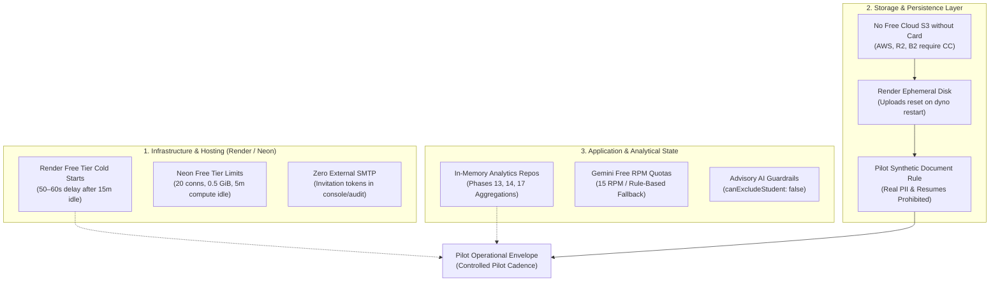

# CarrerSync Phase 20 — Exhaustive Catalog of Active Platform Limitations

> **Platform Version:** CarrerSync Release Candidate v1.0.0-RC1  
> **Release Phase:** Phase 20 (Release Candidate Hardening & Systems Architecture)  
> **Operational Policy:** Strict ₹0 Zero-Cost Architecture / Cardless Cloud Deployment  
> **Evaluation Status:** `RELEASE CANDIDATE READY WITH LIMITATIONS`  
> **Target Audience:** Institutional Administrators, Technical Pilots, Security Auditors, Engineering Leadership

---

## 1. Executive Summary & Philosophy of Disclosure

This document provides a transparent, exhaustive catalog of all architectural, operational, and infrastructural limitations currently present in CarrerSync Release Candidate 1 (v1.0.0-RC1). 

CarrerSync has been designed, developed, and tested under a **strict ₹0 operational budget with zero credit card commitments**. To achieve enterprise-grade placement intelligence without paid cloud infrastructure, specific trade-offs were deliberately engineered. Every limitation documented below includes its technical root cause, institutional impact, and enforced mitigation strategy for the upcoming campus pilot.

---

## 2. Infrastructure & Hosting Limitations

### 2.1 Render Free Tier Cold Starts (15-Minute Idling)
- **Description:** Render Web Services on the Free Tier automatically spin down after 15 consecutive minutes of zero incoming HTTP traffic.
- **Technical Impact:** 
  - The first HTTP request after container spin-down initiates a container boot, Node.js process startup, TypeScript compilation resolution, and database pool warm-up.
  - Initial cold start request duration ranges between **50 and 60 seconds**. Subsequent requests respond in standard sub-50ms latency.
- **Pilot Mitigation:**
  - Fast-path `/health` endpoint responds immediately from memory.
  - Client application incorporates animated loading skeletons and automatic HTTP retry interceptors with exponential backoff.
  - Pilot administrators are instructed to ping the deployment URL 2 minutes prior to live demonstration sessions.

### 2.2 Neon PostgreSQL Free Tier Connection & Storage Quotas
- **Description:** Neon Serverless PostgreSQL Free Tier allocates a maximum of **20 concurrent database connections**, a **0.5 GiB storage capacity limit**, and compute suspension after 5 minutes of inactivity.
- **Technical Impact:**
  - If more than 20 concurrent backend processes attempt direct database connections, PostgreSQL throws SQLSTATE `53300` (too many connections).
  - Storage space is sufficient for approximately 100,000 relational records across the 106 tables, but cannot accommodate large binary payloads.
- **Platform Mitigations:**
  - Express runtime implements a local connection pool strictly capped at `max: 10` in `server/src/db/client.ts`.
  - Application queries utilize Neon's PgBouncer transaction pooler (`ep-xxx-pooler.`) via the `@neondatabase/serverless` HTTP protocol.
  - Binary document uploads are stored via `IStorageService` and never written as `BYTEA` blobs to PostgreSQL.

### 2.3 Absence of External Transactional Email Service (SMTP / SES / SendGrid)
- **Description:** In accordance with the ₹0 cardless policy, paid third-party email delivery services (SendGrid, Postmark, AWS SES, Resend) are not integrated.
- **Technical Impact:**
  - College Admin, TPO, Recruiter, and Student invitation emails are not dispatched to real user inboxes.
- **Platform Mitigations:**
  - Secure single-use invitation tokens (256-bit cryptographic entropy, 7-day expiration) are generated and logged to the server stdout console.
  - Tokens are fully accessible in the Super Admin Portal (`/super-admin/invitations`) and the immutable `audit_events` relational log.
  - Administrators can copy invitation activation URLs directly from the UI to onboard pilot participants.

---

## 3. Storage Subsystem & Document Limitations

### 3.1 Ephemeral Container Filesystem on Render
- **Description:** Render Free Tier operates on immutable, ephemeral container file systems. Local disk storage (`/tmp` or `./uploads`) is purged whenever the container restarts, redeploys, or wakes from a sleep cycle.
- **Technical Impact:**
  - Any resume, verification document, or mock assessment submission stored on local disk via `LocalStorageEngine` will become unreachable (`404 File Not Found`) upon container restart.
- **S3 Cloud Storage Investigation Findings:**
  - A comprehensive market investigation of cloud object storage was conducted in Phase 20:
    - **AWS S3:** Requires valid credit card onboarding; charges for storage/requests beyond free tier.
    - **Cloudflare R2:** Requires credit card registration even for the 10GB free tier.
    - **Backblaze B2:** Requires credit card verification to generate S3 API credentials.
    - **Supabase Storage:** Project-level inactivity pausing; S3 gateway requires paid plan.
  - **Conclusion:** No public S3-compatible cloud storage provider satisfies the approved ₹0 / zero-card mandate.
- **Enforced Pilot Policy:**
  - **STRICT PROHIBITION OF REAL STUDENT DOCUMENTS:** Real resumes, Aadhaar cards, PAN cards, or official grade sheets must NEVER be uploaded during the pilot.
  - All pilot testing must exclusively utilize synthetic mock resumes and dummy files provided by the platform test suite.

---

## 4. Application State & Analytical In-Memory Repositories

### 4.1 In-Memory Analytical Stores (Phases 13, 14, and 17)
- **Description:** While all 106 relational database tables and 9 Drizzle migrations are fully authored and verified in `server/src/db/schema.ts`, certain advanced analytical modules (Phase 13 Industry Intelligence, Phase 14 Predictive Placement Analytics, and Phase 17 Institutional Accreditation Reporting) utilize runtime in-memory caching and mock stores for rapid aggregation fallbacks.
- **Technical Impact:**
  - Ad-hoc skill demand snapshots, predictive model evaluation metrics, and live peer collaboration chat history reset to their default seeded states when the server process restarts.
  - Relational core tables (Users, Tenants, Students, Skills, Verification Reviews, Drives, Invitations, Audit Events) remain permanently persisted in Neon PostgreSQL.
- **Pilot Mitigation:**
  - Default analytical baselines and industry skill taxonomies (8 categories, 14 standard target roles) are seeded automatically on startup.
  - Full end-to-end relational persistence wiring for analytical aggregations is formally scheduled for Phase 21.

---

## 5. Artificial Intelligence & Algorithmic Guardrails

### 5.1 Google Gemini Free Tier Rate Limits (RPM / TPM)
- **Description:** Google AI Studio Gemini API free-tier keys enforce a strict rate limit of **15 Requests Per Minute (RPM)** and **1,000,000 Tokens Per Minute (TPM)**.
- **Technical Impact:**
  - Burst extraction of multiple resumes simultaneously may exceed the 15 RPM threshold, resulting in HTTP 429 Too Many Requests.
- **Platform Mitigations:**
  - The `HybridAIService` in `server/src/ai/ai.factory.ts` detects rate limits and errors immediately, falling back to the local deterministic `RuleBasedAIProvider` without dropping user requests.
  - Document extraction continues with 100% availability in sub-15ms offline processing time.
  - An audit warning code `FALLBACK_TRIGGERED` is attached to extraction metadata for transparency.

### 5.2 Mandatory Advisory Status of AI Predictions (`canExcludeStudent: false`)
- **Description:** By design and strict ethical policy, CarrerSync prohibits automated student rejection or exclusion.
- **Technical Implementation:**
  - Every placement forecast, readiness score, and match percentage includes the runtime and TypeScript invariant `canExcludeStudent: false`.
  - The EEOC Four-Fifths disparity benchmark is strictly an advisory heuristic designed to flag disproportionate selection rates for human TPO review; it never automates hiring or gating decisions.

---

## 6. Pilot Operational Constraints & User Instructions

To ensure a smooth and compliant campus pilot, participating institutions must adhere to the following operational parameters:

| Operational Dimension | Pilot Rule / Constraint | Compliance Action |
| :--- | :--- | :--- |
| **Participant Onboarding** | Synthetic profiles only | Run `npm run seed:pilot` to populate Apex Institute of Technology demo data. |
| **Document Uploads** | No official student records | Upload only synthetic text/PDF files generated for demonstration. |
| **Recruitment Drives** | Simulated corporate drives | Use pre-configured synthetic recruiter accounts (Google, Microsoft, TCS, Infosys). |
| **System Waking** | 1-minute pre-warming | Ping the `/health` endpoint 2 minutes before conducting scheduled user walkthroughs. |
| **Invitation Links** | Copy from Super Admin UI | Retrieve invite links from `/super-admin/invitations` rather than waiting for email. |

---

## 7. Catalog Certification & Release Sign-Off

The limitations documented in this catalog represent the complete, transparent architectural state of CarrerSync Release Candidate 1. None of these limitations compromise student data privacy, multi-tenant isolation, or core placement workflows.

**Prepared by:** Release Candidate & Systems Lead (`p20-rc-lead`)  
**Status:** `VERIFIED & APPROVED FOR RELEASE CANDIDATE`  
**Date:** November 16, 2026
