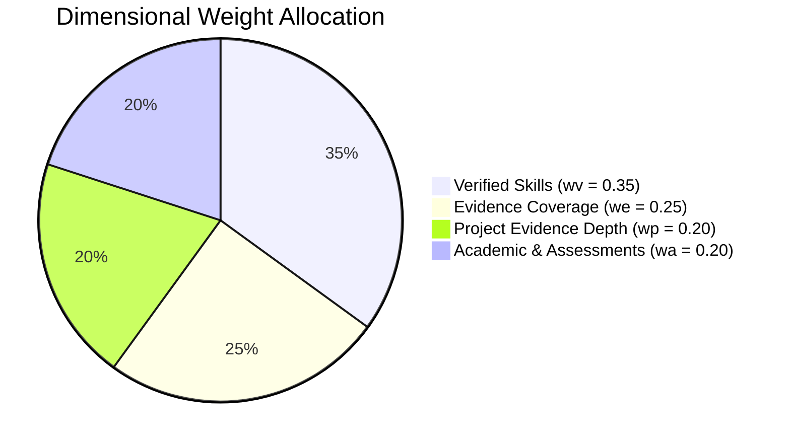

# CarrerSync Placement Readiness Intelligence Engine Specification

> **Document Type**: Canonical Algorithm & Architecture Specification  
> **Status**: APPROVED & CANONICAL  
> **Phase**: Phase 10 — TPO Verification Portal, Placement Readiness & Job Eligibility Subsystem  
> **Target Release**: Active Node.js + Express Backend (`server/src/readiness/`) & React Client (`client/src/pages/tpo/`)  
> **Master Policy**: Explainable, Deterministic Scoring | Advisory Metric (Never Guaranteed Placement)  

---

## 1. Executive Summary & Core Design Principles

Traditional placement drives rely heavily on coarse academic metrics (e.g., aggregate CGPA cutoffs) or self-declared resume claims. This creates systemic failures: high-CGPA candidates frequently struggle in technical coding rounds due to lack of verifiable practical experience, while highly capable builders with moderate GPAs are eliminated before the first interview.

The **CarrerSync Placement Readiness Engine** introduces an objective, multi-dimensional, and **100% explainable** readiness index. It measures a candidate's verified competency density, artifact backing, project depth, and academic consistency.

```
┌────────────────────────────────────────────────────────────────────────────────────────┐
│                      THE ADVISORY MANDATE OF READINESS SCORING                         │
│                                                                                        │
│  The Placement Readiness Score is an ADVISORY BENCHMARK,                              │
│  quantifying portfolio verification rigor and technical readiness.                    │
│                                                                                        │
│  IT IS NEVER A GUARANTEED PROBABILITY OF PLACEMENT.                                    │
│  Hiring decisions depend on human interview performance, interpersonal dynamics,       │
│  company-specific culture fits, and market conditions that no software can guarantee. │
│  The platform explicitly displays this disclaimer across all student and TPO views.    │
└────────────────────────────────────────────────────────────────────────────────────────┘
```

### Core Design Principles
1. **Deterministic Reproducibility**: Given the exact same set of evidence artifacts, academic records, and verification statuses, the engine produces the exact same score and explanation. Zero stochastic AI fluctuations.
2. **Transparent Explainability**: Every score is accompanied by an itemized mathematical breakdown, highlighting verified strengths, evidence strengths, and high-impact remediation recommendations.
3. **Graceful Handling of Sparse Data**: Profiles with missing optional records are scored equitably via a **Data Completeness Index** rather than punitive zero-point deductions.
4. **Institutional Privacy**: All scoring calculations execute locally inside the Node.js/TypeScript backend runtime. Zero student records or transcript data are sent to external AI vendors.

---

## 2. Explainable Readiness Scoring Formula

The overall Placement Readiness Score $S \in [0.0, 100.0]$ is computed as a weighted linear combination of four discrete dimension scores:

$$S = w_v \cdot S_{\text{verified}} + w_e \cdot S_{\text{coverage}} + w_p \cdot S_{\text{project}} + w_a \cdot S_{\text{academic}}$$

### Dimensional Weight Allocation



| Dimension | Symbol | Weight ($w$) | Focus Area | Data Source |
| :--- | :---: | :---: | :--- | :--- |
| **Verified Technical Skills** | $S_{\text{verified}}$ | **$0.35$ (35%)** | Technical competencies certified by TPO/College Admin | `profileSkillEvidence` (Status: `VERIFIED`) |
| **Evidence Coverage** | $S_{\text{coverage}}$ | **$0.25$ (25%)** | Ratio of evidence-backed claims vs total self-declared claims | `profileSkillEvidence` (All records) |
| **Project Evidence Depth** | $S_{\text{project}}$ | **$0.20$ (20%)** | Complexity, repositories, and demonstrable code artifacts | `profileSkillEvidence` (Type: `PROJECT`), `documents` |
| **Academic & Assessments** | $S_{\text{academic}}$ | **$0.20$ (20%)** | Normalized CGPA and proctored technical evaluations | `students`, `academicSemesters`, `skillAssessments` |

---

## 3. Dimensional Metric Calculations

### 3.1 Verified Skills Score ($S_{\text{verified}}$)
Measures the depth and breadth of competencies that have received the canonical institutional `VERIFIED` seal from an authorized TPO:

$$S_{\text{verified}} = \min\left(100, \; \sum_{k=1}^{N_{\text{verified}}} \beta(c_k) \cdot 15.0\right)$$

- Where $N_{\text{verified}}$ is the count of skills with status `VERIFIED`.
- $\beta(c_k)$ is a category relevance multiplier:
  - Core Engineering (`programming_languages`, `databases`, `cloud_devops`): $\beta = 1.00$
  - Frameworks & Applied CS (`frameworks`, `core_cs`, `data_ai`): $\beta = 0.85$
  - Secondary Tools & Soft Skills (`tools`, `soft_skills`): $\beta = 0.60$
- A student with 7–8 well-distributed verified skills across core categories achieves the maximum score of 100.

### 3.2 Evidence Coverage Score ($S_{\text{coverage}}$)
Quantifies the student's evidentiary rigor, rewarding candidates whose resume claims are substantiated by physical artifacts rather than unbacked assertions:

$$\text{Coverage Ratio } R_{\text{cov}} = \frac{N_{\text{verified}} + N_{\text{evidence\_found}} + 0.5 \cdot N_{\text{pending\_review}}}{N_{\text{total\_declared}}}$$

$$S_{\text{coverage}} = R_{\text{cov}} \times 100.0$$

- A student claiming 10 skills with 8 substantiated by artifacts achieves $80.0\%$.
- A student listing 40 uncorroborated skills on a resume achieves a low coverage score, disincentivizing "keyword stuffing".

### 3.3 Project Evidence Depth Score ($S_{\text{project}}$)
Evaluates practical engineering output, inspecting code repositories, architectural documents, and live deployments:

$$S_{\text{project}} = \min\left(100, \; \sum_{p=1}^{N_{\text{projects}}} \text{ProjectScore}_p\right)$$

- Each verified project artifact contributes based on complexity:
  - Documented repository with multi-tier architecture & tests: $25 \text{ pts}$
  - Single-service project with functional code: $15 \text{ pts}$
  - Basic tutorial or exploratory script: $5 \text{ pts}$
- Project depth tops out at 4 substantial, verifiable projects ($4 \times 25 = 100$).

### 3.4 Academic & Assessment Score ($S_{\text{academic}}$)
Measures institutional academic consistency and standardized assessment performance:

$$S_{\text{academic}} = 0.70 \cdot \left(\frac{\text{CGPA}}{\text{Max CGPA}} \times 100\right) + 0.30 \cdot S_{\text{assessments}}$$

- When proctored internal placement assessments are unavailable, the CGPA component scales to 100% of the academic score.
- For a student with an $8.40 / 10.0$ CGPA and no assessments: $S_{\text{academic}} = 84.0$.

---

## 4. The Data Completeness Indicator ($C$)

A critical failure of algorithmic evaluations is the punitive penalization of students who simply have not yet uploaded optional records (e.g., semester grade sheets or extracurricular certificates). CarrerSync decouples completeness from capability using the **Data Completeness Indicator** $C \in [0.00, 1.00]$.

### Completeness Components
$$C = \sum_{i=1}^{M} w_{c, i} \cdot I_i$$

| Profile Component ($i$) | Weight ($w_c$) | Presence Condition ($I_i$) |
| :--- | :---: | :--- |
| Basic Profile & Department | $0.20$ | Full name, enrollment number, department, graduation year |
| Primary Resume / Document | $0.25$ | At least one parsed resume document in `documents` |
| Declared & Staged Skills | $0.25$ | Minimum 3 skill claims recorded in `profileSkillEvidence` |
| Project Artifacts | $0.15$ | At least 1 project link or repository uploaded |
| Academic CGPA Record | $0.15$ | CGPA or semester marks present in `students` table |

### Equitable Missing Data Handling
1. **Dynamic Academic Reweighting**: If academic data is absent ($I_{\text{academic}} = 0$), the student is NOT awarded 0 for $S_{\text{academic}}$. Instead, the remaining three dimensions ($S_{\text{verified}}, S_{\text{coverage}}, S_{\text{project}}$) are normalized across the active weight sum ($0.80$), and $C$ is reduced to $\le 0.85$.
2. **Transparent Completeness Flagging**: The UI displays both the Readiness Score and a completeness badge (e.g., *"Score: 78/100 · Profile Completeness: 85%"*), advising the student on which specific documents will unlock full evaluation fidelity.

---

## 5. Readiness Categorization Matrix

Students are assigned an actionable readiness classification based on their composite score $S$ and data completeness $C$:

```
┌────────────────────────────────────────────────────────────────────────────────────────┐
│                              READINESS CATEGORY THRESHOLDS                             │
│                                                                                        │
│  Score >= 80.0 AND Completeness >= 0.40  ──►  READY                                   │
│  Score 60.0 - 79.9 AND Completeness >= 0.40 ──► DEVELOPING                             │
│  Score < 60.0 AND Completeness >= 0.40   ──►  NEEDS_SUPPORT                           │
│  Completeness < 0.40 (Regardless of Score)──► INSUFFICIENT_DATA                        │
└────────────────────────────────────────────────────────────────────────────────────────┘
```

| Category | Score Threshold | Completeness | Operational Meaning & Recommended Action |
| :--- | :---: | :---: | :--- |
| **READY** | $S \ge 80.0$ | $C \ge 0.40$ | High verification density; proven project artifacts; ready for immediate placement drives and direct recruiter shortlisting. |
| **DEVELOPING** | $60.0 \le S < 79.9$ | $C \ge 0.40$ | Core skills demonstrated; requires targeted evidence verification (e.g., submitting GitHub links for self-declared skills) or one capstone project. |
| **NEEDS_SUPPORT** | $S < 60.0$ | $C \ge 0.40$ | Substantial gaps in verified skills or minimal practical project evidence; flagged for TPO remediation and specialized training workshops. |
| **INSUFFICIENT_DATA**| Any | $C < 0.40$ | Profile lacks foundational documentation; cannot reliably evaluate readiness; prompt student to complete profile and upload initial resume. |

---

## 6. Explainability Engine & Snapshot Persistence

### 6.1 Structured Diagnostic Output
The engine returns a rich, human-readable explainability schema:

```json
{
  "studentId": "0d6f2122-8356-4b21-81d3-300642fa6054",
  "score": 82.50,
  "category": "READY",
  "dataCompleteness": 0.95,
  "dimensions": {
    "verifiedSkillsScore": 85.00,
    "evidenceCoverageScore": 82.50,
    "projectScore": 80.00,
    "academicScore": 84.00
  },
  "explanation": "Candidate demonstrates high readiness (82.50) backed by 6 verified core competencies including TypeScript, PostgreSQL, and Node.js. Evidence coverage is robust (82.5%), with 2 verified production-grade project repositories.",
  "verifiedStrengths": ["TypeScript", "PostgreSQL", "Node.js", "Docker", "REST APIs"],
  "evidenceStrengths": ["AWS Cloud Practitioner Certification", "E-commerce Microservices Project"],
  "skillsRequiringVerification": ["Redis", "Kubernetes"],
  "missingRequiredSkills": ["CI/CD Pipeline Configuration"],
  "recommendedActions": [
    "Request TPO review for Redis by linking caching benchmark repo.",
    "Complete CI/CD workflow milestone in upcoming mock drive."
  ]
}
```

### 6.2 Relational Snapshot Ledger (`studentReadinessSnapshots`)
To provide longitudinal tracking and historical trend analysis, every calculation creates an immutable snapshot row in PostgreSQL:

```sql
CREATE TABLE student_readiness_snapshots (
    id UUID PRIMARY KEY DEFAULT gen_random_uuid(),
    tenant_id UUID NOT NULL REFERENCES tenants(id) ON DELETE CASCADE,
    student_id UUID NOT NULL REFERENCES users(id) ON DELETE CASCADE,
    score NUMERIC(5, 2) NOT NULL,
    category VARCHAR(50) NOT NULL,
    dimensions JSONB NOT NULL DEFAULT '{}',
    explanation TEXT NOT NULL,
    data_completeness NUMERIC(4, 2) NOT NULL DEFAULT '1.00',
    calculated_at TIMESTAMP WITH TIME ZONE DEFAULT NOW()
);
```

---

## 7. Cohort and Department-Level Intelligence Aggregations

The Readiness Engine equips institutional leadership (Placement Directors, TPOs, Department Heads) with real-time macro analytics across entire graduating batches:

```
┌────────────────────────────────────────────────────────────────────────────────────────┐
│                          INSTITUTIONAL READINESS DASHBOARD                             │
├────────────────────────────────────────────────────────────────────────────────────────┤
│  Cohort Average: 74.2/100  │  Total Evaluated: 840  │  Verification Rate: 78.4%       │
├────────────────────────────────────────────────────────────────────────────────────────┤
│  Distribution: [ READY: 340 (40.5%) ] [ DEVELOPING: 380 (45.2%) ] [ SUPPORT: 120 ]     │
├────────────────────────────────────────────────────────────────────────────────────────┤
│  Department Performance Breakdown:                                                     │
│  • Computer Science & Eng (CSE)  : Avg 79.4  | 54% Ready | Top Gap: Kubernetes (42%)    │
│  • Information Technology (IT)   : Avg 76.1  | 48% Ready | Top Gap: System Design (38%) │
│  • Electronics & Comm (ECE)      : Avg 67.2  | 28% Ready | Top Gap: Data Structures(52%)│
└────────────────────────────────────────────────────────────────────────────────────────┘
```

### Institutional Metrics
1. **Cohort Category Distribution**: Real-time count and percentage of students in `READY`, `DEVELOPING`, `NEEDS_SUPPORT`, and `INSUFFICIENT_DATA`.
2. **Department Benchmark Matrix**: Direct cross-departmental comparison of average readiness, verified skill density, and project artifact coverage.
3. **Institutional Bottleneck Identification**: Automatically highlights the top 5 missing skills across the entire student body (e.g., "48% of eligible students lack verified Docker competence"), informing syllabus enhancements and targeted TPO bootcamps.
4. **Early Intervention Roster**: Generates a priority queue of students in the `NEEDS_SUPPORT` category who have upcoming drive deadlines, enabling faculty mentors to provide personalized guidance.

---

## 8. REST API Reference

| Method | Endpoint | Allowed Roles | Description |
| :--- | :--- | :--- | :--- |
| `GET` | `/api/v1/readiness/students/:studentId` | `STUDENT` (own), `TPO_ADMIN`, `COLLEGE_ADMIN`, `RECRUITER` | Retrieves current readiness assessment, dimensional scores, completeness index, and explainability breakdown. |
| `GET` | `/api/v1/readiness/students/:studentId/history` | `STUDENT` (own), `TPO_ADMIN`, `COLLEGE_ADMIN` | Retrieves historical timeline of readiness snapshots for the student to visualize growth trajectory. |
| `GET` | `/api/v1/tpo/readiness/cohort` | `TPO_ADMIN`, `COLLEGE_ADMIN` | Retrieves cohort-wide aggregate intelligence: mean scores, distribution counts, top skill gaps, and intervention alerts. |
| `GET` | `/api/v1/tpo/readiness/departments` | `TPO_ADMIN`, `COLLEGE_ADMIN` | Retrieves department-wise breakdown of readiness metrics, verification rates, and candidate counts. |
