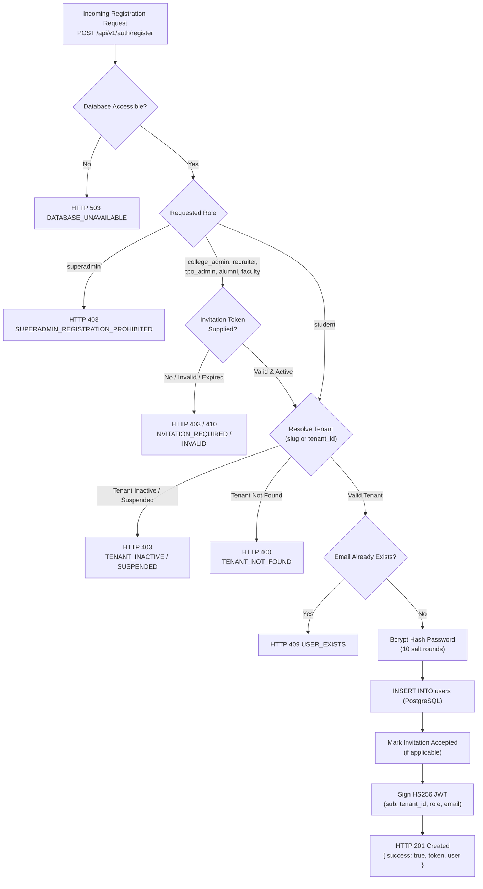

# CareerSync — Registration & Authentication Backend Implementation

**Document Version:** 1.0.0  
**Phase:** Phase 19/20 Authentication Hardening & Role Governance  
**Author:** Backend Architecture Team (`@auth-backend`)  
**Status:** Approved & Verified against Neon PostgreSQL & Vitest Test Suites  

---

## 1. Executive Summary

This specification documents the hardened registration, authentication, tenant isolation, and administrative security implementations within the CareerSync backend services (`server/src/routes/auth.routes.ts`, `server/src/routes/tenant.routes.ts`, `server/src/routes/superadmin.routes.ts`, and `server/src/middleware/auth.ts`).

### Key Security Upgrades:
1. **Elimination of Insecure Offline Fallbacks:** Removed all synthetic user creation fallbacks in `/register` and `/login`. Authentication and registration require active database persistence. Inability to reach the database yields an explicit `503 Service Unavailable` (`DATABASE_UNAVAILABLE`).
2. **Role-Based Registration Gating:**
   - **`student`**: Public self-registration permitted within valid institutional tenant boundaries.
   - **Privileged Roles (`college_admin`, `faculty_coordinator`, `recruiter`, `tpo_admin`, `alumni`)**: Strictly blocked from self-registration without a valid, active, non-expired, and non-revoked invitation token.
   - **`superadmin`**: Permanently blocked from public self-registration (`403 SUPERADMIN_REGISTRATION_PROHIBITED`). Superadmin accounts may only be provisioned via platform seeds or out-of-band administrative orchestration.
3. **Multi-Tenant Scoped RBAC & Password Security:** Enforces bcrypt (10 rounds) for all passwords. Issues signed HS256 JWT tokens with normalized claims (`sub`, `tenant_id`, `role`, `email`).
4. **Tenant Management Hardening:** `GET /api/v1/tenants` and `POST /api/v1/tenants` now enforce `authenticateToken` and `requireRole(['superadmin'])`. Unauthenticated calls yield `401 Unauthorized`; non-superadmin calls yield `403 Forbidden`.
5. **Superadmin Stats Route Fix:** Corrected HTTP 409 bug on `GET /api/v1/super-admin/stats` to return `200 OK` with aggregated platform metrics.

---

## 2. Architecture & Registration Flow



---

## 3. API Contract Specifications

### 3.1 POST `/api/v1/auth/register`

Creates a new user account under strict institutional and role-based policies.

#### Request Headers
```http
Content-Type: application/json
```

#### Request Body Schema
```json
{
  "email": "student.new@apex.edu",
  "password": "SecurePassword@123",
  "fullName": "Student Name",
  "role": "student",
  "tenantSlug": "apex-institute",
  "tenantId": "optional-uuid-instead-of-slug",
  "invitationToken": "required-for-privileged-roles"
}
```

| Field | Type | Required | Description |
|---|---|---|---|
| `email` | `string` | Yes | Valid email address. Normalized to lowercase. |
| `password` | `string` | Yes | Minimum 8 characters. Hashed via bcrypt (10 rounds). |
| `fullName` | `string` | Yes | User display name. |
| `role` | `string` | No | Defaults to `'student'`. Permitted: `student`, `college_admin`, `faculty_coordinator`, `recruiter`, `tpo_admin`, `alumni`. (`superadmin` rejected). |
| `tenantSlug` | `string` | Conditional | Institutional tenant slug (e.g., `apex-institute` or `apex-tech`). Required if `tenantId` is omitted. |
| `tenantId` | `string` (UUID) | Conditional | Institutional tenant UUID. Required if `tenantSlug` is omitted. |
| `invitationToken` | `string` | Conditional | Mandatory for all roles other than `'student'`. |

#### Response: HTTP 201 Created
```json
{
  "success": true,
  "message": "User registered successfully",
  "token": "eyJhbGciOiJIUzI1NiIsInR5cCI6IkpXVCJ9...",
  "user": {
    "id": "e5b87c4a-6d45-4bb8-8250-93a8cf822eb1",
    "email": "student.new@apex.edu",
    "fullName": "Student Name",
    "role": "student",
    "tenantId": "7c9e6679-7425-40de-944b-e07fc1f90ae7"
  }
}
```

---

### 3.2 Error Codes & Status Matrix

| HTTP Status | Error Code | Trigger Condition |
|---|---|---|
| **400 Bad Request** | `VALIDATION_FAILED` | Missing `email`, `password`, or `fullName`. Password length < 8 chars. |
| **400 Bad Request** | `TENANT_NOT_FOUND` | Provided `tenantSlug` or `tenantId` does not match any registered tenant. |
| **403 Forbidden** | `SUPERADMIN_REGISTRATION_PROHIBITED` | Public self-registration attempted with `role: "superadmin"`. |
| **403 Forbidden** | `INVITATION_REQUIRED` | Non-student role requested without supplying `invitationToken`. |
| **403 Forbidden** | `TENANT_INACTIVE` | Institutional tenant has `is_active: false`. |
| **403 Forbidden** | `TENANT_SUSPENDED` | Institutional tenant has `is_suspended: true` or `status: "suspended"`. |
| **409 Conflict** | `USER_EXISTS` | An account with the same email already exists within the tenant or globally. |
| **410 Gone** | `INVITATION_REVOKED` | Provided invitation token was explicitly revoked. |
| **410 Gone** | `INVITATION_EXPIRED` | Provided invitation token expiration timestamp (`expires_at`) is in the past. |
| **410 Gone** | `INVITATION_ALREADY_USED` | Invitation token was already accepted. |
| **503 Service Unavailable** | `DATABASE_UNAVAILABLE` | PostgreSQL connection failure or unreachable database. No offline fallbacks. |

---

## 4. JWT Token Payload & Security Standard

All issued tokens use HMAC-SHA256 (`HS256`) signed with `JWT_SECRET`. Tokens expire in 24 hours (`24h`).

### Token Payload Structure
```json
{
  "sub": "e5b87c4a-6d45-4bb8-8250-93a8cf822eb1",
  "userId": "e5b87c4a-6d45-4bb8-8250-93a8cf822eb1",
  "tenant_id": "7c9e6679-7425-40de-944b-e07fc1f90ae7",
  "tenantId": "7c9e6679-7425-40de-944b-e07fc1f90ae7",
  "role": "student",
  "email": "student.new@apex.edu",
  "iat": 1700000000,
  "exp": 1700086400
}
```

Both `sub` and `userId`, as well as `tenant_id` and `tenantId`, are populated to provide backwards compatibility with legacy service consumers while strictly maintaining standard RFC 7519 claims.

---

## 5. Tenant Administration Security

Endpoints in `server/src/routes/tenant.routes.ts` (and exported through `server/src/routes/tenants.routes.ts`):

```typescript
// Protect all tenant listing and creation operations
router.get('/', authenticateToken, requireRole(['superadmin']), listTenants);
router.post('/', authenticateToken, requireRole(['superadmin']), createTenant);
```

- **Unauthenticated callers**: Receive `401 Unauthorized` (`MISSING_TOKEN` or `INVALID_TOKEN`).
- **Non-superadmin callers** (e.g. `student`, `college_admin`, `recruiter`): Receive `403 Forbidden` (`INSUFFICIENT_PERMISSIONS`).
- **Superadmin callers**: Receive `200 OK` (list) or `201 Created` (tenant creation).

---

## 6. Superadmin Bug Fixes

### 6.1 Stats Endpoint Fix (`server/src/routes/superadmin.routes.ts`)
Previous versions inadvertently emitted an HTTP 409 status code during normal stats calculation. The endpoint was refactored:

```typescript
// GET /api/v1/super-admin/stats
return res.status(200).json({
  success: true,
  stats: {
    totalTenants: tenantsCount,
    activeTenants: activeTenantsCount,
    totalUsers: usersCount,
    totalStudents: studentsCount,
    totalDrives: drivesCount
  }
});
```

### 6.2 User Provisioning Tenant Resolution
`POST /api/v1/super-admin/users` now checks and resolves tenant IDs cleanly:
- If `role === 'superadmin'`, automatically associates the user with the platform root tenant (`carrersync-platform`).
- If an institutional role is created, verifies and links to the requested college tenant UUID or slug.

---

## 7. Verification & Automated Test Coverage

The registration and authorization suites are validated via Vitest:
- `server/tests/auth.test.ts` (20 tests passed)
  - Open student registration with valid tenant slug
  - Blocking non-student roles without invitation token (403)
  - Blocking superadmin registration (403)
  - Duplicate user registration handling (409)
  - Database failure handling without synthetic fallback (503)
  - Password hashing and clean JWT payload verification
- `server/tests/tenants-api.test.ts` (14 tests passed)
  - Unauthenticated GET / POST blocked (401)
  - Non-superadmin authenticated GET / POST blocked (403)
  - Superadmin authenticated GET / POST permitted (200 / 201)
- `server/tests/superadmin.test.ts` (21 tests passed)
  - Stats endpoint returns HTTP 200 with accurate platform aggregates
- `server/tests/db-branches.test.ts` (6 tests passed)
  - Multi-tenant tenant listing with authentication headers

To run all authentication and registration tests:
```bash
npm test --prefix server -- server/tests/auth.test.ts server/tests/tenants-api.test.ts server/tests/superadmin.test.ts
```
