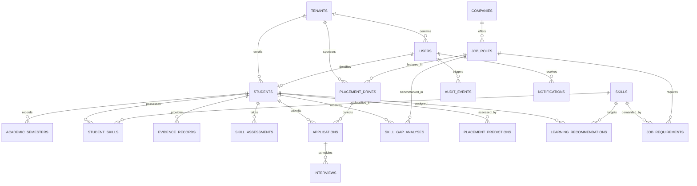

# CarrerSync Database Architecture & Schema Documentation

## 1. Executive Summary

CarrerSync utilizes a normalized relational database architecture engineered for **Neon PostgreSQL (Free Tier)**. It delivers strict multi-tenant isolation, version-controlled migrations via **Alembic**, asynchronous connectivity via **SQLAlchemy 2.0** and **asyncpg**, and a strict **₹0 zero-cost** operational budget.

---

## 2. Complete Entity-Relationship (ER) Diagram



---

## 3. Database Tables & Specifications

The schema consists of 16 normalized relational tables divided into functional modules:

### 3.1 Tenancy & Authentication
1. **`tenants`**: Core institutions/universities.
   - Primary Key: `id` (UUID). Unique fields: `name`, `slug`.
2. **`users`**: Platform actors (`superadmin`, `college_admin`, `faculty_coordinator`, `recruiter`, `student`).
   - Composite Unique: `(tenant_id, email)`
   - Security: Hashed passwords using bcrypt (12 rounds). Role-based access control.

### 3.2 Student Profiles & Academics
3. **`students`**: Academic profile, roll number, graduation batch, CGPA, and readiness score.
   - Composite Unique: `(tenant_id, roll_number)`
   - Composite Index: `(tenant_id, batch_year, department)`
   - Ethical Constraint: `date_of_birth` enforces age $\ge 18$. No behavioral monitoring for minors.
4. **`academic_semesters`**: Granular semester performance (SGPA, credits, backlogs).
   - Composite Unique: `(student_id, semester_number)`

### 3.3 The 5-Stage Skill Verification Lifecycle
5. **`skills`**: Standardized canonical taxonomy (`name`, `canonical_slug`, `category`).
6. **`student_skills`**: Dynamic skill association with **5 mandatory states**:
   - **`Claimed`**: Self-reported by student, zero evidence.
   - **`Observed`**: Automatically extracted by Student Profiling Agent from repository metadata.
   - **`Evidence-linked`**: Bound to inspectable GitHub commits or R2 project artifacts.
   - **`Verified`**: Validated by human faculty or placement administrator (AI cannot issue final verification).
   - **`Expired`**: Competency lapsed without recertification over defined threshold.
   - Composite Unique: `(student_id, skill_id)`
   - Composite Index: `(tenant_id, state, skill_id)`
7. **`evidence_records`**: Inspectable proofs-of-work (GitHub commits, PRs, project repositories, Cloudflare R2 artifacts).
8. **`skill_assessments`**: Standardized assessment scores and evaluation metrics.

### 3.4 Industry Demand & Placement Orchestration
9. **`companies`**: Hiring organizations.
10. **`job_roles`**: Specific hiring positions (`title`, `experience_level`, `ctc_lpa`).
11. **`job_requirements`**: Skill demands per job role (`is_mandatory`, `min_proficiency`, `weight`).
12. **`placement_drives`**: College recruitment campaigns with deterministic eligibility criteria.
    - Composite Index: `(tenant_id, status, batch_year)`
13. **`applications`**: Candidate drive applications with human decision tracking (`final_decision_by`).
    - Composite Unique: `(drive_id, student_id)`
14. **`interviews`**: Multi-round interview progression (`online_test`, `technical_1`, `technical_2`, `hr`, `management`).

### 3.5 AI Agent Intelligence & Auditability
15. **`skill_gap_analyses`**: Semantic & deterministic comparisons between student profile and job specs.
16. **`placement_predictions`**: Composite placement probability scores (`is_advisory_only` = True).
17. **`learning_recommendations`**: Targeted remediation milestones to close identified gaps.
18. **`agent_execution_logs`**: Multi-agent observability tracking latency, token usage, and fallback executions.
19. **`agent_workflows`**: State machine transitions for automated hiring workflows.
20. **`audit_events`**: Immutable compliance audit trail.
21. **`notifications`**: Targeted user alert delivery.

---

## 4. Multi-Tenant Isolation & PostgreSQL Row-Level Security (RLS)

CarrerSync enforces a **zero-trust tenant architecture**:
1. Every tenant-scoped table contains a mandatory `tenant_id` foreign key.
2. In PostgreSQL, native **Row-Level Security (RLS)** is enabled on all 16 tenant tables:
   ```sql
   ALTER TABLE <table_name> ENABLE ROW LEVEL SECURITY;
   CREATE POLICY <table_name>_tenant_isolation ON <table_name>
     FOR ALL
     USING (tenant_id = NULLIF(current_setting('app.current_tenant_id', true), '')::uuid)
     WITH CHECK (tenant_id = NULLIF(current_setting('app.current_tenant_id', true), '')::uuid);
   ```
3. During request execution, the session sets transaction-scoped context:
   ```python
   async with session_scope(tenant_id=current_tenant_id) as session:
       # Queries are automatically sandboxed to current_tenant_id by PostgreSQL engine
       students = await student_repo.list_all(session)
   ```
4. Client-supplied tenant IDs are never trusted. Tenant ID is extracted strictly from verified JWT claims.

---

## 5. Free-Tier Resource Budgeting (Neon PostgreSQL)

To remain strictly within the **Neon Free Tier** (0.5 GiB storage, 100 compute hours/month):
- **Connection Pooling**: Uses `AsyncAdaptedQueuePool` with conservative pool size (`pool_size=5`, `max_overflow=5`).
- **Connection Recycling**: Idle connections are recycled every 5 minutes (`pool_recycle=300`) to prevent zombie serverless connections.
- **Pre-Ping Validation**: `pool_pre_ping=True` detects disconnected serverless backends before query checkout.
- **Cold-Start Resilience**: The application auto-detects `postgresql+asyncpg://` prefixes and tolerates ephemeral network sleeps.

---

## 6. Migration & Setup Instructions

### Environment Configuration
Copy `.env.example` to `.env` and configure:
```bash
DATABASE_URL=postgresql+asyncpg://<user>:<password>@<neon-endpoint>.neon.tech/carrersync?sslmode=require
```

### Applying Alembic Migrations
```bash
cd backend
../.venv/bin/alembic upgrade head
```

### Rolling Back Migrations
```bash
cd backend
../.venv/bin/alembic downgrade -1
```

### Running the Synthetic Data Seeder
```bash
cd backend
../.venv/bin/python -m src.seeds.demo_data
```

### Running Test Suite
```bash
.venv/bin/pytest -v
```
