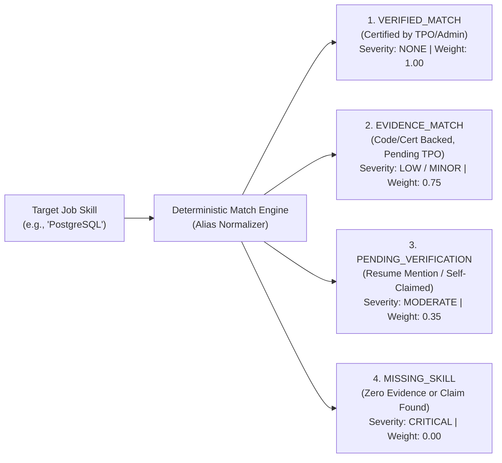
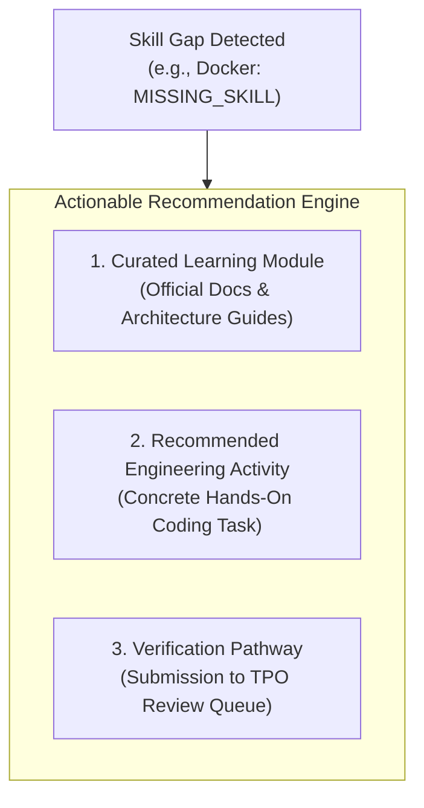

# CarrerSync Skill Gap Diagnostics Engine Specification

> **Document Type**: Canonical Diagnostic Algorithm & Recommendation Framework  
> **Status**: APPROVED & CANONICAL  
> **Phase**: Phase 10 — TPO Verification Portal, Placement Readiness & Job Eligibility Subsystem  
> **Target Release**: Active Node.js + Express Backend (`server/src/readiness/skill-gap.service.ts`)  
> **Master Policy**: Deterministic Competency Benchmarking | Actionable Remediation Paths  

---

## 1. Executive Summary & Diagnostic Philosophy

In modern campus recruitment, candidate screening is frequently plagued by two extremes: blunt keyword filters that reject qualified candidates for minor nomenclature discrepancies, and loose resume skimming that accepts candidates who have merely memorized buzzwords.

The **CarrerSync Skill Gap Diagnostics Engine** establishes an objective, deterministic comparison pipeline. Rather than relying on non-deterministic vector similarity or opaque LLM hallucinations, the engine performs a **canonicalized four-tier evidentiary comparison** between job requirements and verified student portfolios.

```
┌────────────────────────────────────────────────────────────────────────────────────────┐
│                        THE FIRST PRINCIPLE OF SKILL GAP DIAGNOSTICS                    │
│                                                                                        │
│  "A skill gap is not merely a missing word on a resume;                                │
│   it is an absence of verifiable evidentiary proof for an industry competency.         │
│   Every diagnosed gap must be classified by severity and paired with                   │
│   a concrete, actionable engineering milestone for student remediation."               │
└────────────────────────────────────────────────────────────────────────────────────────┘
```

---

## 2. Four-Tier Skill Match Classification

When evaluating a candidate against a required or preferred competency, the engine inspects the candidate's active `profileSkillEvidence` ledger and assigns one of four canonical match tiers:



### Match Tier Definitions

| Match Status | Evidentiary State | Verification Seal | Operational Definition | Recruiting Impact |
| :--- | :--- | :---: | :--- | :--- |
| **`VERIFIED_MATCH`** | `profileSkillEvidence.status === 'VERIFIED'` | **Yes (Gold)** | Skill verified by institutional TPO or faculty with primary artifact inspection. | Fully satisfies mandatory prerequisite. Direct qualification signal. |
| **`EVIDENCE_MATCH`** | `status === 'EVIDENCE_FOUND'` or valid repository link | Pending | Practical code or certificate artifact uploaded and validated by AST/ingestion parser, awaiting TPO sign-off. | Strong candidate signal; prioritized in TPO queue for expedited approval. |
| **`PENDING_VERIFICATION`**| `status === 'PENDING_REVIEW'` or `SELF_DECLARED` | No | Claim appears in resume or student self-declaration, but lacks backing code repository or credential proof. | Flagged as uncorroborated; does not satisfy strict corporate prerequisites. |
| **`MISSING_SKILL`** | No matching record in student profile | No | Candidate possesses zero claims or evidence for this competency. | Represents an acute capability gap requiring active student remediation. |

---

## 3. Canonical Skill Normalization & Alias Taxonomy

Technical skills are referenced under numerous syntactic variations across company job postings and student resumes. The diagnostics engine utilizes a deterministic alias resolver (`SkillTaxonomy`) ensuring zero false negatives:

```
[Target: 'PostgreSQL']  ◄──►  Matches: ['postgres', 'postgresql', 'pgsql', 'postgres db']
[Target: 'Kubernetes']  ◄──►  Matches: ['k8s', 'kubernetes', 'kube']
[Target: 'Node.js']     ◄──►  Matches: ['node', 'nodejs', 'node.js', 'node js']
[Target: 'TypeScript']  ◄──►  Matches: ['ts', 'typescript']
[Target: 'Docker']      ◄──►  Matches: ['docker', 'containerization', 'docker-compose']
```

### Normalization Pipeline
1. **Case & Space Normalization**: Strings are trimmed, lowercased, and stripped of non-alphanumeric separators (`c++` and `c#` are preserved via token exemptions).
2. **Taxonomy Lookup**: Checked against the pre-compiled canonical taxonomy dictionary.
3. **Exact Token Matching**: If no alias exists, canonical string equivalence is enforced.

---

## 4. Gap Severity Classification

Not all missing competencies carry equal weight in recruitment. The engine classifies skill gaps into three distinct operational severities based on job requirement criticality and evidentiary proximity:

```
┌────────────────────────────────────────────────────────────────────────────────────────┐
│                              GAP SEVERITY MATRIX                                       │
├──────────────────────────┬─────────────────────────────┬───────────────────────────────┤
│ Target Requirement Type  │ Candidate Evidentiary State │ Resulting Gap Severity        │
├──────────────────────────┼─────────────────────────────┼───────────────────────────────┤
│ Required Skill (Hard)    │ MISSING_SKILL               │ CRITICAL                      │
│ Required Skill (Hard)    │ PENDING_VERIFICATION        │ MODERATE                      │
│ Required Skill (Hard)    │ EVIDENCE_MATCH              │ MINOR (Needs TPO Review)      │
│ Required Skill (Hard)    │ VERIFIED_MATCH              │ NONE (Satisfied)              │
├──────────────────────────┼─────────────────────────────┼───────────────────────────────┤
│ Preferred Skill (Soft)   │ MISSING_SKILL               │ MODERATE                      │
│ Preferred Skill (Soft)   │ PENDING_VERIFICATION        │ MINOR                         │
│ Preferred Skill (Soft)   │ EVIDENCE_MATCH              │ MINOR                         │
│ Preferred Skill (Soft)   │ VERIFIED_MATCH              │ NONE (Satisfied)              │
└──────────────────────────┴─────────────────────────────┴───────────────────────────────┘
```

### 1. `CRITICAL` Severity
- **Trigger**: Mandatory required skill is completely missing from the candidate's profile (`MISSING_SKILL`).
- **Recruitment Consequence**: Prevents automated qualification; candidate flagged as high risk for technical rejection.
- **Urgency**: Immediate student remediation required before applying for the target role.

### 2. `MODERATE` Severity
- **Trigger**: Required skill is only self-declared (`PENDING_VERIFICATION`), or a preferred skill is completely missing.
- **Recruitment Consequence**: Candidate may be evaluated, but lacks competitive standing against verified peers.
- **Urgency**: Moderate; student must link existing project proof or complete assessment.

### 3. `MINOR` Severity
- **Trigger**: Required skill has backing evidence (`EVIDENCE_MATCH`) but is waiting in the TPO queue, or preferred skill is pending verification.
- **Recruitment Consequence**: Negligible impact once TPO completes review.
- **Urgency**: Low; student prompts TPO for verification or submits minor credential update.

---

## 5. Actionable Learning & Activity Recommendation Framework

To avoid leaving students with dead-end rejection notices, every diagnosed skill gap is automatically paired with a **targeted remediation prescription**:



### Remediation Taxonomy Examples

| Competency Gap | Severity | Curated Learning Module | Recommended Practical Activity | Verification Action |
| :--- | :---: | :--- | :--- | :--- |
| **Docker** | `CRITICAL` | Docker Engine Architecture & Multi-Stage Builds Guide | Containerize a multi-tier Express + PostgreSQL app with Docker Compose; include non-root user and healthchecks. | Push repository to GitHub; submit repo URL to TPO verification queue. |
| **PostgreSQL** | `CRITICAL` | Relational Indexing, B-Trees & ACID Transaction Deep Dive | Implement schema migrations, connection pooling, and multi-tenant RLS policies using Drizzle ORM. | Upload repository with integration tests to Student Portal. |
| **Redis** | `MODERATE` | In-Memory Caching Strategies & Token Bucket Rate Limiting | Build a rate-limiting middleware and session cache service in Node.js using Redis clients. | Submit repo link and benchmark report for TPO review. |
| **Kubernetes** | `MODERATE` | K8s Pod Lifecycle, Services, and Ingress Controller Basics | Create declarative Kubernetes manifests (`Deployment`, `ClusterIP`, `ConfigMap`) for a containerized backend. | Submit YAML configurations and local Minikube verification log. |
| **CI/CD** | `MINOR` | GitHub Actions Workflow Syntax & Automated Testing Runners | Configure an automated CI pipeline running linting, TypeScript typecheck, and unit test suites on every pull request. | Connect GitHub repository with verified green CI badges. |

---

## 6. Diagnostic Execution Algorithm & Data Structures

### TypeScript Service Interface (`server/src/readiness/readiness.types.ts`)

```typescript
export type MatchStatus = 'VERIFIED_MATCH' | 'EVIDENCE_MATCH' | 'PENDING_VERIFICATION' | 'MISSING_SKILL';
export type GapSeverity = 'CRITICAL' | 'MODERATE' | 'MINOR';

export interface SkillGapItem {
  skillName: string;
  category: string;
  isRequired: boolean;
  status: MatchStatus;
  gapSeverity: GapSeverity | 'NONE';
  evidenceType?: string;
  evidenceConfidence?: number;
  suggestedLearning: string;
  recommendedActivity: string;
  verificationAction: string;
}

export interface SkillGapDiagnosticResult {
  studentId: string;
  targetRole?: string;
  matchPercentage: number;
  totalRequired: number;
  verifiedRequiredCount: number;
  evidenceRequiredCount: number;
  missingRequiredCount: number;
  gaps: SkillGapItem[];
  overallSeverity: 'HIGH_RISK' | 'MODERATE_RISK' | 'PLACEMENT_READY';
}
```

### Diagnostic Output Example
```json
{
  "studentId": "0d6f2122-8356-4b21-81d3-300642fa6054",
  "targetRole": "Full Stack Cloud Engineer",
  "matchPercentage": 75.0,
  "totalRequired": 4,
  "verifiedRequiredCount": 2,
  "evidenceRequiredCount": 1,
  "missingRequiredCount": 1,
  "overallSeverity": "MODERATE_RISK",
  "gaps": [
    {
      "skillName": "TypeScript",
      "category": "programming_languages",
      "isRequired": true,
      "status": "VERIFIED_MATCH",
      "gapSeverity": "NONE",
      "suggestedLearning": "Advanced Generics and Conditional Types",
      "recommendedActivity": "Maintain existing verified status.",
      "verificationAction": "Already Verified by TPO."
    },
    {
      "skillName": "PostgreSQL",
      "category": "databases",
      "isRequired": true,
      "status": "EVIDENCE_MATCH",
      "gapSeverity": "MINOR",
      "evidenceType": "PROJECT",
      "evidenceConfidence": 0.88,
      "suggestedLearning": "PostgreSQL Performance Optimization & Query Plans",
      "recommendedActivity": "Document database indexing strategies in project README.",
      "verificationAction": "Item pending in TPO Verification Queue. Awaiting review."
    },
    {
      "skillName": "Docker",
      "category": "cloud_devops",
      "isRequired": true,
      "status": "MISSING_SKILL",
      "gapSeverity": "CRITICAL",
      "suggestedLearning": "Containerization Fundamentals & Docker Compose Guide",
      "recommendedActivity": "Write a multi-stage Dockerfile for an Express service and test locally.",
      "verificationAction": "Upload project repository with Dockerfile to trigger verification."
    }
  ]
}
```

---

## 7. REST API Reference

| Method | Endpoint | Allowed Roles | Description |
| :--- | :--- | :--- | :--- |
| `POST` | `/api/v1/readiness/students/:studentId/skill-gap` | `STUDENT` (own), `TPO_ADMIN`, `COLLEGE_ADMIN`, `RECRUITER` | Executes deterministic skill gap diagnostics comparing student competencies against a specific list of required and preferred skills. |

### Request Body Schema
```json
{
  "targetRole": "Cloud Systems Engineer",
  "requiredSkills": ["Docker", "Kubernetes", "TypeScript", "PostgreSQL"],
  "preferredSkills": ["Redis", "Terraform", "CI/CD"]
}
```
