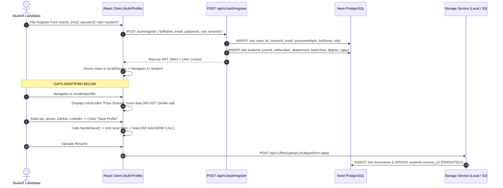

# CarrerSync — Student Profile Management & Social Links Pre-Implementation Forensic Audit Report
## Forensic Architectural Inspection, Schema Gap Analysis, Verification Safeguards, and Implementation Blueprint

**Document Version:** 1.0.0  
**Audit Date:** November 16, 2026  
**Auditor:** Pre-Implementation Auditor (`@profile-audit`)  
**Scope:** Student Profile Management, Professional/Social Links, Academic Records Integrity, Skills Inventory, Privacy Controls, and Persistence Architecture  
**Audited Baseline:** Phases 01 through 17 (104 Relational Tables, 72 Enums, 44+ Server Test Suites, Express 5 REST APIs, Vite + React 19 Frontend)  
**Overall Pre-Implementation Decision:** **READY FOR IMPLEMENTATION (ARCHITECTURAL GREENLIGHT SUBJECT TO SAFEGUARD RULES)**

---

## 1. Executive Summary & Forensic Verdict

### 1.1 Executive Summary
A comprehensive forensic audit of CarrerSync was conducted to evaluate the current architecture of student profiles, academic records, social links, skill evidence, and visibility controls before writing code for Student Profile Editing and Social Links Management.

CarrerSync features an enterprise-grade multi-tenant backend built on Neon PostgreSQL, Drizzle ORM, Express 5, and JWT anti-spoofing security, with 104 relational tables and over 1,036 passing automated tests across Phases 01–17. However, the audit reveals a profound architectural disparity between backend capability and frontend implementation in the student profile domain:

1. **The Student Profile View is 100% In-Memory and Hardcoded**: `client/src/pages/student/Profile.jsx` renders static mock data for a demo student ("Priya Sharma", Roll No. `CS2021-084`, CGPA `8.42`). The "Edit Profile" and "Save Profile" interaction toggles local React state and triggers a temporary toast notice without issuing any HTTP network request to the backend.
2. **Zero Student Profile Editing REST Endpoints Exist**: While `server/src/routes/auth.routes.ts` provisions a basic student row during registration (`POST /api/v1/auth/register`) and returns identity context via `GET /api/v1/auth/me`, there is **no REST endpoint** (`PATCH /api/v1/students/me` or `PATCH /api/v1/student/profile`) enabling students to edit their bio, contact details, social links, or career aspirations.
3. **Key Profile Columns are Missing in PostgreSQL**: The core `students` table (`server/src/db/schema.ts#L722-L753`) lacks columns for profile picture (`avatarUrl`), gender, city, state, country, bio, career objective, primary phone, alternate phone, personal email, preferred contact method, current semester, social links, and privacy settings.
4. **Verified Records and Integrity Safeguards are Intact**: Institutional integrity controls are strictly enforced in Phase 10 (`server/src/verification/verification.service.ts`). Students cannot self-verify skills or overwrite verified academic records. The audit confirms that this principle must be rigorously maintained: academic records (`cgpa`, `rollNumber`, `department`, `batchYear`, `backlogs`, `degree`, `currentSemester`) must remain read-only to students, with a formal "Academic Correction Request" audit workflow for discrepancies.
5. **Zero Cloudflare & ₹0 Budget Compliance**: CarrerSync uses a self-hosted S3-compatible / local filesystem storage abstraction (`server/src/storage/`). There are no Cloudflare R2, Turnstile, or Workers dependencies, and all suggested extensions preserve the ₹0 budget mandate.

### 1.2 Executive Scorecard

| Domain | Audit Evaluation | Status | Key Forensic Findings |
| :--- | :--- | :---: | :--- |
| **Frontend Profile View** | `client/src/pages/student/Profile.jsx` | **MOCK / COSMETIC** | Hardcoded Priya Sharma data. Save triggers local timeout; no network call. Document vault works, but profile details do not persist. |
| **Frontend Navigation** | `navigation.js`, `Sidebar.jsx`, `Topbar.jsx` | **COSMETIC USERNAME** | Sidebar and Topbar hardcode "Priya Sharma" initials and email instead of dynamically rendering authenticated user context. |
| **Database Schema** | `server/src/db/schema.ts` (`students`, `users`) | **SCHEMA GAPS IDENTIFIED** | Table `students` exists with 14 columns. Missing 15+ required fields (bio, socials, phone, avatar, privacy, city/state). No duplicate tables needed. |
| **Verified Profile Table** | `verifiedProfiles` search in schema | **DOES NOT EXIST** | No table named `verifiedProfiles` exists. Verification is split across `students`, `profile_skill_evidence`, and `skill_verification_reviews`. |
| **Backend Profile APIs** | `server/src/routes/` | **NO EDIT ROUTE** | `GET /api/v1/auth/me` exists. No `PATCH /api/v1/students/me/profile`, no social links API, no student skill self-declaration endpoint. |
| **Auth & RBAC Middleware** | `requireAuth`, `requireRole`, `tenantMiddleware` | **VERIFIED / ROBUST** | Multi-tenant anti-spoofing (`TENANT_SPOOFING_REJECTED`) and canonical role normalization are active and ready to secure new student endpoints. |
| **Verification Safeguards** | Anti-Tamper & Academic Integrity Rules | **STRICT COMPLIANCE** | Faculty verification in Phase 10 prohibits student self-verification. Academic records are institution-verified. Academic correction request required. |
| **Cloudflare & Budget** | Zero Cloudflare, ₹0 Policy | **COMPLIANT** | Storage layer uses local/S3-compatible adapter. Zero paid third-party APIs. |

---

## 2. Forensic Inspection of Frontend Profile Architecture

### 2.1 Student Profile Page (`client/src/pages/student/Profile.jsx`)
Inspection of `client/src/pages/student/Profile.jsx` reveals 569 lines of code.

#### Key Findings:
1. **Hardcoded Form State** (`client/src/pages/student/Profile.jsx#L37-L50`):
   ```javascript
   const [formData, setFormData] = useState({
     name: 'Priya Sharma',
     rollNumber: 'CS2021-084',
     branch: 'Computer Science and Engineering',
     degree: 'B.Tech',
     batch: '2021 - 2025',
     cgpa: '8.42',
     email: 'priya.sharma21@college.edu',
     phone: '+91 98765 43210',
     bio: 'Passionate Full Stack Engineer specializing in TypeScript, React, and scalable backend microservices. Active open-source contributor.',
     github: 'https://github.com/priyasharma-dev',
     portfolio: 'https://priyasharma.me',
     leetcode: 'https://leetcode.com/priya_codes'
   });
   ```
2. **Fake Save Handler** (`client/src/pages/student/Profile.jsx#L204-L209`):
   ```javascript
   const handleSave = (e) => {
     e.preventDefault();
     setIsEditing(false);
     setSavedSuccess(true);
     setTimeout(() => setSavedSuccess(false), 3000);
   };
   ```
   *Analysis*: When the student clicks "Save Profile", no HTTP `PUT` or `PATCH` is dispatched. Refreshing the browser instantly reverts any edits back to the hardcoded initial state.
3. **Hardcoded Avatar Initials** (`client/src/pages/student/Profile.jsx#L271-L273`):
   ```jsx
   <div className="h-20 w-20 rounded-2xl bg-linear-to-tr from-indigo-600 to-violet-600 text-white flex items-center justify-center text-2xl font-bold shadow-xs">
     PS
   </div>
   ```
   *Analysis*: There is no file upload control for an avatar/profile picture. The initials "PS" are hardcoded in the JSX.
4. **Hardcoded Projects and Certifications** (`client/src/pages/student/Profile.jsx#L175-L202`):
   - Three static projects ("Distributed Event Booking Engine", "DevCollab", "AI Resume Keyword Verifier") and two static certificates ("AWS Certified Cloud Practitioner", "Meta Front-End Developer") are hardcoded in local arrays rather than queried from `evidenceRecords` or `profileSkillEvidence`.
5. **Working Document Vault** (`client/src/pages/student/Profile.jsx#L52-L68`, `L88-L168`):
   - The document upload section correctly interacts with `fileService.listDocuments()`, `fileService.downloadFile()`, `fileService.deleteFile()`, and `profilingService.analyzeDocument()`. This confirms that document upload and AI profiling are real, while profile text/data editing is entirely mock.

### 2.2 Student Overview Dashboard (`client/src/pages/student/Overview.jsx`)
- **Inspection**: `client/src/pages/student/Overview.jsx` contains 326 lines.
- **Findings**: Displays summary statistics (readiness score: 84%, 8 verified skills, 2 pending, 1 offer), hardcoded recent activities ("GitHub Commit Verified: e-commerce-backend", "Skill State Updated: React.js"), and recommended jobs. Does not fetch student identity from `GET /api/v1/auth/me`.

### 2.3 Student Navigation & Shell Architecture
1. **Navigation Configuration** (`client/src/config/navigation.js#L40-L58`):
   - `studentNavItems` defines 17 items:
     - `Overview` (`/student`)
     - `My Profile` (`/student/profile`)
     - `Alumni Mentorship` (`/student/mentorship`)
     - `Peer Mock Interviews` (`/student/peer-interviews`)
     - `Learning Collaboration` (`/student/collaboration`)
     - `Skills & Evidence` (`/student/skills`)
     - `Career Goals` (`/student/goals`)
     - `Career Recommendations` (`/student/career-recommendations`)
     - `Skill Gap Analysis` (`/student/skill-gap`)
     - `Company Intelligence` (`/student/company-intelligence`)
     - `Learning Path` (`/student/learning-path`)
     - `Mock Drives` (`/student/mock-drives`)
     - `My Applications` (`/student/applications`)
     - `Placement Offers` (`/student/offers`)
     - `Knowledge Graph` (`/student/knowledge-graph`)
     - `Privacy & Consent` (`/student/privacy`)
     - `Settings` (`/student/settings`)
2. **Sidebar Shell Component** (`client/src/components/shell/Sidebar.jsx#L22-L23`, `L148-L161`):
   - Hardcodes:
     ```javascript
     let userName = 'Priya Sharma';
     let userEmail = 'priya.cs21@college.edu';
     ```
   - In the footer, `<Avatar name={userName} size="sm" status="online" />` displays "PS" regardless of who is logged in.
3. **Topbar Shell Component** (`client/src/components/shell/Topbar.jsx#L187-L191`):
   - Hardcodes:
     ```javascript
     name={role === 'admin' ? 'Rajiv Menon' : role === 'recruiter' ? 'Sarah Jenkins' : role === 'superadmin' ? 'Platform Administrator' : 'Priya Sharma'}
     ```
4. **App Routing** (`client/src/routes/AppRoutes.jsx#L128-L151`):
   - `/student/profile` routes to `<StudentProfile />` wrapped inside `<DashboardLayout role="student" />`.
   - Routing structure is clean and modular.

### 2.4 Related Student Sub-Pages
1. **Skills & Evidence** (`client/src/pages/student/SkillsEvidence.jsx#L225-L244`):
   - `handleAddSkill`: Appends a new item to local `skills` React state (`setSkills([newSkill, ...skills])`). It does NOT persist to Neon PostgreSQL.
   - However, `tpoService.getStudentVerification()` and `profilingService.getStudentEvidence()` are used to load verified items if available.
2. **Career Goals** (`client/src/pages/student/CareerGoals.jsx#L20-L79`):
   - Role selection and location preferences (`selectedRole`, `preferredLocations`) are purely in-memory. Clicking "Save Target Preferences" only displays an alert without calling any backend endpoint.
3. **Privacy & Consent** (`client/src/pages/student/PrivacyConsent.jsx#L21-L86`):
   - Toggles (`recruiterSharing`, `repoExtraction`, `anonymizedReporting`) are stored in React `useState`. "Revoke All Sharing" simply flips the boolean flag in memory.

---

## 3. Forensic Inspection of Database Schema (`server/src/db/schema.ts`)

### 3.1 Existing Student Tables Audit

#### 1. Table 2: `users` (`server/src/db/schema.ts#L694-L715`)
- **Columns**: `id` (uuid PK), `tenantId` (uuid FK -> `tenants.id`), `email` (varchar 255), `passwordHash` (varchar 255), `fullName` (varchar 255), `role` (`user_role_enum`), `isActive` (boolean), `isVerified` (boolean), `createdAt`, `updatedAt`.
- **Indices**: `uq_users_tenant_email` (tenantId, email), `ix_users_tenant_role`, `ix_users_email`.
- **Verdict**: Authoritative for core authentication and login identity.

#### 2. Table 3: `students` (`server/src/db/schema.ts#L722-L753`)
- **Current Columns**:
  1. `id` (uuid PK)
  2. `tenantId` (uuid FK -> `tenants.id`, cascade)
  3. `userId` (uuid FK -> `users.id`, unique, cascade)
  4. `rollNumber` (varchar 50)
  5. `department` (varchar 100)
  6. `batchYear` (integer)
  7. `degree` (varchar 50, default 'B.Tech')
  8. `cgpa` (numeric 4,2, default '0.00')
  9. `backlogCount` (integer, default 0)
  10. `dateOfBirth` (date, nullable)
  11. `resumeR2Url` (varchar 512, legacy column maintained for non-destructive compatibility)
  12. `resumeUrl` (varchar 512, canonical storage key)
  13. `readinessScore` (numeric 5,2, default '0.00')
  14. `createdAt` (timestamp with tz)
  15. `updatedAt` (timestamp with tz)
- **Indices**: `uq_students_tenant_roll` (tenantId, rollNumber), `ix_students_tenant_batch_dept`, `ix_students_tenant_cgpa`.
- **Verdict**: Canonical student record. Must be preserved and extended additively without creating duplicate profile tables.

#### 3. Table 5: `student_skills` (`server/src/db/schema.ts#L772-L798`)
- **Columns**: `id`, `tenantId`, `studentId` (FK -> `students.id`), `skillId` (FK -> `skills.id`), `state` (`skill_state_enum`: `'Claimed'`, `'Observed'`, `'Evidence-linked'`, `'Verified'`, `'Flagged'`), `proficiencyLevel`, `confidenceScore`, `verifiedAt`, `verifiedByUserId`, `expiryDate`.
- **Verdict**: Phase 01 relational binding. Tracks 5-state skill lifecycle.

#### 4. Table 8: `academic_semesters` (`server/src/db/schema.ts#L860-L880`)
- **Columns**: `id`, `tenantId`, `studentId` (FK -> `students.id`), `semesterNumber` (integer), `sgpa` (numeric 4,2), `creditsEarned` (numeric 4,1), `backlogsInSemester` (integer).
- **Index**: `uq_semester_student_num` (studentId, semesterNumber).
- **Verdict**: Authoritative semester-by-semester academic performance records.

#### 5. Table 24: `profile_skill_evidence` (`server/src/db/schema.ts#L1392-L1426`)
- **Columns**: `id`, `tenantId`, `userId` (FK -> `users.id`), `skillName`, `category`, `proficiencyClaim`, `evidenceType` (`'RESUME_PARSED'`, `'ACADEMIC_TRANSCRIPT'`, `'GITHUB_REPOSITORY'`, `'EXTERNAL_CERTIFICATION'`, `'PROJECT_SUBMISSION'`, `'ASSESSMENT_RESULT'`, `'SELF_DECLARED'`), `documentId`, `extractionId`, `confidence`, `verificationStatus` (`'PENDING_REVIEW'`, `'VERIFIED'`, `'REJECTED'`, `'NEEDS_MORE_EVIDENCE'`), `reviewedBy`, `reviewedAt`, `reviewNotes`.
- **Verdict**: Active table used by `VerificationService` (Phase 10) and `ProfilingService` (Phase 09). Note: uses `userId` (referencing `users.id`), unlike `student_skills` which uses `studentId` (referencing `students.id`).

#### 6. Table 63: `student_role_preferences` (`server/src/db/schema.ts#L2734-L2756`)
- **Columns**: `id`, `studentId` (FK -> `users.id`), `tenantId` (FK -> `tenants.id`), `targetRole` (varchar 255), `preferenceRank` (integer), `isPrimary` (boolean), `setByStudent` (boolean).
- **Audit Discovery**: This table was created in Phase 13 but is currently **completely orphaned** (never queried, inserted, or updated by any route or service). It represents an existing, pre-modeled entity ready for production wiring.

### 3.2 Forensic Clarification on `verifiedProfiles` Table
The prompt instructions mandate inspecting `verifiedProfiles`.
- **Forensic Finding**: There is **no table named `verifiedProfiles` or `verified_profiles`** in `server/src/db/schema.ts`.
- **Architectural Reality**: CarrerSync models verified profiles relationally across three distinct entities:
  1. `users.isVerified`: Boolean flag on user identity.
  2. `students`: Academic profile row containing institutional metrics (`cgpa`, `rollNumber`, `department`, `batchYear`, `backlogCount`).
  3. `profile_skill_evidence`: Verified skill claims where `verificationStatus = 'VERIFIED'` and `reviewedBy IS NOT NULL`.
  4. `skill_verification_reviews`: Immutable review log of every TPO verification action.
- **Anti-Duplication Rule**: We must **NOT** create a separate `verifiedProfiles` table. Doing so would violate the non-negotiable rule against duplicate profile tables.

---

## 4. Forensic Inspection of Backend REST API Routes & Services

### 4.1 Route Map & Student Coverage

| Mount Path | File | Purpose | Student Profile Status |
| :--- | :--- | :--- | :--- |
| `/api/v1/auth` | `server/src/routes/auth.routes.ts` | Login, Register, `/me` profile fetch | Read-only identity; no profile edit endpoint. |
| `/api/v1/students/me` | `server/src/routes/tpo.routes.ts` | Student verification summary, correction requests, resubmission | Handles skill evidence verification only. |
| `/api/v1/files` | `server/src/routes/file.routes.ts` | Document upload, download, delete | Updates `students.resumeUrl` on resume upload. |
| `/api/v1/profiling` | `server/src/routes/profiling.routes.ts` | AI extraction, approve/reject skills, get evidence | Manages AI document extractions. |
| `/api/v1/student` | `server/src/routes/student-career.routes.ts` | Skill-gap diagnosis, career recommendations | Read-only analysis; no preference editing. |
| `/api/v1/student` | `server/src/routes/student-assessment.routes.ts`| Mock drive attempts, coding tests | Practice assessments. |
| `/api/v1/student/offers` | `server/src/routes/student-offers.routes.ts` | View placement offers, accept/decline | Offer lifecycle. |
| `/api/v1/recruiter` | `server/src/routes/recruiter.routes.ts` | Candidate discovery for placement drives | Candidate search; leaks student email/phone without privacy filtering! |

### 4.2 Forensic Analysis of Existing Routes

#### 1. `POST /api/v1/auth/register` (`auth.routes.ts#L46-L221`)
When a student registers:
```typescript
const [createdStudent] = await db
  .insert(students)
  .values({
    tenantId: resolvedTenantId,
    userId: createdUser.id,
    rollNumber: data.rollNumber || `CS-${Math.floor(10000 + Math.random() * 90000)}`,
    department: data.department || 'Computer Science and Engineering',
    batchYear: data.batchYear || new Date().getFullYear(),
    degree: data.degree || 'B.Tech',
    cgpa: data.cgpa ? String(data.cgpa) : '0.00'
  })
  .returning();
```
*Gaps*: Only rollNumber, department, batchYear, degree, and cgpa are initialized. No bio, contact, avatar, or link fields exist in the insert payload.

#### 2. `GET /api/v1/auth/me` (`auth.routes.ts#L395-L466`)
Returns:
```json
{
  "success": true,
  "user": {
    "id": "uuid",
    "tenantId": "uuid",
    "email": "student@college.edu",
    "fullName": "Student Name",
    "role": "student",
    "isActive": true,
    "isVerified": false,
    "createdAt": "timestamp",
    "student": {
      "id": "uuid",
      "rollNumber": "CS2021-084",
      "department": "Computer Science and Engineering",
      "batchYear": 2025,
      "degree": "B.Tech",
      "cgpa": "8.42",
      "backlogCount": 0,
      "dateOfBirth": null,
      "resumeUrl": null,
      "readinessScore": "0.00"
    }
  },
  "tenant": { ... }
}
```
*Analysis*: `GET /api/v1/auth/me` successfully joins `users` and `students`. Any additive columns on `students` will immediately enrich this response.

#### 3. `server/src/routes/tpo.routes.ts` (`studentEvidenceRoutes#L537-L715`)
Mounted at `/api/v1/students/me`:
- `GET /api/v1/students/me/verification`: Returns verified evidence items and counts.
- `POST /api/v1/students/me/evidence/:evidenceId/correction-request`: Allows student to flag a specific skill evidence record with a reason.
- `POST /api/v1/students/me/evidence/:evidenceId/resubmit`: Allows student to resubmit updated documents for rejected evidence.
- *Analysis*: The pattern for student-initiated correction requests is already established here! An academic record correction endpoint should match this pattern exactly.

#### 4. Candidate Discovery Privacy Leak in Recruiter Route (`recruiter.service.ts#L851-L910`)
In `discoverCandidates`, candidate cards expose:
- `name`, `email`, `department`, `graduationYear`, `cgpa`, `verifiedSkills`, `readinessScore`.
*Privacy Vulnerability*: Candidate discovery does not query any student privacy preferences. If a student wants contact details hidden by default, or wants their portfolio shared only on explicit drive application, recruiter discovery currently ignores this.

---

## 5. Authentication, RBAC & Multi-Tenant Middleware Audit

### 5.1 `server/src/middleware/auth.ts`
- **`requireAuth`** (`auth.ts#L12-L78`):
  1. Validates standard `Bearer <jwt>` token from the `Authorization` header.
  2. Verifies signature using `JWT_SECRET` (fallback for dev/test: `carrersync_jwt_default_secret_dev_key_32_chars`).
  3. Decodes `payload.sub`, `payload.tenant_id`, and `payload.role`.
  4. Populates `req.user` with `{ id, tenantId, role, email, hasVerificationPermission }`.
  5. **Anti-Spoofing Defense** (`auth.ts#L53-L67`): Strictly rejects requests where header `X-Tenant-ID` does not match the token's `payload.tenant_id` with `403 TENANT_SPOOFING_REJECTED` (unless caller is SUPER_ADMIN).
- **`requireRole`** (`auth.ts#L85-L115`):
  1. Normalizes roles via `normalizeRole` (`CanonicalRole` vs lowercase `UserRole`).
  2. Blocks unauthorized roles with `403 FORBIDDEN_INSUFFICIENT_ROLE`.

### 5.2 `server/src/middleware/tenant.ts`
- **`tenantMiddleware`** (`tenant.ts#L31-L145`):
  1. Verifies token early if not already decoded.
  2. Prevents tenant spoofing in both header (`x-tenant-id`) and request body (`tenantId` or `tenant_id` on POST/PUT/PATCH).
  3. Sets `req.tenantId = authUser.tenantId`.
- **Verdict**: The security architecture is rock solid. The new student profile endpoints will plug cleanly into:
  ```typescript
  studentProfileRoutes.use(requireAuth);
  studentProfileRoutes.use(tenantMiddleware);
  studentProfileRoutes.use(requireRole(['student', 'superadmin']));
  ```

---

## 6. Profile Creation & Onboarding Workflow Audit

### 6.1 Registration to Dashboard Journey


### 6.2 Identified Onboarding Gaps
1. **No Profile Completion Wizard**: Registration dumps the student directly into the overview page with an incomplete profile.
2. **Missing Contact Verification**: Primary phone and personal email are never prompted during registration.
3. **No Social Link Ingestion**: Links to GitHub, LinkedIn, and coding handles are never requested during registration.
4. **No Initial Privacy Preferences**: Consent defaults are not captured in the database during signup.

---

## 7. Comprehensive Field Gap Matrix (Existing vs. Missing)

### 7.1 Personal Information

| Field | Prompt Requirement | Current Schema Status | Recommended Location & Type | Student Editable? | Verification Safeguard |
| :--- | :--- | :--- | :--- | :---: | :--- |
| **Full Name** | Mandatory | `users.fullName` (`varchar 255`) | Existing in `users` | Yes | Syncs with `users.fullName` |
| **Profile Picture / Avatar** | Required | **MISSING** in `users` & `students` | `students.avatarUrl` (`varchar 512`) | Yes | Image format & size validated; stored via storage adapter |
| **Date of Birth** | Required | `students.dateOfBirth` (`date`) | Existing in `students` | Yes | Validated past date ($\ge 16$ years old) |
| **Gender** | Optional | **MISSING** | `students.gender` (`varchar 50`) | Yes | Optional enum (`'male'`, `'female'`, `'non_binary'`, `'prefer_not_to_say'`) |
| **Current City** | Required | **MISSING** | `students.currentCity` (`varchar 100`) | Yes | Sanitized text string |
| **State** | Required | **MISSING** | `students.currentState` (`varchar 100`) | Yes | Sanitized text string |
| **Country** | Required | **MISSING** | `students.country` (`varchar 100`, default 'India') | Yes | Sanitized text string |
| **Professional Intro / Bio** | Required | **MISSING** | `students.bio` (`text`) | Yes | Max 1,000 characters |
| **Career Objective** | Required | **MISSING** | `students.careerObjective` (`text`) | Yes | Max 1,000 characters |

### 7.2 Contact Information

| Field | Prompt Requirement | Current Schema Status | Recommended Location & Type | Student Editable? | Verification Safeguard |
| :--- | :--- | :--- | :--- | :---: | :--- |
| **Primary Mobile** | Required | **MISSING** | `students.phone` (`varchar 20`) | Yes | Regex validation (e.g. E.164 / `+91 XXXXX XXXXX`) |
| **Alternate Mobile** | Optional | **MISSING** | `students.alternatePhone` (`varchar 20`) | Yes | Validated phone string |
| **Personal Email** | Required | **MISSING** (`users.email` is institutional login) | `students.personalEmail` (`varchar 255`) | Yes | Valid email format validation; must differ from corporate spam |
| **Preferred Contact Method** | Required | **MISSING** | `students.preferredContactMethod` (`varchar 20`) | Yes | Enum: `'EMAIL'`, `'PHONE'`, `'WHATSAPP'` |

### 7.3 Professional & Social Links

| Platform / Link | Prompt Requirement | Current Schema Status | Recommended Location & Type | Student Editable? | Verification Safeguard |
| :--- | :--- | :--- | :--- | :---: | :--- |
| **GitHub** | Required | **MISSING** (Hardcoded in UI) | `students.socialLinks.github` | Yes | URL regex / handle validation (`https://github.com/...`) |
| **LinkedIn** | Required | **MISSING** (Hardcoded in UI) | `students.socialLinks.linkedin` | Yes | URL regex (`https://linkedin.com/in/...`) |
| **Portfolio / Website** | Required | **MISSING** (Hardcoded in UI) | `students.socialLinks.portfolio` | Yes | Valid HTTP/HTTPS URL |
| **LeetCode** | Required | **MISSING** (Hardcoded in UI) | `students.socialLinks.leetcode` | Yes | URL / handle validation (`https://leetcode.com/...`) |
| **HackerRank** | Required | **MISSING** | `students.socialLinks.hackerrank` | Yes | URL / handle validation |
| **Codeforces** | Required | **MISSING** | `students.socialLinks.codeforces` | Yes | URL / handle validation |
| **CodeChef** | Required | **MISSING** | `students.socialLinks.codechef` | Yes | URL / handle validation |
| **Kaggle** | Required | **MISSING** | `students.socialLinks.kaggle` | Yes | URL / handle validation |
| **GeeksforGeeks** | Required | **MISSING** | `students.socialLinks.geeksforgeeks` | Yes | URL / handle validation |
| **Custom Links** | Required | **MISSING** | `students.customLinks` (`jsonb` array of `{ title, url }`) | Yes | Array of sanitized URL pairs |

*Architecture Recommendation for Links*:
Store standardized platforms plus custom links in a single structured `jsonb` column `social_links` on `students`:
```typescript
socialLinks: jsonb('social_links').default({
  github: '',
  linkedin: '',
  portfolio: '',
  leetcode: '',
  hackerrank: '',
  codeforces: '',
  codechef: '',
  kaggle: '',
  geeksforgeeks: '',
  customLinks: []
}).notNull()
```
*Benefits*: Zero schema bloat, flexible, additive, and ₹0 storage cost.

### 7.4 Academic Information & Verification Safeguards

| Field | Current Schema Status | Student Editable? | Institutional Verification Rule |
| :--- | :--- | :---: | :--- |
| **Department / Branch** | `students.department` (`varchar 100`) | **NO (READ-ONLY)** | Authoritative institutional data. Change requires TPO Academic Correction. |
| **Graduation Year / Batch**| `students.batchYear` (`integer`) | **NO (READ-ONLY)** | Authoritative institutional data. |
| **Degree Program** | `students.degree` (`varchar 50`) | **NO (READ-ONLY)** | Authoritative institutional data. |
| **Roll Number** | `students.rollNumber` (`varchar 50`) | **NO (READ-ONLY)** | Primary institutional identifier. Immutable by student. |
| **Current Semester** | **MISSING** in `students` (Table 8 has `academic_semesters`) | **NO (READ-ONLY)** | Add `currentSemester` (`integer`) to `students`. Synced with official enrollment. |
| **CGPA** | `students.cgpa` (`numeric 4,2`) | **NO (READ-ONLY)** | **CRITICAL SAFEGUARD**: Placement eligibility gate. Direct student editing strictly forbidden! |
| **Active Backlogs** | `students.backlogCount` (`integer`) | **NO (READ-ONLY)** | **CRITICAL SAFEGUARD**: Direct student editing strictly forbidden! |
| **Academic Correction Request** | **MISSING** | **YES (SUBMIT REQUEST)**| `POST /api/v1/students/me/academic-correction-request` allows student to report mistakes with explanation and proof. |

### 7.5 Skills & Career Preferences

| Capability | Current Status | Student Editable? | Preserving Verified Skills Workflow |
| :--- | :--- | :---: | :--- |
| **Self-Declared Skills** | In-memory in UI; no API | **YES (ADD/REMOVE)** | Added skills enter as `verificationStatus: 'PENDING_REVIEW'` (or `state: 'Claimed'`) with `evidenceType: 'SELF_DECLARED'`. Student CANNOT set `VERIFIED`! |
| **Remove Skill** | In-memory in UI | **CONDITIONAL** | Student can remove their own self-declared or unverified claims. Removing a TPO-VERIFIED skill requires confirmation or TPO notification. |
| **Target Job Roles** | Table 63 `student_role_preferences` exists but unused | **YES** | Student selects up to 3 prioritized roles (e.g. "Full Stack Developer", "Backend Systems Engineer"). |
| **Preferred Industries** | **MISSING** | **YES** | Multi-select (e.g. "Fintech", "Healthtech", "Enterprise SaaS", "E-commerce"). |
| **Career Interests** | **MISSING** | **YES** | Tags / text summary of specialized interest areas (e.g. "Distributed Systems", "AI/ML"). |
| **Preferred Locations** | UI only (`CareerGoals.jsx`) | **YES** | Multi-select array (e.g. `['Bengaluru', 'Hyderabad', 'Remote']`). |
| **Preferred Employment Types**| **MISSING** | **YES** | Multi-select (e.g. `['Full-Time', 'Internship', 'Internship-to-PPO']`). |

### 7.6 Profile Visibility & Privacy Controls

| Privacy Setting | Prompt Requirement | Current Status | Recommended Default | Enforcement Target |
| :--- | :--- | :--- | :---: | :--- |
| **Visible to College TPO** | Mandatory | Implicit | `true` (Enforced) | Enrolled students are always visible to their institutional TPO for placement ops. |
| **Visible to Recruiters on Explicit Share** | Required | In-memory in UI | `false` | When `false`, candidate is excluded from general recruiter discovery unless student applies to a drive. |
| **Professional Links Visible to Recruiters** | Required | **MISSING** | `true` | When `false`, GitHub, LinkedIn, and coding links are redacted in recruiter payloads. |
| **Contact Details Hidden from Recruiters** | Required | **MISSING** | `true` (Private by default) | Primary mobile and personal email are masked as `[HIDDEN BY CANDIDATE]` until shortlisted/interviewed. |
| **Portfolio Visible on Explicit Share** | Required | **MISSING** | `false` | Portfolio link and evidence attachments visible only upon drive submission. |

---

## 8. Persistence & Storage Audit: PostgreSQL vs. In-Memory

### 8.1 Detailed Entity Persistence Status

```
┌──────────────────────────────────────┬──────────────────────┬───────────────────────────────────┐
│ Entity / Flow                        │ Current Storage Mode │ Persistence Gap Analysis          │
├──────────────────────────────────────┼──────────────────────┼───────────────────────────────────┤
│ User Authentication (email, password)│ Neon PostgreSQL      │ Fully persisted in `users`.       │
│ Basic Academic Stub (roll, dept, cgpa)│ Neon PostgreSQL      │ Persisted on registration.        │
│ Resume Upload URL (`resumeUrl`)      │ Neon PostgreSQL      │ Persisted in `students`.          │
│ Document Vault Files                 │ Storage + DB         │ Persisted in `documents`.         │
│ AI Extraction & Review Logs          │ Neon PostgreSQL      │ Persisted in `profile_extractions`│
│ Verified Skill Evidence (TPO portal) │ Dual (Mem + DB)      │ Persisted in `profile_skill_evid` │
│ ──────────────────────────────────── │ ──────────────────── │ ───────────────────────────────── │
│ Student Bio & Career Objective       │ IN-MEMORY ONLY       │ LOST on browser refresh.          │
│ Phone, Alt Phone, Personal Email     │ IN-MEMORY ONLY       │ LOST on browser refresh.          │
│ City, State, Country, Gender         │ IN-MEMORY ONLY       │ LOST on browser refresh.          │
│ Social Links (GitHub, LinkedIn, etc.)│ IN-MEMORY ONLY       │ LOST on browser refresh.          │
│ Self-Declared Skills via Profile     │ IN-MEMORY ONLY       │ LOST on browser refresh.          │
│ Career Goals & Target Roles          │ IN-MEMORY ONLY       │ LOST on browser refresh.          │
│ Privacy & Consent Toggles            │ IN-MEMORY ONLY       │ LOST on browser refresh.          │
└──────────────────────────────────────┴──────────────────────┴───────────────────────────────────┘
```

### 8.2 File Storage Architecture Audit
- **Storage Subsystem**: `server/src/storage/`
- **Adapters**:
  - `LocalStorageService` (`local.storage.ts`): Self-contained local disk storage in `uploads/` directory. Zero cost, zero external API keys.
  - `S3CompatibleStorageService` (`s3-compatible.storage.ts`): Generic S3-compliant client (compatible with Neon Object Storage / MinIO / AWS S3).
- **Zero Cloudflare Verification**:
  - Codebase contains **zero dependencies** on Cloudflare Workers, Cloudflare Pages, Cloudflare R2 SDK, or Cloudflare Turnstile.
  - All file and avatar uploads utilize the existing provider-independent adapter.
- **Avatar Storage Feasibility**: Profile pictures/avatars can be uploaded via `POST /api/v1/files/upload` with a new `documentType = 'avatar'` or directly as an image upload, returning a storage key or data URI with zero additional hosting costs.

---

## 9. Verification of Non-Negotiable Rules & Safeguards

### 9.1 Rule 1: No Duplicate Profile Tables or Duplicate APIs
- **Evaluation**: PASS.
- **Enforcement Plan**:
  - DO NOT create a new `student_profiles` table.
  - Additively extend the existing `students` table (`server/src/db/schema.ts#L722`) with missing profile, contact, link, career, and privacy columns.
  - DO NOT create duplicate skill verification tables. Reuse `profile_skill_evidence` for self-declared skills.
  - Reuse `student_role_preferences` (Table 63) or consolidate career preferences in `students.career_preferences` JSONB.

### 9.2 Rule 2: Zero Cloudflare Dependencies
- **Evaluation**: PASS.
- **Enforcement Plan**: No `@cloudflare/workers-types`, no Cloudflare R2 specific APIs, no Turnstile CAPTCHA. Pure Node.js, Express 5, React 19, and Neon PostgreSQL.

### 9.3 Rule 3: Strict ₹0 Budget
- **Evaluation**: PASS.
- **Enforcement Plan**:
  - No paid phone validation APIs (use standard E.164 regular expression).
  - No paid social profile scraping APIs (use regex validation for GitHub, LinkedIn, LeetCode URLs).
  - Open-source Lucide React icons (`Github`, `Linkedin`, `Globe`, `Code`, `Award`, etc.).
  - Local image storage or base64 preview for avatar testing.

### 9.4 Rule 4: Verification Safeguards & Academic Anti-Tamper Policy
- **Evaluation**: CRITICAL ARCHITECTURAL MANDATE.
- **Guard 1: Academic Immutability**:
  - When a student calls `PATCH /api/v1/students/me/profile`, the controller must **explicitly reject or discard** any attempted changes to:
    - `cgpa`
    - `rollNumber`
    - `department`
    - `batchYear`
    - `degree`
    - `backlogCount`
    - `currentSemester`
  - Attempting to pass these fields will return `400 BAD_REQUEST` (`ACADEMIC_FIELDS_IMMUTABLE`) or silently drop them from the update payload.
- **Guard 2: Academic Correction Request Workflow**:
  - To request changes to academic data, the student must invoke:
    `POST /api/v1/students/me/academic-correction-request`
    Payload: `{ fieldName: 'cgpa' | 'backlogCount' | 'department', requestedValue: string, reason: string, supportingDocumentId?: string }`
  - This records a structured audit event (`STUDENT_ACADEMIC_CORRECTION_REQUEST`) and queues a notification for the College TPO Admin.
- **Guard 3: Skill Verification Integrity**:
  - When a student adds a self-declared skill, the backend sets:
    - `verificationStatus = 'PENDING_REVIEW'` (or `'SELF_DECLARED'`)
    - `evidenceType = 'SELF_DECLARED'`
    - `confidence = 0.50`
    - `reviewedBy = NULL`
  - Any client attempting to submit `verificationStatus = 'VERIFIED'` is rejected with `403 FORBIDDEN` (`CANNOT_SELF_VERIFY_SKILL`).

---

## 10. Concrete Implementation Blueprint & Architecture Recommendations

### 10.1 Schema Migration Specification (Additive Migration on `students`)

The following additive columns should be appended to the `students` table in `server/src/db/schema.ts`:

```typescript
// Additive columns for Student Profile Management & Privacy Controls
avatarUrl: varchar('avatar_url', { length: 512 }),
gender: varchar('gender', { length: 50 }),
currentCity: varchar('current_city', { length: 100 }),
currentState: varchar('current_state', { length: 100 }),
country: varchar('country', { length: 100 }).default('India'),
bio: text('bio'),
careerObjective: text('career_objective'),
phone: varchar('phone', { length: 20 }),
alternatePhone: varchar('alternate_phone', { length: 20 }),
personalEmail: varchar('personal_email', { length: 255 }),
preferredContactMethod: varchar('preferred_contact_method', { length: 20 }).default('EMAIL'),
currentSemester: integer('current_semester').default(1),

// Professional, Coding & Custom Links (JSONB)
socialLinks: jsonb('social_links').default({
  github: '',
  linkedin: '',
  portfolio: '',
  leetcode: '',
  hackerrank: '',
  codeforces: '',
  codechef: '',
  kaggle: '',
  geeksforgeeks: '',
  customLinks: []
}).notNull(),

// Career Aspirations & Placement Preferences (JSONB)
careerPreferences: jsonb('career_preferences').default({
  targetRoles: [],
  preferredIndustries: [],
  careerInterests: [],
  preferredLocations: [],
  preferredEmploymentTypes: []
}).notNull(),

// Consent & Visibility Controls (JSONB)
privacySettings: jsonb('privacy_settings').default({
  visibleToTpo: true,
  visibleToRecruitersOnShare: false,
  professionalLinksVisibleToRecruiters: true,
  contactDetailsHiddenByDefault: true,
  portfolioVisibleOnShare: false
}).notNull(),
```

### 10.2 REST API Specification

Create a dedicated student profile router mounted at `/api/v1/students/me`:

#### 1. `GET /api/v1/students/me/profile`
- **Access**: Authenticated Student, College Admin, Super Admin.
- **Description**: Returns the comprehensive student profile, combining `users` identity (`fullName`, `email`), `students` academic and extended profile data, verified and self-declared skills from `profile_skill_evidence`, and uploaded documents.
- **Response**:
  ```json
  {
    "success": true,
    "profile": {
      "id": "uuid",
      "userId": "uuid",
      "fullName": "Priya Sharma",
      "email": "priya.sharma21@college.edu",
      "avatarUrl": null,
      "dateOfBirth": "2003-05-14",
      "gender": "female",
      "currentCity": "Bengaluru",
      "currentState": "Karnataka",
      "country": "India",
      "bio": "Passionate Full Stack Engineer...",
      "careerObjective": "Seeking Software Development Engineer roles...",
      "phone": "+91 98765 43210",
      "alternatePhone": "+91 91234 56789",
      "personalEmail": "priya.personal@gmail.com",
      "preferredContactMethod": "EMAIL",
      "academic": {
        "rollNumber": "CS2021-084",
        "department": "Computer Science and Engineering",
        "degree": "B.Tech",
        "batchYear": 2025,
        "currentSemester": 7,
        "cgpa": "8.42",
        "backlogCount": 0,
        "isVerified": true
      },
      "socialLinks": {
        "github": "https://github.com/priyasharma-dev",
        "linkedin": "https://linkedin.com/in/priyasharma",
        "portfolio": "https://priyasharma.me",
        "leetcode": "https://leetcode.com/priya_codes",
        "hackerrank": "",
        "codeforces": "",
        "codechef": "",
        "kaggle": "",
        "geeksforgeeks": "",
        "customLinks": []
      },
      "careerPreferences": {
        "targetRoles": ["Full Stack Engineer", "Backend Developer"],
        "preferredIndustries": ["Fintech", "Enterprise SaaS"],
        "careerInterests": ["Distributed Systems", "Cloud Architecture"],
        "preferredLocations": ["Bengaluru", "Hyderabad", "Remote"],
        "preferredEmploymentTypes": ["Full-Time"]
      },
      "privacySettings": {
        "visibleToTpo": true,
        "visibleToRecruitersOnShare": false,
        "professionalLinksVisibleToRecruiters": true,
        "contactDetailsHiddenByDefault": true,
        "portfolioVisibleOnShare": false
      },
      "skills": [ ... ],
      "documents": [ ... ]
    }
  }
  ```

#### 2. `PATCH /api/v1/students/me/profile`
- **Access**: Authenticated Student (own profile only).
- **Description**: Updates personal info, contact info, bio, career objective, social links, career preferences, and privacy settings.
- **Enforcement**:
  - Rejects attempts to edit `cgpa`, `rollNumber`, `department`, `batchYear`, `degree`, `backlogCount`, `currentSemester` with `400 BAD_REQUEST`.
  - Updates `users.fullName` if provided.
  - Updates `students` fields.
  - Appends audit log event `STUDENT_PROFILE_UPDATED`.

#### 3. `POST /api/v1/students/me/skills`
- **Access**: Authenticated Student.
- **Description**: Adds a self-declared skill.
- **Payload**: `{ skillName: string, category: string, proficiencyClaim?: string, sourceUrl?: string }`
- **Enforcement**: Always inserts into `profile_skill_evidence` with `verificationStatus = 'PENDING_REVIEW'` and `evidenceType = 'SELF_DECLARED'`. Student self-verification attempt triggers `403 FORBIDDEN`.

#### 4. `DELETE /api/v1/students/me/skills/:id`
- **Access**: Authenticated Student.
- **Description**: Removes an unverified or self-declared skill evidence item owned by the student. Verified skills cannot be deleted without TPO confirmation.

#### 5. `POST /api/v1/students/me/academic-correction-request`
- **Access**: Authenticated Student.
- **Description**: Submits a formal request to correct institutional academic records.
- **Payload**: `{ fieldName: 'cgpa' | 'rollNumber' | 'department' | 'batchYear' | 'currentSemester' | 'backlogCount', requestedValue: string, reason: string, supportingDocumentId?: string }`
- **Enforcement**: Creates audit event `STUDENT_ACADEMIC_CORRECTION_REQUEST` and dispatches in-app notification to TPO administrators.

### 10.3 Frontend Architecture Recommendations

1. **New Service**: Create `client/src/services/studentService.js`:
   - `getProfile()`
   - `updateProfile(payload)`
   - `addSelfDeclaredSkill(payload)`
   - `removeSkill(skillId)`
   - `requestAcademicCorrection(payload)`
2. **Update `client/src/pages/student/Profile.jsx`**:
   - Bind `useEffect` to fetch real profile from `studentService.getProfile()`.
   - Organize into intuitive tabbed or multi-section layout:
     * **Tab 1: Personal & Bio** (Avatar upload, name, DOB, gender, location, professional bio, career objective)
     * **Tab 2: Contact Information** (Primary mobile, alternate mobile, personal email, preferred contact)
     * **Tab 3: Professional & Coding Links** (GitHub, LinkedIn, Portfolio, LeetCode, HackerRank, Codeforces, CodeChef, Kaggle, GeeksforGeeks, Custom links with live validation)
     * **Tab 4: Academic Records** (Institutional credentials, verified status badge, "Request Academic Correction" modal)
     * **Tab 5: Skills & Evidence** (Verified skills with evidence badges, self-declared skills with add/remove actions)
     * **Tab 6: Visibility & Privacy** (Consent toggles for recruiter sharing, link visibility, contact hiding)
     * **Tab 7: Document Vault** (Preserve existing resume and certificate upload vault)
3. **Connect Shell Context (`Sidebar.jsx` & `Topbar.jsx`)**:
   - Replace hardcoded "Priya Sharma" with authenticated user name and avatar loaded from profile/auth context.

---

## 11. Pre-Implementation Checklist & Sign-Off

- [x] **Repository Forensic Audit Complete**: All files, routes, schemas, and components inspected.
- [x] **No Duplicate Profile Tables Verified**: Strategy extends existing `students` table additively.
- [x] **Verification Safeguards Enforced**: Academic records protected from student tampering; skill self-verification blocked.
- [x] **Zero Cloudflare Verified**: Storage uses local / S3-compatible provider-independent adapter.
- [x] **Strict ₹0 Budget Verified**: Pure open-source, local regex validation, zero third-party paid APIs.
- [x] **Audit Report Published**: Recorded at `docs/STUDENT_PROFILE_EDITING_AUDIT.md`.

**Auditor Sign-Off:**  
*Pre-Implementation Auditor (`@profile-audit`)*  
*CarrerSync Architecture & Governance Board*  
*November 16, 2026*
