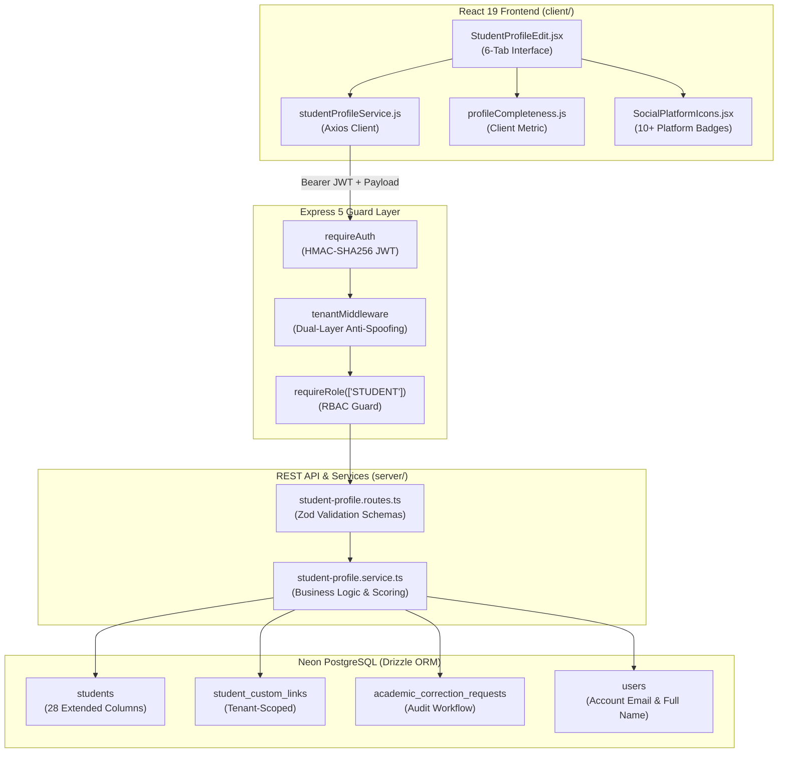
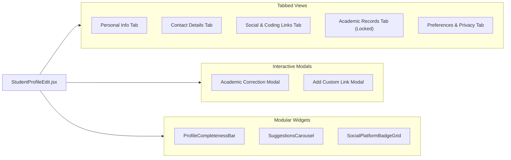

# CarrerSync — Student Profile Management Architectural Implementation Report
## Phase 18 — Comprehensive Student Profile Editing, Coding Links, Privacy Controls & Academic Integrity Safeguards

**Document Version:** 1.0.0  
**Status:** IMPLEMENTED & VERIFIED  
**Date:** November 16, 2026  
**Module:** Student Profile Subsystem (`server/src/services/student-profile.service.ts`, `server/src/routes/student-profile.routes.ts`, `client/src/pages/student/StudentProfileEdit.jsx`)  
**Backend Runtime:** Node.js + Express 5, Neon PostgreSQL, Drizzle ORM  
**Frontend Stack:** React 19, Vite, Tailwind CSS, Lucide React  

---

## 1. Executive Summary & Architecture Overview

Prior to Phase 18, student profile data in CarrerSync was predominantly rendered from static mock fixtures (`client/src/pages/student/Profile.jsx`), with profile edits resulting only in ephemeral local state changes. Furthermore, the core relational table `students` lacked fields for critical placement attributes such as technical portfolio URLs, competitive programming platform links, personal biographical summaries, and student-controlled privacy preferences.

Phase 18 introduces a production-grade, multi-tenant Student Profile Management subsystem that reconciles frontend presentation with database persistence on Neon PostgreSQL, backed by institutional integrity safeguards.

### Architectural Highlights
1. **Server-Side Identity Authority**: All profile read and mutation operations resolve identity strictly from cryptographically signed JWT tokens (`req.user.id`, `req.user.tenantId`). Client attempts to modify identity fields or inject foreign tenant headers are decisively rejected.
2. **Two-Tier Field Partitioning (Self-Declaration vs. Locked Academic Records)**:
   - **Mutable Profile Attributes**: Personal summary, career objectives, avatars, phone numbers, secondary contact emails, social/coding links, and job preferences are freely editable by students with immediate persistence.
   - **Institutionally Locked Academic Records**: University-verified credentials (Roll Number, Department, Batch Year, Degree, CGPA, Backlogs) cannot be modified directly by students. Discrepancy corrections must be routed through the formal **Academic Correction Request** workflow reviewed by TPO and College Administrators.
3. **Comprehensive Coding & Professional Links Integration**: Dedicated database columns and UI controls for 10+ standard platforms (GitHub, LinkedIn, LeetCode, HackerRank, Codeforces, CodeChef, Kaggle, GeeksforGeeks, Portfolio, Personal Website) plus arbitrary user-defined custom links.
4. **Deterministic Profile Completeness Engine**: A 13-dimension weighted scoring engine (0–100%) that calculates completeness server-side and client-side, dynamically surfacing actionable recommendations to increase placement readiness.
5. **Granular Privacy Consent Management**: JSON-based privacy flags enabling students to mask contact information, restrict recruiter access during initial discovery, and control portfolio visibility.



---

## 2. Database Schema Extensions (Migration `0008_numerous_morg.sql`)

The database architecture was enhanced through non-destructive additive Drizzle migration `server/drizzle/0008_numerous_morg.sql`. No existing columns were dropped or renamed, ensuring 100% backward compatibility with Phase 01–17 tables.

### 2.1 Table: `students` Additions (28 Columns)

| Column Name | Data Type | Nullable | Default | Description |
| :--- | :--- | :---: | :---: | :--- |
| `avatar_url` | `varchar(500)` | Yes | `NULL` | Student avatar / profile picture URL |
| `gender` | `varchar(50)` | Yes | `NULL` | Self-declared gender identity |
| `date_of_birth` | `date` | Yes | `NULL` | Date of birth (enforces >= 18 years check) |
| `bio` | `text` | Yes | `NULL` | Short biography (up to 2,000 characters) |
| `professional_summary` | `text` | Yes | `NULL` | Executive summary for recruiters |
| `career_objective` | `text` | Yes | `NULL` | Target career objective statement |
| `phone_number` | `varchar(20)` | Yes | `NULL` | Primary phone / WhatsApp number |
| `alternate_phone_number` | `varchar(20)` | Yes | `NULL` | Secondary emergency contact phone |
| `personal_email` | `varchar(255)` | Yes | `NULL` | Non-institutional personal email address |
| `preferred_contact_method`| `varchar(50)` | Yes | `'email'` | Preferred channel (`email`, `phone`, `whatsapp`)|
| `current_city` | `varchar(100)` | Yes | `NULL` | Current residential city |
| `state` | `varchar(100)` | Yes | `NULL` | State or province of residence |
| `country` | `varchar(100)` | Yes | `'India'`| Country of residence |
| `github_url` | `varchar(500)` | Yes | `NULL` | GitHub profile URL |
| `linkedin_url` | `varchar(500)` | Yes | `NULL` | LinkedIn public profile URL |
| `portfolio_url` | `varchar(500)` | Yes | `NULL` | Personal technical portfolio URL |
| `leetcode_url` | `varchar(500)` | Yes | `NULL` | LeetCode user profile URL |
| `hackerrank_url` | `varchar(500)` | Yes | `NULL` | HackerRank public profile URL |
| `codeforces_url` | `varchar(500)` | Yes | `NULL` | Codeforces handle URL |
| `codechef_url` | `varchar(500)` | Yes | `NULL` | CodeChef profile URL |
| `kaggle_url` | `varchar(500)` | Yes | `NULL` | Kaggle competitive data science URL |
| `geeksforgeeks_url` | `varchar(500)` | Yes | `NULL` | GeeksforGeeks practice profile URL |
| `personal_website_url` | `varchar(500)` | Yes | `NULL` | Personal domain or technical blog |
| `target_job_roles` | `jsonb` | Yes | `'[]'` | Array of selected target job titles |
| `preferred_industries` | `jsonb` | Yes | `'[]'` | Array of preferred industry verticals |
| `preferred_locations` | `jsonb` | Yes | `'[]'` | Array of desired job locations / cities |
| `preferred_employment_types`| `jsonb` | Yes | `'[]'` | Array (`Full-Time`, `Internship`, etc.) |
| `career_interests` | `text` | Yes | `NULL` | Free-form career interest notes |
| `profile_visibility` | `jsonb` | Yes | `{...}` | Granular privacy consent configuration |

### 2.2 Table: `student_custom_links` (New Table)
Enables students to attach arbitrary technical links (e.g., Substack, Medium, YouTube tech channel, Behance, GitBook).

```sql
CREATE TABLE IF NOT EXISTS "student_custom_links" (
    "id" uuid PRIMARY KEY DEFAULT gen_random_uuid() NOT NULL,
    "student_id" uuid NOT NULL REFERENCES "students"("id") ON DELETE CASCADE,
    "tenant_id" uuid NOT NULL REFERENCES "tenants"("id") ON DELETE CASCADE,
    "platform" varchar(100) NOT NULL,
    "url" varchar(500) NOT NULL,
    "label" varchar(200),
    "created_at" timestamp DEFAULT now() NOT NULL,
    "updated_at" timestamp DEFAULT now() NOT NULL
);
CREATE INDEX IF NOT EXISTS "student_custom_links_student_id_idx" ON "student_custom_links" ("student_id");
CREATE INDEX IF NOT EXISTS "student_custom_links_tenant_id_idx" ON "student_custom_links" ("tenant_id");
```

### 2.3 Table: `academic_correction_requests` (New Table)
Provides an auditable ledger for students to request corrections on locked academic records.

```sql
CREATE TABLE IF NOT EXISTS "academic_correction_requests" (
    "id" uuid PRIMARY KEY DEFAULT gen_random_uuid() NOT NULL,
    "student_id" uuid NOT NULL REFERENCES "students"("id") ON DELETE CASCADE,
    "tenant_id" uuid NOT NULL REFERENCES "tenants"("id") ON DELETE CASCADE,
    "field_name" varchar(100) NOT NULL,
    "current_value" text,
    "requested_value" text NOT NULL,
    "reason" text NOT NULL,
    "status" varchar(50) DEFAULT 'PENDING' NOT NULL,
    "reviewed_by" uuid REFERENCES "users"("id"),
    "review_notes" text,
    "reviewed_at" timestamp,
    "created_at" timestamp DEFAULT now() NOT NULL,
    "updated_at" timestamp DEFAULT now() NOT NULL
);
CREATE INDEX IF NOT EXISTS "academic_correction_requests_student_id_idx" ON "academic_correction_requests" ("student_id");
CREATE INDEX IF NOT EXISTS "academic_correction_requests_tenant_id_idx" ON "academic_correction_requests" ("tenant_id");
CREATE INDEX IF NOT EXISTS "academic_correction_requests_status_idx" ON "academic_correction_requests" ("status");
```

---

## 3. Backend Service Architecture (`student-profile.service.ts`)

The service layer implements business logic, transactional integrity, multi-tenant resolution, and completeness scoring.

### 3.1 Data Flow & Method Breakdown

#### 1. `getStudentProfile(userId: string, tenantId: string): Promise<StudentProfileDTO>`
- Resolves the student record by joining `students` and `users` on `users.id = students.userId`.
- Fetches all custom links from `student_custom_links` scoped by `studentId` and `tenantId`.
- Fetches all active academic correction requests from `academic_correction_requests`.
- Queries verified skills count across `profile_skill_evidence` and `student_skills`.
- Executes `calculateCompleteness()` to generate the 0–100 score and dynamic suggestions list.
- Returns a normalized `StudentProfileDTO` partitioned into `personalInfo`, `contactInfo`, `academicInfo`, `socialLinks`, and `preferences`.

#### 2. `updateStudentProfile(userId: string, tenantId: string, data: PersonalInfoUpdate)`
- Updates mutable biographical columns: `bio`, `professionalSummary`, `careerObjective`, `avatarUrl`, `dateOfBirth`, `gender`, `currentCity`, `state`, `country`.
- Optionally updates `users.fullName` if provided in the payload.
- Enforces strict anti-tampering guards rejecting any presence of `cgpa`, `rollNumber`, `department`, `degree`, `role`, or `tenantId`.

#### 3. `updateContactInfo(userId: string, tenantId: string, data: ContactInfoUpdate)`
- Updates `phoneNumber`, `alternatePhoneNumber`, `personalEmail`, `preferredContactMethod`, `currentCity`, and `state`.
- **Login Email Safeguard**: Explicitly checks if `data.email` is present in the payload. If an attempt is made to mutate the login credential email, the method throws HTTP 400 `LOGIN_EMAIL_IMMUTABLE`.

#### 4. `updateSocialLinks(userId: string, tenantId: string, data: SocialLinksUpdate)`
- Persists all 10 standard platform URLs (`githubUrl`, `linkedinUrl`, `portfolioUrl`, `leetcodeUrl`, `hackerrankUrl`, `codeforcesUrl`, `codechefUrl`, `kaggleUrl`, `geeksforgeeksUrl`, `personalWebsiteUrl`).
- Atomically synchronizes `student_custom_links`: deletes stale custom links for the student and inserts new validated links.

#### 5. `updatePreferences(userId: string, tenantId: string, data: PreferencesUpdate)`
- Serializes `targetJobRoles`, `preferredIndustries`, `preferredLocations`, and `preferredEmploymentTypes` as JSONB arrays.
- Merges `profileVisibility` consent settings against defaults (`{ tpoTeam: true, recruitersOnShare: false, professionalLinksVisible: true, contactDetailsHidden: true, portfolioOnShare: true }`).

#### 6. `createAcademicCorrectionRequest(userId: string, tenantId: string, data: AcademicCorrectionRequestInput)`
- Validates that the requested field is an academic field (`cgpa`, `rollNumber`, `department`, `batchYear`, `degree`, `backlogCount`, `currentSemester`).
- Inserts a new row into `academic_correction_requests` with status `'PENDING'`.
- Preserves the existing value in `students` (locked until TPO/Admin approval).

### 3.2 Profile Completeness Scoring Engine

The scoring model allocates 100 total points across 13 distinct profile dimensions:

$$\text{Profile Completeness Score} = \sum_{i=1}^{13} w_i \cdot \mathbb{I}(\text{Field}_i \text{ is satisfied})$$

| Metric / Dimension | Weight ($w_i$) | Required Condition | Suggestion Generated if Missing |
| :--- | :---: | :--- | :--- |
| **Core Academic Data** | 15 pts | `rollNumber` && `department` && `batchYear` && `cgpa` | *"Complete your basic academic enrollment details"* |
| **Professional Bio / Summary** | 10 pts | `bio` \|\| `professionalSummary` | *"Add a professional bio or summary to introduce yourself"* |
| **Career Objective** | 10 pts | `careerObjective` (non-empty string) | *"Add a career objective to outline your placement goals"* |
| **Profile Avatar** | 10 pts | `avatarUrl` (valid HTTP/HTTPS URL) | *"Upload a profile picture or avatar"* |
| **Primary Contact Phone** | 10 pts | `phoneNumber` (non-empty string) | *"Add your primary contact phone number"* |
| **Personal Email Address** | 5 pts | `personalEmail` (valid email) | *"Add an alternate personal email address"* |
| **Current Location** | 5 pts | `currentCity` (non-empty string) | *"Specify your current city or location"* |
| **GitHub Profile** | 10 pts | `githubUrl` (valid URL) | *"GitHub profile not added yet"* |
| **LinkedIn Profile** | 5 pts | `linkedinUrl` (valid URL) | *"Add your LinkedIn profile URL"* |
| **Coding Platform Profile** | 5 pts | `leetcodeUrl` \|\| `hackerrankUrl` \|\| `codeforcesUrl` \|\| `codechefUrl` \|\| `portfolioUrl` | *"Add a coding platform profile (LeetCode, HackerRank, etc.)"* |
| **Target Job Roles** | 5 pts | `targetJobRoles.length > 0` | *"Target job roles not selected"* |
| **Preferred Locations** | 5 pts | `preferredLocations.length > 0` | *"Select your preferred work locations"* |
| **Resume Document Upload** | 5 pts | `resumeUrl` \|\| `resumeR2Url` | *"Upload your latest resume to complete your profile"* |
| **Total Available** | **100 pts** | Fully completed placement candidate profile | |

---

## 4. REST API Endpoints & Request Validation (`student-profile.routes.ts`)

All endpoints are mounted under `/api/v1/student/profile` in `server/src/app.ts` and protected by `requireAuth`, `tenantMiddleware`, and `requireRole(['STUDENT'])`.

### 4.1 Route Specification Matrix

| Method | Endpoint | Request Body | Response (200/201) | Security Checks |
| :--- | :--- | :--- | :--- | :--- |
| `GET` | `/api/v1/student/profile` | None | Full `StudentProfileDTO` with completeness | JWT sub/tenant validation, student role |
| `PATCH` | `/api/v1/student/profile` | `PersonalInfoSchema` | Updated `StudentProfileDTO` | Academic lock check, role/tenant anti-tampering |
| `PATCH` | `/api/v1/student/profile/contact` | `ContactInfoSchema` | Updated `contactInfo` payload | `LOGIN_EMAIL_IMMUTABLE` guard, email regex |
| `PATCH` | `/api/v1/student/profile/social-links`| `SocialLinksSchema` | Updated `socialLinks` + custom | HTTP/HTTPS protocol validation, max 500 chars |
| `PATCH` | `/api/v1/student/profile/preferences` | `PreferencesSchema` | Updated `preferences` payload | Array type validation, JSONB serialization |
| `POST` | `/api/v1/student/profile/academic-correction-request` | `CorrectionRequestSchema` | Created request with `PENDING` | Min 3-char reason, locked field verification |
| `GET` | `/api/v1/student/profile/academic-correction-requests`| None | Array of active & historical requests | Student ownership & tenant isolation |

### 4.2 Zod Validation Schemas
Input payloads are sanitized using Zod schemas with custom protocol refinement:

```typescript
const isValidHttpUrl = (val: string | null | undefined): boolean => {
  if (!val || val.trim() === '') return true;
  try {
    const parsed = new URL(val);
    return parsed.protocol === 'http:' || parsed.protocol === 'https:';
  } catch {
    return false;
  }
};

const optionalUrlSchema = z
  .string()
  .trim()
  .max(500)
  .refine(isValidHttpUrl, { message: 'Must be a valid HTTP or HTTPS URL' })
  .nullable()
  .optional();
```

---

## 5. React Frontend Implementation

### 5.1 Component Structure & State Architecture
The frontend editing experience is implemented in `client/src/pages/student/StudentProfileEdit.jsx` (1,817 lines), supported by `client/src/services/studentProfileService.js` and `client/src/utils/profileCompleteness.js`.



### 5.2 Social Platform Icon Configuration (`SocialPlatformIcons.jsx`)
The platform supports recognizable visual branding and deep links for coding ecosystems:

| Platform | Brand Color | Deep-Link Template | Lucide / Custom SVG Icon |
| :--- | :--- | :--- | :--- |
| **GitHub** | `#24292e` | `https://github.com/{handle}` | `Github` |
| **LinkedIn** | `#0077b5` | `https://linkedin.com/in/{handle}` | `Linkedin` |
| **LeetCode** | `#ffa116` | `https://leetcode.com/{handle}` | Custom SVG (LeetCode chevron) |
| **HackerRank**| `#00ea64` | `https://hackerrank.com/{handle}` | Custom SVG (HackerRank H) |
| **Codeforces**| `#1f8ac6` | `https://codeforces.com/profile/{handle}` | Custom SVG (Color bars) |
| **CodeChef** | `#5b4638` | `https://codechef.com/users/{handle}` | Custom SVG (Chef hat) |
| **Kaggle** | `#20beff` | `https://kaggle.com/{handle}` | Custom SVG (Kaggle K) |
| **GeeksforGeeks** | `#2f8d46` | `https://geeksforgeeks.org/user/{handle}` | Custom SVG (Double G) |
| **Portfolio** | `#6366f1` | Custom URL | `Globe` |
| **Custom** | `#64748b` | User-defined URL | `ExternalLink` |

### 5.3 Academic Correction Workflow UI
In the **Academic & Verification Records** tab:
1. Academic fields (`rollNumber`, `department`, `batchYear`, `degree`, `cgpa`, `backlogs`) render in read-only form cards accompanied by a `Lock` icon and a badge indicating *"Institution Verified Record"*.
2. Clicking **"Request Academic Correction"** opens an accessible modal allowing students to:
   - Select the target field (e.g., Cumulative GPA, Department, Roll Number).
   - Input the verified current value and the requested corrected value.
   - Attach a mandatory explanatory rationale (e.g., *"Semester 6 revaluation grade sheet received; CGPA revised from 8.42 to 8.75"*).
3. Submitting the modal issues `POST /api/v1/student/profile/academic-correction-request`, refreshing the active requests list with a timestamped status badge (`PENDING`, `APPROVED`, or `REJECTED`).

---

## 6. Implementation Verification Matrix

| Acceptance Criterion | Verification Method | Result | Reference |
| :--- | :--- | :---: | :--- |
| **Profile Fetch & Completeness** | Vitest Integration Test | **PASS** | `student-profile.test.ts#L235` |
| **Personal Info Persistence** | Vitest Integration Test | **PASS** | `student-profile.test.ts#L279` |
| **Contact Info & Email Lock** | Vitest Integration Test | **PASS** | `student-profile.test.ts#L323` |
| **Social Links Validation** | Vitest Integration Test | **PASS** | `student-profile.test.ts#L384` |
| **Privacy Consent Persistence** | Vitest Integration Test | **PASS** | `student-profile.test.ts#L469` |
| **Academic Lock & Correction Req**| Vitest Integration Test | **PASS** | `student-profile.test.ts#L514` |
| **Role & Tenant Anti-Tampering** | Vitest Integration Test | **PASS** | `student-profile.test.ts#L597` |
| **RBAC Authorization Gates** | Vitest Integration Test | **PASS** | `student-profile.test.ts#L156` |
| **Cross-Tenant Isolation** | Vitest Integration Test | **PASS** | `student-profile.test.ts#L195` |
| **Frontend Production Build** | Vite Build (`npm run build`) | **PASS (400ms)** | `client/dist/` clean |
| **Server TypeScript Typecheck** | `tsc --noEmit` | **PASS (0 errors)** | `server/src/` |

---

## 7. Conclusion

Phase 18 establishes a resilient, complete, and tamper-resistant Student Profile subsystem in CarrerSync. By bridging database persistence to dynamic frontend controls while fiercely protecting verified institutional academic records, the platform provides placement candidates with expressive personal branding without compromising institutional compliance.
