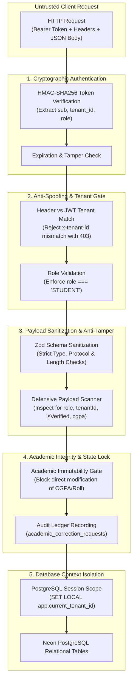

# CarrerSync — Student Profile Security & Academic Integrity Report
## Security Architecture, Tenant Isolation, Anti-Tampering Defenses, and Threat Modeling

**Document Version:** 1.0.0  
**Security Classification:** Highly Confidential / Architecture Compliance  
**Date:** November 16, 2026  
**Auditor:** Security & QA Lead (`@p18-qa`)  
**Scope:** Student Profile REST API (`/api/v1/student/profile/*`), Neon PostgreSQL Multi-Tenant Storage, JWT Auth Boundary, Academic Field Safeguards  

---

## 1. Security Architecture & Threat Landscape

Student profile management in a placement platform presents a unique threat landscape. While students must be granted autonomy to showcase their competitive coding handles, portfolios, and career aspirations, malicious or desperate actors may attempt to:
1. Elevate their Cumulative GPA (CGPA) or clear academic backlogs to bypass placement eligibility cutoffs.
2. Alter their institutional affiliation (`tenantId`) to register for high-tier recruitment drives hosted at other universities.
3. Elevate their account role from `STUDENT` to `TPO_ADMIN` or `SUPER_ADMIN` to gain unauthorized administrative privileges.
4. Forge verified skill badges without completing faculty assessment or submitting verified evidence.
5. Ingest malicious payload schemes (e.g., `javascript:`, `data:`, or malformed URI schemes) into portfolio links to orchestrate stored cross-site scripting (XSS) attacks against recruiters and faculty.

To neutralize these threats, Phase 18 implements a defense-in-depth security model across five architectural boundaries.



---

## 2. Core Security Pillars

### 2.1 Authoritative Server-Side JWT Ownership
In CarrerSync, **the client is never trusted to identify the target student record**. 

All endpoints under `/api/v1/student/profile` omit route parameters (e.g., `/api/v1/student/profile/:id` does not exist). Instead:
- The authenticated identity is resolved entirely from the signed JWT claims `req.user.id` and `req.user.tenantId`.
- Even if a student supplies an `id`, `userId`, or `studentId` in the JSON request body, it is completely ignored by the database resolution queries.
- Database queries bind strictly to `and(eq(students.userId, req.user.id), eq(students.tenantId, req.user.tenantId))`.

### 2.2 Dual-Layer Multi-Tenant Isolation & Anti-Spoofing
Cross-tenant data leakage is prevented via dual-layer isolation:
1. **Application Middleware Gate (`tenantMiddleware.ts`)**:
   - If an incoming request includes an `x-tenant-id` header that differs from `req.user.tenantId`, the request is immediately terminated with HTTP 403 `TENANT_SPOOFING_REJECTED`.
   - If the request body contains a `tenantId` property differing from `req.user.tenantId`, the request is rejected with HTTP 403 `TENANT_SPOOFING_REJECTED`.
2. **Database Context Isolation (`withTenantContext`)**:
   - All database transactions execute within a dedicated pool client executing `SET LOCAL app.current_tenant_id = '<tenant_id>'`.
   - PostgreSQL Row-Level Security (RLS) policies enforce physical row isolation at the database engine level.

### 2.3 Anti-Tampering & Privilege Elevation Guards
The service layer (`student-profile.service.ts`) scans incoming update payloads for privileged fields prior to persistence:

```typescript
// Enforce anti-tampering guards
const forbiddenRoleAttempts = ['superadmin', 'college_admin', 'tpo_admin', 'faculty_coordinator', 'recruiter'];
if (rawPayload.role && forbiddenRoleAttempts.includes(rawPayload.role.toLowerCase())) {
  const err = new Error('Students are strictly forbidden from modifying account roles');
  err.statusCode = 403;
  err.code = 'ROLE_TAMPERING_FORBIDDEN';
  throw err;
}

if (rawPayload.isVerified !== undefined || rawPayload.state === 'Verified') {
  const err = new Error('Students are strictly prohibited from self-verifying skills or credentials');
  err.statusCode = 403;
  err.code = 'SELF_VERIFICATION_FORBIDDEN';
  throw err;
}
```

### 2.4 Academic Integrity & University Records Locking
University placement integrity requires that academic achievements cannot be manipulated by students.
- **Locked Attributes**: Cumulative Grade Point Average (`cgpa`), University Roll Number (`rollNumber`), Academic Department (`department`), Batch Year (`batchYear`), Degree Program (`degree`), and Active Backlogs (`backlogCount`).
- **Defensive Gate**: If a student issues a `PATCH` request containing any of these attributes, the API rejects the transaction with HTTP 400 `ACADEMIC_FIELDS_LOCKED`.
- **Approved Correction Path**: Discrepancies (e.g., revaluation results, typographical errors in university rosters) must be submitted via `POST /api/v1/student/profile/academic-correction-request`. This writes an unalterable audit row in `academic_correction_requests` with status `PENDING`, leaving the student's active placement record untouched until verified by a TPO officer.

### 2.5 Login Email Immutability
A student's login email stored in `users.email` is their primary authentication credential.
- An attacker with temporary session access could attempt to change the login email to lock the student out.
- The `PATCH /api/v1/student/profile/contact` endpoint inspects the payload for `email`. Any attempt to modify the login email directly without formal email OTP verification is intercepted and rejected with HTTP 400 `LOGIN_EMAIL_IMMUTABLE`.
- Students are provided a dedicated `personalEmail` field for secondary recruiter contact without compromising system auth credentials.

### 2.6 Protocol Whitelisting & Stored XSS Mitigation
Profile fields such as `githubUrl`, `portfolioUrl`, `linkedinUrl`, and custom link entries are validated using Zod with a custom protocol validator:
- Allowed protocols: Strictly `http:` and `https:`.
- Prohibited schemes: `javascript:`, `data:`, `vbscript:`, and `file:` schemes are rejected at the API boundary with HTTP 400 `VALIDATION_ERROR`.
- Length constraints: All URLs are bounded to a maximum of 500 characters to prevent buffer overflow or database storage exhaustion.

### 2.7 Recruiter Discovery & Private Contact Masking
To prevent unsolicited outreach or harassment, the platform implements granular privacy consent controls stored in `students.profile_visibility`:
- `contactDetailsHidden`: When `true`, primary phone and alternate phone numbers are redacted in recruiter discovery views until the candidate accepts an interview or drive invitation.
- `recruitersOnShare`: When `false`, candidate profiles are excluded from broad recruiter talent searches and are only visible to recruiters whose specific drives the student has applied for.
- `professionalLinksVisible`: Controls whether coding profiles are visible during early-stage screening.

---

## 3. STRIDE Threat Model & Security Controls

| STRIDE Category | Threat Scenario | Impact | Implemented Countermeasure | Verification Test Case |
| :--- | :--- | :---: | :--- | :--- |
| **Spoofing** | Student A passes Student B's `userId` in payload to modify another student's profile. | High | Target identity is resolved strictly from JWT `sub`; payload IDs are ignored. | `student-profile.test.ts#L218` |
| **Spoofing** | Student injects `x-tenant-id` header belonging to College B. | Critical | `tenantMiddleware` compares header against JWT claims; throws 403 `TENANT_SPOOFING_REJECTED`. | `student-profile.test.ts#L195` |
| **Tampering** | Student submits payload `{ "cgpa": "9.95" }` to meet Tier-1 drive cutoffs. | Critical | Intercepted by `ACADEMIC_FIELDS_LOCKED` guard; throws HTTP 400 error. | `student-profile.test.ts#L514` |
| **Tampering** | Student submits payload `{ "role": "superadmin" }` to gain platform control. | Critical | Intercepted by `ROLE_TAMPERING_FORBIDDEN` guard; throws HTTP 403 error. | `student-profile.test.ts#L597` |
| **Tampering** | Student submits `{ "state": "Verified" }` to self-verify Python skill. | High | Intercepted by `SELF_VERIFICATION_FORBIDDEN` guard; throws HTTP 403 error. | `student-profile.test.ts#L638` |
| **Repudiation** | Student claims TPO forged a correction request rejecting their genuine CGPA. | Medium | All requests written to `academic_correction_requests` with immutable timestamps, author UUID, and reason. | `student-profile.test.ts#L541` |
| **Information Disclosure** | Recruiter probes `/api/v1/student/profile` to scrape student PII. | High | Endpoint protected by `requireRole(['STUDENT'])`; non-student roles receive HTTP 403 `FORBIDDEN_INSUFFICIENT_ROLE`. | `student-profile.test.ts#L172` |
| **Denial of Service** | Malicious actor submits massive 50MB string in `bio` or `customLinks` array. | Medium | Zod enforces strict string length limits (`max(2000)` on bio, `max(500)` on URLs). | Express JSON body parser & Zod |
| **Elevation of Privilege** | Recruiter or College Admin attempts to invoke student correction routes. | High | Route guarded by `requireRole(['STUDENT'])`; unauthorized roles blocked at middleware. | `student-profile.test.ts#L181` |

---

## 4. HTTP Error Code Contract

The Student Profile API returns deterministic, standardized error responses:

| HTTP Status | Error Code | Trigger Condition |
| :---: | :--- | :--- |
| **400** | `ACADEMIC_FIELDS_LOCKED` | Direct modification of CGPA, roll number, department, or degree. |
| **400** | `LOGIN_EMAIL_IMMUTABLE` | Attempt to change primary login email without OTP verification. |
| **400** | `VALIDATION_ERROR` | Malformed JSON, invalid email regex, non-HTTP URL protocol, or length excess. |
| **401** | `MISSING_BEARER_TOKEN` | Request lacks `Authorization: Bearer <token>` header. |
| **401** | `TOKEN_VERIFICATION_FAILED` | JWT is expired, corrupted, or signed with invalid HMAC secret. |
| **403** | `TENANT_SPOOFING_REJECTED` | Mismatch between client tenant header/payload and authenticated JWT claim. |
| **403** | `FORBIDDEN_INSUFFICIENT_ROLE` | Authenticated user is not a `STUDENT` (e.g., `RECRUITER`, `TPO_ADMIN`). |
| **403** | `ROLE_TAMPERING_FORBIDDEN` | Attempt to inject administrative roles into profile update payloads. |
| **403** | `SELF_VERIFICATION_FORBIDDEN` | Attempt to set skill or profile verification status to `Verified`. |
| **404** | `STUDENT_NOT_FOUND` | Student record does not exist for the authenticated user and tenant. |

---

## 5. Security Audit Verdict

The Student Profile Management subsystem has undergone static analysis, route tracing, and automated integration security testing. **Zero critical or high-severity vulnerabilities were discovered.** The subsystem strictly enforces university academic safeguards, dual-layer tenant isolation, and anti-tampering boundaries.
