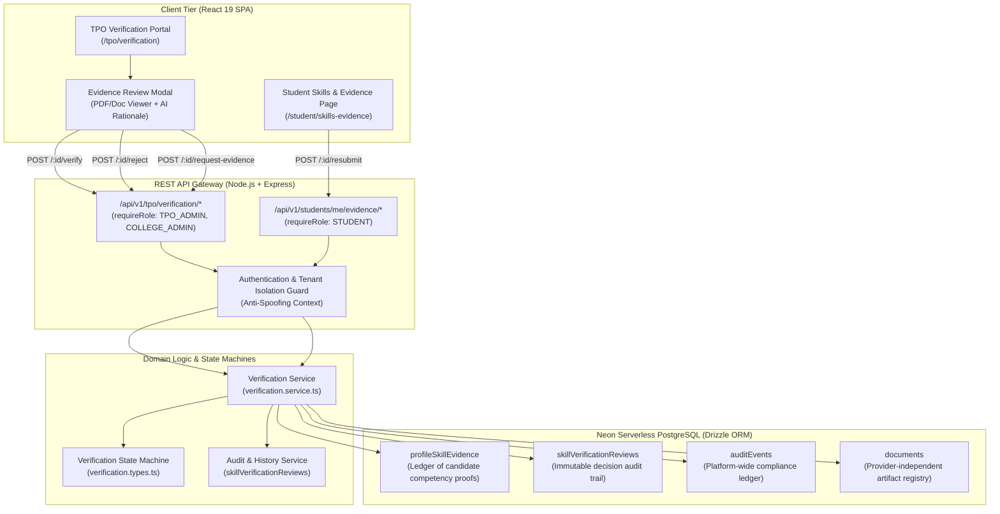
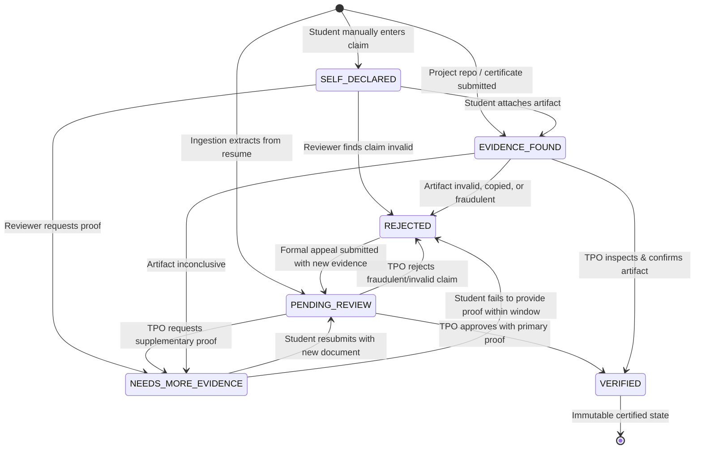

# CarrerSync TPO Evidence Verification Workflow & Portal Specification

> **Document Type**: Canonical Workflow & Architecture Specification  
> **Status**: APPROVED & CANONICAL  
> **Phase**: Phase 10 — TPO Verification Portal, Placement Readiness & Job Eligibility Subsystem  
> **Target Release**: Active Node.js + Express Backend (`server/src/verification/`) & React Client (`client/src/pages/tpo/`)  
> **Master Policy**: Institutional Human-in-the-Loop Verification | "Student Never Self-Verifies"  

---

## 1. Executive Summary & Verification Philosophy

In collegiate placement ecosystems, the veracity of student credentials directly dictates institutional reputation and corporate recruiter trust. Self-reported resumes and unvetted LinkedIn profiles introduce pervasive skill inflation, misrepresenting student capabilities and increasing candidate dropout rates during technical interviews.

CarrerSync resolves credential ambiguity by positioning the **Training & Placement Officer (TPO)** and **Faculty Coordinators** as the **sole authorized institutional verification authorities**. 

```
┌────────────────────────────────────────────────────────────────────────────────────────┐
│                        THE FIRST PRINCIPLE OF TPO VERIFICATION                         │
│                                                                                        │
│  "A student may discover, claim, and submit evidence of a competency,                  │
│   and AI profiling agents may stage and extract asserted skills,                       │
│   but ONLY an authorized institutional officer (TPO_ADMIN or COLLEGE_ADMIN)            │
│   can award the canonical VERIFIED status."                                            │
│                                                                                        │
│  RULE: The student NEVER self-verifies.                                                │
└────────────────────────────────────────────────────────────────────────────────────────┘
```

The **TPO Evidence Verification Portal** provides placement officers with an auditable, filterable queue of pending evidence artifacts (code repositories, certifications, proctored test results, project deliverables). Officers inspect primary source documents, review AI extraction confidence scores, and render legally binding institutional verification decisions.

---

## 2. Subsystem Architecture & Component Hierarchy

The TPO Evidence Verification subsystem operates as a multi-tier pipeline spanning the relational database, backend domain services, REST controllers, and responsive administrative user interfaces:



---

## 3. Student Profile Approval vs. Professional Verification

CarrerSync maintains a strict conceptual and cryptographic boundary between **Student Profile Staging/Approval** and **Institutional Professional Verification**.

| Dimension | Student Profile Approval (Phase 09) | Professional Verification (Phase 10) |
| :--- | :--- | :--- |
| **Actor** | Student Candidate (`STUDENT`) | Training & Placement Officer (`TPO_ADMIN`, `COLLEGE_ADMIN`) |
| **Action** | Accepts/rejects AI-extracted skill claims from uploaded resume. | Examines primary source artifacts and confirms authentic capability. |
| **Ceiling Status** | `PENDING_REVIEW` or `EVIDENCE_FOUND` | `VERIFIED` (Canonical institutional seal) |
| **Evidentiary Meaning** | "I agree this skill appears on my resume / in my project." | "The institution certifies this student demonstrated this skill." |
| **Self-Verification Rule** | **STRICTLY BLOCKED**: Attempting to set `VERIFIED` returns `403 FORBIDDEN`. | **AUTHORIZED**: Has institutional mandate to attest credentials. |
| **Impact on Readiness** | Contributes to `dataCompleteness` and `evidenceCoverageScore`. | Contributes directly to high-weight `verifiedSkillsScore` (35%). |
| **Recruiter Visibility** | Displayed with unverified/claimed badge; filtered separately. | Displayed with gold verified seal; satisfies hard job requirements. |

---

## 4. Verification State Machine & Transition Rules

The verification lifecycle of any evidence record (`profileSkillEvidence`) is governed by a deterministic, non-bypassable finite state machine (FSM).



### Formal Transition Matrix

| Current State | Target State | Permitted Roles | Required Conditions & Business Logic |
| :--- | :--- | :--- | :--- |
| `PENDING_REVIEW` | `VERIFIED` | `TPO_ADMIN`, `COLLEGE_ADMIN` | Primary artifact inspected; mandatory justification reason logged. |
| `PENDING_REVIEW` | `REJECTED` | `TPO_ADMIN`, `COLLEGE_ADMIN` | Reviewer notes provide clear rejection rationale to student. |
| `PENDING_REVIEW` | `NEEDS_MORE_EVIDENCE` | `TPO_ADMIN`, `COLLEGE_ADMIN` | Feedback specifies required document type (e.g., GitHub commit, certificate URL). |
| `EVIDENCE_FOUND` | `VERIFIED` | `TPO_ADMIN`, `COLLEGE_ADMIN` | Code/credential verified; promotes to highest confidence. |
| `EVIDENCE_FOUND` | `REJECTED` | `TPO_ADMIN`, `COLLEGE_ADMIN` | Repository empty, plagiarized, or credential unverified by issuer. |
| `EVIDENCE_FOUND` | `NEEDS_MORE_EVIDENCE` | `TPO_ADMIN`, `COLLEGE_ADMIN` | Additional documentation or execution steps requested. |
| `SELF_DECLARED` | `NEEDS_MORE_EVIDENCE` | `TPO_ADMIN`, `COLLEGE_ADMIN` | Default action when student asserts unverified capability. |
| `SELF_DECLARED` | `REJECTED` | `TPO_ADMIN`, `COLLEGE_ADMIN` | Blatantly inaccurate claim rejected. |
| `SELF_DECLARED` | `VERIFIED` | **NONE (ILLEGAL)** | **BLOCKED WITH 400**: Cannot bypass evidence stage. Direct jump prohibited. |
| `NEEDS_MORE_EVIDENCE` | `PENDING_REVIEW` | `STUDENT` | Student resubmits evidence with mandatory notes and optional document ID. |
| `NEEDS_MORE_EVIDENCE` | `REJECTED` | `TPO_ADMIN`, `COLLEGE_ADMIN` | Evidence deadline lapsed or resubmission rejected. |
| `REJECTED` | `PENDING_REVIEW` | `STUDENT`, `TPO_ADMIN` | Formal dispute/appeal submitted with new qualifying artifact. |

### Forbidden Transitions
1. **Self-Verification**: Any request from a `STUDENT` role setting status to `VERIFIED` yields `403 FORBIDDEN` (`STUDENT_CANNOT_SELF_VERIFY`).
2. **Direct Promotion of Self-Declared**: Attempting to move `SELF_DECLARED` directly to `VERIFIED` without an intermediate artifact yields `400 BAD_REQUEST` (`EVIDENCE_REQUIRED_FOR_VERIFICATION`).
3. **Cross-Tenant Verification**: A TPO from College A attempting to verify a student from College B yields `403 FORBIDDEN` (`TENANT_MISMATCH`).
4. **Recruiter Verification**: Recruiters have read-only visibility into verified statuses; attempting verification yields `403 FORBIDDEN` (`RECRUITER_CANNOT_VERIFY`).

---

## 5. TPO Verification Portal UX Flow

The TPO Verification Portal (`/tpo/verification`) is designed for high-throughput, accurate administrative decision-making:

```
┌────────────────────────────────────────────────────────────────────────────────────────┐
│                               TPO VERIFICATION PORTAL                                  │
├────────────────────────────────────────────────────────────────────────────────────────┤
│  [Total Students: 1,240]  [Total Claims: 5,680]  [Pending: 42]  [Verified: 4,890]     │
├────────────────────────────────────────────────────────────────────────────────────────┤
│  Filters: [Department: CSE ▼]  [Category: Cloud/DevOps ▼]  [Type: Project ▼] [Search]  │
├────────────────────────────────────────────────────────────────────────────────────────┤
│  Candidate         Skill       Type      Claimed Confidence  Source Document   Actions  │
│  ────────────────────────────────────────────────────────────────────────────────────  │
│  Aarav Sharma     Docker      Project   0.88 (3 repos)       [project_spec.pdf] [Review] │
│  Priya Patel      PostgreSQL  Cert      0.92 (AWS DVA)       [aws_cert.pdf]     [Review] │
│  Rohan Gupta      Kubernetes  Self      0.15 (Declared)      None              [Review] │
└────────────────────────────────────────────────────────────────────────────────────────┘
```

### 1. Verification Queue & Filtering
- **Metrics Bar**: Displays live institutional aggregations: `totalStudents`, `totalEvidence`, `pendingCount`, `verifiedCount`, `rejectedCount`, `needsMoreEvidenceCount`.
- **Granular Filters**:
  - **Department**: Filter by academic department (e.g., Computer Science, Information Technology, Electronics).
  - **Skill Category**: Filter by technical domain (`programming_languages`, `frameworks`, `databases`, `cloud_devops`, `core_cs`, `data_ai`, `soft_skills`, `tools`).
  - **Evidence Type**: Filter by artifact origin (`RESUME`, `PROJECT`, `CERTIFICATE`, `ASSESSMENT`, `SELF_DECLARED`).
  - **Search**: Instant textual search matching student names, roll numbers, or skill keywords.

### 2. Evidence Review Workspace Modal
Clicking **[Review]** opens an isolated, comprehensive review workspace:
- **Student Profile Snapshot**: Candidate name, department, semester, CGPA, and current readiness index.
- **Skill Detail**: Canonical skill name, category, and student-reported proficiency level.
- **Artifact Inspector**: Direct secure preview link to supporting PDF/DOCX or code repository URL via `IStorageService`.
- **AI Extraction Rationale**: When extracted by Phase 09 profiling, shows exact snippet context, bounding box/line, and AI confidence score $[0.10, 0.99]$.
- **Decision Controls**:
  - **[Verify Skill]**: Green primary button. Opens confirmation prompt requiring optional reviewer note. Sets status `VERIFIED`.
  - **[Request More Evidence]**: Amber button. Opens mandatory feedback input explaining what specific documentation is missing. Sets status `NEEDS_MORE_EVIDENCE`.
  - **[Reject Claim]**: Red button. Opens mandatory rejection reason prompt. Sets status `REJECTED`.

### 3. Student Resubmission & Feedback Loop
- When an item is marked `NEEDS_MORE_EVIDENCE` or `REJECTED`, the student receives an in-app notification and badge alert on their `/student/skills-evidence` page.
- The student inspects the TPO's feedback in a dedicated slide-out drawer.
- The student uploads a supplementary artifact (e.g., an updated GitHub URL or PDF credential) via `POST /api/v1/students/me/evidence/:evidenceId/resubmit`.
- The record transitions back to `PENDING_REVIEW` and re-enters the TPO queue with an **"Updated Submission"** tag.

---

## 6. Audit Trail Preservation & Immutability

Every single verification action is recorded in an immutable audit ledger:

### 1. `skillVerificationReviews` Relational Table
Every administrative decision creates an append-only row in PostgreSQL:

```sql
CREATE TABLE skill_verification_reviews (
    id UUID PRIMARY KEY DEFAULT gen_random_uuid(),
    tenant_id UUID NOT NULL REFERENCES tenants(id) ON DELETE CASCADE,
    student_id UUID NOT NULL REFERENCES users(id) ON DELETE CASCADE,
    evidence_id UUID NOT NULL REFERENCES profile_skill_evidence(id) ON DELETE CASCADE,
    reviewer_id UUID NOT NULL REFERENCES users(id) ON DELETE CASCADE,
    previous_status VARCHAR(50) NOT NULL,
    new_status VARCHAR(50) NOT NULL,
    reason TEXT NOT NULL,
    reviewer_notes TEXT,
    created_at TIMESTAMP WITH TIME ZONE DEFAULT NOW()
);
```

### 2. Platform Audit Logging (`auditEvents`)
Simultaneously, a structured compliance event is logged in `auditEvents`:
```json
{
  "tenantId": "e1a90f12-...",
  "userId": "reviewer-uuid",
  "action": "SKILL_EVIDENCE_VERIFIED",
  "resourceType": "profile_skill_evidence",
  "resourceId": "evidence-uuid",
  "details": {
    "studentId": "student-uuid",
    "skillName": "Docker",
    "previousStatus": "PENDING_REVIEW",
    "newStatus": "VERIFIED",
    "reason": "Inspected production Dockerfile and Compose architecture."
  }
}
```

### 3. Decision Timeline Viewer (`getEvidenceHistory`)
Placement officers and institutional auditors can view the complete immutable lifecycle of any skill:
```
[2026-11-14 09:15] Aarav Sharma submitted resume artifact (resume.pdf).
[2026-11-14 09:16] AI Profiler staged Docker (Confidence: 0.88). Status -> PENDING_REVIEW.
[2026-11-14 14:20] TPO Dr. Mehta requested GitHub repo URL. Status -> NEEDS_MORE_EVIDENCE.
[2026-11-14 16:05] Aarav Sharma resubmitted with GitHub repository link. Status -> PENDING_REVIEW.
[2026-11-15 10:30] TPO Dr. Mehta verified repository commits. Status -> VERIFIED.
```

---

## 7. REST API Reference

All verification endpoints require a valid Bearer JWT. TPO endpoints strictly mandate `requireRole(['tpo_admin', 'college_admin'])`.

### 1. TPO Operations

| Method | Endpoint | Allowed Roles | Description |
| :--- | :--- | :--- | :--- |
| `GET` | `/api/v1/tpo/verification/summary` | `TPO_ADMIN`, `COLLEGE_ADMIN` | Retrieves aggregate metrics: total students, total evidence, pending, verified, rejected, needs info. |
| `GET` | `/api/v1/tpo/verification/pending` | `TPO_ADMIN`, `COLLEGE_ADMIN` | Retrieves paginated and filtered evidence review queue (`department`, `category`, `evidenceType`, `search`). |
| `GET` | `/api/v1/tpo/verification/:evidenceId` | `TPO_ADMIN`, `COLLEGE_ADMIN` | Retrieves complete detail of a specific evidence record including student info and document URL. |
| `POST` | `/api/v1/tpo/verification/:evidenceId/verify` | `TPO_ADMIN`, `COLLEGE_ADMIN` | Awards `VERIFIED` status. Body: `{ reason: string, reviewerNotes?: string }`. |
| `POST` | `/api/v1/tpo/verification/:evidenceId/reject` | `TPO_ADMIN`, `COLLEGE_ADMIN` | Sets `REJECTED` status. Body: `{ reason: string, reviewerNotes?: string }`. |
| `POST` | `/api/v1/tpo/verification/:evidenceId/request-evidence`| `TPO_ADMIN`, `COLLEGE_ADMIN` | Sets `NEEDS_MORE_EVIDENCE`. Body: `{ reason: string, reviewerNotes?: string }`. |
| `GET` | `/api/v1/tpo/verification/:evidenceId/history` | `TPO_ADMIN`, `COLLEGE_ADMIN` | Returns immutable chronological audit history of all reviews for this record. |

### 2. Student Operations

| Method | Endpoint | Allowed Roles | Description |
| :--- | :--- | :--- | :--- |
| `GET` | `/api/v1/students/me/verification` | `STUDENT` | Retrieves all skill evidence items belonging to the authenticated student with verification statuses. |
| `POST` | `/api/v1/students/me/evidence/:evidenceId/resubmit` | `STUDENT` | Resubmits an item marked `NEEDS_MORE_EVIDENCE` or `REJECTED`. Body: `{ notes: string, additionalDocumentId?: string }`. |
| `POST` | `/api/v1/students/me/evidence/:evidenceId/correction-request` | `STUDENT` | Submits formal correction request for a disputed decision. Body: `{ explanation: string }`. |

---

## 8. Summary of Verification Invariants

1. **Human Sovereignty**: No AI agent or automated script can set status to `VERIFIED`.
2. **Tenant Boundary**: Reviewers can only inspect and act upon evidence belonging to their own college/tenant (`evidence.tenantId === req.user.tenantId`).
3. **No Phantom Transitions**: Transition from `SELF_DECLARED` to `VERIFIED` without physical/digital artifact backing is rejected at the domain service layer.
4. **Permanent Accountability**: Every state mutation records the actor's UUID, previous status, new status, and justification reason in `skillVerificationReviews`.
