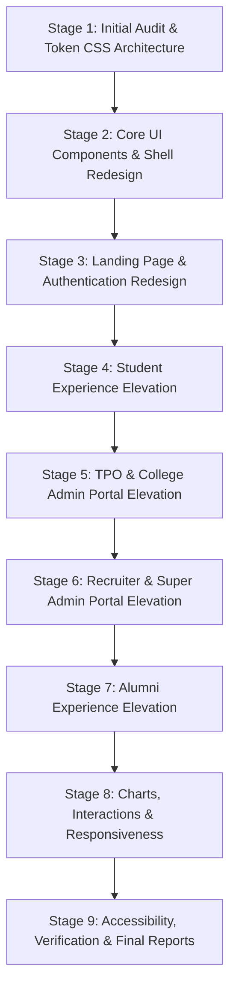

# CarrerSync — UI/UX Redesign Initial Audit & Design System Plan

**Document ID:** `DOC-UIUX-AUDIT-01`  
**Phase:** UI/UX Redesign & Design System Implementation  
**Role:** Senior UI/UX Designer, Design Systems Architect & Senior React Frontend Engineer  
**Status:** Audit Complete • Implementation In Progress  

---

## 1. Executive Summary & Objective

The CarrerSync platform has developed extensive end-to-end capabilities spanning 20 iterative phases: multi-agent intelligence, evidence-based skill verification, institutional predictive analytics, fairness governance, peer mock interviews, live collaboration rooms, and accreditation reporting.

However, the visual user interface evolved organically across individual features, resulting in:
1. Inconsistent color application (ad-hoc indigo, violet, blue, and navy gradients conflicting with the authoritative brand palette).
2. Fragmented spacing, inconsistent elevation, and mixed border radius scales.
3. Lack of a unified corporate design language, causing pages to feel like disparate admin views rather than a coherent, enterprise-grade Agentic Placement Intelligence SaaS platform.
4. Information density mismatches across student, TPO, college admin, recruiter, super admin, and alumni views.

This audit establishes the baseline across all 6 user roles and defines the implementation architecture to transform CarrerSync into a modern, corporate, digital-first SaaS platform powered by the authoritative **Mint Green (`#02E8A7`) / Aqua (`#11F1CF`) / Amber (`#FFC558`) / Deep Green (`#002020`)** brand design system.

---

## 2. Existing Frontend Architecture Audit

### 2.1 Technology Stack & Build Architecture
- **Framework:** React 19.x with Vite 8.x
- **Routing:** React Router v7 (`AppRoutes.jsx`) with `lazy` code-splitting and `Suspense` fallbacks
- **Styling:** Tailwind CSS v4 (`@import "tailwindcss";`) with CSS custom properties in `client/src/index.css`
- **Icons:** Lucide React (`lucide-react`)
- **Visual Graph & Charting:** Cytoscape.js for knowledge graphs, custom responsive SVG/canvas data visualizations

### 2.2 Directory & Module Structure
```
client/src/
  ├── components/
  │   ├── common/        # Legacy basic cards and buttons
  │   ├── layout/        # Navbar.jsx, Footer.jsx (dark theme shell)
  │   ├── shell/         # Sidebar.jsx, Topbar.jsx (dashboard application shell)
  │   ├── ui/            # Reusable core widgets (Button, Card, Input, Modal, etc.)
  │   ├── profile/       # SocialPlatformIcons, Profile completeness widgets
  │   ├── profiling/     # Multimodal evidence modals
  │   ├── notifications/ # NotificationDrawer
  │   └── landing/       # LandingNavbar.jsx, LandingFooter.jsx
  ├── layouts/           # DashboardLayout.jsx, MainLayout.jsx
  ├── pages/
  │   ├── landing/       # LandingPage.jsx
  │   ├── auth/          # Login.jsx, Register.jsx
  │   ├── student/       # 20 student views
  │   ├── admin/         # 13 institutional placement admin views
  │   ├── tpo/           # 14 TPO governance & intelligence views
  │   ├── recruiter/     # 12 recruiter views
  │   ├── superadmin/    # 9 multi-tenant management views
  │   └── alumni/        # 2 alumni portal views
  ├── routes/            # AppRoutes.jsx
  ├── services/          # 23 client API services (api.js, authService.js, etc.)
  └── utils/             # Profile completeness, URL validators, formatting helpers
```

---

## 3. Six Role User Experiences Audit

| Role Portal | Current Route Prefix | Current Visual Experience | Identified Issues & Gaps | Target SaaS Polish |
| :--- | :--- | :--- | :--- | :--- |
| **Public & Landing** | `/`, `/auth/*` | Mixed slate-950 dark header and white hero with blue/violet CTA buttons. | Inconsistent brand voice. Did not feature the official "From Skills to Successful Careers" messaging. | Clean, high-impact enterprise landing page with mint/aqua accents, interactive 4-agent showcase, and responsive navigation. |
| **Student Portal** | `/student/*` | Functional but visual hierarchy is cluttered; cards use generic borders. | Inconsistent card paddings; hardcoded indigo focus rings; profile editing needed clearer self-declared vs verified badges. | Clean, motivational student dashboard with mint progress rings, clear verification badges, and structured tabs. |
| **TPO Admin Portal** | `/tpo/*`, `/admin/*` | Dense data tables and metric cards with mixed purple and green status chips. | Visual overload on verification queues and predictive analytics; lack of consistent chart containers. | Enterprise operations dashboard with high information density, subtle `#BDF9F9` surface containers, and clear human approval callouts. |
| **College Admin** | `/college-admin/*`, `/admin/*` | Functional views for departments, cohort analytics, and institutional governance. | Inconsistent header spacing; lack of unified breadcrumb and stat card layout. | Clean institutional intelligence view with department comparisons, compliance indicators, and tenant security badges. |
| **Recruiter Portal** | `/recruiter/*` | Candidate discovery, job postings, drive coordination, and shortlists. | Generic cards; candidate comparison lacked visual hierarchy; filters needed polish. | Modern hiring cockpit with candidate match percentage in mint/aqua, streamlined shortlisting, and clear student consent indicators. |
| **Super Admin Portal**| `/super-admin/*` | Multi-tenant provisioning, college onboarding, audit logs, and system health. | Dangerous actions (suspension, deletion) lacked clear visual containment; table pagination was basic. | High-security platform administration console with clear confirmation dialogs, audit log filters, and health indicators. |
| **Alumni Portal** | `/alumni/*` | Mentorship hub, peer mock interviews, session scheduling, and collaboration rooms. | Peer interview and collaboration rooms had mixed dark/light elements. | Trustworthy, professional networking and mentorship suite with clear safety guidelines and session management. |

---

## 4. Brand Palette & Color Audit

### Previous State:
The previous design utilized an ad-hoc mix of `#7C3AED` (Purple), `#4F46E5` (Indigo), `#0F172A` (Navy), and generic Slate neutrals.

### Authoritative Target Specification:
Under the official CarrerSync Design Language:
- **Primary Mint:** `#02E8A7` (High-energy mint brand accent, active states, key CTAs)
- **Secondary Aqua:** `#11F1CF` (Vibrant tech accent, active tabs, secondary highlights)
- **Tertiary Amber:** `#FFC558` (Warnings, pending claims, premium certifications)
- **Neutral:** `#B6F1F1` (Subtle tint borders and accents)
- **Background:** `#E2FFFE` (Luminous, digital-first canvas background)
- **Surface:** `#FFFFFF` (Clean white elevated card surface)
- **Surface Low:** `#C3FFFE` (Subtle tonal card / badge background)
- **Surface Container:** `#BDF9F9` (Nested containers, table headers, sidebar active states)
- **Surface High:** `#B8F3F3` (Hover states, elevated popovers)
- **Main Text:** `#002020` (Deep forest-teal black for maximum contrast and readability)
- **Secondary Text:** `#3B4A42` (Sophisticated corporate slate-teal for metadata and labels)
- **Outline:** `#6B7B71` (Clean structured borders)
- **Outline Variant:** `#BACBC0` (Soft dividers and table gridlines)

> **Mandate:** Purple and blue are strictly prohibited as primary brand colors. All text on bright mint and aqua surfaces must be dark (`#002020`) for WCAG 2.1 AA/AAA compliance.

---

## 5. Typography, Shapes & Spacing Audit

### Typography Hierarchy:
- **Font Family:** `Inter, -apple-system, BlinkMacSystemFont, "Segoe UI", Roboto, sans-serif`
- **Headline Large:** `32px` / Line height `40px` / Weight `600`
- **Headline Medium:** `24px` / Line height `32px` / Weight `600`
- **Title Medium:** `18px` / Line height `24px` / Weight `600`
- **Body Medium:** `16px` / Line height `24px` / Weight `400`
- **Body Small:** `14px` / Line height `20px` / Weight `400`
- **Label Small:** `12px` / Line height `16px` / Weight `500`
- **Label Tiny:** `10px` / Line height `14px` / Weight `600` (Metadata, badges)

### Shapes & Corner Radii:
- Small (`rounded-xs`): `4px` (Tags, chips, table cell badges)
- Default (`rounded-sm`): `8px` (Form controls, buttons, select menus)
- Medium (`rounded-md`): `12px` (Cards, dialog headers, notification cards)
- Large (`rounded-lg`): `16px` (Main modal containers, hero feature cards)
- Extra Large (`rounded-xl`): `24px` (Hero containers, large banner sections)
- Full (`rounded-full`): `9999px` (Avatars, pills, circular icon badges)

### Spacing Scale:
- XS: `4px`
- SM: `8px`
- MD: `16px`
- LG: `24px`
- XL: `32px`

---

## 6. Execution Roadmap



Proceeding immediately with Stage 1 token architecture and Stage 2 component library upgrade.
