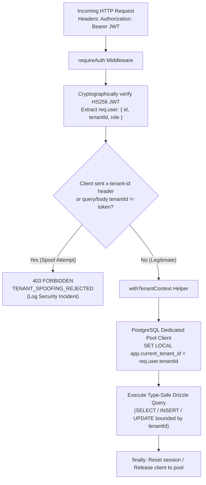

# CarrerSync Verification & Governance Security Model

> **Document Type**: Canonical Security Architecture & RBAC Specification  
> **Status**: APPROVED & CANONICAL  
> **Phase**: Phase 10 — TPO Verification Portal, Placement Readiness & Job Eligibility Subsystem  
> **Target Release**: Active Node.js + Express Backend (`server/src/middleware/`, `server/src/verification/`)  
> **Master Policy**: Zero-Trust Multi-Tenancy | Five-Role RBAC | Absolute Student Privacy  

---

## 1. Threat Model & Security Posture

Phase 10 introduces critical institutional workflows: awarding formal competency verifications, computing readiness rankings, and evaluating candidate eligibility for corporate recruitment drives. Compromising any of these workflows introduces severe legal, institutional, and reputational risks.

CarrerSync mitigates four primary threat vectors:

```
┌────────────────────────────────────────────────────────────────────────────────────────┐
│                                 PHASE 10 THREAT MODEL                                  │
├────────────────────────────────┬───────────────────────────────────────────────────────┤
│ Threat Vector                  │ Mitigation Architecture                               │
├────────────────────────────────┼───────────────────────────────────────────────────────┤
│ 1. Student Privilege Escalation │ Backend service rejects any non-TPO verification call │
│    (Self-Verification Forgery) │ with 403 FORBIDDEN. FSM blocks SELF_DECLARED -> VERIFIED.│
├────────────────────────────────┼───────────────────────────────────────────────────────┤
│ 2. Cross-Tenant Data Leakage   │ Authoritative JWT-derived tenantId; header spoofing   │
│    (College A accessing Col B) │ rejected with 403; RLS session variables enforced.   │
├────────────────────────────────┼───────────────────────────────────────────────────────┤
│ 3. Recruiter Overreach         │ Sensitive internal TPO reviewer notes are stripped    │
│    (Viewing Private Notes)     │ at the repository layer before payload serialization. │
├────────────────────────────────┼───────────────────────────────────────────────────────┤
│ 4. Student Data Egress to AI   │ 100% deterministic local TypeScript execution. Zero   │
│    (PII / Transcripts Leaked)  │ student data, CGPAs, or resumes sent to external LLMs.│
└────────────────────────────────┴───────────────────────────────────────────────────────┘
```

---

## 2. Five-Role RBAC Enforcement Matrix

CarrerSync enforces strict Role-Based Access Control (RBAC) across five institutional roles:
1. `SUPER_ADMIN`: System-wide platform administrator.
2. `COLLEGE_ADMIN`: Institutional Placement Director / Dean.
3. `TPO_ADMIN`: Operational Training & Placement Officer.
4. `RECRUITER`: Corporate talent acquisition partner.
5. `STUDENT`: Enrolled student candidate.

### Phase 10 RBAC Permissions Matrix

| Resource / Endpoint | `SUPER_ADMIN` | `COLLEGE_ADMIN` | `TPO_ADMIN` | `RECRUITER` | `STUDENT` |
| :--- | :---: | :---: | :---: | :---: | :---: |
| **TPO Verification Queue** (`GET /api/v1/tpo/verification/pending`) | Read (All) | Read (Tenant) | Read (Tenant) | **403 Forbidden** | **403 Forbidden** |
| **Verify Evidence** (`POST /api/v1/tpo/verification/:id/verify`) | Execute | Execute | Execute | **403 Forbidden** | **403 Forbidden** |
| **Reject Evidence** (`POST /api/v1/tpo/verification/:id/reject`) | Execute | Execute | Execute | **403 Forbidden** | **403 Forbidden** |
| **Request More Evidence** (`POST .../request-evidence`) | Execute | Execute | Execute | **403 Forbidden** | **403 Forbidden** |
| **Evidence Audit History** (`GET .../:id/history`) | Read | Read | Read | **403 Forbidden** | **403 Forbidden** |
| **Student Resubmit Evidence** (`POST .../evidence/:id/resubmit`)| **403** | **403** | **403** | **403 Forbidden** | **Execute (Own)** |
| **Student Correction Request** (`POST .../correction-request`)| **403** | **403** | **403** | **403 Forbidden** | **Execute (Own)** |
| **Student Readiness Score** (`GET /api/v1/readiness/students/:id`)| Read | Read | Read | Read (In Drive) | Read (Own Only) |
| **Cohort Readiness Analytics** (`GET /api/v1/tpo/readiness/cohort`)| Read | Read | Read | **403 Forbidden** | **403 Forbidden** |
| **Department Readiness Analytics** (`.../departments`)| Read | Read | Read | **403 Forbidden** | **403 Forbidden** |
| **Skill Gap Diagnostics** (`POST .../:id/skill-gap`)| Execute | Execute | Execute | Execute (In Drive) | Execute (Own) |
| **Job Requirements Management** (`POST/PUT /api/v1/jobs`)| Manage | Manage | Manage | Manage (Own Jobs) | **403 Forbidden** |
| **Job Requirements List** (`GET /api/v1/jobs`)| Read | Read | Read | Read (Own Jobs) | Read (Active) |
| **Job Eligibility Evaluation** (`POST /jobs/:id/evaluate`)| Execute | Execute | Execute | Execute | **403 Forbidden** |
| **Candidate Eligibility Ledger** (`GET /jobs/:id/eligibility`)| Read | Read | Read | Read | Read (Own Result) |
| **TPO Eligibility Override** (`POST .../review`)| Execute | Execute | Execute | **403 Forbidden** | **403 Forbidden** |
| **Internal Reviewer Notes** (`reviewerNotes` column)| Read | Read | Read | **HIDDEN** | **HIDDEN** |

---

## 3. Anti-Spoofing Tenant Isolation & RLS Compliance

CarrerSync is engineered for secure multi-tenancy where hundreds of colleges share the same PostgreSQL database instance without risk of cross-institutional data leakage.



### 1. Authoritative Identity Principle
The authenticated tenant identity is derived solely from the cryptographically verified JWT payload (`req.user.tenantId`). Under no circumstances is a tenant identifier trusted from:
- Request headers (`x-tenant-id`, `tenant-id`, `x-college-id`).
- URL query parameters (`?tenant_id=...`).
- HTTP POST/PUT request bodies (`{ "tenantId": "..." }`).

### 2. Tenant Spoofing Defense (`tenant.ts`)
If a client request explicitly supplies a mismatched `x-tenant-id` header or body `tenantId` that differs from the JWT token, the request is immediately terminated:
```typescript
if (req.headers['x-tenant-id'] && req.headers['x-tenant-id'] !== req.user.tenantId) {
  logger.warn('Tenant spoofing attempt detected', {
    tokenTenant: req.user.tenantId,
    headerTenant: req.headers['x-tenant-id'],
    ip: req.ip
  });
  return res.status(403).json({
    error: 'TENANT_SPOOFING_REJECTED',
    message: 'Cross-tenant access or header spoofing is strictly prohibited.'
  });
}
```

### 3. Transaction-Scoped PostgreSQL RLS (`withTenantContext`)
All database operations utilize connection-level session scoping:
```typescript
await dbClient.query('SET LOCAL app.current_tenant_id = $1', [tenantId]);
```
This guarantees that even if a developer omits a `where(eq(table.tenantId, ...))` clause, PostgreSQL Row-Level Security policies block unauthorized row exposure at the storage engine level.

---

## 4. Privacy Protections & Recruiter View Limits

Corporate recruiters must have access to certified candidate capabilities to make informed hiring decisions, but institutional privacy and candidate dignity must be rigorously safeguarded.

```
┌────────────────────────────────────────────────────────────────────────────────────────┐
│                             RECRUITER VIEW BOUNDARIES                                  │
├────────────────────────────────────────────────────────────────────────────────────────┤
│  RECRUITER CAN ACCESS:                                                                 │
│  ✔ Composite Placement Readiness Score (e.g., 84.5/100)                               │
│  ✔ Readiness Classification Category (e.g., READY)                                     │
│  ✔ Verified Skill Badges (e.g., Docker [VERIFIED by Institutional TPO])                 │
│  ✔ Student Public Project Repositories and Descriptions                                │
│  ✔ Overall Eligibility Status for their Specific Job (e.g., ELIGIBLE)                   │
├────────────────────────────────────────────────────────────────────────────────────────┤
│  RECRUITER CANNOT ACCESS (STRICTLY REDACTED):                                          │
│  ✖ Internal TPO Reviewer Notes (e.g., "Student had to resubmit after invalid repo")    │
│  ✖ Student Correction Request Grievances & Appeals                                      │
│  ✖ Disciplinary or Attendance Notes from Faculty Coordinators                          │
│  ✖ Internal Placement Office Deliberations and Priority Rankings                       │
└────────────────────────────────────────────────────────────────────────────────────────┘
```

### Server-Side Data Redaction
In `readiness.service.ts` and `job.service.ts`, candidate records queried by a `RECRUITER` role pass through a deterministic sanitizer that deletes internal metadata fields before JSON serialization:
```typescript
if (requestingRole === 'recruiter') {
  delete candidateProfile.internalNotes;
  delete candidateProfile.reviewerNotes;
  delete candidateProfile.correctionRequests;
}
```

---

## 5. Absolute AI Privacy & Zero-Egress Architecture

A cornerstone of CarrerSync's institutional ethics policy is that **no proprietary or personal student data is forwarded to external AI providers**:

1. **Local Deterministic Engines**:
   - The **Placement Readiness Engine** calculates scores using deterministic mathematical formulas in TypeScript.
   - The **Skill Gap Diagnostics Engine** compares competencies using an in-memory alias dictionary.
   - The **Job Eligibility Engine** validates hard criteria and cutoffs via relational SQL and boolean logic.
2. **Zero Network Egress**: None of these Phase 10 services make outbound network calls to OpenAI, Google Gemini, Anthropic, or any third-party cloud AI APIs.
3. **Audit Compliance**: All institutional evaluations are 100% reproducible and verifiable for academic accreditation bodies (e.g., NAAC, NBA, ABET).
